# Audit d'ergonomie, d'accessibilité, d'écoconception et de direction artistique — Nicephos

> **Livrables :** ce rapport ; les données structurées [`donnees-audit.json`](donnees-audit.json) (constats, plan d'action, maquettes) ; les grilles complétées dans [`grilles/`](grilles/) (RGAA du site public et de l'administration en Markdown et en Excel, RGESN 2024) ; 30 captures de la démonstration dans [`captures/`](captures/) ; les 20 maquettes HTML et leurs rendus WebP dans [`maquettes/`](maquettes/) (voir [Maquettes](#maquettes)).

**Date :** 16 octobre 2026  
**Auditrice :** Camille Arnaud — ergonome certifiée (conception centrée utilisateur, ISO 9241-210), auditrice RGAA (méthode DINUM), référente écoconception (RGESN 2024), ancienne responsable marketing et communication d'une galerie de photographie, photographe.  
**Pour :** Sébastien et Julien  
**Périmètre :** le site public (galerie, séries, photographes, visionneuse, carte, voyages, recherche, Partager, Signaler, « Bonjour », J'aime, droits, à propos, mentions légales, confidentialité, trois langues, trois thèmes) et l'administration (les 21 écrans de /admin, l'app de terrain, les cartes d'accord), sur bureau 1440 × 900, Pixel 7 (412 × 915) et 320 px. En regard : les trois projets à l'étude (carnet, galeries privées, boutique).  
**Version auditée :** code au commit 4042eaa ; les écarts avec `main` (c88632d : Florence-2 « Léger » par défaut) sont signalés quand ils changent un constat.

Sébastien, Julien,

j'ai regardé Nicephos comme on regarde un accrochage avant le vernissage : d'abord de loin, puis photo par photo et cartel par cartel, enfin en coulisses. Ce rapport réunit sept analyses menées les 15 et 16 octobre : accessibilité du site public et de l'administration (RGAA 4.1.2 et WCAG 2.2), écoconception (RGESN 2024), parcours du visiteur et du photographe (Bastien & Scapin, ISO 9241-110, Nielsen), direction artistique et marketing, et qualité transverse (Opquast, RGPD, impression, langues). J'ai fusionné les constats qui se recoupaient : il en reste 96, chacun avec sa preuve, son référentiel et une recommandation, et un plan de 59 actions en quatre vagues.

## Méthode

- **Instance de démonstration** locale (photos de synthèse, données fictives, thème Atelier, et thème nuit forcé pour comparer), parcourue avec Chromium piloté par Playwright : 1440 × 900, Pixel 7, 320 px, zoom graphique et zoom du texte à 200 %, espacement du texte WCAG, JavaScript coupé, réseau limité (512 et 400 kbit/s), impression en PDF.
- **Copies privées** de la démo (mêmes code et données) pour tous les tests qui écrivent : import, publication, suppression, envoi de formulaires. Je n'ai rien modifié sur la démo partagée, ni sur la production, et je n'ai jamais utilisé le serveur de test, qui contient des données réelles.
- **Production** (www.nicephos.art) en simple visiteur, pages publiques uniquement, à moins d'une requête par seconde et sous la limite de 150 chargements pour l'ensemble de l'audit, collecte du 15 octobre comprise. Les captures de production contiennent vos photos personnelles : elles restent hors du dépôt, et ce rapport les **décrit sans les montrer**.
- **Mesures** : sondes RGAA et RGESN, axe-core, html-validate, arbre d'accessibilité de Chromium, différence de pixels avec et sans focus, contraste du texte posé sur vos vraies photos (fond pris au 90e centile sous le texte, ombre comprise), tailles de cibles, positions à l'écran, comptes de tabulations, d'actions et d'écrans, poids et requêtes à froid et au rechargement, coût processeur des traitements côté serveur.
- **Lecture du code** des gabarits, des feuilles de style, des scripts et des routes : chaque constat cite `fichier:ligne` au commit audité.
- **Référentiels** : RGAA 4.1.2 complété des critères WCAG 2.2 AA nouveaux ; RGESN 2024 (78 critères) ; critères ergonomiques de Bastien & Scapin ; ISO 9241-110:2020 (7 principes) ; heuristiques de Nielsen ; Opquast v5 2025-2030 (245 règles) ; lois de l'UX ; pour le droit (RGPD, LCEN, Code de la consommation, acte européen sur l'accessibilité), une lecture d'auditrice, pas un avis juridique.

### Ce que je n'ai pas fait (limites)

- **Aucun test avec un lecteur d'écran réel** (NVDA, JAWS, VoiceOver, TalkBack) : la restitution vocale est déduite de l'arbre d'accessibilité de Chromium. Les annonces des régions live sont à confirmer à l'oreille.
- **Aucun test avec des utilisateurs réels** : ni visiteurs, ni personnes photographiées, ni vous deux en situation. Les notes sont un jugement d'experte sur des parcours rejoués et mesurés ; elles ne remplacent pas cinq séances d'observation.
- **Pas de Safari ni d'iPhone réel** : le téléphone est émulé dans Chromium (Pixel 7) ; les comportements propres à iOS (appui long, îlot dynamique) sont déduits du code.
- **Démonstration ≠ production** : la démo sert Node seul, sans compression ni HTTP/2, avec des images de synthèse légères ; seuls les poids mesurés en production font foi.
- **Hébergement non évalué** : je n'ai accès ni au serveur Unraid ni à sa consommation ; 9 critères RGESN restent « non évalués ».
- **Connexion Zitadel non auditée** (hors du site) ; validation W3C de l'admin et critère 10.5 non testés (2 critères RGAA « NT » côté admin).
- **Échantillon** : une vingtaine de pages publiques et une vingtaine d'écrans d'admin, pas l'échantillon réglementaire complet. **Ce rapport n'est ni une déclaration d'accessibilité ni une déclaration d'écoconception.**

### Comment lire ce rapport

- **Identifiants** : UX-F pour le site public, UX-A pour l'administration et l'app de terrain, UX-T pour ce qui est transverse (droit, hébergement, gouvernance, projets). Ils sont triés par gravité.
- **Gravité** : *critique* = atteinte possible aux droits d'une personne (droit à l'image, consentement, mineur) ou perte de la preuve d'un accord ; *majeur* = une tâche importante échoue, se détourne, ou un groupe d'utilisateurs est exclu ; *moyen* = gêne réelle mais contournable ; *mineur* = finition ; *suggestion* = opportunité ou préparation des projets.
- **Effort** : S = moins d'une journée ; M = 2 à 5 jours ; L = plus d'une semaine. **Impact** : fort, moyen, faible. **Vague** : la première vague du plan d'action qui traite le constat.
- **Preuves** : les captures de la démonstration sont dans [`captures/`](captures/) ; les chemins `ux-data/…` et `outils/…` désignent les mesures brutes et les scripts, conservés dans l'espace de travail de l'audit, hors du dépôt ; les constats de production sont décrits, sans image.

## En une page

### Verdict

Nicephos a des fondations rares. Le site marche sans JavaScript, n'embarque aucun service tiers, sert des photos en AVIF bien compressées et parle trois langues. Il entretient avec les personnes photographiées une relation éthique (consentement par usage, « Bonjour », « Votre photo », une page Confidentialité d'une clarté exemplaire) que je n'ai vue sur aucun autre site de photographe. Et l'administration, refaite après l'audit du 10 octobre, est devenue un vrai outil de photographe.

Ce qui manque n'est pas de la technique, c'est du soin aux **coutures** : là où une personne arrive de l'extérieur (un lien partagé, un QR), change d'avis (un refus), se trompe (un champ oublié), ou veut aller plus loin (un tirage). Trois de ces coutures touchent aux droits des personnes photographiées ; je les classe critiques et je vous demande de les traiter avant tout le reste. Ensuite, il faut rendre à la photo sa place : aujourd'hui, le filigrane, l'ouverture recadrée et voilée, une visionneuse qui la réduit à 27 % de l'écran du téléphone et une grille lue en colonnes passent avant elle. Enfin, en six jours et 87 PR, l'administration a pris des fonctions plus vite qu'elle ne les a rangées : il faut ranger avant d'accueillir le carnet, les galeries privées et la boutique.

Presque tout se corrige en petits lots, sans toucher à l'esthétique que vous avez choisie : 18 actions de la vague 0 tiennent chacune en moins d'une journée.

| Périmètre | critique | majeur | moyen | mineur | suggestion | Total |
|---|---|---|---|---|---|---|
| Site public (UX-F) | 0 | 22 | 16 | 5 | 3 | 46 |
| Administration (UX-A) | 1 | 10 | 18 | 1 | 2 | 32 |
| Transverse (UX-T) | 2 | 1 | 7 | 3 | 5 | 18 |
| **Total** | **3** | **33** | **41** | **9** | **10** | **96** |

### Cinq forces à garder à tout prix

1. **Une sobriété d'architecture réelle.** Rendu serveur, 30 ko de JavaScript et 43 ko de CSS pour tout le site, aucun script tiers (CSP 'self'), site utilisable sans script (galerie, filtres, page photo, partage, langue, carte), photos en AVIF avec repli WebP, cache d'un an, mesure d'audience sans cookie ni IP, IA locale éteinte par défaut et mesurée (0,26 s par photo pour CLIP).
2. **Une éthique de l'image.** Consentement granulaire et réversible, « Je ne sais pas encore » par défaut, refus aussi simple que l'accord, mineurs gérés dans l'app de terrain, lien cadeau privé, daté et non indexé, purges automatiques, export des données par personne.
3. **Une administration devenue outil de photographe.** 12 des 14 recommandations du 10 octobre sont en place : premier retour d'import en 0,8 s, faux fichier refusé avant l'envoi, 5 photos titrées, situées, classées et publiées en 12 actions sur un seul écran, sélection multiple complète au clavier, lien d'évitement, planche contact et loupe.
4. **Des composants accessibles soignés.** Diaporama avec Pause, arrêt au focus et respect du mouvement réduit ; fenêtre Partager en dialog natif qui rend le focus ; loupe modale ; chaque glisser-déposer doublé d'une alternative ; erreurs de la fiche photo reliées et annoncées ; zoom à 200 % et espacement du texte sans perte ; aucune cible sous 24 px en conflit sur le site public.
5. **Un ton et des formes éditoriales justes.** Le cartel en Plex Mono, le noir qui isole l'image, le partage exemplaire (9/10 au bureau), et le récit de voyage de la démo, jour par jour et à deux voix, digne d'un éditeur.

### Cinq priorités

1. **Tenir la promesse faite aux personnes photographiées** : qu'une photo refusée disparaisse vraiment (cache Cloudflare, UX-T-01), qu'un mineur ne puisse pas donner seul son accord en ligne (UX-T-02), et que l'app de terrain ne perde plus jamais un accord signé (UX-A-01).
2. **Rendre la photo maîtresse des lieux** : filigrane en signature d'angle (UX-F-15), logo retiré de la photothèque (UX-F-16), ouverture sans recadrage ni voile (UX-F-17), visionneuse qui donne 64 % de l'écran à l'image (UX-F-14), grille en rangées qui respecte votre Sélection (UX-F-13).
3. **Recoudre la page photo au reste du site** : c'est la porte d'entrée des partages. Marque, retour nommé, contexte du voyage ou de la recherche, pied de page, et une porte « Tirage, licence : nous écrire » (UX-F-08, UX-F-09, UX-F-11).
4. **Des formulaires et des gestes qui ne piègent personne** : focus visible, filets à 3:1, obligations annoncées sur « Bonjour » et « Signaler » (UX-F-03, UX-F-04, UX-F-05) ; dans l'admin, plus de publication par une seule touche, de page qui se recharge sous les doigts, de saisie perdue ni de titre provisoire publié (UX-A-02, UX-A-05, UX-A-06, UX-A-03).
5. **Ranger avant de construire** : mentions légales complètes (UX-T-03), menu de l'admin en cinq groupes (UX-A-11), un lexique et une seule façon d'enregistrer, des budgets de poids et une déclaration d'écoconception (UX-T-09, UX-T-10), puis le cadre commun du carnet, des galeries privées et de la boutique (UX-T-16, UX-T-17).

## Tableau de bord par référentiel

### RGAA 4.1.2 et WCAG 2.2 AA

| Périmètre | C | NC | NA | NT | Taux |
|---|---|---|---|---|---|
| Site public — grille automatique du 15/10 | 6 | 3 | 13 | 84 | non calculable |
| **Site public — grille complétée du 16/10** | **48** | **23** | **35** | **0** | non calculé (échantillon non réglementaire, restitution au lecteur d’écran non testée) |
| Administration — grille automatique du 15/10 | 6 | 6 | 13 | 81 | non calculable |
| **Administration — grille complétée du 16/10** | **48** | **27** | **29** | **2** | non calculable (8.2 et 10.5 non testés) |

Je ne calcule de taux ni pour le site public ni pour l'administration : je ne donne que les effectifs. Pour le site public, aucun critère n'est resté NT, mais l'échantillon n'est pas l'échantillon réglementaire et je n'ai pas fait de test avec un lecteur d'écran réel : 7.1 et 7.5 (et, côté WCAG, 4.1.2) ont été jugés sur l'arbre d'accessibilité de Chromium, ce qui ne suffit pas pour les déclarer entièrement testés. Pour l'administration, il reste deux critères non testés. **Ce n'est pas une déclaration d'accessibilité** ; elle reste à établir par l'éditeur, sur l'échantillon réglementaire.

Critères non conformes, et constats qui les traitent :

| Thème RGAA | Site public | Administration |
|---|---|---|
| Images | 1.1, 1.3, 1.9 → UX-F-41, UX-F-16 | 1.9 → UX-A-30 |
| Couleurs | 3.2, 3.3 → UX-F-01, UX-F-04 | 3.2, 3.3 → UX-A-30, UX-A-27 |
| Tableaux | — | 5.6 → UX-A-30 |
| Liens | 6.1 → UX-F-24 | 6.2 → UX-A-28 |
| Scripts | 7.1, 7.3, 7.5 → UX-F-24, UX-F-25, UX-F-41 | 7.1, 7.3, 7.4, 7.5 → UX-A-15, UX-A-08, UX-A-10, UX-A-14 |
| Éléments obligatoires | 8.2, 8.7, 8.9 → UX-F-41, UX-F-22 | 8.7, 8.9 → UX-A-12, UX-A-30 |
| Structuration | 9.1, 9.3 → UX-F-10, UX-F-41 | 9.1, 9.2 → UX-A-12 |
| Présentation | 10.6, 10.7, 10.11 → UX-F-23, UX-F-03, UX-F-02 | 10.1, 10.6, 10.7, 10.11 → UX-A-30, UX-A-27, UX-A-09 |
| Formulaires | 11.9, 11.10 → UX-F-24, UX-F-05 | 11.2, 11.5, 11.7, 11.10, 11.13 → UX-A-10, UX-A-12, UX-A-14, UX-A-23 |
| Navigation | 12.1, 12.6, 12.7, 12.8 → UX-F-08, UX-F-06, UX-F-07 | 12.6, 12.7, 12.8, 12.10 → UX-A-12, UX-A-09, UX-A-02 |
| Consultation | — | 13.1 → UX-A-05 |

Critères WCAG 2.2 AA absents du RGAA 4.1.2 :

| Critère WCAG 2.2 | Site public | Administration |
|---|---|---|
| 2.4.11 Focus non masqué | NC : vignettes de la carte agrandie hors du cadre (UX-F-25) | NC : barre d'onglets, feuille de l'inspecteur, menu (UX-A-09) |
| 2.5.7 Mouvements de glissement | NC : carte agrandie déplaçable au seul glisser (UX-F-25) | C : chaque glisser a son alternative |
| 2.5.8 Taille des cibles (minimum) | C (aucune cible sous 24 px en conflit) | NC : vue Liste au téléphone, cases de 18 px (UX-A-24) |
| 3.2.6 Aide cohérente | NA aujourd'hui ; à prévoir avec la boutique | C |
| 3.3.7 Saisie redondante | C | NC : signature et photo à refaire (UX-A-01) |
| 3.3.8 Authentification accessible | NA aujourd'hui ; galeries privées à venir (UX-T-18) | NT : Zitadel non audité (UX-T-15) |

Grilles complètes : [RGAA site public](grilles/rgaa-site-public.md) ([Excel](grilles/rgaa-site-public.xlsx)) · [RGAA administration](grilles/rgaa-administration.md) ([Excel](grilles/rgaa-administration.xlsx)).

### RGESN 2024

| Famille | Satisfaits | Non satisfaits | Non applicables | Non évalués |
|---|---|---|---|---|
| 1 Stratégie | 3 | 6 | 1 | 0 |
| 2 Spécifications | 1 | 6 | 1 | 2 |
| 3 Architecture | 3 | 2 | 1 | 1 |
| 4 UX/UI | 9 | 6 | 0 | 0 |
| 5 Contenus | 4 | 0 | 4 | 0 |
| 6 Frontend | 3 | 4 | 0 | 0 |
| 7 Backend | 3 | 0 | 1 | 0 |
| 8 Hébergement | 2 | 2 | 0 | 6 |
| 9 Algorithmie | 3 | 0 | 4 | 0 |
| **Total (78 critères)** | **31** | **26** | **12** | **9** |

C'est un décompte, pas une note, et ce n'est pas une déclaration d'écoconception. Cinq critères satisfaits dans les faits (1.7, 3.1, 5.2, 7.1, 9.7) attendent d'être écrits dans une déclaration ; les 9 « non évalués » portent surtout sur l'hébergement (matériel, électricité, vieux terminal) et attendent vos réponses (voir les questions en annexe).

| Critères non satisfaits | Constats |
|---|---|
| 1.1 à 1.5, 1.8, 2.1, 2.6 à 2.8, 2.10, 3.4 (stratégie, cibles, référent, revues, fournisseurs, maintenance) | UX-T-10, UX-T-11 |
| 2.5 (adaptation aux petits écrans) | UX-F-02 |
| 3.2 (ressources serveur) | UX-T-08 |
| 4.3, 6.1 (parcours et poids) | UX-T-09 |
| 4.6 (animations) | UX-F-18, UX-F-17 |
| 4.9 à 4.11 (saisie, contrôles, transferts) | UX-T-12 |
| 4.15 (information et mode sobre) | UX-F-43 |
| 6.2 (cache) | UX-A-29 |
| 6.4, 6.5 (ressources adaptées et utiles) | UX-F-18, UX-F-19, UX-F-20, UX-F-21, UX-T-07, UX-F-37, UX-F-38 |
| 8.8 (stockage froid), 8.10 (traitements différés) | UX-T-14, UX-T-13 |

Grille complète : [RGESN 2024](grilles/rgesn-2024.md).

### Bastien & Scapin

| Critère Bastien & Scapin | Site public | Administration | Justification | Constats |
|---|---|---|---|---|
| 1. Guidage (incitation, groupement, retour immédiat, lisibilité) | 5/10 | 6/10 | Site : cartel clair, recherche expliquée, partage exemplaire ; mais aucun retour visible au choix d'un regard, aucune porte vers le contact, carte à deviner, textes de 11 px. Admin : Aujourd'hui priorisé, aide sur 26 écrans sur 27 ; mais menu de 28 entrées, assistants et mentions enfouis. | UX-F-12, UX-F-11, UX-F-29, UX-A-11, UX-A-17 |
| 2. Charge de travail (brièveté, densité) | 5/10 | 7/10 | Site : la série arrive au troisième écran, le pied de page à 27 écrans sur mobile, la photo n'occupe que 27 % de l'écran du téléphone. Admin : lot de 5 photos en 12 actions (remarquable) ; mais villes et traductions photo par photo, pages de 29 formulaires. | UX-F-10, UX-F-14, UX-A-21, UX-A-25 |
| 3. Contrôle explicite (actions explicites, contrôle utilisateur) | 6/10 | 3/10 | Site : diaporama pausable, partage maîtrisé ; mais « Fermer » mène ailleurs, la carte fait sauter la page, le clic droit est bloqué. Admin : une touche publie, des listes agissent à la flèche, la fiche se recharge seule, deux suppressions sans confirmation, « Annuler » hors de portée. | UX-F-09, UX-F-25, UX-F-34, UX-A-02, UX-A-10, UX-A-05, UX-A-07, UX-A-08 |
| 4. Adaptabilité (flexibilité, prise en compte de l'expérience) | 6/10 | 6/10 | Site : sans JavaScript, trois langues, thèmes, mouvement réduit ; mais langue imposée par le pays, ni plein écran ni mode sobre, nuit imposée aux pages de texte. Admin : clavier complet, palette, sélection multiple ; mais raccourcis non désactivables, téléphone inachevé. | UX-F-32, UX-F-29, UX-F-43, UX-A-02, UX-A-24 |
| 5. Gestion des erreurs (protection, qualité des messages, correction) | 4/10 | 4/10 | Site : messages humains, saisies conservées ; mais obligations non annoncées, erreurs portées par la couleur, quota qui compte les échecs, recherche sans tolérance. Admin : fiche et import exemplaires ; mais l'app de terrain efface signature et photo, les saisies se perdent en quittant, les titres provisoires passent. | UX-F-05, UX-F-04, UX-F-27, UX-F-26, UX-A-01, UX-A-06, UX-A-03 |
| 6. Homogénéité / cohérence | 6/10 | 4/10 | Site : gabarits et cartel cohérents ; mais deux filtres voisins qui se comportent différemment, vignettes aux informations variables, pages bilingues au hasard. Admin : trois façons d'enregistrer, confirmations inégales, deux pages au même titre. | UX-F-12, UX-F-28, UX-F-31, UX-A-06, UX-A-07, UX-A-16 |
| 7. Signifiance des codes et dénominations | 5/10 | 4/10 | Site : « vues », « Fermer », « S » et « J », numéro instable, traductions mot à mot. Admin : « prête » à trois sens, jargon d'hébergeur, « Personne de reconnaissable ». | UX-F-28, UX-T-05, UX-F-31, UX-A-16, UX-A-18 |
| 8. Compatibilité | 5/10 | 6/10 | Site : grille lue en colonnes contre le sens de lecture, langue décidée par le pays, photo réduite sur téléphone. Admin : date libre « oct. 2026 » et gestes de photographe bien compris ; mais page 403 au thème public, ⌘ affiché sous Windows. | UX-F-13, UX-F-32, UX-F-14, UX-A-04, UX-A-15 |
| **Moyenne** | **5,3/10** | **5,0/10** | Cible après les vagues 0 à 2 : 8/10 au moins sur chaque ligne. | |

### ISO 9241-110:2020 — principes d'interaction

| Principe ISO 9241-110:2020 | Site public | Administration | Justification | Constats |
|---|---|---|---|---|
| Adéquation aux tâches de l'utilisateur | 5/10 | 6/10 | Contempler une photo et demander un tirage sont les deux tâches du visiteur : la photo est petite, la demande impossible. L'admin fait bien le lot, mal les villes et traductions, et laisse le Photographe sans issue. | UX-F-14, UX-F-11, UX-A-21, UX-A-04 |
| Autodescriptivité | 5/10 | 5/10 | La page photo ne dit pas où l'on est, le regard choisi ne se voit pas, le H1 est la diapositive. Dans l'admin, le menu, le jargon et les assistants enfouis obligent à deviner. | UX-F-08, UX-F-12, UX-F-10, UX-A-11, UX-A-18 |
| Conformité aux attentes de l'utilisateur | 5/10 | 5/10 | « Fermer » qui mène ailleurs, grille lue en colonnes, page série qui est l'accueil, langue choisie par le pays. Dans l'admin, l'enregistrement change de règle d'un écran à l'autre. | UX-F-09, UX-F-13, UX-F-32, UX-A-06 |
| Facilité d'apprentissage | 7/10 | 6/10 | Le site public s'apprend en un regard ; seuls les gestes de la visionneuse ne sont pas annoncés. L'admin a de l'aide partout, mais en un seul bloc de 17 600 mots, et sans lexique. | UX-F-14, UX-A-22, UX-A-16 |
| Contrôlabilité | 6/10 | 3/10 | Le diaporama se met en pause, les filtres sont des adresses ; mais le contexte se perd. Dans l'admin, une touche publie, une liste agit, une page se recharge, un message « Annuler » s'enfuit. | UX-F-09, UX-A-02, UX-A-10, UX-A-05, UX-A-08 |
| Robustesse vis-à-vis des erreurs d'utilisation | 4/10 | 3/10 | Erreurs annoncées après coup et portées par la couleur ; quota qui bloque ceux qui se trompent. Dans l'admin, un accord signé peut se perdre, une saisie aussi, et les titres provisoires passent. | UX-F-05, UX-F-27, UX-A-01, UX-A-06, UX-A-03 |
| Engagement de l'utilisateur | 5/10 | 7/10 | Le site est sobre et éthique, le partage et le récit de voyage sont beaux ; mais filigrane, logo-photo, « 0 j'aime » et ton défensif découragent, et rien n'invite à revenir. L'admin, elle, donne envie de travailler : planche, loupe, Aujourd'hui. | UX-F-15, UX-F-16, UX-F-34, UX-F-39 |
| **Moyenne** | **5,3/10** | **5,0/10** | Cible après les vagues 0 à 2 : 8/10 au moins sur chaque ligne. | |

### Heuristiques de Nielsen

| Heuristique de Nielsen | Site public | Administration | Justification | Constats |
|---|---|---|---|---|
| #1 Visibilité de l'état du système | 5/10 | 6/10 | Regard sans retour visible, aplats vides en réseau lent, « Lien copié » non annoncé. Admin : progression d'import exemplaire ; annonces de sélection et état Instagram trompeurs. | UX-F-12, UX-F-40, UX-A-31, UX-A-16 |
| #2 Correspondance avec le monde réel | 5/10 | 4/10 | « vues », numéro instable, traductions mot à mot. Admin : jargon d'hébergeur, « prête » à trois sens. | UX-F-28, UX-T-05, UX-A-18, UX-A-16 |
| #3 Contrôle et liberté | 5/10 | 3/10 | « Fermer » vers l'accueil, carte qui fait sauter la page. Admin : « Annuler » de 10 s inatteignable, suppressions sans retour. | UX-F-09, UX-F-25, UX-A-08, UX-A-07 |
| #4 Cohérence et standards | 6/10 | 4/10 | Filtres voisins incohérents, langues mêlées. Admin : trois façons d'enregistrer, deux pages au même titre. | UX-F-12, UX-F-31, UX-A-06, UX-A-16 |
| #5 Prévention des erreurs | 4/10 | 3/10 | Obligations annoncées après l'envoi. Admin : touche P, titres provisoires publiés, accord perdu. | UX-F-05, UX-A-02, UX-A-03, UX-A-01 |
| #6 Reconnaître plutôt que se souvenir | 5/10 | 5/10 | Index des séries sans image sur téléphone, aucun contact visible. Admin : palette sans synonymes, mentions légales introuvables. | UX-F-30, UX-F-11, UX-A-15, UX-A-26 |
| #7 Flexibilité et efficacité | 6/10 | 6/10 | Filtres adressables et gestes ; pas de plein écran. Admin : palette, raccourcis, sélection multiple ; mais villes et traductions à l'unité. | UX-F-14, UX-A-21 |
| #8 Esthétique et minimalisme | 6/10 | 5/10 | Une sobriété rare, contrariée par le filigrane, le voile, le logo-photo et « 0 j'aime ». Admin : menu et pages trop denses. | UX-F-15, UX-F-17, UX-F-39, UX-A-11, UX-A-25 |
| #9 Aider à reconnaître et corriger les erreurs | 5/10 | 5/10 | Messages humains mais non reliés aux champs, quota trompeur, recherche sans « vouliez-vous dire ». Admin : fiche exemplaire ; toast éphémère et app de terrain en français pour une personne qui lit l'anglais. | UX-F-05, UX-F-27, UX-F-26, UX-A-14, UX-A-01 |
| #10 Aide et documentation | 6/10 | 5/10 | Consignes contextuelles justes ; gestes non annoncés. Admin : « Aide sur cette page » partout, mais une page de 46 écrans sans surlignage. | UX-F-14, UX-A-22 |
| **Moyenne** | **5,3/10** | **4,6/10** | Cible après les vagues 0 à 2 : 8/10 au moins sur chaque ligne. | |

### Opquast v5 (2025-2030) — 41 règles non respectées

| Famille | Règles non respectées | Constats |
|---|---|---|
| Contenus | 2 (droits de copie depuis toutes les pages), 4 (dates explicites) | UX-F-08, UX-A-19 |
| Données personnelles | 15 (confidentialité depuis toutes les pages) | UX-F-08 |
| Formulaires | 70, 71, 79 (erreurs associées, obligations, champs rejetés), 82 (erreurs dans la langue), 95 (type de champ) | UX-F-05, UX-F-04, UX-A-30 |
| Identification et contact | 101 (identité), 108 (délais), 110 (accusé de réception), 114 (responsable des contenus) | UX-T-03, UX-T-04, UX-F-11 |
| Images et médias | 119 (vignettes redimensionnées) | UX-T-07 |
| Internationalisation | 132 (changement de langue), 135 (ordre des langues) | UX-F-22, UX-F-32 |
| Liens | 140, 141, 142, 146 (liens différenciés, visités, externes, nouvelle fenêtre), 147, 148 (format et poids des fichiers) | UX-F-23, UX-T-12 |
| Navigation | 155, 156, 164, 171 (accueil, fil d'Ariane, accès rapide, plan), 165 (focus), 172 (limites de temps) | UX-F-06, UX-F-03, UX-A-01 |
| Présentation | 181 (pas seulement la couleur), 186 (cibles), 189 (pictogrammes), 195, 196 (impression) | UX-F-04, UX-F-36, UX-F-41, UX-F-35 |
| Serveur et performances | 224 (page 403), 225 (menu sur les erreurs), 229, 230 (minification) | 224 : UX-A-04, UX-A-01 ; 225 : UX-A-30 ; 229 et 230 : sans constat (voir ci-dessous) |
| Structure et code | 231 (dates balisées), 234 (titres), 238 (menu contextuel), 239 (rafraîchissement), 243 (titres de tableaux) | UX-F-41, UX-F-10, UX-F-34, UX-A-05, UX-A-30 |

Les règles du commerce en ligne (30 à 68), des comptes (17 à 22) et de la lettre d'information (173 à 179) sont sans objet aujourd'hui ; je les ai reprises comme critères d'acceptation des projets (UX-T-17, UX-T-18). La minification (229, 230) est en grande partie absorbée par la compression de production : vous pouvez aussi l'assumer et l'écrire dans la documentation.

## Parcours

### Site public

Neuf parcours rejoués au clavier, à la souris et au doigt, sur bureau et sur Pixel 7. Note sur 10.

| Parcours | Bureau | Mobile | Ce qui coince | Constats | Visé |
|---|---|---|---|---|---|
| Découvrir le site (premier écran) | 6 | 5 | Logo publié comme photo, ouverture recadrée et voilée, aucune promesse ; menu illisible sur la photo au téléphone | UX-F-16, UX-F-17, UX-F-01 | 8 |
| Choisir un regard, parcourir une série | 5 | 4 | Aucun retour visible au choix d'un regard ; la série arrive au troisième écran ; grille lue en colonnes | UX-F-12, UX-F-10, UX-F-13 | 8 |
| Regarder une photo (visionneuse) | 7 | 6 | Gestes excellents mais non annoncés ; photo à 27 % de l'écran du téléphone ; pas de plein écran | UX-F-14 | 9 |
| Carte et voyage | 5 | 4 | Villes à deviner, saut de page au clic ; la photo ouverte perd le fil du voyage | UX-F-25, UX-F-09 | 8 |
| Rechercher | 6 | 6 | Ni pluriels ni fautes ; zéro résultat sans piste | UX-F-26 | 8 |
| Partager | 9 | 8 | Exemplaire ; seul « Lien copié » n'est pas annoncé | UX-F-41 | 9 |
| Signaler, exercer ses droits | 6 | 5 | Obligations annoncées après l'envoi ; formulaire de droits introuvable ; quota qui bloque | UX-F-05, UX-T-04, UX-F-27 | 8 |
| Changer de langue | 8 | 5 | Liste hors de l'écran sur téléphone ; pays avant navigateur | UX-F-02, UX-F-32 | 9 |
| Acheter un tirage ou écrire | 2 | 1 | Aucune porte depuis la photo ; pied de page à 27 écrans sur mobile | UX-F-11 | 8 |

### Administration et app de terrain

Neuf parcours rejoués sur une copie privée de la démo, en Administrateur puis en Photographe, sur bureau et sur Pixel 7. Note sur 10, nombre d'actions mesuré.

| Parcours | Note | Actions | Ce qui coince | Constats | Visé |
|---|---|---|---|---|---|
| P1 Importer, compléter, publier — Administrateur | 7,5 | 12 pour 5 photos | Série par défaut arbitraire, doublons acceptés, titres provisoires qui passent | UX-A-20, UX-A-03 | 9 |
| P1 — Photographe | 4 | 16, et une page 403 | Lot « Compléter et publier » sans Proposer ; boutons « Publier » interdits | UX-A-04 | 8 |
| P1 — téléphone | 6,5 | — | Feuille d'import qui masque la suite ; focus caché ; lots 4 à 6 en attente | UX-A-24, UX-A-09 | 8 |
| P2 Séries et ouverture | 7 | 22 | Ordre de l'ouverture perdu en quittant sans enregistrer | UX-A-06 | 8 |
| P3 Terrain (app, cartes, QR) | 6 | 15 ; 20 avec une erreur | Signature et photo perdues après une erreur ; cartes en 5,3 pt | UX-A-01, UX-A-12, UX-A-13 | 9 |
| P4 Aujourd'hui, À valider | 6 | — | Titres provisoires « prêts » ; tâches répétées ; villes et traductions à l'unité | UX-A-03, UX-A-25, UX-A-21 | 8 |
| P5 Voyage | 6 | 10 | Suppression d'un voyage publié en un clic ; « journées » ambiguës | UX-A-07, UX-A-16 | 8 |
| P6 Instagram | 6,5 | 9 | Page qui se recharge seule ; état « pas encore partagée » trompeur | UX-A-05, UX-T-06 | 8 |
| P7 Apparence et mentions légales | 6 | — | Mentions introuvables par leur nom ; identité sur deux pages | UX-A-26, UX-T-03 | 8 |
| P8 Comptes, circuit, journal | 6 | — | Compte supprimé en un clic ; Journal technique | UX-A-07, UX-A-19 | 8 |
| P9 Aide | 5,5 | — | Une page de 46 écrans ; palette muette pour 16 requêtes sur 27 | UX-A-22, UX-A-15 | 8 |

## Suivi des audits précédents

Je n'ai pas refait ces audits ; j'ai vérifié ce qu'il est advenu de leurs recommandations.

| Audit | Recommandation | État au 16 octobre | Constat |
|---|---|---|---|
| Ergonomie de l'admin (10 oct.) | 14 recommandations | **12 sur 14 en place** : import refait, lot sur un écran, sélection multiple, séries en planches, ouverture ordonnable avec compteur, lien d'évitement (F-M08), barre d'onglets | — |
| | F-m06 Titres provisoires signalés | En partie : signalés dans le lot, contournés par quatre chemins | UX-A-03 |
| | F-m01 Date tolérante | Suivie par le serveur, pas par la consigne affichée | UX-A-23 |
| | F-m02 Série du lot | En partie : la première série de la liste, arbitraire | UX-A-20 |
| | F-M06 Formulaires repliés | Fait pour les Séries ; pas pour Photographes et Comptes | UX-A-25 |
| Écrans cibles (10 oct.) | 0 violation axe sur chaque écran revu | Tenu sur les écrans d'alors ; 7 règles en échec sur les écrans ajoutés depuis | UX-T-15 |
| Audit iPhone (oct.) | Lots 1 à 3 | Faits (lot en cartes, « Ouvrir la fiche », cibles de 44 px) | — |
| | Lots 4 à 6 (Sélectionner, Séries au toucher, Enregistrer collant) | Non faits | UX-A-24 |
| Revue d'octobre | Voiles plus denses sur l'ouverture | Contraste réglé au bureau seulement (1,9:1 à 1,0:1 sur téléphone), au prix de l'image | UX-F-01, UX-F-17 |
| | Bordures des champs à 3,2:1 | Fait dans l'admin ; formulaires publics toujours à 1,3:1 | UX-F-04 |
| | Focus rendu au lien activé après un filtre | Régression sur les séries (focus parti hors de l'écran) | UX-F-07 |
| | aria-invalid et aria-describedby | Fiche photo exemplaire ; sur « Bonjour » et « Signaler », aria-describedby absent | UX-F-05 |
| | Focus des boutons pleins de l'admin | Fait ; les champs restent à 1,7:1 en mode clair | UX-A-27 |
| | Aperçus des brouillons en no-store | Fait ; mais les photos publiées sont aussi re-téléchargées | UX-A-29 |
| | Mouvement réduit, Pause du diaporama | Suivis, et bien | — |
| Directions de design (oct.) | Raccourcis, palette ⌘K, planche contact, « Chambre noire » | En place ; mais P publie sans garde-fou et les raccourcis ne se désactivent pas ; la palette ignore la moitié des mots d'un photographe | UX-A-02, UX-A-15 |

## Index des constats

| Id | Constat | Gravité | Effort | Impact | Vague |
|---|---|---|---|---|---|
| UX-F-01 | Menu et métadonnées illisibles sur les photos de l'ouverture, surtout sur téléphone | majeur | S | fort | 0 |
| UX-F-02 | La liste des langues sort de l'écran sur téléphone dès que le menu passe à la ligne | majeur | S | fort | 0 |
| UX-F-03 | Focus invisible sur les cases, boutons radio et champs des formulaires de consentement et de signalement | majeur | S | fort | 0 |
| UX-F-04 | Champs à peine visibles (filet de 1,3:1) et erreurs portées par la seule couleur d'un trait | majeur | S | fort | 0 |
| UX-F-05 | Champs obligatoires annoncés seulement après l'envoi ; erreurs non reliées aux champs ; focus laissé en haut de page | majeur | M | fort | 1 |
| UX-F-06 | Ni lien d'évitement ni repère d'en-tête : 18 tabulations avant le contenu, 28 avant la première photo | majeur | S | moyen | 0 |
| UX-F-07 | Après un filtre de série au clavier, le focus part hors de l'écran sur un autre lien (régression) | majeur | S | moyen | 0 |
| UX-F-08 | La page photo, porte d'entrée des partages, n'a ni marque, ni menu, ni recherche, ni pied de page | majeur | M | fort | 1 |
| UX-F-09 | Ouverte depuis un voyage, la carte ou la recherche, une photo perd son fil | majeur | M | fort | 1 |
| UX-F-10 | Les pages Série et Photographe sont l'accueil déguisé ; leur titre de niveau 1 est la diapositive du moment | majeur | M | fort | 1 |
| UX-F-11 | Acheter un tirage ou écrire aux auteurs : aucune porte d'entrée depuis la photo | majeur | M | fort | 1 |
| UX-F-12 | Choisir un regard ne change rien de visible à l'écran | majeur | S | fort | 1 |
| UX-F-13 | La grille se lit en colonnes : l'ordre de votre « Sélection » est perdu | majeur | M | fort | 1 |
| UX-F-14 | La visionneuse donne trop peu de place à la photo, et le cartel mêle l'œuvre et les boutons | majeur | M | fort | 1 |
| UX-F-15 | Le filigrane plein cadre recouvre chaque photo, vignettes comprises | majeur | S | fort | 0 |
| UX-F-16 | Le premier écran ne dit ni qui vous êtes ni ce qu'on va voir : le logo est publié comme une photo | majeur | S | fort | 0 |
| UX-F-17 | L'ouverture recadre les photos jusqu'à n'en montrer qu'un tiers, les voile et les zoome | majeur | M | fort | 1 |
| UX-F-18 | Ouverture : 820 ko de diapositives invisibles téléchargés dès l'arrivée, même sans JavaScript | majeur | M | fort | 1 |
| UX-F-19 | Carte du monde : 1,1 Mo de vignettes de 640 px pour des épingles de 34 px, dont 15 sur 19 invisibles | majeur | M | fort | 1 |
| UX-F-20 | Page photo : 230 ko de fond de carte mondial pour une vignette de carte, qui retarde la photo en bas débit | majeur | M | fort | 0 et 1 |
| UX-F-21 | Visionneuse : l'image est choisie pour toute la largeur de l'écran alors que la hauteur la limite | majeur | S | fort | 1 |
| UX-F-22 | Textes affichés dans une autre langue que la page, sans attribut lang | majeur | M | moyen | 1 |
| UX-F-23 | Liens impossibles à distinguer du texte, nouvelles fenêtres non signalées, adresses non cliquables | moyen | S | moyen | 1 |
| UX-F-24 | Nom accessible différent du texte affiché : langue, J'aime, étapes de voyage | moyen | S | moyen | 1 |
| UX-F-25 | Carte du monde : il faut deviner les villes, un clic fait quitter la carte, et elle ne se déplace pas au clavier | moyen | M | moyen | 3 |
| UX-F-26 | Recherche sans tolérance aux fautes ni aux pluriels ; zéro résultat et 404 sans piste | moyen | M | moyen | 3 |
| UX-F-27 | Le quota anti-abus compte aussi les envois refusés, et bloque une heure, y compris sur une connexion partagée | moyen | S | moyen | 0 |
| UX-F-28 | Dénominations ambiguës : « vues », « Galerie » et « Toutes les séries », « Fermer », « S » et « J », « 03 » | moyen | S | moyen | 2 |
| UX-F-29 | Lisibilité : textes de 11 px, titres longs en capitales espacées, Jost 300 sur noir, faux gras et faux italique | moyen | S | moyen | 2 |
| UX-F-30 | Index des séries : sur téléphone, on choisit une série sans en voir une seule image | moyen | S | moyen | 1 |
| UX-F-31 | Anglais et allemand : expressions traduites mot à mot, coquilles, deux tons dans le pied de page | moyen | S | moyen | 2 |
| UX-F-32 | La langue est choisie d'après le pays avant la préférence du navigateur ; des drapeaux pour des langues | moyen | S | moyen | 1 |
| UX-F-33 | Le récit n'est pas raconté : À propos centré sur le matériel, Voyages fermé, nom et rhinocéros inexpliqués | moyen | S | fort | 2 |
| UX-F-34 | Un ton défensif et aucun moyen de vous suivre : clic droit bloqué, « reproduction interdite » partout, ni Instagram ni RSS | moyen | S | moyen | 0 |
| UX-F-35 | Aucun style d'impression : en thème nuit, le texte imprimé est presque blanc sur blanc | moyen | S | moyen | 2 |
| UX-F-36 | Téléphone : cibles de 14 à 37 px sur des gestes fréquents, en-tête de 187 px, bords sûrs ignorés | moyen | S | moyen | 1 |
| UX-F-37 | Police Cormorant italique préchargée sur toutes les pages, inutilisée par le thème de production | moyen | S | moyen | 0 |
| UX-F-38 | Système de marque : trois rhinocéros différents, un nom écrit deux fois, un emblème de 93 ko pour 44 px | moyen | S | moyen | 2 |
| UX-F-39 | « 0 j'aime » affiché sous presque toutes les photos | mineur | S | faible | 0 |
| UX-F-40 | En réseau lent : aplats noirs sans réserve, menu qui se réorganise à l'arrivée de la police | mineur | S | faible | 3 |
| UX-F-41 | Petites non-conformités du site public à corriger en une passe | mineur | S | faible | 1 |
| UX-F-42 | Ce qui part sur les réseaux : description collée, auteur absent | mineur | S | faible | 0 |
| UX-F-43 | Ni information sur l'empreinte ni mode sobre pour le visiteur | mineur | S | faible | 2 |
| UX-F-44 | De vraies descriptions des photos pour les personnes aveugles, à partir des suggestions Florence-2 | suggestion | M | moyen | 3 |
| UX-F-45 | « Deux regards » : mettre en scène le concept le plus fort du site | suggestion | M | fort | 3 |
| UX-F-46 | « Votre photo » : un beau geste, à prolonger sans insister | suggestion | S | moyen | 3 |
| UX-A-01 | App de terrain : un accord signé peut être perdu (champ oublié, réseau coupé, session expirée) | critique | M | fort | 0 |
| UX-A-02 | Une seule touche publie la sélection, sans moyen de couper les raccourcis | majeur | S | fort | 0 |
| UX-A-03 | Titres provisoires publiés sans garde-fou par quatre chemins | majeur | S | fort | 1 |
| UX-A-04 | Rôle Photographe : aucun moyen de proposer depuis le lot, et des boutons « Publier » qui mènent à une page 403 | majeur | S | fort | 0 |
| UX-A-05 | La fiche photo se recharge toute seule et efface la saisie en cours (de même Séries et Instagram) | majeur | S | fort | 0 |
| UX-A-06 | Saisies perdues en quittant une page, sans avertissement ; trois façons d'enregistrer coexistent | majeur | M | fort | 1 |
| UX-A-07 | Suppression définitive d'un compte ou d'un voyage publié en un clic, sans confirmation | majeur | S | moyen | 0 |
| UX-A-08 | « Annuler » inatteignable en 10 s au clavier, et focus perdu après les actions | majeur | M | fort | 1 |
| UX-A-09 | Au téléphone, le focus disparaît sous la barre d'onglets, le menu ouvert ou la feuille de l'inspecteur | majeur | S | moyen | 0 |
| UX-A-10 | Des listes déroulantes qui agissent à la première flèche : filtres de la photothèque, série du lot | majeur | S | moyen | 1 |
| UX-A-11 | Menu de 28 entrées, groupes trompeurs, Aide sous la ligne de flottaison | majeur | M | fort | 1 |
| UX-A-12 | App de terrain : langue, titres, regroupements et repères | moyen | S | moyen | 1 |
| UX-A-13 | Cartes d'accord imprimées : textes de 5,3 à 5,6 pt pour un consentement qui doit être éclairé | moyen | S | moyen | 1 |
| UX-A-14 | Inspecteur : une erreur de saisie dite dans un message éphémère, loin du champ | moyen | S | moyen | 1 |
| UX-A-15 | Palette ⌘K : 16 requêtes sur 27 sans résultat, et « Aucun résultat » non annoncé | moyen | S | moyen | 1 |
| UX-A-16 | Vocabulaire et états : un même mot pour des choses différentes, deux pages au même titre | moyen | S | moyen | 2 |
| UX-A-17 | Assistants d'analyse (IA) : réglages cachés au bas de la page Séries, et dépendants l'un de l'autre | moyen | M | moyen | 3 |
| UX-A-18 | Jargon d'hébergeur montré aux photographes (TSA\_URL, DATA\_KEY, sub, SMTP\_URL, POST /admin/…) | moyen | S | moyen | 2 |
| UX-A-19 | Journal peu lisible : 35 % de lignes techniques, 29 % de connexions, heure en UTC, cibles sans lien | moyen | S | moyen | 2 |
| UX-A-20 | Import : série par défaut arbitraire, doublons acceptés, lot introuvable ensuite | moyen | M | moyen | 3 |
| UX-A-21 | Villes et traductions : un travail photo par photo, alors qu'Aujourd'hui en réclame des dizaines | moyen | M | moyen | 2 |
| UX-A-22 | Aide : une seule page de 17 600 mots, recherche sans surlignage | moyen | M | moyen | 3 |
| UX-A-23 | Fiche photo : deux commandes de statut (dépublier sans raison possible), champs obligatoires et format de date non annoncés | moyen | S | moyen | 1 |
| UX-A-24 | Téléphone : lots 4 à 6 de l'audit iPhone en attente, feuille d'import qui masque la suite, cibles trop petites en vue Liste | moyen | M | moyen | 1 |
| UX-A-25 | Pages-formulaires très denses : le bouton plein ne désigne plus l'action principale ; Aujourd'hui répète ses tâches | moyen | M | moyen | 3 |
| UX-A-26 | Mentions légales introuvables par leur nom dans l'admin ; identité du site répartie sur deux pages | moyen | S | moyen | 1 |
| UX-A-27 | Mode clair : anneau de focus des champs à 1,7:1 | moyen | S | moyen | 0 |
| UX-A-28 | Liens-vignettes sans intitulé sur les fiches Personne et Rencontre | moyen | S | moyen | 1 |
| UX-A-29 | L'administration re-télécharge toutes ses images à chaque page, y compris celles déjà publiques | moyen | S | moyen | 1 |
| UX-A-30 | Petites non-conformités de l'administration à corriger en une passe | mineur | S | faible | 1 |
| UX-A-31 | Annonces de sélection peu parlantes dans l'inspecteur | suggestion | S | faible | 1 |
| UX-A-32 | Préparer le blog, les galeries privées et la boutique sur une administration rangée | suggestion | L | fort | 2 |
| UX-T-01 | Une photo retirée après un refus reste servie par le cache de Cloudflare jusqu'à un an | critique | M | fort | 0 |
| UX-T-02 | Sur /bonjour, l'accord en ligne d'un mineur est enregistré sans parent | critique | S | fort | 0 |
| UX-T-03 | Mentions légales de production incomplètes, et une phrase sur l'hébergement sans objet | majeur | S | fort | 0 |
| UX-T-04 | Exercer ses droits : le bon formulaire existe mais on ne le trouve pas ; base légale incomplète, aucun accusé de réception | moyen | S | moyen | 2 |
| UX-T-05 | Le « N° » change à chaque réordonnancement : il ne peut pas servir de référence | moyen | M | moyen | 2 |
| UX-T-06 | Instagram et le site ne se répondent pas : « lien en bio » vers l'accueil, verticales recadrées par défaut | moyen | S | moyen | 2 |
| UX-T-07 | Aucune variante sous 640 px : des vignettes de 18 à 220 px servies en 640 px | moyen | M | moyen | 1 |
| UX-T-08 | Serveur : un contrôle de santé qui consomme plus de processeur que les visiteurs, un traducteur allumé en permanence | moyen | S | moyen | 0 |
| UX-T-09 | Aucun budget de poids ni de requêtes : 8 pages de production au-delà de 1 Mo | moyen | M | moyen | 2 |
| UX-T-10 | Ni déclaration d'écoconception ni cadre écrit : stratégie, cibles, référent, maintenance, licence | moyen | M | moyen | 2 |
| UX-T-11 | Cloudflare réécrit les pages : script d'obfuscation des e-mails, adresse illisible sans JavaScript | mineur | S | faible | 0 |
| UX-T-12 | Autocomplétion trop rapide, contrôles uniquement côté serveur, téléchargements sans poids annoncé | mineur | S | faible | 1 |
| UX-T-13 | Calculs lourds lancés à toute heure : seule la description des photos attend la nuit | mineur | S | faible | 3 |
| UX-T-14 | Les originaux (données froides) sont rangés sur le disque rapide avec la base et les variantes | suggestion | S | faible | 3 |
| UX-T-15 | Verrouiller les acquis : tests d'accessibilité automatiques et connexion Zitadel | suggestion | M | moyen | 2 |
| UX-T-16 | Avant le carnet, les galeries privées et la boutique : un menu et une visionneuse prêts à les recevoir | suggestion | M | fort | 2 |
| UX-T-17 | Boutique : éditions honnêtes, certificat vérifiable, prix clairs, accessibilité et sobriété comme critères d'acceptation | suggestion | L | fort | 2 |
| UX-T-18 | Galeries privées et carnet : les règles d'expérience à écrire dans la spécification | suggestion | M | moyen | 2 |

## Constats — site public (UX-F)

### UX-F-01 — Menu et métadonnées illisibles sur les photos de l'ouverture, surtout sur téléphone

**Gravité :** majeur · **Effort :** S · **Impact :** fort · **Vague :** 0 (V0-08, V1-09)  
**Écran :** Ouverture (diaporama) de l'accueil, des pages série et photographe — bureau 1440, Pixel 7, 320 px ; démo et production  
**Référentiels :** RGAA 3.2 ; WCAG 2.2 1.4.3 ; WCAG 2.2 1.4.11 ; B&S 1.4 Lisibilité

**Constat.** Le menu (Séries, Galerie, Carte, À propos, loupe), le sélecteur « FR » et la ligne de métadonnées sont en --dark-mute posés sur la photo, et le voile du haut ne couvre que 26 % de la hauteur de l'ouverture. Mesures en production, ombre portée comprise, fond pris au 90e centile sous le texte : au bureau, 10 textes de menu sur 42 sont sous 4,5:1 (pire 3,4:1) ; sur Pixel 7, 14 sur 36 (pire 1,9:1) ; à 320 px, 18 sur 36 (pire 1,0:1 : « FR » invisible sur un ciel clair). Sur téléphone, le menu passe sur deux lignes et la seconde tombe sous le voile. Les titres (≥ 6:1) et « Voir la photo » (≥ 12:1) sont conformes. Les « voiles plus denses » de la revue d'octobre n'ont réglé le problème qu'au bureau.

**Preuve.** [captures/F-ouverture-contraste-menu-sur-photo.webp](captures/F-ouverture-contraste-menu-sur-photo.webp) (démo : 36 textes de menu sur 49 en échec à 320 px) ; ux-data/rgaa-front/contraste-demo/contraste-mesures.json ; production : 229 textes mesurés sur 5 chargements (ux-data/prod/rgaa-front/contraste/contraste-mesures.json, captures conservées hors dépôt) ; public/css/site.css:80 (voile en pourcentage) et :84 (.hero nav a en --dark-mute).

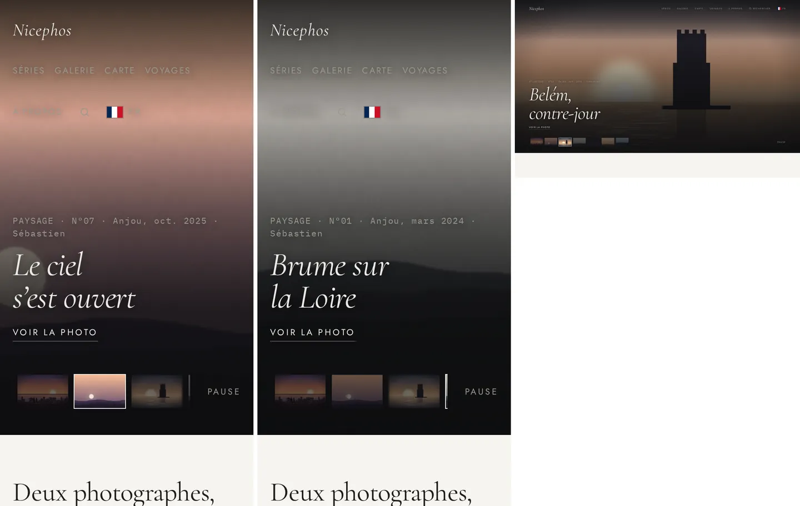

*Démo : menu de l'ouverture sur la photo à 320 px (deux diapositives) et au bureau — « À propos », la loupe et « FR » se perdent dans le ciel clair.*

**Recommandation.** Fixer la hauteur du voile du haut en pixels (linear-gradient(to bottom, rgba(5,5,5,.85) 0, rgba(5,5,5,.6) 160px, transparent 220px)), qui couvre toujours les deux lignes du menu mobile, et passer le menu de l'ouverture en --dark-ink. À terme, je préfère sortir le texte de l'image : voir UX-F-17. Passer chaque nouvelle photo d'ouverture à la mesure fournie (outils/rgaa-front-contraste-photos.mjs) avant publication : c'est une photo claire qui fait échouer.

### UX-F-02 — La liste des langues sort de l'écran sur téléphone dès que le menu passe à la ligne

**Gravité :** majeur · **Effort :** S · **Impact :** fort · **Vague :** 0 (V0-07)  
**Écran :** Sélecteur de langue ouvert, toutes les pages à menu (accueil, séries, carte, À propos…) — 320 à 430 px, FR/EN/DE  
**Référentiels :** RGAA 10.11 ; WCAG 2.2 1.4.10 ; RGESN 2.5 ; B&S 1.4 Lisibilité ; ISO 9241-110 Conformité aux attentes de l'utilisateur

**Constat.** La liste est ancrée à droite (right: 0) alors que la navigation passe à la ligne et pose le sélecteur au début d'une ligne. Sur la démo (cinq entrées de menu), les bords gauches mesurés vont de −63 à −107 px entre 320 et 430 px, sur presque toutes les pages et dans les trois langues : à 412 px, il ne reste à l'écran que le « s » final de « Français » ; English et Deutsch sont invisibles, alors que c'est précisément le chemin des visiteurs étrangers. L'en-tête des pages intérieures fait 187 px, 22 % de l'écran, avec le drapeau seul sur une troisième ligne.

En production (quatre entrées, Voyages étant fermé), la liste s'affiche correctement à 412 px en français. Le défaut y apparaîtra dès qu'une entrée sera ajoutée (Voyages, Carnets, Tirages) ; je ne l'ai pas vérifié en production à 320 et 360 px. La page photo, où le sélecteur est à droite, n'est pas touchée.

**Preuve.** [captures/F-langues-hors-ecran-mobile.webp](captures/F-langues-hors-ecran-mobile.webp) (démo, 412 px) ; ux-data/rgaa-front/affichage-reflow-zoom-spacing-lang.json (clé « langues » : 6 largeurs × 9 pages) ; ux-data/ergo-public/mobile/p4-9.json (x = −105 px, 65 px visibles sur 170) ; public/css/site.css:93.

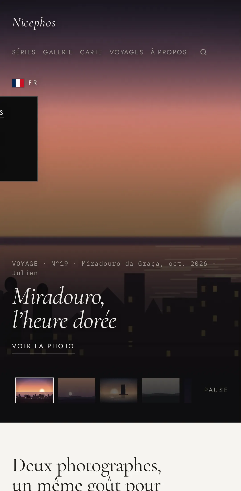

*Démo, Pixel 7 : la liste des langues ouverte commence à x = −105 px ; aucun nom de langue n'est lisible.*

**Recommandation.** Sous 640 px, ancrer la liste au bord visible (inset-inline-start: 0 ; max-width: calc(100vw − 2 gouttières)), ou la placer en position fixe sous le sélecteur pour qu'elle ne dépende plus du retour à la ligne. Mieux : le sélecteur à droite, sur la ligne du logo (voir UX-F-36). Ajouter un test e2e : liste ouverte, getBoundingClientRect().left ≥ 0 à 320, 360, 390 et 412 px, dans les trois langues.

### UX-F-03 — Focus invisible sur les cases, boutons radio et champs des formulaires de consentement et de signalement

**Gravité :** majeur · **Effort :** S · **Impact :** fort · **Vague :** 0 (V0-06)  
**Écran :** /bonjour (« Je vous ai photographié »), /photo/…/signaler, champ du lien de partage — tous thèmes  
**Référentiels :** RGAA 10.7 ; WCAG 2.2 2.4.7 ; Opquast 165 ; B&S 1.3 Feedback immédiat

**Constat.** La règle .hello-form input:focus { outline: none; border-color: var(--ink) } supprime le contour de toutes les entrées, cases et radios comprises ; et le changement de bordure ne s'applique jamais aux champs texte, car il perd en spécificité contre .hello-form input:not([type=checkbox]):not([type=radio]). Mesure par différence de pixels avec et sans focus : 0 pixel modifié pour les 6 cases et radios de /bonjour, la case de /signaler, les champs Référence et E-mail ; seule la zone de texte change. Au clavier, on ne sait pas où l'on est dans un formulaire qui engage son droit à l'image. Même famille : le champ du lien de partage (outline: none, changement de couleur à 2,42:1) et, en thème Atelier, le lien « Voyages » sur la photo de tête d'un voyage (contour sombre sur photo sombre, 2,0:1).

**Preuve.** [captures/F-focus-formulaire-sans-avec.webp](captures/F-focus-formulaire-sans-avec.webp) (à gauche sans focus, à droite avec : champ, case et radio identiques) ; ux-data/rgaa-front/clavier-pages-diff.json ; public/css/site.css:242-245.

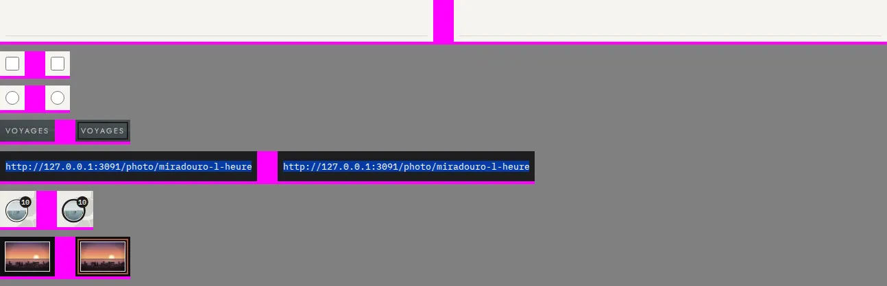

*Démo, /bonjour : à gauche sans focus, à droite avec focus — champ, case et bouton radio sont identiques.*

**Recommandation.** Retirer outline: none de .hello-form input:focus et textarea:focus et laisser jouer la règle générale :focus-visible (2 px --ink, décalage 3 px), qui vaut aussi pour les cases et radios. Pour les champs texte : border-bottom-color: var(--ink) et box-shadow: 0 1px 0 var(--ink). Ajouter .trip-hero :focus-visible { outline-color: var(--dark-ink) }, comme pour .hero.

### UX-F-04 — Champs à peine visibles (filet de 1,3:1) et erreurs portées par la seule couleur d'un trait

**Gravité :** majeur · **Effort :** S · **Impact :** fort · **Vague :** 0 (V0-06)  
**Écran :** /bonjour, /bonjour/:ref, /photo/…/signaler — thèmes Atelier, Nicephos nuit et jour  
**Référentiels :** RGAA 3.3 ; RGAA 3.1 ; WCAG 2.2 1.4.11 ; WCAG 1.4.1 ; Opquast 181 ; B&S 1.2.2 Distinction par le format ; B&S 7 Signifiance des codes

**Constat.** Les champs ne se repèrent que par un filet bas de 1 px en --rule : 1,30:1 en Atelier, 1,41:1 en nuit, 1,33:1 en jour, pour 3:1 requis ; « Votre e-mail » et « Votre prénom ou nom » semblent flotter au-dessus du vide. Après un envoi incomplet, chaque champ fautif n'est signalé que par la couleur de ce filet, sans message ni symbole ; en nuit, l'erreur prend le sable (#cbb68b), la couleur réservée aux états actifs. La revue d'octobre annonçait des bordures à 3,2:1 : c'est fait dans l'admin, pas sur les formulaires publics. Enfin, le résumé « Pas de carte ? Dites-nous quand et où » n'a plus de triangle (summary en display:flex) et ressemble à du texte.

**Preuve.** [captures/F-bonjour-liens-et-filets-pales.webp](captures/F-bonjour-liens-et-filets-pales.webp) ; [captures/F-bonjour-erreur-trait-colore-mobile.webp](captures/F-bonjour-erreur-trait-colore-mobile.webp) (démo) ; contrastes calculés : #dcd7cd/#f6f4ef 1,30:1, #2c2c2b/#0b0b0b 1,41:1, #dddcd7/#fbfbf9 1,33:1 ; public/css/site.css:243, 246 et 253 ; public/themes/nicephos.css:22.

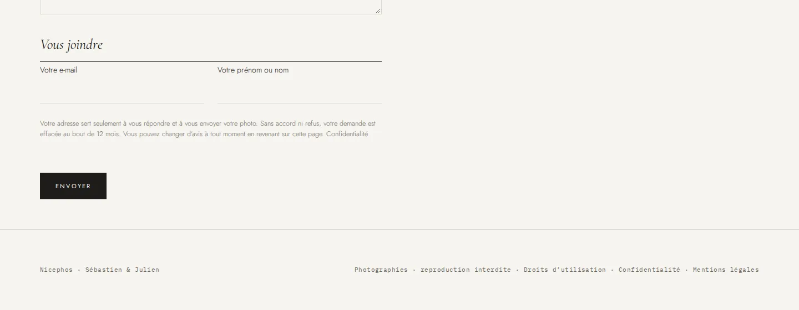

*Démo, /bonjour : filets des champs à 1,30:1 et lien « Confidentialité » impossible à distinguer du texte.*

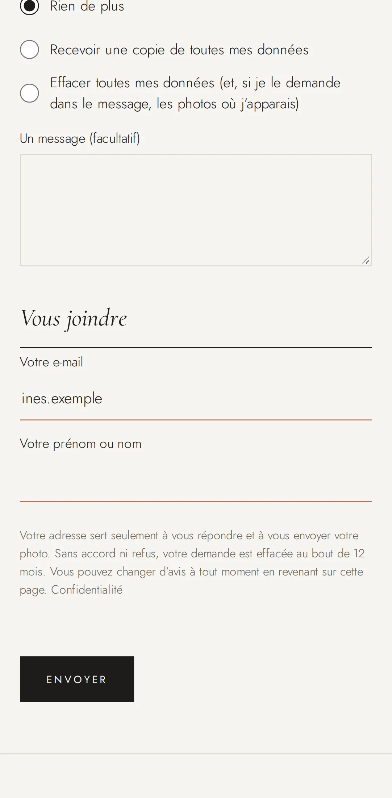

*Démo, /bonjour sur téléphone après un envoi incomplet : seul le trait sous le champ change de couleur.*

**Recommandation.** Filet des champs en --mute (5,2:1 en Atelier, 7,4:1 en nuit), 2 px au focus et en erreur ; ou un fond --frame légèrement teinté avec un filet --ink, plus proche d'une fiche d'exposition. En erreur, un symbole et un message « Erreur : … » sous le champ (voir UX-F-05), et une couleur d'erreur propre au thème nuit (corail ≥ 4,5:1), distincte du sable. Rendre au résumé un chevron visible.

### UX-F-05 — Champs obligatoires annoncés seulement après l'envoi ; erreurs non reliées aux champs ; focus laissé en haut de page

**Gravité :** majeur · **Effort :** M · **Impact :** fort · **Vague :** 1 (V1-04)  
**Écran :** /bonjour, /bonjour/:ref, /photo/…/signaler  
**Référentiels :** RGAA 11.10 ; WCAG 2.2 3.3.1 et 3.3.2 ; Opquast 70, 71 et 79 ; B&S 5.1 Protection contre les erreurs ; B&S 5.2 Qualité des messages d'erreur ; Nielsen #5 et #9

**Constat.** Aucun champ ne porte required ni aria-required, et aucun libellé ne dit « obligatoire ». Sur /signaler, le choix « Que voulez-vous nous dire ? » est exigé. Sur /bonjour, l'e-mail devient obligatoire dès qu'on veut la photo ou qu'on accepte, le nom dès qu'on accepte, la date et le lieu s'il n'y a pas de carte ; le message est même marqué « (facultatif) » alors qu'au moins un vœu est exigé.

Après l'envoi, le récapitulatif en role="alert" est clair, les saisies sont conservées et aria-invalid est posé : c'est bien. Mais il n'y a aucun aria-describedby, le titre de la page ne change pas, le focus reste sur body (une dizaine de tabulations avant les erreurs) et les messages ne mènent pas aux champs. Rien n'est vérifié dans le navigateur : chaque erreur coûte un aller-retour et une page entière.

**Preuve.** [captures/F-signaler-erreurs-focus-en-haut.webp](captures/F-signaler-erreurs-focus-en-haut.webp) (démo) ; ux-data/rgaa-front/clavier-scenarios.json (required 0, describedby 0) ; ux-data/ergo-public/desktop/p4-9.json (focus BODY après envoi vide) ; ux-data/qualite-transverse/mesures/erreurs.json ; server/encounters.js:125-140 ; views/report.eta:14-18 ; views/bonjour.eta:65-66.

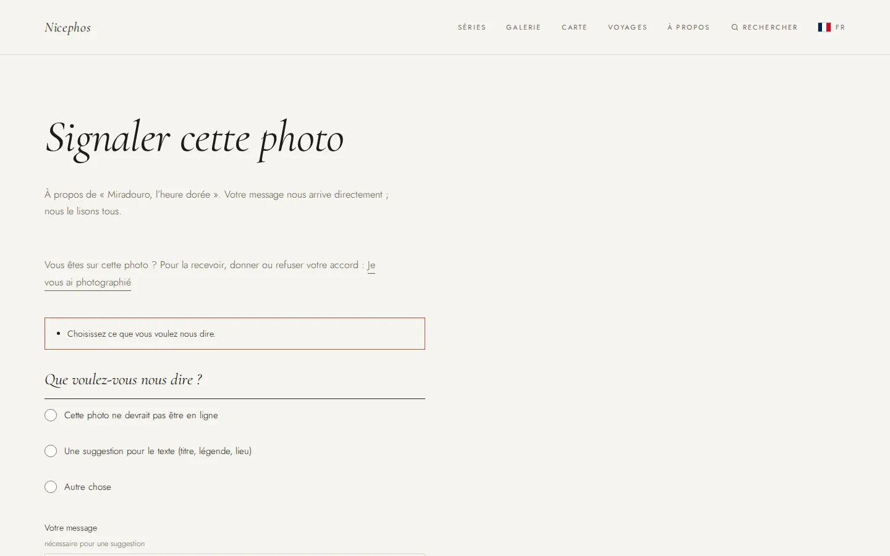

*Démo, /signaler après un envoi vide : le message est en tête, le focus reste sur la page, rien ne mène au champ.*

**Recommandation.**

- Dans les libellés : « Votre e-mail (nécessaire pour recevoir la photo ou donner votre accord) », « Votre prénom ou nom (obligatoire avec un accord) », « (obligatoire) » sur le type de signalement ; required sur le groupe radio de /signaler.
- Relier chaque message à son champ (id + aria-describedby) et faire de chaque erreur du résumé un lien vers son champ.
- Donner le focus au résumé (tabindex=-1) et préfixer le titre : « Erreur — 3 points à corriger · Je vous ai photographié ».
- Garder novalidate pour des messages maîtrisés, mais appeler checkValidity() dans site.js avant l'envoi, avec les mêmes textes que le serveur (qui reste le filet, puisque le site doit marcher sans JavaScript).

### UX-F-06 — Ni lien d'évitement ni repère d'en-tête : 18 tabulations avant le contenu, 28 avant la première photo

**Gravité :** majeur · **Effort :** S · **Impact :** moyen · **Vague :** 0 (V0-09)  
**Écran :** Toutes les pages publiques ; en-tête de l'accueil, des pages série et photographe  
**Référentiels :** RGAA 12.7 ; RGAA 12.6 ; WCAG 2.2 2.4.1 ; WCAG 1.3.1 ; Opquast 155, 156, 164 et 171 ; B&S 1.1 Incitation

**Constat.** Aucune page publique n'a de lien « Aller au contenu », alors que l'admin a le sien depuis l'audit du 10 octobre. À l'accueil, il faut 18 tabulations avant le premier lien du contenu principal (logo, 6 liens de menu, langue, « Voir la photo », 7 vignettes, Pause) et 28 avant la première photo de la galerie. Sur les pages galerie, le &lt;header> est imbriqué dans la section de l'ouverture : il n'est pas exposé comme repère banner (logo hors de tout repère, d'où la violation axe « region »). Seul le logo mène à l'accueil ; il n'y a ni plan du site ni fil d'Ariane ; l'entrée active du menu ne se distingue que par une nuance de 2,99:1 (Atelier) ou 2,30:1 (nuit).

**Preuve.** ux-data/rgaa-front/clavier-scenarios.json (tabsAvantContenu : 18) ; ux-data/qualite-transverse/mesures/mesures.json (28 tabulations sur /, 29 sur /serie/atlantique) ; ux-data/rgaa-front/aria/accueil.txt (aucun banner) ; views/layout.eta:48 ; views/home.eta:13 et 35 ; public/css/site.css:217.

**Recommandation.** En premier élément du body : &lt;a class="skip" href="#contenu">Aller au contenu&lt;/a>, hors écran et visible au focus, en trois langues ; id="contenu" sur chaque &lt;main>, visionneuse et page Partager comprises. Sortir le &lt;header> de la section de l'ouverture (positionné par-dessus) ou lui donner role="banner". Souligner l'entrée active du menu (text-underline-offset 5px, comme pour les langues). Plus tard : une page « Plan du site » générée et un fil d'Ariane discret, en mono, au-dessus du H1 des pages série, voyage et photo.

### UX-F-07 — Après un filtre de série au clavier, le focus part hors de l'écran sur un autre lien (régression)

**Gravité :** majeur · **Effort :** S · **Impact :** moyen · **Vague :** 0 (V0-10)  
**Écran :** Accueil, pages série et photographe — index des séries (filtre sans rechargement)  
**Référentiels :** RGAA 12.8 ; RGAA 10.7 ; WCAG 2.2 2.4.3 ; WCAG 2.4.7 ; B&S 1.3 Feedback immédiat ; ISO 9241-110 Conformité aux attentes de l'utilisateur

**Constat.** Entrée sur « Atlantique » : la page défile jusqu'à la galerie et l'annonce est juste (« Atlantique : 03 / 22 vues »). Mais le focus va sur le lien « Les deux · 22 photos » du choix du regard, 814 px au-dessus de la vue : il porte le même href, et site.js prend le premier lien de même adresse. Rien n'est visible à l'écran, et la tabulation suivante remonte dans les regards. C'est une régression de la correction annoncée dans la revue d'octobre (« focus rendu au lien activé ») ; le choix d'un photographe, lui, garde bien le focus.

**Preuve.** [captures/F-filtre-serie-focus-hors-ecran.webp](captures/F-filtre-serie-focus-hors-ecran.webp) (démo : aucun focus visible) ; ux-data/rgaa-front/affichage-scen.json (« filtre » : focus « Les deux 22 photos », top −814, scrollY 1896) ; public/js/site.js:126-128.

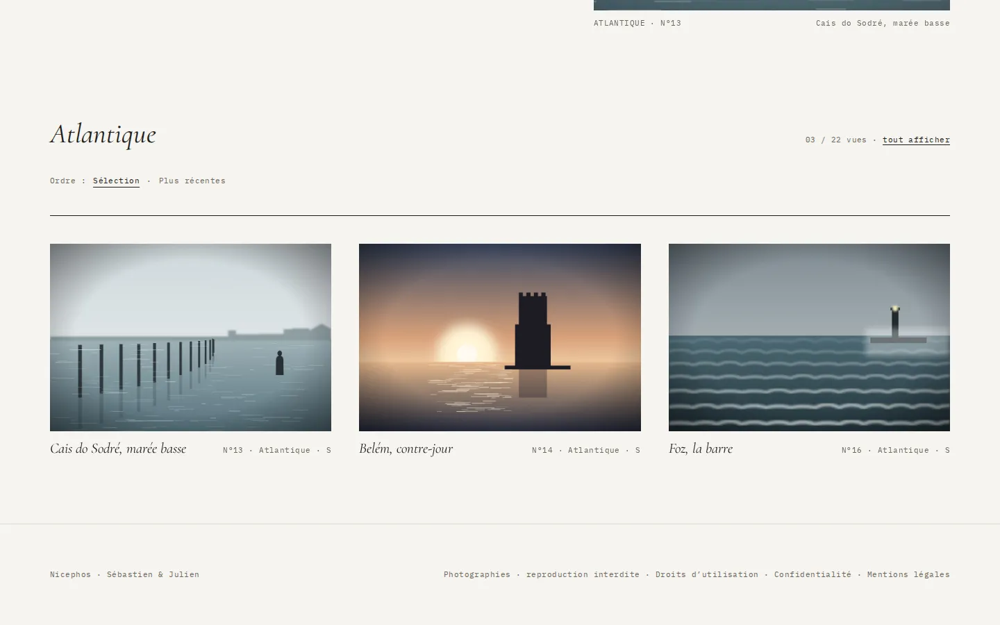

*Démo : après Entrée sur « Atlantique », la page défile mais le focus est parti 814 px plus haut ; rien n'est visible.*

**Recommandation.** Retrouver le lien activé dans son bloc (#series, #regards, .order) et non par sa seule adresse, ou par un attribut data-key stable. À défaut de cible, donner le focus au titre de la galerie (déjà tabindex=-1), qui est à l'écran puisque la page y défile. Ajouter le scénario aux tests e2e.

### UX-F-08 — La page photo, porte d'entrée des partages, n'a ni marque, ni menu, ni recherche, ni pied de page

**Gravité :** majeur · **Effort :** M · **Impact :** fort · **Vague :** 1 (V1-05)  
**Écran :** /photo/… (toutes langues, démo et production) ; /photo/…/partager ; page 404  
**Référentiels :** RGAA 12.1 ; WCAG 2.2 2.4.5 ; Opquast 2, 15, 155 et 158 ; LCEN (mentions accessibles) ; Nielsen #3 Contrôle et liberté ; Nielsen #6 ; B&S 1.1 Incitation ; ISO 9241-110 Autodescriptivité

**Constat.** La visionneuse n'affiche que « ← Fermer », le compteur et la langue : ni nom ni emblème du site (« Nicephos » n'est que dans l'onglet), ni menu, ni recherche, ni pied de page. 12 gabarits sur 17 incluent le pied de page ; photo.eta, share.eta et notfound.eta non. Une personne qui arrive de WhatsApp, d'Instagram, de Google Images ou d'un QR ne trouve ni Droits d'utilisation, ni Confidentialité, ni Mentions légales, ni la mention « reproduction interdite », ni crédit « © ». « Fermer » ne ferme rien qu'elle ait ouvert : en arrivée directe, il mène à /#galerie, au milieu de l'accueil (page défilée à 1 922 px, présentation sautée). RGAA 12.1 demande deux systèmes de navigation pour chaque ensemble de pages, et la visionneuse n'est pas un processus.

**Preuve.** ux-data/ergo-public/desktop/p123.json (brand false, siteNameVisible false ; afterClose « /#galerie », scrollY 1922) ; ux-data/ergo-public/desktop/p4-9.json (footerOnPhoto 0, legalLinksOnPhoto 0) ; production : pages photo sans pied de page ni lien /droits, /confidentialite, /mentions-legales (prod-front-bureau/photo-sillon-saint-malo.json ; capture conservée hors dépôt) ; views/photo.eta:5-8 et 51-63 ; views/share.eta ; views/notfound.eta.

**Recommandation.**

- En-tête discret : à gauche « NICEPHOS » (lien vers l'accueil), puis un retour nommé par sa destination (« ← Rue, par Julien », « ← Galerie », « ← Lisbonne et Porto ») ; à droite une loupe, le compteur, la langue. Trois éléments monochromes de 44 px : la photo garde la scène.
- Sous « À proximité », un pied de page compact, comme un cartel : « © 2026 Julien · Nicephos — reproduction interdite · Utiliser cette photo ? · Contact · Confidentialité · Mentions légales ». Le même include dans share.eta et notfound.eta.
- En arrivée directe, le retour mène au haut de l'accueil (« ← Toutes les photos »), pas à #galerie.

### UX-F-09 — Ouverte depuis un voyage, la carte ou la recherche, une photo perd son fil

**Gravité :** majeur · **Effort :** M · **Impact :** fort · **Vague :** 1 (V1-05)  
**Écran :** /voyage/lisbonne-et-porto, /carte, /recherche?q=Lisbonne et la rangée « À proximité », puis /photo/… (bureau et mobile)  
**Référentiels :** B&S 3.2 Contrôle utilisateur ; B&S 1.1 Incitation ; ISO 9241-110 Contrôlabilité ; ISO 9241-110 Conformité aux attentes de l'utilisateur ; Nielsen #1 et #3

**Constat.** Ouverte depuis le récit « Lisbonne et Porto », la photo affiche « 13 / 22 » : c'est sa position dans toute la galerie, pas parmi les 10 photos du voyage. La flèche « suivante » mène à « Belém, contre-jour » dans l'ordre de la galerie. « Fermer » comme Échap conduisent à /#galerie, sur l'accueil, au lieu de revenir au jour du voyage. Même chose depuis la carte (« 13 / 22 ») et depuis un résultat de recherche (« 08 / 22 »). La visionneuse ne dit pas non plus que la photo appartient à un voyage. Seul le bouton Retour du navigateur ramène au bon endroit.

**Preuve.** [captures/F-photo-depuis-voyage-compteur-galerie-mobile.webp](captures/F-photo-depuis-voyage-compteur-galerie-mobile.webp) (démo) ; ux-data/ergo-public/desktop/p4-9.json (photoFromTrip, photoFromMap, photoFromSearch : counter, nextHref, afterClose, afterEscape) ; views/trip.eta:49 et views/search.eta:22 (photoUrl sans contexte) ; views/carte.eta:51 ; views/photo.eta:55 ; public/js/site.js:229-233.

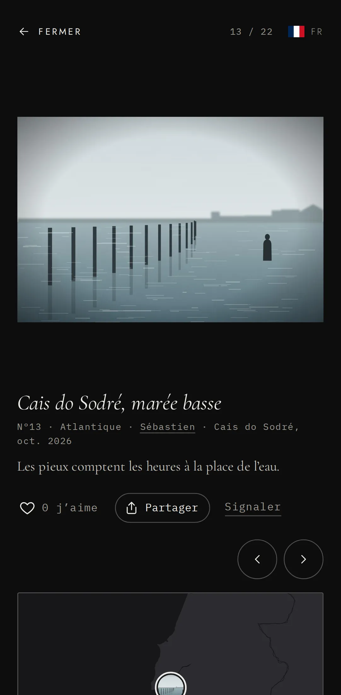

*Démo, photo ouverte depuis le voyage « Lisbonne et Porto » : le compteur dit « 13 / 22 », sa position dans toute la galerie, et non parmi les 10 photos du voyage.*

**Recommandation.** Faire passer le contexte dans l'adresse, comme vous le faites déjà pour les filtres : ?voyage=lisbonne-et-porto, ?q=lisbonne, ?lieu=&lt;id>. Le serveur en déduit précédente et suivante, le compteur (« 3 / 10 · Lisbonne et Porto ») et le retour. Côté script, généraliser close() : si la page précédente est une page du site qui n'est pas une photo, history.back(). Ajouter à la ligne de métadonnées « Voyage : Lisbonne et Porto, jour 1 ». Ce mécanisme servira tel quel aux carnets et aux galeries privées (voir UX-T-16).

### UX-F-10 — Les pages Série et Photographe sont l'accueil déguisé ; leur titre de niveau 1 est la diapositive du moment

**Gravité :** majeur · **Effort :** M · **Impact :** fort · **Vague :** 1 (V1-07)  
**Écran :** /serie/…, /auteur/… (démo et production) ; accueil  
**Référentiels :** RGAA 9.1 ; WCAG 2.2 1.3.1 et 2.4.6 ; Opquast 234 ; B&S 1.1 Incitation ; B&S 2.1.2 Actions minimales ; ISO 9241-110 Conformité aux attentes, Autodescriptivité ; Nielsen #2 ; Loi de Jakob

**Constat.** /serie/rue a pour titre d'onglet « Rue · Nicephos », mais affiche toute l'ouverture de l'accueil (« Miradouro, l'heure dorée », une photo de la série Voyage), puis l'accroche, les regards et l'index des séries : sa première photo arrive à 2 247 px sur bureau (2,5 écrans) et 1 675 px sur mobile. Le nom de la série n'est qu'un H3, sous le H2 de l'accroche ; chaque diapositive porte son propre H1 (sept dans le code de l'accueil, un seul exposé, qui change toutes les 6 s). Sur /auteur/julien, le H1 peut être une photo de Sébastien. En production, /serie/urbain commence par « BIENVENUE! HI ! HALLO! ».

Les données ne prévoient qu'un nom par série et, par photographe, un nom et une biographie : ni texte d'intention, ni couverture choisie, ni portrait. Or ce sont ces adresses que l'on partage et que le sitemap donne aux moteurs de recherche.

**Preuve.** [captures/F-page-serie-rue-premier-ecran.webp](captures/F-page-serie-rue-premier-ecran.webp) (démo) ; ux-data/ergo-public/desktop/p123.json (p2.serieRue.firstTileY = 2247) et mobile/p123.json (1675) ; ux-data/rgaa-front/aria/serie.txt (heading 1 « Miradouro, l'heure dorée », heading 3 « Atlantique ») ; server/routes/public.js:190-192 et 223-233 ; server/db/migrations/001\_init.sql:10-16 ; views/home.eta:20 et 72.

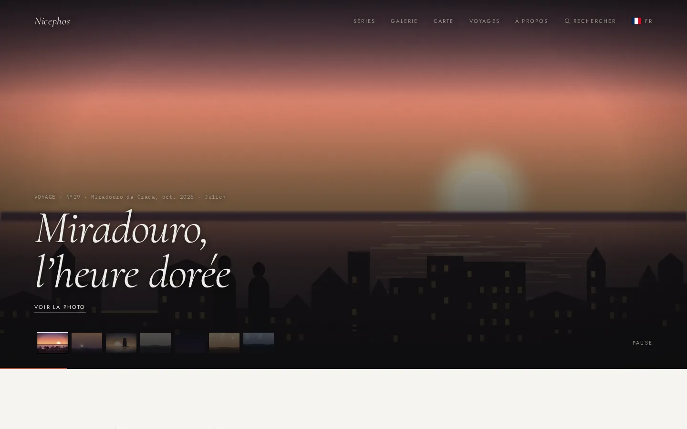

*Démo, /serie/rue au bureau : le premier écran est l'ouverture de l'accueil, avec une photo d'une autre série.*

**Recommandation.**

- Une vraie page Série : H1 « Rue », texte d'intention de 300 à 600 signes (FR/EN/DE), période, photographe(s), couverture choisie et non recadrée, puis la séquence dès le premier écran ; pas de diaporama.
- Une vraie page Photographe : portrait (Sébastien vu par Julien, Julien vu par Sébastien), démarche en quelques lignes, sélection personnelle.
- En bas : les autres séries et « l'autre regard ».
- À l'accueil : un H1 stable (« Nicephos — photographies de Sébastien et Julien », il peut être masqué visuellement), titres de diapositives en &lt;p class="cap-title">.
- Distinguer les séries (projets d'auteur, finis, ordonnés) des thèmes (fleurs, nuit, véhicules), déjà couverts par les mots-clés et la recherche.

### UX-F-11 — Acheter un tirage ou écrire aux auteurs : aucune porte d'entrée depuis la photo

**Gravité :** majeur · **Effort :** M · **Impact :** fort · **Vague :** 1 (V1-05, V2-01)  
**Écran :** Visionneuse /photo/…, menu, À propos, pied de page (bureau et mobile, démo et production)  
**Référentiels :** B&S 1.1 Incitation ; B&S 2.1.2 Actions minimales ; ISO 9241-110 Adéquation aux tâches ; ISO 9241-110 Engagement de l'utilisateur ; Nielsen #6 ; Opquast 107 et 108 ; Loi de Jakob

**Constat.** L'envie d'un tirage ou d'une licence naît devant une photo. Or la visionneuse n'offre ni contact ni lien vers les droits. Le menu n'a pas d'entrée Contact ; « tirage », « acheter » et « contact » ne donnent aucun résultat dans la recherche. Le seul e-mail cliquable du site est sur Droits d'utilisation (et en bas de Confidentialité) ; en production, À propos donne des adresses masquées en texte (du type « prénom[at]domaine{point}art »), à recopier à la main, et /bonjour est réservée aux personnes photographiées. Le chemin le plus court : Fermer, puis descendre jusqu'au pied de page (environ 4 200 px sur bureau ; environ 22 300 px sur mobile en production, soit 27 écrans), puis Droits d'utilisation, puis un e-mail à rédiger soi-même, sans la référence de la photo.

**Preuve.** ux-data/ergo-public/desktop/p4-9.json (p9 : occurrences de tirage, achat, contact ; contactInNav false ; p5 : « tirage », « acheter », « contact » sans résultat) ; ux-data/ergo-public/mobile/p4-9.json ; production : À propos et Mentions sans mailto (prod-front-bureau/a-propos.json, mentions-legales.json) ; views/photo.eta ; views/nav.eta.

**Recommandation.**

- Tout de suite, sous Partager : « Tirage, licence : nous écrire », qui ouvre un formulaire court (gabarit de Signaler) prérempli avec la référence de la photo (inventaire, titre, auteur).
- Une page Contact (« Écrire à Sébastien, à Julien ou aux deux », mailto, délai de réponse annoncé), liée depuis le pied de page et À propos ; toutes les adresses en mailto.
- Pour la boutique : réserver cet emplacement à « Commander un tirage » et ajouter « Tirage disponible » au cartel.

### UX-F-12 — Choisir un regard ne change rien de visible à l'écran

**Gravité :** majeur · **Effort :** S · **Impact :** fort · **Vague :** 1 (V1-08)  
**Écran :** Accueil, choix « Les deux / Sébastien / Julien » (bureau et mobile)  
**Référentiels :** B&S 1.3 Feedback immédiat ; B&S 1.1 Incitation ; B&S 6 Homogénéité/cohérence ; ISO 9241-110 Autodescriptivité ; Nielsen #1 Visibilité de l'état du système

**Constat.** Après un clic sur « Julien », la page ne défile pas (0 px) : la grille filtrée commence 1 533 px sous le haut de l'écran sur bureau et 978 px sur mobile, pour un écran de 839 px. Le seul retour visible est un point de 6 px devant « 12 photos » et le nom passé en italique ; en production, un simple passage de la graisse 300 à 400. Les séries, elles, font défiler la page jusqu'à la grille : deux filtres voisins ne se comportent pas pareil. En production, l'introduction n'invite pas à choisir et les trois cases ressemblent à des statistiques plutôt qu'à des boutons. L'annonce aux lecteurs d'écran et le focus, corrigés en octobre, sont bons.

**Preuve.** [captures/F-regard-julien-apres-clic.webp](captures/F-regard-julien-apres-clic.webp) (démo) ; ux-data/ergo-public/desktop/p123.json (scrolledBy 0, gridTopVy 1533) et mobile/p123.json (978) ; views/home.eta:45 (pas de data-scroll) et :54 ; public/css/site.css:143 (point de 6 px).

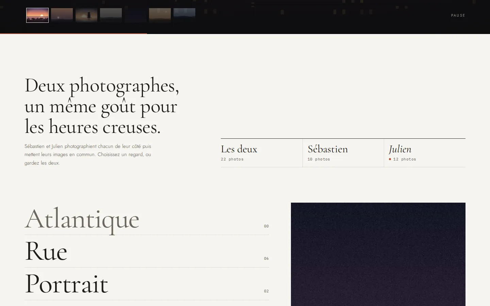

*Démo : écran juste après le clic sur « Julien » — la page n'a pas bougé, seul un point de 6 px a changé.*

**Recommandation.** Ajouter data-scroll aux liens des regards, comme pour les séries. Mieux : une barre de filtres collante au-dessus de la grille (« Les deux · Sébastien · Julien », puis les séries en pastilles), qui montre l'état là où il agit, et le filtre actif en étiquette avec ✕ dans l'en-tête de la grille. Une phrase d'invitation (« Choisissez un regard ») et un état actif franc (soulignement couleur sable).

### UX-F-13 — La grille se lit en colonnes : l'ordre de votre « Sélection » est perdu

**Gravité :** majeur · **Effort :** M · **Impact :** fort · **Vague :** 1 (V1-08)  
**Écran :** Grille de l'accueil, des séries, des photographes, de la recherche et des voyages (2 colonnes dès 640 px, 3 dès 1 100 px)  
**Référentiels :** B&S 1.2.1 Groupement par la localisation ; B&S 8 Compatibilité ; ISO 9241-110 Conformité aux attentes ; RGAA 12.8 ; WCAG 2.4.3 ; Effet de position sérielle ; Loi de proximité (Gestalt)

**Constat.** La grille utilise des colonnes CSS (columns: 3) : l'ordre descend dans la première colonne, puis dans la deuxième. La première rangée visible montre N°01, 08 et 16 sur la démo, N°01, 17 et 32 en production : l'ordre que vous composez dans l'admin n'est pas celui qu'on lit. Au clavier, le focus remonte de 3 194 px après la 7e vignette et de 3 212 px après la 15e sur bureau, de 5 262 px sur tablette. La règle .tile:nth-child(3n+2) { margin-top: 72px }, pensée pour des rangées, décale des vignettes sans logique visible, et les colonnes s'arrêtent à des hauteurs différentes (5 413, 6 116 et 5 761 px). En production, la Sélection enchaîne dix photos de Sébastien puis seize de Julien : les deux regards ne dialoguent pas.

**Preuve.** [captures/F-grille-ordre-en-colonnes.webp](captures/F-grille-ordre-en-colonnes.webp) (démo, numéro d'ordre sur chaque vignette) ; sortie de outils/camille-grille.mjs (première rangée [1, 8, 16] ; sauts de focus [[7, 8, −3194], [15, 16, −3212]]) ; ux-data/direction-artistique/mesures-demo.json (firstRowNs, colEnds) ; public/css/site.css:172-175.

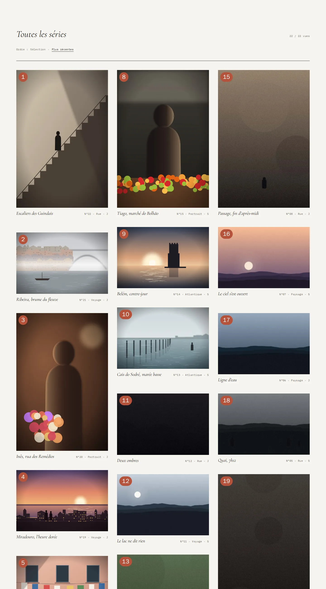

*Démo : numéro d'ordre de la Sélection posé sur chaque vignette — la première rangée montre 1, 8 et 16.*

**Recommandation.** Une planche contact en rangées justifiées, sans script : flex-wrap, chaque vignette avec flex-grow égal à son rapport largeur/hauteur, hauteur cible d'environ 300 px (240 px sur mobile). L'ordre et le format de chaque photo sont respectés. Retirer la règle nth-child(3n+2). Composer la Sélection en alternant les regards (voir UX-F-45).

### UX-F-14 — La visionneuse donne trop peu de place à la photo, et le cartel mêle l'œuvre et les boutons

**Gravité :** majeur · **Effort :** M · **Impact :** fort · **Vague :** 1 (V1-06)  
**Écran :** /photo/… sur Pixel 7 (412 × 839 utiles) et sur bureau 1440 × 900  
**Référentiels :** B&S 2.2 Densité informationnelle ; B&S 1.2.1 ; B&S 4.1 Flexibilité ; ISO 9241-110 Adéquation aux tâches ; Nielsen #7 et #8 ; Loi de Fitts ; Loi de proximité

**Constat.** Sur téléphone, le cadre garde au moins 45 % de la hauteur et y centre l'image : une photo 3:2 s'affiche en 371 × 247 px, 27 % de l'écran, entre des bandes noires de 130 à 300 px ; le titre arrive environ 150 px sous la photo, on ne les lit plus ensemble ; quand la page a une carte, la carte (371 × 269) est plus grande que la photo. Sur bureau, une 3:2 occupe 833 × 555 px (36 % de l'écran) et une verticale 370 × 555 (16 %) ; la mini-carte fait passer l'image de 655 à 555 px de haut.

Il n'y a ni plein écran, ni indice des gestes (← →, Échap, glissé, qui fonctionnent très bien), et les flèches sont à 797 px du centre de l'image, loin du compteur. Le titre est en capitales espacées ; « 0 j'aime », Partager et Signaler sont au même niveau que l'œuvre.

**Preuve.** [captures/F-visionneuse-mobile-photo-27pc.webp](captures/F-visionneuse-mobile-photo-27pc.webp) (démo) ; ux-data/ergo-public/mesures.json (mobile.viewer : 371 × 247, bandsPx 298, areaPct 27 ; desktop.viewer : 1296 × 555 avec carte, 1296 × 655 sans) ; ux-data/direction-artistique/mesures-demo.json (viewer) ; public/css/site.css:195-201 ; public/js/site.js (fit(), 45 % au minimum).

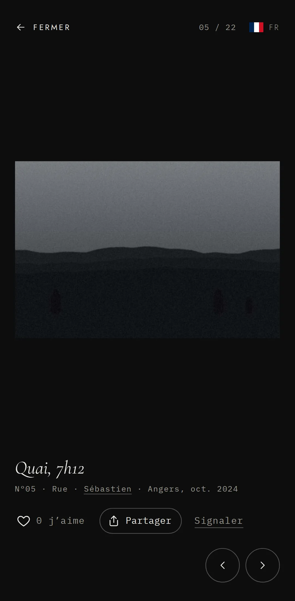

*Démo, Pixel 7 : une photo 3:2 occupe 27 % de l'écran, entre deux bandes noires ; « 0 j'aime » au premier plan du cartel.*

**Recommandation.**

- La photo d'abord : sur bureau, hauteur d'image = écran moins l'en-tête et une ligne de titre (environ 1 116 × 744 px, 64 % de l'écran au lieu de 36 %) ; sous 640 px, pleine largeur (padding-inline: 0), cadre à la hauteur de l'image, titre à 24 px au plus.
- Juste dessous, un cartel : titre en casse normale, auteur, lieu, date, série, prise de vue, numéro d'inventaire.
- La mini-carte rejoint « À proximité ».
- Un mode plein écran (touche F, API Fullscreen) et un indice discret « ← → pour naviguer · Échap pour revenir » ; le compteur à côté des flèches.

### UX-F-15 — Le filigrane plein cadre recouvre chaque photo, vignettes comprises

**Gravité :** majeur · **Effort :** S · **Impact :** fort · **Vague :** 0 (V0-05)  
**Écran :** Production : grille de l'accueil, visionneuse, ouverture, « À proximité », séries ; réglage Admin › Filigrane et EXIF  
**Référentiels :** Nielsen #8 Esthétique et design minimaliste ; B&S 1.4 Lisibilité ; ISO 9241-110 Engagement de l'utilisateur ; Effet esthétique-utilisabilité ; Opquast 180

**Constat.** En production, le logo complet (rhinocéros, NICEPHOS, PHOTOGRAPHY GALLERY) est incrusté au centre de toutes les tailles d'image, vignettes de 640 px comprises. Il couvre 75 à 80 % de la largeur de la photo (620 px sur 832 dans la visionneuse, 327 sur 405 dans une vignette, mesurés sur les captures à l'échelle 1), avec une opacité que j'estime entre 35 et 45 %. Sur un ciel ou une mer, on le voit avant la photo ; dans la grille, chaque vignette porte le même rhinocéros ; dans l'ouverture recadrée sur téléphone, il est agrandi et devient le sujet. Ce réglage suit l'aide de l'admin, qui présente le plein cadre comme « le réglage recommandé », alors que le code propose par défaut « © {auteur} » en bas à droite et un seuil « 1 280 px et plus (vignettes épargnées) ».

**Preuve.** Production décrite sans image (captures conservées hors dépôt : ux-data/prod/direction-artistique/filigrane-ombre-1x.png, filigrane-sillon-1x.png, hero-mobile-5.png) ; server/variants.js:16-21 ; server/watermark.js:13-20 et 83-90 ; docs/aide/07-filigrane-exif.md:35-43.

**Recommandation.** Signer sans masquer : « © Julien » ou « © Sébastien » en Jost 300, ou l'emblème seul, en bas à droite, sur 10 à 14 % de la largeur, opacité de 30 à 40 %, marge de 3 %. Choisir « Appliquer aux tailles : 1 280 px et plus » pour épargner vignettes, aperçus et carte ; jamais sur l'ouverture. Réécrire la section de l'aide pour présenter le plein cadre comme une option dissuasive, et avertir dans l'admin au-delà de 30 % de largeur. Comparez sur trois photos (une claire, une sombre, une verticale) avant de trancher : c'est votre arbitrage entre protection et regard. La vraie protection est ailleurs : page Droits, IPTC, preuves horodatées.

### UX-F-16 — Le premier écran ne dit ni qui vous êtes ni ce qu'on va voir : le logo est publié comme une photo

**Gravité :** majeur · **Effort :** S · **Impact :** fort · **Vague :** 0 (V0-05)  
**Écran :** Production : accueil (bureau et Pixel 7), /en/, /de/, et les pages série et photographe qui reprennent la même ouverture  
**Référentiels :** Opquast 99, 101 et 102 ; RGAA 1.3 ; RGAA 8.7 ; B&S 1.1 Incitation ; Nielsen #2 ; Effet de position sérielle

**Constat.** La première diapositive est le logo (fichier logo-nicephos-fond-noir-2x), publié comme photo N°37 de la série « Plus près du ciel », attribuée à Julien et placée à Strasbourg sur la carte. Il est compté dans les 44 photos de production et apparaît dans la grille et dans « À proximité ». Son titre « BIENVENUE! HI ! HALLO! » devient le H1 de l'accueil, des séries et des photographes, dans les trois langues, avec une ponctuation incohérente et sans attribut lang ; son alternative ne restitue pas le texte de l'image. Le premier écran montre trois rhinocéros (en-tête, diapositive, filigrane). Aucune phrase ne dit « deux photographes, Sébastien et Julien » ; l'accroche « Ce qui attire nos regards mérite d'être partagé. » commence à y ≈ 917 px, sous la ligne de flottaison ; le titre de la page est seulement « Nicephos ».

**Preuve.** Production décrite sans image : ux-data/prod/direction-artistique/hero-prod.json ; prod-front-bureau/accueil.json (title « Nicephos », 6 H1) ; prod-front-bureau/carte.json (« Strasbourg · 1 photo ») ; prod-front-bureau/photo-logo-nicephos.json (alt « Bienvenue! Hi ! Hallo! ») ; server/routes/public.js:210.

**Recommandation.** Dépublier /photo/logo-nicephos-fond-noir-2x : il fausse le compte, la carte, la numérotation et « À proximité ». Ouvrir sur une photo forte, avec dans le premier écran une promesse d'une ligne et une sous-ligne factuelle, par exemple « Deux regards, une même lumière. » / « Rue, mer et nuit, de Saint-Malo à la Californie : les photographies de Sébastien et Julien. ». Titre de l'accueil : « Nicephos — photographies de Sébastien et Julien ». Le mot d'accueil multilingue est inutile : le site est déjà traduit. Si vous tenez à un carton d'accueil, réglez-le dans Apparence (emblème et accroche), hors de la photothèque.

### UX-F-17 — L'ouverture recadre les photos jusqu'à n'en montrer qu'un tiers, les voile et les zoome

**Gravité :** majeur · **Effort :** M · **Impact :** fort · **Vague :** 1 (V1-09)  
**Écran :** Diaporama de l'accueil, des séries et des photographes (démo et production, bureau et mobile)  
**Référentiels :** Nielsen #8 ; ISO 9241-110 Conformité aux attentes de l'utilisateur ; B&S 1.4 Lisibilité ; RGESN 4.6 ; WCAG 2.2 1.4.3 (à préserver)

**Constat.** En object-fit: cover, les photos verticales ne montrent que 36 % de leur hauteur sur ordinateur, et les horizontales 38 % de leur largeur sur téléphone : le couple de « Miradouro » passe sous le texte, le soleil est coupé au bord. Le voile assombrit la moitié basse de 45 à 95 % et le quart haut de 50 à 82 % : seule une bande de 2 % de la hauteur reste intacte. Un zoom lent de 4 % rogne encore les bords, à titre purement décoratif, et l'aperçu des séries est recadré en 4:5. Ce voile vient de la correction de contraste d'octobre : juste pour le texte, coûteux pour l'image. Le cadrage, c'est l'œuvre.

**Preuve.** [captures/F-ouverture-recadrage-38pc-mobile.webp](captures/F-ouverture-recadrage-38pc-mobile.webp) (démo : le cadre montre les 38 % gardés) ; ux-data/direction-artistique/hero-demo.json ; ux-data/ergo-public/mesures.json (heroCrop : keptPct 38 sur mobile, 36 pour une verticale sur bureau) ; production : mêmes rapports (hero-prod.json, hors dépôt) ; public/css/site.css:74-80, 113 et 158.

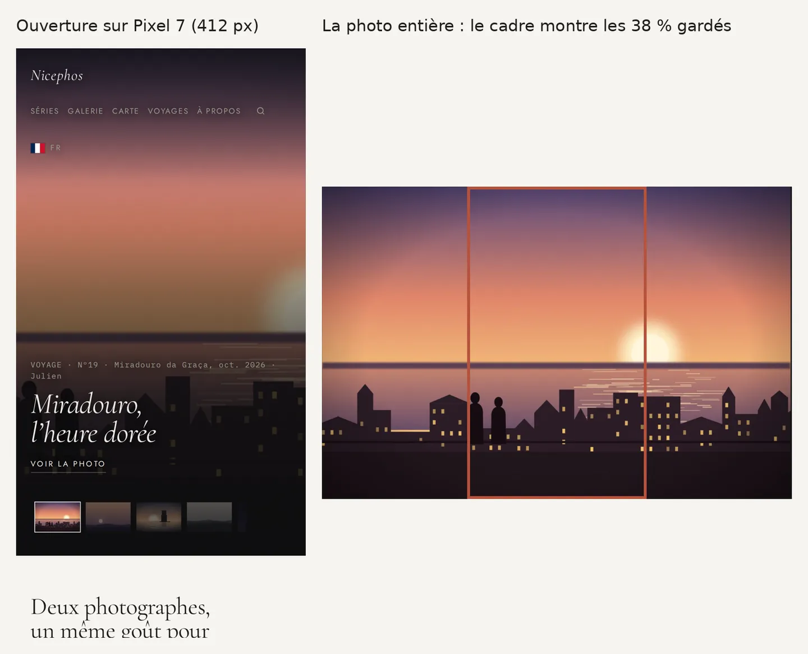

*Démo : l'ouverture sur Pixel 7 (à gauche) ne garde que 38 % de la largeur de la photo (cadre, à droite).*

**Recommandation.**

- Sortir le texte de l'image : promesse, légende et bouton Pause sur un bandeau noir sous la photo, avec seulement une bande légère sous le menu ; le contraste est garanti sans voiler la photo.
- Un point focal par photo (object-position réglé d'un clic sur la vignette, dans la fiche), repris par l'ouverture, l'aperçu des séries, les voyages et « À proximité ».
- Une photo pour l'ordinateur et une pour le téléphone (&lt;picture media>), ou les portraits montrés entiers (contain) sur le noir, comme un tirage au mur.
- Supprimer le zoom, garder le fondu.

### UX-F-18 — Ouverture : 820 ko de diapositives invisibles téléchargés dès l'arrivée, même sans JavaScript

**Gravité :** majeur · **Effort :** M · **Impact :** fort · **Vague :** 1 (V1-09)  
**Écran :** Accueil (/, /en/, /de/), pages série et photographe — production, bureau et mobile  
**Référentiels :** RGESN 6.5 ; RGESN 6.4 ; RGESN 4.6 ; RGESN 6.1

**Constat.** Sur les 8 pages de galerie mesurées en production, le navigateur télécharge dès l'arrivée les 6 photos de l'ouverture en 2 000 px (846 ko), alors qu'une seule est visible : les 5 autres sont empilées en opacité 0, donc « à l'écran » pour le navigateur, et loading="lazy" ne joue pas. Cela fait 820 ko invisibles : 42 % des 1 953 ko de l'accueil et 66 % de /serie/nuit. Sur mobile, 417 ko (5 × 1 280 px). Sans JavaScript, le diaporama ne défile jamais, mais les 6 images sont quand même chargées. Le bandeau de vignettes de 64 px charge en plus six fichiers de 640 px (158 ko). Les portraits livrés en 2 000 × 3 000 px sont recadrés en bandeau : environ 64 % de leurs pixels ne sont jamais vus.

**Preuve.** Production (sonde réseau, sans image) : prod-front-bureau/accueil.rgesn-first.json (6 fichiers -2000.avif demandés à 416 ms, dont un seul visible) ; prod-front-mobile/accueil.json (5 × 1 280 px cachées = 417 ko) ; démo sans JavaScript : ux-data/rgesn/mesures-camille/mesures.json (« accueil-sans-js », 39 requêtes) ; views/home.eta:6-10 et 27 ; public/css/site.css:76-78 ; public/js/site.js:47-79.

**Recommandation.** Ne mettre dans le HTML que la première diapositive (eager, fetchpriority=high). Garder les suivantes en data-srcset et laisser site.js charger la diapositive suivante environ 1,5 s avant son tour, seulement si le diaporama tourne (ni pause, ni mouvement réduit, ni Save-Data, onglet visible). Sans JavaScript, rien d'autre ne se charge. Bandeau en variante de 160 px (UX-T-07). Estimation : accueil bureau ≈ 1 953 → 1 000 ko au chargement, mobile ≈ 1 180 → 700 ko, /serie/nuit ≈ 1 281 → 460 ko.

### UX-F-19 — Carte du monde : 1,1 Mo de vignettes de 640 px pour des épingles de 34 px, dont 15 sur 19 invisibles

**Gravité :** majeur · **Effort :** M · **Impact :** fort · **Vague :** 1 (V1-10)  
**Écran :** /carte (production, bureau 1440 × 900 ; même code sur mobile)  
**Référentiels :** RGESN 6.4 ; RGESN 6.5 ; RGESN 6.1 ; Opquast 119

**Constat.** À l'échelle du monde, les 19 lieux sont regroupés en 4 épingles visibles (7, 1, 27 et 8 photos). Pourtant chaque lieu charge sa vignette WebP de 640 px (59 ko en moyenne) pour un disque d'environ 34 px : 1 124 ko pour 4 disques, 44 % des 2 522 ko de la page (67 requêtes, record du site). Les &lt;image> SVG n'ont pas de chargement différé. Les mêmes photos sont rechargées en AVIF dans la liste des lieux (doublon), qui affiche des vignettes de 168 à 220 px à partir de fichiers de 640 px (environ 1 232 ko en défilant).

**Preuve.** Production (sonde réseau, sans image) : prod-front-bureau/carte.rgesn-first.json (19 × -640.webp = 1 123 538 o ; 33 × -640.avif = 1 231 982 o) ; views/carte.eta:29 et 51 ; server/routes/public.js:350 (thumb = WebP de 640 px) ; public/js/site.js:256-347.

**Recommandation.**

- Une vignette d'épingle dédiée de 96 à 160 px en WebP (3 à 8 ko ; WebP plutôt qu'AVIF, car un &lt;image> SVG n'a pas de repli).
- Avec JavaScript, n'écrire le href des épingles regroupées qu'à l'ouverture du groupe ou au zoom (data-href → href) ; sans JavaScript, garder les 19 petites vignettes (environ 95 ko).
- Variante de 320 px pour la liste des lieux.
- Estimation : 2 522 → environ 800 ko ; requêtes au chargement 67 → environ 50.

### UX-F-20 — Page photo : 230 ko de fond de carte mondial pour une vignette de carte, qui retarde la photo en bas débit

**Gravité :** majeur · **Effort :** M · **Impact :** fort · **Vague :** 0 et 1 (V0-17 pour le fond de carte léger, V1-10 pour les tuiles écrites par le serveur)  
**Écran :** /photo/… des photos situées, production et démo, bureau et mobile (de même la page d'un voyage)  
**Référentiels :** RGESN 6.5 ; RGESN 2.3 ; RGESN 6.4 ; RGESN 6.1

**Constat.** La petite carte (environ 300 × 185 px) charge le fond mondial au 1:50m (carte-terre-fine.svg : 1,06 Mo, 230 ko compressés), premier poste de la page, puis les tuiles détaillées de la zone qui le recouvrent (93 ko pour Saint-Malo) et, pour le repère, la WebP de 640 px de la photo déjà affichée (35 ko, doublon de l'AVIF). Sur la page « Le Sillon », la carte pèse 358 ko sur 767 (47 %). À 512 kbit/s, cache vide (démo), le fond se télécharge en même temps que la photo : la photo n'apparaît qu'à 7,0 s et la carte finit à 9,1 s. Or la page photo est la page d'arrivée des liens partagés et des moteurs de recherche.

**Preuve.** Production (sonde réseau, sans image) : prod-front-bureau/photo-sillon-saint-malo.rgesn-first.json (carte-terre-fine.svg 230 061 o ; tuiles 43 558, 25 486 et 24 048 o ; -640.webp 34 956 o) ; démo à 512 kbit/s : ux-data/rgesn/mesures-camille/mesures.json (« photo-512k », LCP 7 036 ms) ; views/photo.eta:27-37 ; views/trip.eta:27-29.

**Recommandation.** Ne plus charger le fond au 1:50m sur la page photo : le serveur connaît le cadrage et l'index des tuiles, il peut écrire directement les &lt;use> des 1 à 3 tuiles utiles (ce qui marche aussi sans JavaScript) ; à défaut, le fond au 1:110m (25 ko). Charger la carte à l'approche de l'écran (sur téléphone, elle est sous la photo). Repère en 96 à 160 px. Gain : −230 à −265 ko par première page photo ; « Le Sillon » passerait d'environ 767 à 450 ko avec UX-F-21.

### UX-F-21 — Visionneuse : l'image est choisie pour toute la largeur de l'écran alors que la hauteur la limite

**Gravité :** majeur · **Effort :** S · **Impact :** fort · **Vague :** 1 (V1-06)  
**Écran :** /photo/…, bureau 1440 × 900 et tout écran plus large que haut  
**Référentiels :** RGESN 6.4 ; RGESN 6.1

**Constat.** Le &lt;picture> de la visionneuse annonce sizes="100vw" : sur un écran de 1 440 px, le navigateur prend la variante de 2 000 px. Mais l'image tient dans 70 % de la hauteur, soit environ 555 px : un paysage 3:2 s'affiche en 833 × 555 px, un portrait 2:3 en 370 × 555 px. Le portrait est servi 5,4 fois trop large (29 fois trop de pixels), le paysage 2,4 fois. Sur de vraies photos de production : portrait de 236 ko en 2 000 px contre 108 ko en 1 280 px et 35 ko en 640 px ; paysage de 125 ko contre 67 ko en 1 280 px.

**Preuve.** views/photo.eta:9 (sizes: '100vw') ; public/css/site.css:196-198 (.vimg à 70vh, object-fit: contain) ; production : toutes les pages photo servent -2000.avif pour une boîte de 1296 × 555 (rgesn/prod-front-bureau--photo-\*.json) ; démo : ux-data/demo-front-bureau/ecran/photo-ines-portrait.png.

**Recommandation.** Calculer sizes par photo côté serveur, avec son rapport largeur/hauteur r : sizes="min(92vw, calc(70vh \* r))" (ou la hauteur cible retenue en UX-F-14). Sur un écran de 1 440 × 900 de densité 1, le navigateur prendra 640 px pour un portrait et 1 280 px pour un paysage ; sur téléphone et sur écran haute densité, rien ne change là où la taille est nécessaire. Gain : −58 à −200 ko par page photo sur bureau, à netteté identique.

### UX-F-22 — Textes affichés dans une autre langue que la page, sans attribut lang

**Gravité :** majeur · **Effort :** M · **Impact :** moyen · **Vague :** 1 (V1-15)  
**Écran :** /en/ et /de/ (accueil, séries, photographes, pages photo), /de/a-propos ; pages françaises aux titres anglais — production et démo  
**Référentiels :** RGAA 8.7 ; WCAG 2.2 3.1.2 ; Opquast 132

**Constat.** Quand un titre, une légende, un nom de série ou une biographie n'est pas traduit, pick() se replie sur le français sans le signaler. En production, 38 titres de photo sur 44 sont identiques en FR, EN et DE, et aucun ne porte lang="fr" : « Eclosion florale », « Le Sillon de Saint Malo à marée haute »… sont prononcés par une voix anglaise ou allemande. Le H1 et l'alternative de /en/photo/skyline-de-san-francisco sont en français dans une page lang="en". Sur /de/a-propos (démo), la biographie est en français. À l'inverse, « The Grapes of Wrath » ou « Alley of the giants, California » ne sont pas marqués en anglais sur les pages françaises.

**Preuve.** Production décrite sans image : prod-front-bureau/accueil-en.json, accueil-de.json, photo-skyline-en.json (comparaison des intitulés) ; démo : 16 titres sur 22 en EN, 17 sur 22 en DE ; server/i18n.js:18-27 (pick() ne renvoie que la valeur).

**Recommandation.** Faire renvoyer à pick() la valeur et la langue servie ({ text, lang }) et poser lang="…" sur l'élément (titre, alternative, légende, nom de série, biographie) quand elle diffère de celle de la page. Pour les titres volontairement dans une autre langue, un champ « langue du titre » dans la fiche photo. Dans l'admin, un compteur « 12 titres sans anglais » sur Aujourd'hui (voir UX-A-21).

### UX-F-23 — Liens impossibles à distinguer du texte, nouvelles fenêtres non signalées, adresses non cliquables

**Gravité :** moyen · **Effort :** S · **Impact :** moyen · **Vague :** 1 (V1-16)  
**Écran :** Pied de page de toutes les pages ; consigne de /bonjour ; fenêtre Partager ; À propos, Mentions légales, Confidentialité  
**Référentiels :** RGAA 10.6 ; RGAA 13.2 ; WCAG 2.2 1.4.1 ; WCAG 3.2.5 ; Opquast 140, 141, 142 et 146 ; B&S 1.2.2 Distinction par le format

**Constat.** La règle globale a { color: inherit; text-decoration: none } efface tout indice. Dans « Photographies · reproduction interdite · Droits d'utilisation · Confidentialité · Mentions légales », les deux premières mentions ne sont pas des liens et les trois suivantes le sont, sans aucune différence de couleur, de graisse ou de soulignement. Le « Confidentialité » qui termine la consigne de /bonjour est tout aussi invisible, alors que c'est le lien que l'on cherche avant de donner son adresse. Aucun style :visited. Les liens de réseaux de la fenêtre Partager (WhatsApp, Facebook, Bluesky, X, Pinterest, « Voir sur Instagram ») s'ouvrent dans un nouvel onglet sans le dire. Les adresses e-mail d'À propos et des Mentions ne sont pas des mailto : impossible de les toucher sur un téléphone.

**Preuve.** [captures/F-bonjour-liens-et-filets-pales.webp](captures/F-bonjour-liens-et-filets-pales.webp) (démo) ; ux-data/qualite-transverse/mesures/mesures.json (blank : 5 liens, warn false) ; public/css/site.css:30, 39 et 186 ; views/footer.eta:4 ; views/bonjour.eta:68 ; views/\_share.eta:14-15.

**Recommandation.** Souligner les liens de texte courant et du pied de page (text-decoration: underline ; text-underline-offset: 3px ; épaisseur de 1 px, 2 px au survol), sans changer la couleur ; le menu et les vignettes peuvent rester sans soulignement. Un :visited discret pour les liens de contenu. Une flèche ↗ (aria-hidden) et « (nouvel onglet) » en texte masqué sur les liens de réseaux. Toutes les adresses en mailto.

### UX-F-24 — Nom accessible différent du texte affiché : langue, J'aime, étapes de voyage

**Gravité :** moyen · **Effort :** S · **Impact :** moyen · **Vague :** 1 (V1-16)  
**Écran :** Sélecteur de langue (toutes pages), bouton J'aime (pages photo), carte d'un voyage  
**Référentiels :** RGAA 7.1 ; RGAA 11.9 ; RGAA 6.1 ; WCAG 2.2 2.5.3 ; WCAG 4.1.2

**Constat.**

- Le &lt;summary> affiche « FR », mais son aria-label « Langue : français » remplace ce texte : une commande vocale « cliquer FR » échoue.
- Le bouton J'aime affiche « 0 j'aime » mais s'appelle « J'aime » : le nombre n'est jamais lu. Son nom bascule en plus à « Je n'aime plus » en même temps que aria-pressed, et la synthèse annonce « Je n'aime plus, enfoncé », ce qui est contradictoire.
- Les étapes d'un voyage affichent « J1 · 10 oct. / Lisbonne / 1 », mais s'appellent « Étape 1, 10 oct. : Lisbonne ».

**Preuve.** ux-data/rgaa-front/clavier-scenarios.json (langue.name, jaime) ; views/langs.eta:4 ; views/photo.eta:21 ; public/js/site.js:455 ; views/trip.eta:31.

**Recommandation.** Langue : &lt;summary>&lt;img alt="">&lt;span class="sr-only">Langue : &lt;/span>&lt;span>FR&lt;/span>&lt;/summary>, sans aria-label (le nom devient « Langue : FR »). J'aime : retirer aria-label, garder le libellé visible comme nom et ne signaler l'état que par aria-pressed. Étapes : un nom qui commence par le texte visible (« J1 · 10 oct. · Lisbonne (étape 1) »).

### UX-F-25 — Carte du monde : il faut deviner les villes, un clic fait quitter la carte, et elle ne se déplace pas au clavier

**Gravité :** moyen · **Effort :** M · **Impact :** moyen · **Vague :** 3 (V3-04)  
**Écran :** /carte (bureau et mobile) ; carte d'un voyage  
**Référentiels :** B&S 2.1.2 Actions minimales ; B&S 1.4 ; B&S 3.2 ; B&S 4.1 ; Nielsen #3 ; RGAA 7.3 ; RGAA 10.7 ; WCAG 2.2 2.1.1 ; WCAG 2.5.7 ; WCAG 2.4.11

**Constat.** La carte s'ouvre sur le monde entier, même quand toutes les photos sont au Portugal : une seule vignette de 37 px sur 1 296 × 674 (30 px sur 371 × 193 en mobile). Les vignettes ne portent aucun nom de ville visible, alors que la mini-carte de la page photo en affiche. Un clic sur une ville fait sauter la page de 1 019 px vers la liste et sort la carte de l'écran, sans lien « ↑ Carte » pour y revenir. La liste est triée par nombre de photos, pas par géographie. L'aide « Pincez ou Ctrl + molette » est la même au doigt et à la souris. Carte et voyages ne se répondent pas.

Au clavier, on zoome (+, −, Monde) mais on ne déplace pas la vue : après trois « Zoom avant », Lisbonne et Porto restent dans l'ordre de tabulation alors qu'elles sont hors du cadre (rectangle mesuré à y = −637 px). La carte d'un voyage défile horizontalement sur mobile sans indice (721 px de contenu pour 332 visibles), et son cadre (tabindex=0 sans rôle) est un arrêt inutile au bureau. La liste des lieux sous la carte évite le blocage, pas la frustration.

**Preuve.** [captures/F-carte-zoom-focus-hors-cadre.webp](captures/F-carte-zoom-focus-hors-cadre.webp) (démo) ; ux-data/ergo-public/desktop/p4-9.json (afterPin2.scrollY 1019 ; backToMapLink false) ; ux-data/ergo-public/mobile/p4-9.json (trip.scrollBox 721/332) ; ux-data/rgaa-front/clavier-scenarios.json (carte.vignettesApresZoom8) ; views/carte.eta:26-42 ; public/js/site.js:395-430 ; views/trip.eta:23.

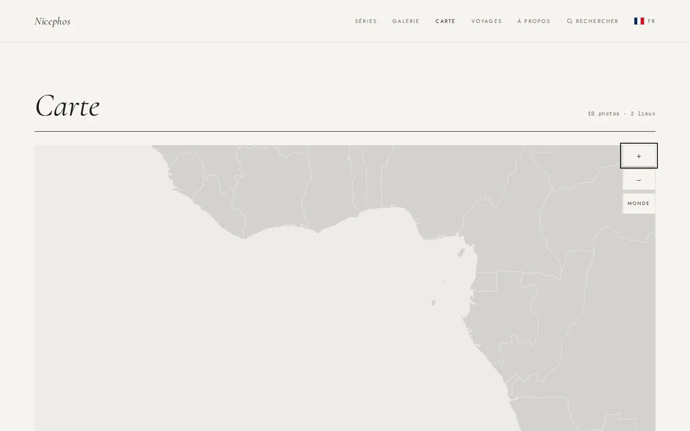

*Démo, /carte après trois zooms au clavier : le focus est sur une vignette sortie du cadre visible.*

**Recommandation.**

- Cadrer la vue initiale sur l'ensemble des lieux (15 % de marge), en gardant « Monde ».
- Écrire le nom de la ville à côté des vignettes quand il y a la place, avec le code de la mini-carte.
- Au clic sur une ville, zoomer et montrer ses photos dans un panneau (« Voir les 7 photos »), plutôt que sauter dans la page ; à défaut, « ↑ Retour à la carte » à chaque lieu de la liste.
- Quatre boutons de déplacement (ou les flèches quand la carte a le focus) ; recentrer la vue sur une vignette qui reçoit le focus hors du cadre.
- Une aide adaptée à l'appareil ; carte et voyages reliés (« Ce lieu dans le voyage Lisbonne et Porto ») ; sur la carte de voyage, tabindex et role="region" seulement quand le cadre défile.

### UX-F-26 — Recherche sans tolérance aux fautes ni aux pluriels ; zéro résultat et 404 sans piste

**Gravité :** moyen · **Effort :** M · **Impact :** moyen · **Vague :** 3 (V3-03)  
**Écran :** /recherche (bureau et mobile) ; page 404  
**Référentiels :** B&S 5.3 Correction des erreurs ; B&S 5.2 ; ISO 9241-110 Robustesse vis-à-vis des erreurs d'utilisation ; Nielsen #9 ; Opquast 225

**Constat.** « brume » trouve 2 photos, « brumes » aucune. « Lisbonne » en trouve 7, « lisbone » et « Lisboa » aucune. « lisbonne porto » n'en trouve aucune, alors que 11 photos contiennent l'un des deux mots : tous les mots sont exigés. La page sans résultat ne propose rien (aucun lien dans le contenu), la recherche vide n'offre aucun point de départ, alors que les mots-clés existent. La 404 dit avec justesse « Cette page n'existe pas, ou la photo a été retirée » mais ne propose que « Revenir à la galerie », sans recherche ni pied de page, et ses liens de langue mènent à une autre 404. La recherche elle-même est soignée : accents ignorés, début de mot suffisant, nombre de résultats annoncé, titre de page explicite.

**Preuve.** [captures/F-recherche-faute-sans-suggestion.webp](captures/F-recherche-faute-sans-suggestion.webp) (démo) ; ux-data/ergo-public/desktop/p4-9.json (p5.queries ; zero.suggestions = 0) ; server/search.js:43-50 (startsWith, terms.every) ; views/search.eta:21-23 ; views/notfound.eta.

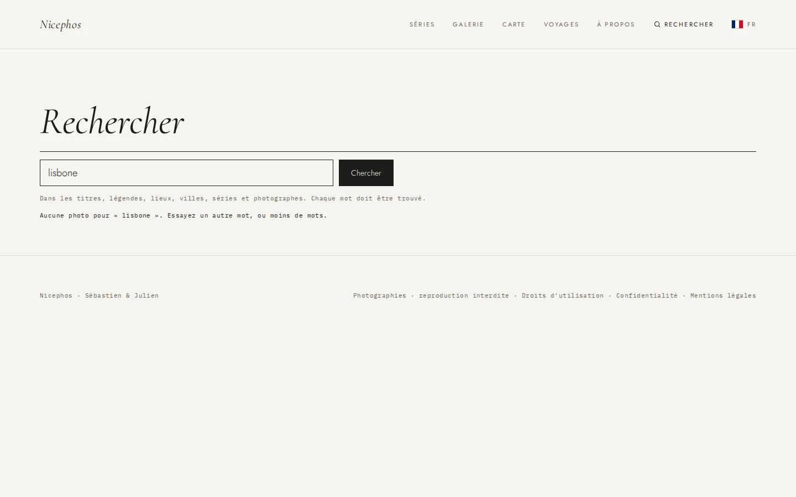

*Démo, /recherche?q=lisbone : aucun résultat, aucune suggestion, aucun lien.*

**Recommandation.**

- Pluriels : retirer le s ou le x final des deux côtés.
- Fautes : à zéro résultat, chercher le mot le plus proche du vocabulaire (titres, lieux, séries ; distance de Levenshtein de 1 à 2) et proposer « Vouliez-vous dire Lisbonne ? ».
- Plusieurs mots : si aucune photo ne les a tous, montrer celles qui en ont un, en le disant.
- Zéro résultat, recherche vide et 404 : « Essayez : brume, Lisbonne, portrait… », les séries en vignettes, un champ de recherche, le pied de page ; liens de langue vers l'accueil de la langue. Comme sur un mur d'exposition, il faut toujours une œuvre vers laquelle se tourner.

### UX-F-27 — Le quota anti-abus compte aussi les envois refusés, et bloque une heure, y compris sur une connexion partagée

**Gravité :** moyen · **Effort :** S · **Impact :** moyen · **Vague :** 0 (V0-11)  
**Écran :** /bonjour (8 envois par heure), /photo/…/signaler (5 par heure)  
**Référentiels :** RGPD art. 12.2 ; B&S 5.2 Qualité des messages d'erreur ; ISO 9241-110 Robustesse ; Opquast 80 ; Nielsen #9

**Constat.** Le limiteur est appelé avant la validation et compte chaque tentative, même rejetée. Une personne qui se trompe 8 fois de référence de carte ne peut plus ni refuser ni accepter pendant une heure, et le message « Trop de messages : réessayez dans une heure » est faux, puisque rien n'est parti ; il remplace en outre les erreurs de saisie, si bien qu'on ne sait plus ce qui manquait. Le compte se fait par adresse IP : j'ai été bloquée dès mon premier essai sur /signaler, comme le serait un visiteur sur le wifi d'un musée ou derrière le partage d'adresse d'un opérateur mobile. Les personnes qui se trompent le plus, notamment en situation de handicap moteur ou cognitif, sont les premières bloquées.

**Preuve.** ux-data/rgaa-front/clavier-scenarios.json (signaler.envoiVide : « Trop de messages ») ; ux-data/qualite-transverse/mesures/erreurs.json ; server/routes/public.js:439 et 480 (limite avant validation) ; server/ratelimit.js:33-37.

**Recommandation.** Ne décompter que les envois acceptés (appeler reportLimit et helloLimit après la validation), ou compter les échecs avec un seuil haut (30 par heure) ; garder le piège à robots. Afficher séparément les erreurs de saisie et le blocage, avec l'heure de reprise (« à partir de 15 h 40 ») et un recours : « Vous pouvez aussi écrire à info@nicephos.art » (mailto), pour qu'une demande sur ses données ne soit jamais bloquée.

### UX-F-28 — Dénominations ambiguës : « vues », « Galerie » et « Toutes les séries », « Fermer », « S » et « J », « 03 »

**Gravité :** moyen · **Effort :** S · **Impact :** moyen · **Vague :** 2 (V2-06)  
**Écran :** Accueil (en-tête de grille, vignettes, index des séries), visionneuse, Signaler, adresses partagées  
**Référentiels :** B&S 7 Signifiance des codes et dénominations ; B&S 6 Homogénéité ; Nielsen #2 ; ISO 9241-110 Autodescriptivité

**Constat.**

- « 44 / 44 vues » se lit comme un nombre de visites, alors qu'il compte les photos affichées (l'anglais dit « shown », l'allemand « angezeigt »).
- Le menu « Galerie » mène à une section titrée « Toutes les séries », tandis que « Séries » mène à l'index.
- « Sélection » (l'ordre choisi par vous) peut se comprendre comme « ma sélection ».
- « Fermer » porte une flèche de retour et ne dit pas où il mène.
- Dans les vignettes, l'auteur est réduit à « S » ou « J », et le nombre de photos d'une série à « 03 », sans unité.
- Sur Signaler, le lien « Je vous ai photographié » parle avec la voix du photographe, au milieu d'une phrase adressée au visiteur.
- Galerie, recherche et voyage n'affichent pas les mêmes informations sous les vignettes.
- En production, 11 photos titrées gardent une adresse tirée du nom de fichier (/photo/dsc7561-dxo pour « Depuis le Nick vers Cézembre »), visible dans « Lien de la photo » de la fenêtre Partager (voir UX-A-03).

**Preuve.** server/i18n.js:70 et 86-89 ; views/home.eta (p.author[0]) ; ux-data/ergo-public/desktop/p4-9.json (« 06 / 22 shown ») ; ux-data/INDEX.md, observation 9 (11 adresses tirées du nom de fichier).

**Recommandation.** « 43 photos sur 43 » (production, une fois le logo retiré : V0-05) ; en-tête de grille « Toutes les photos » ou menu « Photos » ; « Ordre : choisi par nous · plus récentes d'abord » ; « ← Galerie » ou « ← Rue, par Julien » au lieu de « Fermer » ; nom complet de l'auteur dans les vignettes ; « 3 photos » ; sur Signaler, « Vous êtes sur cette photo ? Recevez-la, ou donnez ou refusez votre accord » ; un même cartel partout (titre · série · auteur · lieu). Dans l'admin, proposer de régénérer l'adresse quand le titre provisoire est remplacé, avec une redirection 301 depuis l'ancienne.

### UX-F-29 — Lisibilité : textes de 11 px, titres longs en capitales espacées, Jost 300 sur noir, faux gras et faux italique

**Gravité :** moyen · **Effort :** S · **Impact :** moyen · **Vague :** 2 (V2-03)  
**Écran :** Accueil, visionneuse, pied de page, pages de texte (Mentions, Confidentialité, Droits), fenêtre Partager — thème nuit en production, Atelier en démo  
**Référentiels :** B&S 1.4 Lisibilité ; ISO 9241-110 Contrôlabilité ; ISO 9241-125 ; WCAG 2.2 1.4.8 (AAA) ; Opquast 180 et 192 ; Nielsen #8

**Constat.** Sur l'accueil, 76 éléments de texte sur 111 sont en 11 px : métadonnées en IBM Plex Mono, menu en capitales espacées, compteur, choix de l'ordre, pied de page. En production, tout est en Jost 300 sur fond noir : légendes à 15 px, titres de photos en capitales espacées de 0,22 em (« LE SILLON DE SAINT MALO À MARÉE HAUTE »), qui se déchiffrent mot à mot. Les pages de texte (4 000 px de juridique, formulaires de consentement) sont imposées en nuit, sans réglage automatique : les traits fins sur noir « bavent » pour les nombreux lecteurs astigmates. Leurs intertitres H2 sont en faux gras (Jost 700 n'est pas chargé) ; la fenêtre Partager impose un faux italique. En thème Atelier, le H1 en Cormorant à interlignage 1,02 fait toucher les accents de « même » et « goût » aux jambages de la ligne du dessus. Les contrastes sont bons (7,4:1 et plus) : ce sont la taille, la graisse et la casse qui fatiguent l'œil.

**Preuve.** ux-data/ergo-public/desktop/p123.json (p1.smallText : 76 éléments ≤ 11 px sur 111) ; ux-data/demo-front-mobile/ecran/a-propos.png ; public/css/site.css:5-13, 47-48, 225, 347 et 352 ; public/themes/nicephos.css:14-22, 38, 43, 59 et 63-64 ; server/themes.js:16-23 ; production décrite sans image (pages légales en faux gras).

**Recommandation.**

- Métadonnées à 12-13 px, menu à 12 px ; légendes à 16-17 px en graisse 400 sur noir.
- Titres de photos en casse normale dans la visionneuse et les vignettes ; capitales espacées réservées au logo, au menu et aux noms de séries, qui sont courts.
- .prose h2 en 500 (20 à 22 px) ; var(--display-style) au lieu de italic dans Partager ; interlignage de 1,1 à 1,15 pour les titres en Cormorant.
- Un thème « Nicephos — auto » : nuit pour l'accueil, les séries et la visionneuse ; jour ou nuit selon prefers-color-scheme pour les pages de texte et les formulaires, prose en 400.

### UX-F-30 — Index des séries : sur téléphone, on choisit une série sans en voir une seule image

**Gravité :** moyen · **Effort :** S · **Impact :** moyen · **Vague :** 1 (V1-08)  
**Écran :** Accueil, index des séries sous 900 px ; aperçu au seul survol sur bureau  
**Référentiels :** B&S 7 ; B&S 1.1 Incitation ; Nielsen #6 Reconnaître plutôt que se souvenir ; WCAG 2.2 2.1.1

**Constat.** L'aperçu des séries est masqué sous 900 px de large. Sur téléphone, l'index n'est qu'une liste de titres poétiques (en production : « Feel Good », « Anthropocène », « Pas la mer à boire », « Belles mécaniques »…) suivis d'un nombre comme « 04 » : ils ne disent pas ce qu'on va voir, il faut ouvrir chaque série pour le découvrir. Sur bureau, la couverture ne change qu'au survol de la souris, pas au focus clavier.

**Preuve.** public/css/site.css:154-155 ; public/js/site.js (aperçu sur mouseover seulement) ; ux-data/demo-front-mobile/accueil.png.

**Recommandation.** Sur téléphone, une couverture de 64 px (ou trois petites vignettes) à droite de chaque nom de série. Sur bureau, déclencher aussi l'aperçu au focus (focusin).

### UX-F-31 — Anglais et allemand : expressions traduites mot à mot, coquilles, deux tons dans le pied de page

**Gravité :** moyen · **Effort :** S · **Impact :** moyen · **Vague :** 2 (V2-04)  
**Écran :** /en/, /de/ et pages françaises en production (textes saisis dans l'admin) ; pied de page  
**Référentiels :** B&S 6 Homogénéité ; B&S 7 Signifiance ; Nielsen #4 Cohérence et standards ; ISO 9241-110 Conformité aux attentes

**Constat.** « Pas la mer à boire » devient « NOT THE SEA TO DRINK » et « NICHT DAS MEER ZUM TRINKEN » : le jeu de mots disparaît, il reste un non-sens pour un anglophone ou un germanophone. Sur /en/, l'ouverture mêle « Eclosion florale », « On the terrace in a game of shadows » et « Explosion étoilée ». Coquilles visibles : « Photosynthese », « énergetique », « Eclosion », « Saint Malo » et « Canal Saint Martin » sans trait d'union, « - » au lieu de « – », apostrophes droites, « California » enregistré comme ville. Pied de page : « reproduction interdite » en français, « all rights reserved » en anglais, deux tons.

**Preuve.** Production décrite sans image : prod-front-bureau/accueil-en.json et accueil-de.json (liens des séries, H1), photo-skyline-en.json, carte.json (lieux).

**Recommandation.** Adapter les noms de séries plutôt que les traduire (par exemple « By the Sea », « Am Meer » : c'est votre décision d'auteurs), ou garder l'original en italique avec un sous-titre ; faire relire par un anglophone et un germanophone. Une seule formule : « © 2026 Sébastien & Julien · tous droits réservés ». Traduire par séries entières (voir UX-A-21) et ajouter à la saisie une correction typographique (’, « », –, É, espaces fines), relue par le rôle Relecteur.

### UX-F-32 — La langue est choisie d'après le pays avant la préférence du navigateur ; des drapeaux pour des langues

**Gravité :** moyen · **Effort :** S · **Impact :** moyen · **Vague :** 1 (V1-15)  
**Écran :** Toute arrivée sur une adresse française sans cookie « langue » ; sélecteur de langue  
**Référentiels :** Opquast 135 ; ISO 9241-110 Conformité aux attentes ; B&S 4 Adaptabilité ; Nielsen #7

**Constat.** detectLang() regarde d'abord le pays (CF-IPCountry). Sur 7 combinaisons testées, 6 ignorent la langue du navigateur : une Française à Londres ou en Californie, navigateur en français, reçoit l'anglais ; un anglophone en France reste en français ; hors des pays prévus, tout le monde reçoit l'anglais. Le sélecteur s'appuie sur des drapeaux (Royaume-Uni pour l'anglais, Allemagne pour l'allemand), qui désignent des pays et non des langues : un passant autrichien ou américain ne s'y reconnaît pas.

**Preuve.** ux-data/qualite-transverse/mesures/detectLang.txt (FR+de→fr ; DE+en→de ; US+fr→en ; IT+de→en ; ES+fr→en ; GB+de→en ; XX+de→de) ; server/i18n.js:52-60 ; views/langs.eta:3-8.

**Recommandation.** Prendre d'abord la première langue prise en charge dans Accept-Language, le pays seulement pour départager ; le cookie reste prioritaire. Dans le sélecteur : « Français · English · Deutsch » en texte, le drapeau en simple décor ou supprimé ; de même dans l'app de terrain.

### UX-F-33 — Le récit n'est pas raconté : À propos centré sur le matériel, Voyages fermé, nom et rhinocéros inexpliqués

**Gravité :** moyen · **Effort :** S · **Impact :** fort · **Vague :** 2 (V2-02)  
**Écran :** Production : /a-propos, /voyages (404), /droits ; démo : /voyage/lisbonne-et-porto  
**Référentiels :** Opquast 99 et 101 ; Nielsen #2 ; Règle du pic et de la fin ; B&S 1.1 Incitation

**Constat.** Sur À propos, la biographie de Sébastien parle surtout d'appareils (D50, D70, D200, Z5 II) et celle de Julien est vide ; il n'y a pas de portrait ; on lit « Ce site a été initié en octobre 2026 ». Ni le nom « Nicephos » ni le rhinocéros ne sont expliqués, et le logo occupe environ 480 px avant le premier mot. La page Voyages, la forme la plus aboutie du site sur la démo (récit jour par jour, itinéraire, « Sébastien a cherché la mer, Julien les gens »), répond 404 en production : le meilleur outil de récit du site est fermé. La « Mesure d'audience » est rangée dans Droits d'utilisation au lieu de Confidentialité.

**Preuve.** Production décrite sans image (a-propos, voyages.json : HTTP 404) ; démo : ux-data/direction-artistique/demo-voyage-0.png ; views/rights.eta:15-16 ; server/rights.js:17-18.

**Recommandation.** À propos en trois temps. Nous : deux portraits croisés, deux biographies de même longueur, ce qui vous fait déclencher plutôt que vos boîtiers. Notre démarche : les deux regards. Le nom et l'animal : deux phrases. Ouvrir Voyages, même avec un seul voyage, comme base des futurs « Carnets ». Déplacer la mesure d'audience vers Confidentialité.

### UX-F-34 — Un ton défensif et aucun moyen de vous suivre : clic droit bloqué, « reproduction interdite » partout, ni Instagram ni RSS

**Gravité :** moyen · **Effort :** S · **Impact :** moyen · **Vague :** 0 (V0-18, V2-01, V2-02)  
**Écran :** Pied de page de toutes les pages, toutes les images, À propos, Droits d'utilisation  
**Référentiels :** Opquast 238 Menu contextuel non bloqué ; Opquast 1 Nouveaux contenus ; B&S 3 Contrôle explicite ; Nielsen #3

**Constat.** site.js annule le menu contextuel et le glisser sur toute image, et site.css coupe l'appui long d'iOS et la sélection. Cela n'empêche aucune capture d'écran, mais le visiteur perd « Ouvrir dans un onglet » (le zoom des malvoyants), la recherche visuelle, la traduction et le partage natif ; votre propre étude des galeries privées écarte d'ailleurs ce blocage, jugé inefficace. Le pied de page dit « reproduction interdite » sur chaque page ; la page Droits ne parle que d'interdiction et de licence, jamais de tirage. Rien n'invite à revenir : pas de lien vers votre compte Instagram (pourtant connu de l'admin), pas de flux RSS, pas de lettre ; le seul lien Instagram est caché dans la fenêtre Partager et compté comme un partage.

**Preuve.** public/js/site.js:15-16 ; public/css/site.css:41 ; server/i18n.js:79 ; views/footer.eta ; server/rights.js:9-15 ; views/\_share.eta:15 ; server/instagram.js:220-225 ; docs/etudes/blog-galeries-boutique.md (« Écarté : blocage du clic droit… »).

**Recommandation.** Retirer le blocage du clic droit et de l'appui long : votre protection est déjà la bonne (variantes réduites, filigrane, droits, IPTC, preuves). Pied de page : « © 2026 Sébastien & Julien · Tirages et licences · Contact · Instagram · Flux RSS ». Renommer la page « Droits, tirages et licences » et commencer par ce qui est possible (partager le lien, demander une licence, acquérir un tirage) avant les interdictions. Un flux RSS des nouvelles photos et des carnets ; une lettre facultative « une par saison », double confirmation, désinscription en un clic.

### UX-F-35 — Aucun style d'impression : en thème nuit, le texte imprimé est presque blanc sur blanc

**Gravité :** moyen · **Effort :** S · **Impact :** moyen · **Vague :** 2 (V2-08)  
**Écran :** Ctrl+P sur /photo/…, /voyage/…, /mentions-legales, /confidentialite, accueil — thèmes Atelier et nuit  
**Référentiels :** Opquast 195 et 196 ; WCAG 2.2 1.4.3 (sur papier) ; RGESN 4.8 ; B&S 1.4 Lisibilité

**Constat.** site.css n'a aucune règle @media print. Dans Chromium (A4, fonds non imprimés, réglage par défaut) : le menu, les drapeaux, J'aime, Partager et les flèches s'impriment ; l'accueil prend 8 pages et un voyage 5 ; l'image de tête d'un voyage disparaît et son titre clair sort gris pâle. En thème nuit, la prose #cfcdc7 tombe à 1,59:1 sur le papier, les titres #f0efeb à 1,15:1. Aucune ligne de crédit ni adresse n'est imprimée, ce qui gêne un collectionneur ou un journaliste qui imprime une photo pour la proposer.

**Preuve.** [captures/F-impression-sans-feuille-print.webp](captures/F-impression-sans-feuille-print.webp) (démo : voyage avec et sans fonds, Confidentialité et page photo en thème nuit) ; ux-data/qualite-transverse/mesures/print-\*.pdf ; aucune règle @media print dans public/css/site.css ni public/themes/nicephos.css.

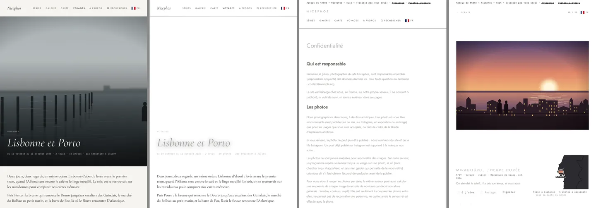

*Démo, aperçu d'impression (A4, fonds non imprimés) : voyage avec et sans fonds, puis Confidentialité et page photo en thème nuit — texte presque blanc sur blanc.*

**Recommandation.** Une feuille d'impression : texte #111 sur blanc quel que soit le thème ; navigation, langue, J'aime, Partager, Signaler, flèches, mini-carte et diaporama masqués. Page photo : l'image sur toute la largeur (80 % de la hauteur de page au plus) et un cartel « Titre — Julien — lieu, date — © Nicephos, reproduction interdite — adresse de la page ». Pages de texte : l'adresse après chaque lien externe. Voyages en blocs insécables par jour. Ces styles serviront aux carnets et aux confirmations de commande.

### UX-F-36 — Téléphone : cibles de 14 à 37 px sur des gestes fréquents, en-tête de 187 px, bords sûrs ignorés

**Gravité :** moyen · **Effort :** S · **Impact :** moyen · **Vague :** 1 (V1-17)  
**Écran :** Pixel 7 : accueil, page photo, /bonjour, voyage ; iPhone en paysage  
**Référentiels :** WCAG 2.2 2.5.8 ; WCAG 2.5.5 (AAA) ; Opquast 186 ; Loi de Fitts ; ISO 9241-110 Adéquation aux tâches

**Constat.** 19 cibles sur 55 font moins de 44 px à l'accueil, 11 sur 36 sur /bonjour, 14 sur 28 sur un voyage. Plusieurs sont des actions isolées, hors de l'exception « dans le texte » : « Signaler » 68 × 21, « Voir la photo » 108 × 21, « ← Tous les voyages » 152 × 16, liens du pied de page de 14 px de haut, loupe 32 × 34, liens du menu 37 px, étapes d'un voyage 120 × 31. Aucune n'est sous 24 px en conflit avec une voisine (le critère AA reste conforme), mais le pouce rate. L'en-tête des pages intérieures fait 187 px. Avec viewport-fit=cover, seuls le haut et le bas sont protégés : en paysage, la marge (5vw, environ 43 px) est plus petite que la zone de l'îlot dynamique (environ 59 px).

**Preuve.** ux-data/ergo-public/mesures.json (targets) ; ux-data/qualite-transverse/mesures/mesures.json (small44, headerH = 187) ; views/layout.eta:8 ; public/css/site.css:46, 186 et 216.

**Recommandation.** min-height: 44px (par padding-block) sur les liens du menu et du pied de page, « Signaler », « Voir la photo », l'auteur, les retours et la loupe ; étapes : cercle et étiquette dans une même zone active. Pied de page en liste verticale sur téléphone. En-tête compact sur une ligne (marque, loupe, « FR » à droite), menu en rangée défilante ou derrière un bouton « Menu ». padding-inline: max(var(--gut), env(safe-area-inset-left)) et son pendant à droite.

### UX-F-37 — Police Cormorant italique préchargée sur toutes les pages, inutilisée par le thème de production

**Gravité :** moyen · **Effort :** S · **Impact :** moyen · **Vague :** 0 (V0-17)  
**Écran :** Toutes les pages publiques, thème « Nicephos — nuit » (production)  
**Référentiels :** RGESN 6.5 ; RGESN 4.8 ; Opquast 180

**Constat.** layout.eta précharge cormorant-garamond-latin-400-italic.woff2 en tête de chaque page, en priorité haute, avant les photos. Le thème de production n'emploie que Jost 300 et 400 et IBM Plex Mono 400 : ces 23,6 ko sont téléchargés pour rien à chaque première visite (41 % des polices de l'accueil) et concurrencent l'image principale. Le thème Atelier de la démo, lui, l'emploie.

**Preuve.** views/layout.eta:34 ; public/themes/nicephos.css:6-7 ; production : polices chargées relevées par la sonde (prod-front-bureau/accueil.rgesn-first.json : Jost et IBM Plex Mono seulement ; Cormorant de 23 960 o initiée par le préchargement).

**Recommandation.** Faire déclarer à chaque thème ses polices à précharger (server/themes.js) et n'émettre le préchargement que pour celles-ci ; à défaut, retirer le préchargement (font-display: swap suffit). Gardez la Plex Mono : ce sont ses cartels qui donnent aux légendes leur ton de galerie.

### UX-F-38 — Système de marque : trois rhinocéros différents, un nom écrit deux fois, un emblème de 93 ko pour 44 px

**Gravité :** moyen · **Effort :** S · **Impact :** moyen · **Vague :** 2 (V2-07)  
**Écran :** En-tête de toutes les pages (bureau, production), À propos, filigrane ; en-tête de l'admin  
**Référentiels :** Opquast 180 ; Opquast 119 ; RGESN 6.4 ; RGESN 5.1 ; B&S 1.4 Lisibilité

**Constat.** L'emblème de l'en-tête contient le rhinocéros, un appareil sur trépied et « NICEPHOS PHOTOGRAPHY GALLERY » en lettres d'environ 5 px, illisibles, à côté du mot « NICEPHOS » : le nom apparaît deux fois. Le rhinocéros existe en trois dessins (en-tête avec trépied, logo sans trépied, icône épaisse sur mobile). L'emblème est un PNG de 1 600 px (93,5 ko) pour 44 px de haut ; avec le logotype d'À propos (27,9 ko), les PNG de marque font 42 % du poids d'une première visite sur une page de texte. Le sous-titre « PHOTOGRAPHY GALLERY » laisse croire à une galerie commerciale.

**Preuve.** Production décrite sans image : prod-front-bureau/a-propos.json (embleme 93 542 o ; logotype 27 920 o) ; prod-front-mobile/a-propos.json (icone 11 031 o) ; server/brand.js:56 ; public/css/site.css:53-65.

**Recommandation.** Une charte en quatre points : l'emblème = le rhinocéros seul, au trait épaissi pour 32 à 44 px, sans texte ; le mot « NICEPHOS » en Jost 300 ; le logo complet réservé à À propos et aux documents (certificats, factures) ; un sous-titre traduit, ou « Sébastien & Julien ». Vectoriser le trait une fois (SVG de quelques ko) ou produire le masque à 2 fois la taille affichée ; garder le grand fichier pour le filigrane et l'image de partage. Gain : environ −88 ko par première visite sur bureau.

### UX-F-39 — « 0 j'aime » affiché sous presque toutes les photos

**Gravité :** mineur · **Effort :** S · **Impact :** faible · **Vague :** 0 (V0-18)  
**Écran :** Visionneuse /photo/… (production)  
**Référentiels :** Nielsen #8 ; B&S 2.1.1 Concision ; ISO 9241-110 Engagement de l'utilisateur

**Constat.** Le compteur s'affiche même à zéro : toutes les pages photo capturées en production montrent « 0 j'aime ». Dans une galerie, un zéro affiché veut dire « personne n'a aimé » : il décourage plus qu'il n'invite. Si l'envoi échoue, le cœur s'annule sans un mot.

**Preuve.** [captures/F-visionneuse-mobile-photo-27pc.webp](captures/F-visionneuse-mobile-photo-27pc.webp) (démo : « 0 j'aime ») ; views/photo.eta (data-like-n) ; ux-data/qualite-transverse/mesures/mesures.json.

**Recommandation.** « J'aime » seul tant que le compteur est sous un seuil (3 par exemple), ou aucun compteur public, le nombre restant dans vos statistiques. En cas d'échec, « Réessayez plus tard » dans la région live.

### UX-F-40 — En réseau lent : aplats noirs sans réserve, menu qui se réorganise à l'arrivée de la police

**Gravité :** mineur · **Effort :** S · **Impact :** faible · **Vague :** 3 (V3-10)  
**Écran :** Page photo, accueil et carte à 400 kbit/s (Pixel 7)  
**Référentiels :** Nielsen #1 ; B&S 1.3 Feedback immédiat ; RGESN 2.3

**Constat.** Sur une connexion lente, la photo reste un aplat noir jusqu'à 3 s, la mini-carte n'a son relief qu'à 12 s, les vignettes de l'ouverture restent des cadres vides jusqu'à 6 à 12 s. À l'arrivée de Jost, le menu mobile change de mise en page (la loupe passe de la troisième à la deuxième ligne).

**Preuve.** ux-data/qualite-transverse/mesures/lent-planche.webp et mesures.json (lent).

**Recommandation.** Poser en fond de chaque image sa couleur dominante, calculée à l'import par sharp et stockée, comme un tirage qui monte dans le révélateur. Ajouter size-adjust et ascent-override à la police de repli de Jost.

### UX-F-41 — Petites non-conformités du site public à corriger en une passe

**Gravité :** mineur · **Effort :** S · **Impact :** faible · **Vague :** 1 (V1-16)  
**Écran :** Fenêtre et page Partager, figures légendées, listes, page photo, thème Atelier, voyages  
**Référentiels :** RGAA 1.1 ; RGAA 1.9 ; RGAA 7.5 ; RGAA 8.2 ; RGAA 8.9 ; RGAA 9.3 ; WCAG 2.2 4.1.3 ; Opquast 189 et 231

**Constat.**

- 1.1 : le QR code de partage est un &lt;svg> sans role="img", sans nom et sans aria-hidden, alors que le texte voisin (« Scannez pour l'ouvrir… ») en fait une image porteuse d'information.
- 7.5 : « ✓ Lien copié » ne change que le texte du bouton ; aucune région d'état n'annonce la copie.
- 1.9 : quatre &lt;figure> (photo offerte, carte du monde, mini-carte, carte de voyage) sans role ni aria-label reprenant la légende.
- 9.3 : menu, index des séries, choix du regard, grilles et pied de page sont des listes visuelles sans &lt;ul>, alors que « À proximité » et les lieux le sont.
- 8.2 : deux erreurs html-validate sur 20 pages, toutes deux sur la page photo (&lt;details> dans un &lt;span>, &lt;img data-src> sans src).
- 8.9 : &lt;i> décoratif dans le logo texte du thème Atelier.
- Aucun &lt;time> sur 21 pages (dates de voyage, « Mise à jour : 15 octobre 2026 ») ; « ← » lu « flèche vers la gauche » dans « ← Tous les voyages ».

**Preuve.** ux-data/rgaa-front/html/\*.html et .htmlvalidate.json ; ux-data/rgaa-front/clavier-scenarios.json (partage.copier : regionsEtat 0) ; views/\_share.eta:17-19 ; server/share.js:26 ; views/gift.eta:14 ; views/carte.eta:15 ; views/photo.eta:7 et 28 ; views/trip.eta:22 et 56 ; views/brand.eta:7.

**Recommandation.** QR : &lt;span class="qr" role="img" aria-label="QR code vers cette photo">, le svg en aria-hidden. Un &lt;p class="sr-only" role="status"> dans la fenêtre Partager, rempli de « Lien copié » puis vidé. role="group" et aria-label sur les quatre figures. &lt;ul role="list"> pour ces ensembles (le style ne change pas). &lt;div class="vh-end"> ; l'&lt;img> de partage créée au premier affichage. &lt;span class="brand-last"> stylé en italique. &lt;time datetime>. Flèches dans un span aria-hidden.

### UX-F-42 — Ce qui part sur les réseaux : description collée, auteur absent

**Gravité :** mineur · **Effort :** S · **Impact :** faible · **Vague :** 0 (V0-18)  
**Écran :** Métadonnées de /photo/… (og:title, og:description) et texte des liens de partage  
**Référentiels :** Opquast 3 et 103 ; Nielsen #4

**Constat.** La description de la page photo colle la légende et l'auteur sans ponctuation (« Longue exposition de 30 sec au Nikon Z 7ii + 24-120 f4 Julien, Saint Malo, France, oct. 2026 »). Le texte partagé (WhatsApp, Bluesky, X, Pinterest, e-mail) et le titre de la page sont « Le Sillon de Saint Malo à marée haute · Nicephos » : le nom du photographe n'y figure pas, sur un site qui réunit deux auteurs.

**Preuve.** Production décrite sans image : prod-front-bureau/photo-sillon-saint-malo.json (metas) ; server/routes/public.js:255-257 et 390.

**Recommandation.** Titre et texte partagé : « Le Sillon de Saint-Malo à marée haute — Julien · Nicephos ». Description : « Légende. Photo de Julien, Saint-Malo, octobre 2026. » (un point après la légende s'il manque).

### UX-F-43 — Ni information sur l'empreinte ni mode sobre pour le visiteur

**Gravité :** mineur · **Effort :** S · **Impact :** faible · **Vague :** 2 (V2-09)  
**Écran :** Toutes les pages publiques  
**Référentiels :** RGESN 4.15

**Constat.** Le visiteur ne sait pas ce que pèse sa visite et ne peut pas l'alléger. Le site respecte déjà le mouvement réduit (le diaporama s'arrête), mais ignore l'en-tête Save-Data et navigator.connection.saveData. Aucune page n'explique vos choix de sobriété, pourtant nombreux et réels.

**Preuve.** Aucune occurrence de save-data, saveData ou prefers-reduced-data dans server/, views/ et public/ ; public/js/site.js:3.

**Recommandation.** Un mode sobre automatique quand le navigateur demande l'économie de données : pas de diaporama, images plafonnées à 1 280 px, carte chargée au clic. Une ligne dans À propos ou le pied de page : « Une page de ce site pèse en moyenne X ko ; voici comment il est fait », liée à la déclaration (UX-T-10). Pas de bouton de plus : ici, le geste juste est discret.

### UX-F-44 — De vraies descriptions des photos pour les personnes aveugles, à partir des suggestions Florence-2

**Gravité :** suggestion · **Effort :** M · **Impact :** moyen · **Vague :** 3 (V3-01)  
**Écran :** Fiche photo de l'admin (description suggérée) → page photo publique  
**Référentiels :** RGAA 1.3 ; WCAG 2.2 1.1.1

**Constat.** Aujourd'hui, l'alternative de chaque photo est son titre, lu juste avant comme H1 : une personne aveugle entend deux fois « Une affaire de gouttes » sans savoir ce que montre l'image. Or l'admin calcule déjà une « description suggérée » et ne s'en sert que comme amorce de légende. Pour un site de photographie, l'audiodescription de l'image est le contenu lui-même.

**Preuve.** server/picture.js:7 (alt = titre par défaut) ; views/admin/photo.eta:69-71 (« Description suggérée », « Reprendre comme légende ») ; ux-data/rgaa-front/aria/photo.txt (image et titre au même texte).

**Recommandation.** Un champ « Ce que montre la photo (pour les personnes aveugles) » en trois langues, prérempli par la suggestion et relu par vous : une à deux phrases, avec la lumière, le cadrage et ce qui se passe. Le servir en alt et garder le titre en H1. Le bouton « Reprendre comme description » est le même geste que celui qui existe déjà.

### UX-F-45 — « Deux regards » : mettre en scène le concept le plus fort du site

**Gravité :** suggestion · **Effort :** M · **Impact :** fort · **Vague :** 3 (V3-02)  
**Écran :** Accueil (section des regards, Sélection), voyages, pages Photographe  
**Référentiels :** Effet de Von Restorff ; Loi de Prägnanz ; Nielsen #2 ; parangonnage webbnorriswebb.co

**Constat.** Le nom du dépôt, l'accroche et le filtre parlent de regards ; le voyage de la démo dit « Sébastien a cherché la mer, Julien les gens ». Mais rien ne montre deux regards sur un même sujet : la Sélection de production enchaîne dix photos de Sébastien puis seize de Julien, et l'auteur n'est indiqué dans la grille que par une initiale de 11 px. Vous avez pourtant des lieux en commun (Saint-Malo, Paris ; Lisbonne et Porto sur la démo).

**Preuve.** Production décrite sans image : prod-front-bureau/accueil.json (N°01 à 10 Sébastien, N°11 à 26 Julien) ; views/home.eta:64 ; ux-data/direction-artistique/maquettes/accueil-promesse.html (section diptyque).

**Recommandation.** Des diptyques « même lieu, deux regards » : une section de l'accueil et un type de carnet. Des monogrammes S et J dessinés, comme A.W. et R.N.W. chez Webb & Norris Webb, utilisés dans la grille et sur les certificats. Une Sélection qui alterne les regards.

### UX-F-46 — « Votre photo » : un beau geste, à prolonger sans insister

**Gravité :** suggestion · **Effort :** S · **Impact :** moyen · **Vague :** 3 (V3-10)  
**Écran :** /pour-vous/:jeton (démo, bureau 1440 × 900)  
**Référentiels :** Règle du pic et de la fin ; Nielsen #1 ; RGESN 4.14

**Constat.** La page cadeau est l'un des plus beaux moments de la marque (« Merci pour ce moment. Voici votre photo, rien que pour vous. »). Mais sur 1 440 × 900, la photo verticale repousse « Télécharger la photo » et la date de validité sous la ligne de flottaison ; le nom du photographe n'est pas lisible au-dessus du pli ; et la page ne propose rien après.

**Preuve.** ux-data/demo-front-bureau/ecran/pour-vous-cadeau.png ; views/gift.eta:13-22.

**Recommandation.** Sur ordinateur, deux colonnes : la photo à gauche ; à droite le bouton de téléchargement, la date de validité et une signature lisible (« Photo de Julien, Lisbonne, 10 octobre 2026 »). En bas, une ligne : « Voir les autres photos de ce jour » et, plus tard, « Recevoir un tirage ». Aucune inscription demandée.

## Constats — administration et app de terrain (UX-A)

### UX-A-01 — App de terrain : un accord signé peut être perdu (champ oublié, réseau coupé, session expirée)

**Gravité :** critique · **Effort :** M · **Impact :** fort · **Vague :** 0 (V0-03, V1-03)  
**Écran :** /admin/rencontre sur téléphone (Pixel 7), bouton « Enregistrer »  
**Référentiels :** WCAG 2.2 3.3.7 Saisie redondante (A) ; WCAG 3.3.1 ; RGAA 11.10 ; B&S 5.1, 5.2 et 5.3 ; ISO 9241-110 Robustesse vis-à-vis des erreurs d'utilisation ; Opquast 172 et 224 ; Nielsen #9

**Constat.** J'ai rejoué le scénario tel qu'il arrive dans la rue. La personne passe l'écran en anglais, coche « I agree », le site et Instagram, donne son nom et son e-mail, signe, mais oublie l'âge. Rien n'est vérifié avant l'envoi. Le serveur renvoie la page défilée en haut, avec « Indiquez si la personne est majeure. » en français, loin des boutons d'âge, qui ne sont pas marqués (aucun aria-invalid ; focus sur body). La signature est effacée (values: { ...body, signature: '' }) et la photo de repère perdue : il faut refaire signer et reprendre la photo, 20 gestes au lieu de 15, devant une inconnue.

Second risque : l'envoi part en une seule requête (photo jusqu'à 15 Mo non réduite, signature, champs), sans progression, ni nouvel essai, ni brouillon (« Rien n'est gardé sur le téléphone »). Si le réseau coupe, ou si la session a expiré (8 h d'inactivité, jamais annoncé), l'accord est perdu. Un envoi sans session affiche au photographe un JSON brut, {"error":"Session expirée, reconnectez-vous."} ; un jeton périmé, le texte « Jeton CSRF invalide. ».

Je le classe critique : c'est la preuve du consentement qui disparaît.

**Preuve.** [captures/A-app-terrain-erreur-apres-signature.webp](captures/A-app-terrain-erreur-apres-signature.webp) (démo, retour après l'erreur : message en tête, loin des champs) ; ux-data/ergo-admin/captures/J3-mobile.json (signature conservée : false ; photo de repère conservée : false) ; ux-data/rgaa-admin/t11-app.json (invalid [], focus BODY) ; ux-data/qualite-transverse/mesures/app-terrain-session-expiree.txt ; server/routes/rencontres.js:188-222 ; public/admin/app.js:12 ; server/sessions.js:3-5.

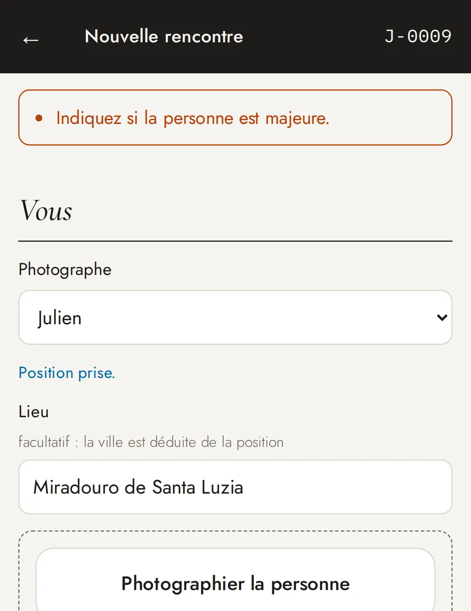

*Démo, app de terrain sur téléphone, après l'envoi : un message en tête, en français ; la signature et la photo de repère sont à refaire.*

**Recommandation.**

- Vérifier dans le navigateur avant l'envoi : avec un accord, au moins un usage, le nom, l'âge et la signature. Messages à côté des champs, dans la langue choisie par la personne, défilement jusqu'au premier champ en défaut, aria-invalid et aria-describedby.
- Ne jamais perdre la signature (le serveur la renvoie dans un champ caché, le data:image/png existe déjà) ni la photo de repère (fichier temporaire côté serveur, aperçu et « Reprendre »).
- Réduire la photo dans le navigateur (1 600 px, JPEG d'environ 300 ko), envoyer avec une barre de progression et « Réessayer », garder un brouillon local (IndexedDB) jusqu'à l'accusé du serveur, puis l'effacer ; l'écrire dans Confidentialité.
- Sur 401 ou 403 : une page HTML qui garde la saisie et propose de se reconnecter dans un nouvel onglet. Sur l'accueil de l'app : « Connecté jusqu'à 14 h 20 ».

### UX-A-02 — Une seule touche publie la sélection, sans moyen de couper les raccourcis

**Gravité :** majeur · **Effort :** S · **Impact :** fort · **Vague :** 0 (V0-12)  
**Écran :** Photothèque /admin/photos (planche et liste), bureau ; focus sur une case à cocher de vignette  
**Référentiels :** RGAA 12.10 ; WCAG 2.2 2.1.4 Raccourcis clavier (A) ; B&S 3.1 Actions explicites ; B&S 5.1 ; ISO 9241-110 Contrôlabilité ; Nielsen #5

**Constat.** P (publier la sélection), I (ouvrir l'import et le sélecteur de fichiers), L et Espace (loupe) sont actifs dès que le focus n'est pas dans un champ texte, case à cocher comprise. Test : focus sur la case de « Pont Dom-Luís, le soir », photo proposée qui attendait d'être validée, Espace puis P. Résultat : POST /admin/photos/actions {"ids":[23],"action":"publish"}, page rechargée, photo en ligne. Aucune confirmation, même quand la sélection contient des titres provisoires ; seul un message « Annuler » de 10 s suit, inatteignable au clavier (UX-A-08). Aucun réglage ne permet de couper ou de changer ces touches : une frappe égarée ou un logiciel de dictée publie une photo.

**Preuve.** [captures/A-touche-p-photo-publiee.webp](captures/A-touche-p-photo-publiee.webp) (démo, copie privée : « 1 photo publiée. Annuler ») ; ux-data/rgaa-admin/t2-phototheque.json (keyP) ; outils/rgaa-admin/t17-touche-i.mjs ; public/admin/admin.js:1545-1565 ; views/admin/photos.eta:133-139.

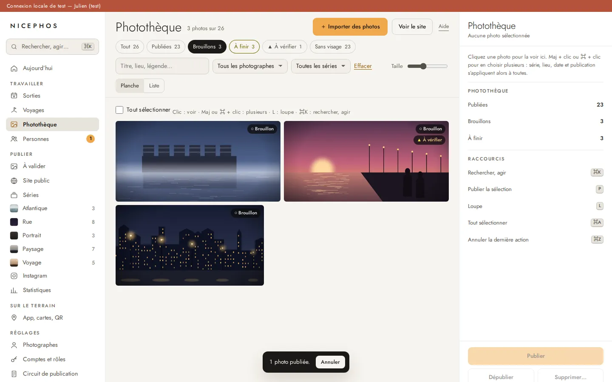

*Démo (copie privée) : la photo en attente de validation a été publiée par la seule touche P ; il reste 10 s pour « Annuler ».*

**Recommandation.** Passer les raccourcis d'action sur une combinaison (Maj+P, Maj+I), ou n'activer P, L et Espace que lorsque le focus est sur une vignette. Un interrupteur « Raccourcis d'une touche » dans « Mon compte ». Une confirmation pour P quand la sélection contient un titre provisoire ou plus de 10 photos. Garder ⌘K, ⌘A et ⌘Z, qui ont déjà une touche de modification, et mettre à jour la liste des raccourcis de l'inspecteur.

### UX-A-03 — Titres provisoires publiés sans garde-fou par quatre chemins

**Gravité :** majeur · **Effort :** S · **Impact :** fort · **Vague :** 1 (V1-11)  
**Écran :** Inspecteur (« Proposer à la publication »), /admin/a-valider, /admin/voyages/:id (« Publier les photos prêtes »), touche P  
**Référentiels :** B&S 5.1 Protection contre les erreurs ; B&S 1.3 ; ISO 9241-110 Robustesse ; Nielsen #5

**Constat.** La recommandation F-m06 du 10 octobre n'est suivie qu'en partie : le lot signale bien « Titre provisoire (nom du fichier) », mais quatre chemins le contournent.

- « Proposer à la publication » accepte des photos titrées R0004012 et R0004057 sans alerte.
- « À valider » les présente avec « Site : prête », sans mention du titre provisoire, et « Valider les photos cochées » les a publiées (vérifié en base : photos 24 et 26).
- « Publier les photos prêtes · 8 » d'un voyage publie en un clic, sans liste : « prête » n'y vérifie que les accords.
- La touche P publie la sélection sans confirmation (choix assumé dans le code).

En production, 11 photos ont une adresse tirée du nom de fichier (/photo/dsc7561-dxo…) : c'est la trace de ce circuit, puisque l'adresse se fige à la publication.

**Preuve.** [captures/A-a-valider-titres-provisoires.webp](captures/A-a-valider-titres-provisoires.webp) (démo) ; ux-data/ergo-admin/captures/J4.json (« 5 photos publiées ») et J1b-sebastien.json ; server/routes/voyages.js:62 (readyDrafts) ; public/admin/admin.js:721-722 et 1557 ; ux-data/INDEX.md, observation 9.

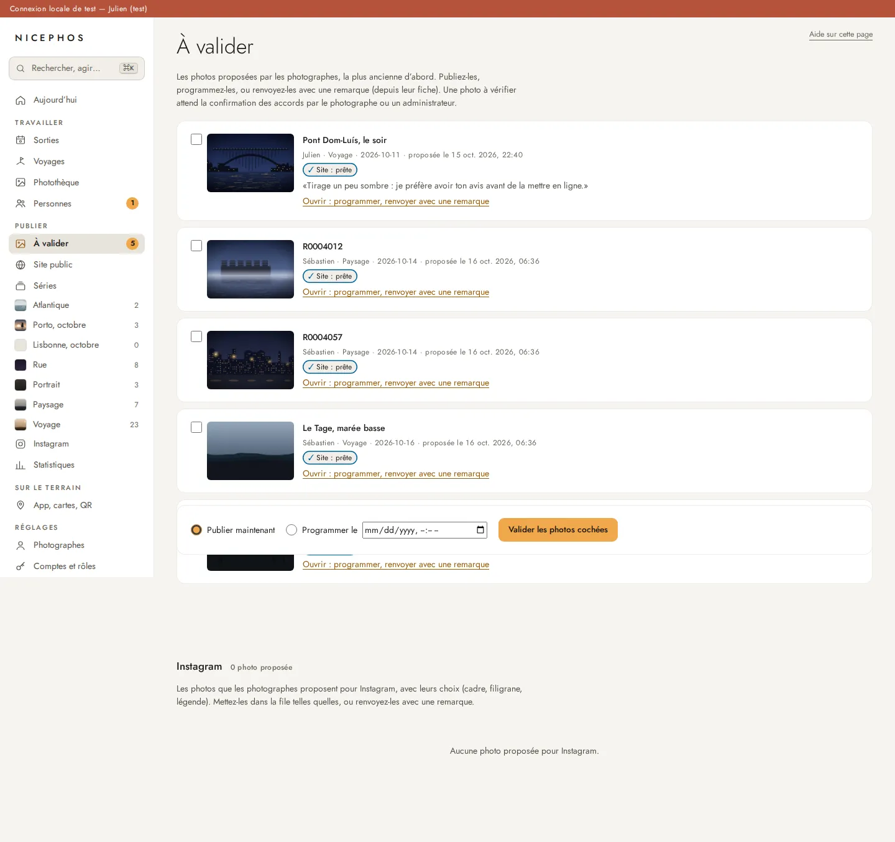

*Démo, À valider : R0004012 et R0004057 apparaissent « Site : prête », sans mention du titre provisoire.*

**Recommandation.** L'étiquette « Titre provisoire » partout où une photo apparaît (À valider, voyage, inspecteur multiple, Aujourd'hui). Quand on propose, valide ou publie un ensemble qui en contient, une étape « 2 titres provisoires : les corriger ici », avec les champs sur place et « Publier quand même » en bouton secondaire. Exclure les titres provisoires de « Publier les photos prêtes ». Pour une photo publiée depuis moins de 24 h dont le titre change, proposer de mettre à jour l'adresse, avec redirection de l'ancienne.

### UX-A-04 — Rôle Photographe : aucun moyen de proposer depuis le lot, et des boutons « Publier » qui mènent à une page 403

**Gravité :** majeur · **Effort :** S · **Impact :** fort · **Vague :** 0 (V0-14)  
**Écran :** /admin/photos/lot?ids=… (Compléter et publier) et Aujourd'hui (bloc « À finir »), compte au rôle Photographe, bureau  
**Référentiels :** B&S 1.1 Incitation ; B&S 8 Compatibilité ; B&S 5.1 ; ISO 9241-110 Adéquation aux tâches ; ISO 9241-110 Conformité aux attentes ; Nielsen #4 et #9

**Constat.** Le résumé d'import propose « Compléter et publier les 5 photos → » et la page s'intitule « Compléter et publier » (étape 3). Elle n'offre pourtant ni Publier (masqué pour ce rôle) ni Proposer : après 11 actions, le lot est complet mais reste en brouillon, sans issue. Pour proposer, il faut revenir à la Photothèque, filtrer « Brouillons », sélectionner par clic puis Maj-clic et cliquer « Proposer à la publication » : 5 actions et 5 écrans de plus (16 au total). Le lot n'étant pas isolable, deux anciennes photos à titre provisoire se sont glissées dans ma sélection et sont parties en proposition. Sur Aujourd'hui, les boutons « Publier » du bloc « À finir » renvoient une erreur 403, sur une page « Accès refusé » au thème du site public dont la seule sortie est « Revenir au site ». Dans le menu de ce rôle, le groupe « Publier » ne contient aucun lien.

**Preuve.** [captures/A-photographe-lot-sans-issue.webp](captures/A-photographe-lot-sans-issue.webp) ; [captures/A-photographe-acces-refuse-403.webp](captures/A-photographe-acces-refuse-403.webp) (démo, copie privée) ; ux-data/ergo-admin/captures/J1-sebastien.json, J1b-sebastien.json ; views/admin/batch.eta:40 ; views/admin/home.eta:55-60 ; public/admin/admin.js:531 ; views/admin/\_import.eta:14 et 36.

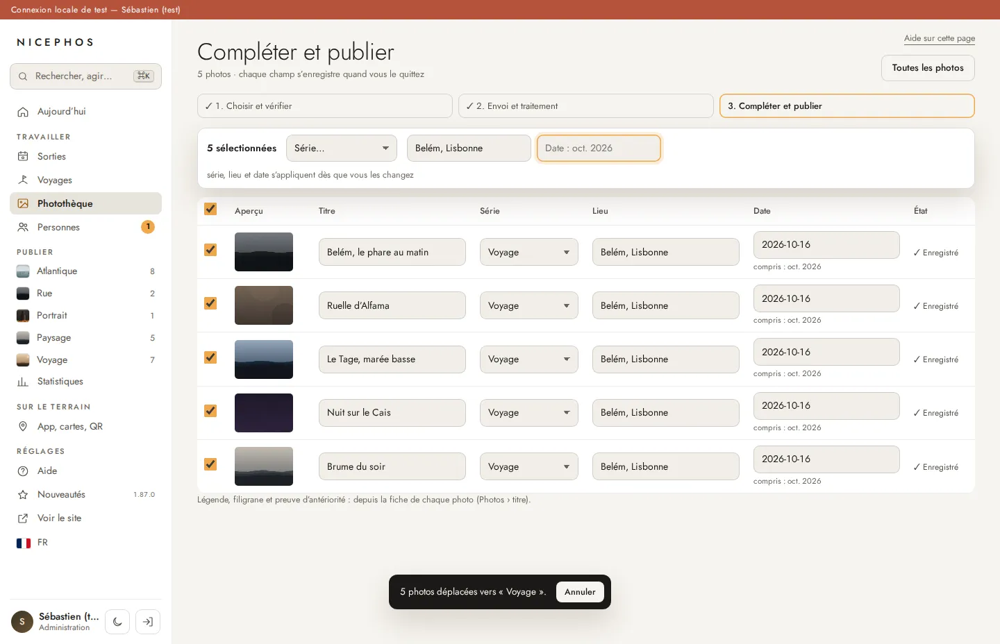

*Démo, compte Photographe : le lot « Compléter et publier » est complet, mais n'offre ni Publier ni Proposer.*

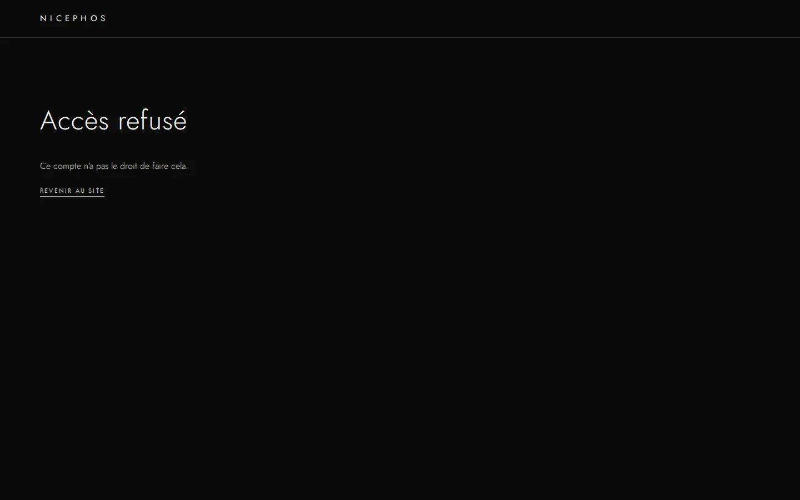

*Démo, compte Photographe : le bouton « Publier » d'Aujourd'hui mène à une page 403 au thème du site public.*

**Recommandation.** Libellés selon le droit du compte : « Compléter et proposer ». Dans la barre du lot, « Proposer les 5 photos » avec « Un mot pour le modérateur ». Dans « À finir », « Proposer » au lieu de « Publier » pour ce rôle. Un filtre « Dernier import » dans la photothèque. La page 403 dans la mise en page de l'admin, avec un retour vers la page précédente. Un test e2e par rôle qui rejoue ce parcours.

### UX-A-05 — La fiche photo se recharge toute seule et efface la saisie en cours (de même Séries et Instagram)

**Gravité :** majeur · **Effort :** S · **Impact :** fort · **Vague :** 0 (V0-13)  
**Écran :** Fiche photo /admin/photos/:id après « Décrire cette photo » ; /admin/series (propositions) ; /admin/instagram  
**Référentiels :** RGAA 13.1 (13.1.3) ; WCAG 2.2 2.2.1 (technique d'échec F41) ; WCAG 3.2.5 ; Opquast 239 ; B&S 3 Contrôle explicite ; B&S 5.1 ; ISO 9241-110 Contrôlabilité ; Nielsen #5

**Constat.** Après « Décrire cette photo » (le message annonce « elle arrive dans une minute environ »), le script interroge le serveur toutes les 5 s et appelle location.reload() dès que la description est prête, alors que l'auteur continue naturellement de remplir la fiche. Reproduit : légende tapée « Texte que je suis en train d'écrire », page rechargée 6 s plus tard, ancienne légende revenue, aucun avertissement, aucun moyen d'arrêter. Séries se recharge quand l'état des propositions change, même pendant qu'on renomme une série ; Instagram 2,5 s après un envoi, ce qui fait disparaître le lien « Voir le post ↗ » qui venait d'apparaître.

**Preuve.** ux-data/rgaa-admin/t3-dialogues.json (autoReload : injected 1, reloaded true, legendAfter = ancienne légende) ; public/admin/admin.js:934, 1802 et 2031-2044.

**Recommandation.** Ne plus recharger : écrire la description dans son bloc, afficher « Reprendre comme légende » et annoncer « Description prête » en role="status". Si un rechargement reste nécessaire, un bandeau « Analyse terminée — Mettre à jour la page », jamais déclenché quand le formulaire contient des modifications. Même règle pour Séries et Instagram.

### UX-A-06 — Saisies perdues en quittant une page, sans avertissement ; trois façons d'enregistrer coexistent

**Gravité :** majeur · **Effort :** M · **Impact :** fort · **Vague :** 1 (V1-12)  
**Écran :** Fiche photo, /admin/site#ouverture, /admin/droits, /admin/apparence, /admin/voyages/:id, /admin/comptes  
**Référentiels :** B&S 5.1 ; B&S 6 Homogénéité/cohérence ; ISO 9241-110 Conformité aux attentes ; ISO 9241-110 Robustesse ; Nielsen #3 et #4

**Constat.** Le seul avertissement de départ (beforeunload) protège l'envoi des fichiers. Sur la fiche, j'ai modifié le titre et la légende puis cliqué « Photothèque » : aucune alerte, les deux modifications sont perdues. Sur l'ouverture, j'ai ajouté une photo et l'ai remontée de la place 8 à la place 1 (8 gestes) ; le message dit « pensez à enregistrer » ; j'ai quitté : aucune alerte, l'ordre est perdu.

Or trois façons d'enregistrer coexistent : l'inspecteur, le lot et l'ordre des séries enregistrent seuls ; la fiche, l'ouverture, le Site public, les Droits, l'Apparence, les Comptes et le voyage exigent un bouton (ce que l'inspecteur rappelle lui-même) ; d'autres boutons agissent tout de suite. On apprend l'enregistrement automatique à un endroit, puis on perd son travail à un autre. Le Site public a même deux boutons, « Enregistrer l'ouverture » et « Enregistrer le site public », qui enregistrent tous deux tout le formulaire, avec deux messages différents.

**Preuve.** ux-data/ergo-admin/captures/F1.json (« quitter la fiche modifiée : avertissement = AUCUN ») et J2.json (« quitter sans enregistrer : avertissement = AUCUN ») ; public/admin/admin.js:108-110 et 584 ; server/routes/admin.js:1962 ; views/admin/settings.eta:79 et 110.

**Recommandation.** À court terme : repérer les formulaires modifiés, déclencher beforeunload et intercepter les liens internes (« Modifications non enregistrées : Enregistrer / Quitter sans enregistrer »), et afficher « • Modifié » près du bouton. À moyen terme, une seule règle : enregistrement automatique avec Annuler partout où c'est réversible (fiche, ouverture) ; bouton explicite seulement pour les actions à fort effet public (publier, mentions légales) ; un seul bouton « Enregistrer » par formulaire.

### UX-A-07 — Suppression définitive d'un compte ou d'un voyage publié en un clic, sans confirmation

**Gravité :** majeur · **Effort :** S · **Impact :** moyen · **Vague :** 0 (V0-15)  
**Écran :** /admin/comptes (« Supprimer ce compte ») et /admin/voyages/:id (« Supprimer ce voyage »)  
**Référentiels :** B&S 3.1 Actions explicites ; B&S 5.1 ; ISO 9241-110 Contrôlabilité ; WCAG 2.2 3.3.4 ; Nielsen #3 et #5

**Constat.** Ces deux commandes ressemblent à des liens mais suppriment au premier clic, sans confirmation ni annulation. Le compte « Compte de démonstration » a disparu au premier clic ; le voyage publié « Lisbonne, octobre 2026 » aussi, et sa page publique est passée de 200 à 404 dans la seconde : un lien déjà partagé est cassé sans retour possible. La photothèque, elle, demande confirmation (« Supprimer définitivement ») : le même geste n'a pas le même filet selon l'écran.

**Preuve.** ux-data/ergo-admin/captures/J8.json (« confirmation avant suppression : AUCUNE ») et J5.json (« page publique après : HTTP 404 ») ; views/admin/accounts.eta:32 ; views/admin/trip.eta:68 ; public/admin/admin.js:721-731 (confirmation réservée aux photos).

**Recommandation.** Réutiliser le dialogue de la photothèque, qui nomme l'objet et dit les conséquences (« la page publique /voyage/… disparaîtra ; ses sorties et ses 20 photos restent »), avec Annuler comme choix par défaut. Mieux : une annulation pendant 10 s, comme pour les actions groupées. Pour un compte, proposer d'abord « Désactiver » et réserver la suppression aux comptes déjà désactivés.

### UX-A-08 — « Annuler » inatteignable en 10 s au clavier, et focus perdu après les actions

**Gravité :** majeur · **Effort :** M · **Impact :** fort · **Vague :** 1 (V1-13)  
**Écran :** Photothèque après une action groupée ; import en cours ; Séries, fenêtre « Supprimer la série »  
**Référentiels :** RGAA 7.3 (7.3.2) ; RGAA 12.8 ; RGAA 7.5 ; WCAG 2.2 2.2.1 ; WCAG 2.4.3 ; B&S 3.2 Contrôle utilisateur ; Nielsen #3

**Constat.** Après une action groupée, la page se recharge, le focus repart du haut et le message « 1 photo publiée. Annuler » est le dernier élément du code : il faut 56 tabulations pour atteindre « Annuler », qui disparaît après 10 s, sans pause au survol ni au focus ; si le focus est dessus à l'expiration, il retombe sur body. Pendant l'import, la liste des fichiers est réécrite à chaque progression : le focus posé sur « Retirer faux.jpg » est perdu en moins de 100 ms. La fenêtre « Supprimer la série » fermée par Échap rend le focus à body. Enfin, la région du message est masquée entre deux messages et remplie juste avant d'être affichée : l'annonce n'est pas garantie (à confirmer avec NVDA et VoiceOver).

**Preuve.** ux-data/rgaa-admin/t2-phototheque.json (toUndo : 56 tabulations ; afterExpiry : focus body) ; t10-import.json ; t3-dialogues.json (delAfterEsc) ; public/admin/admin.js:228-248, 487 et 1001-1021 ; views/admin/layout.eta:185.

**Recommandation.** Après rechargement, rendre le focus à l'élément qui a lancé l'action (bouton Publier ou case de la première photo). Suspendre le minuteur tant que la souris ou le focus est sur le message ; à l'expiration, rendre le focus à l'élément d'origine. Une annulation durable : « Dernières actions » dans le Journal, ou ⌘Z valable jusqu'à l'action suivante. Une région live toujours présente, vidée puis remplie. Import : mettre à jour les barres et les textes sans réécrire la liste. Fenêtre de série : rendre le focus au bouton ⋯ de la carte.

### UX-A-09 — Au téléphone, le focus disparaît sous la barre d'onglets, le menu ouvert ou la feuille de l'inspecteur

**Gravité :** majeur · **Effort :** S · **Impact :** moyen · **Vague :** 0 (V0-16, V1-14)  
**Écran :** Pixel 7 (412 × 915) : fiche photo, Séries, Aujourd'hui, photothèque (menu ouvert ; une photo choisie), app de terrain  
**Référentiels :** WCAG 2.2 2.4.11 Focus non masqué (AA) ; RGAA 10.7 ; RGAA 12.8 ; WCAG 2.4.3

**Constat.** J'ai mesuré l'élément qui a le focus en 9 points, avec elementFromPoint. Il est entièrement caché : par la barre d'onglets fixe de 74 px (7 arrêts sur 60 sur la fiche photo, 10 sur 45 sur Séries, 2 sur 45 sur Aujourd'hui) ; par la barre collante « Enregistrer » de l'app de terrain (5 arrêts sur 30, dont les cases d'accord) ; par la feuille de l'inspecteur (une fois une photo choisie, les 12 tabulations suivantes parcourent des vignettes cachées dessous). Avec le menu ouvert, après 30 tabulations, le focus sort du panneau sans le fermer et circule sous lui. Ces cas concernent les claviers de tablette et l'accès par contacteur.

**Preuve.** [captures/A-mobile-focus-sous-la-feuille.webp](captures/A-mobile-focus-sous-la-feuille.webp) ; [captures/A-mobile-menu-tabulation-dessous.webp](captures/A-mobile-menu-tabulation-dessous.webp) (démo) ; ux-data/rgaa-admin/t4-mobile.json, t11-app.json ; public/admin/admin.css:557-576 ; public/admin/app.css:50.

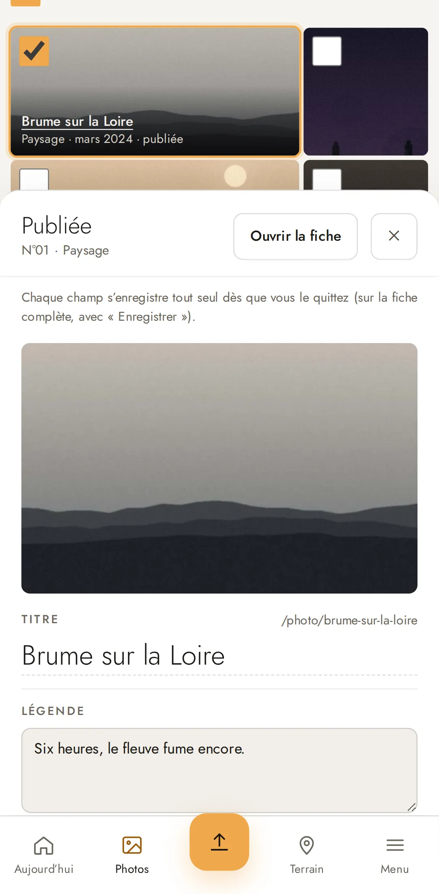

*Démo, Pixel 7 : une photo choisie, le focus parcourt les vignettes cachées sous la feuille de l'inspecteur.*

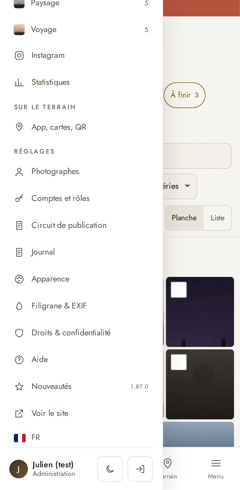

*Démo, Pixel 7 : menu ouvert, la tabulation est sortie du panneau et circule dans le contenu caché dessous.*

**Recommandation.** html { scroll-padding-bottom: 96px } sous 720 px, et l'équivalent pour la barre « Enregistrer » de l'app. Menu ouvert : main et la barre d'onglets en inert, ou fermeture du menu dès que le focus en sort. Inspecteur : y placer le focus quand une photo est choisie, ou la réduire à une barre tant que le focus est dans la planche.

### UX-A-10 — Des listes déroulantes qui agissent à la première flèche : filtres de la photothèque, série du lot

**Gravité :** majeur · **Effort :** S · **Impact :** moyen · **Vague :** 1 (V1-13)  
**Écran :** Photothèque (listes « Photographe » et « Série ») ; Compléter le lot (« Série… » de la barre « Pour les photos cochées »)  
**Référentiels :** RGAA 7.4 ; WCAG 2.2 3.2.2 (technique d'échec F37) ; RGAA 11.2 ; B&S 3.1 Actions explicites ; ISO 9241-110 Contrôlabilité ; WCAG 3.3.4

**Constat.** Dans la photothèque, chaque changement de valeur soumet le formulaire : une seule flèche ↓ sur « Photographe » a chargé /admin/photos?q=&auteur=sebastien&serie=, focus renvoyé sur body ; on ne peut pas parcourir les options pour choisir. Le bouton « Filtrer » n'existe que sans JavaScript. Dans le lot, la liste « Série… » s'applique dès qu'elle change : la première flèche ↓ a envoyé {"ids":[24,25,26],"action":"category"} (« 3 photos déplacées vers Atlantique »), puis la liste revient sur « Série… » et la deuxième flèche réécrit encore. Les champs du lot s'appellent « Titre de la photo 24 » : ce numéro interne n'apparaît nulle part à l'écran.

**Preuve.** ux-data/rgaa-admin/t2-phototheque.json (filterSelect) ; t3-dialogues.json (batch : postsAfterArrow, postsAfter2Arrows 2, fieldNames) ; public/admin/admin.js:318 et 748-751 ; views/admin/photos.eta:39-41 ; views/admin/batch.eta:25 et 60-68.

**Recommandation.** Photothèque : le bouton « Filtrer » visible aussi avec JavaScript, ou un filtre sans rechargement (fetch) qui garde le focus sur la liste et annonce « 8 photos » en role="status". Lot : appliquer la série seulement à la validation (Entrée ou bouton « Appliquer »). Nommer les champs d'après la photo (en-tête de ligne th scope="row" portant le titre ou le nom de fichier).

### UX-A-11 — Menu de 28 entrées, groupes trompeurs, Aide sous la ligne de flottaison

**Gravité :** majeur · **Effort :** M · **Impact :** fort · **Vague :** 1 (V1-18)  
**Écran :** Barre latérale de toutes les pages ; bureau 1440 × 900 et téléphone ; rôles Administrateur et Photographe  
**Référentiels :** B&S 1.2.1 Groupement par la localisation ; B&S 2.2 Densité informationnelle ; B&S 7 ; ISO 9241-110 Autodescriptivité ; ISO 9241-110 Facilité d'apprentissage ; Nielsen #8 ; Loi de Hick

**Constat.** Le menu compte 21 liens et 7 séries (celles de la démo), soit 28 entrées, contre 12 lors de l'audit du 10 octobre ; 87 PR ont été fusionnées entre-temps. Il fait 1 272 px de haut sur bureau pour une fenêtre de 900 : le groupe « Réglages » commence à 828 px et l'Aide est à 1 099 px ; 1 630 px sur téléphone.

- « Réglages » mélange 10 entrées de trois natures : l'équipe (Photographes, Comptes et rôles, Circuit, Journal), le site (Apparence, Filigrane & EXIF, Droits & confidentialité) et l'aide (Aide, Nouveautés, Voir le site).
- Instagram et Statistiques forment un groupe sans titre visible, collé sous la liste des séries : on les croit dans « Publier ».
- Pour un Photographe, « Publier » ne contient aucun lien.
- Deux icônes servent deux fois ; Signalements n'a pas d'entrée ; le pied du menu affiche « Administration » quel que soit le rôle.

**Preuve.** [captures/A-menu-28-entrees.webp](captures/A-menu-28-entrees.webp) (démo) ; ux-data/ergo-admin/captures/menu.json (hauteur 1272/900 ; Photographe : Publier 0) ; menu-sebastien.webp, menu-julien-mobile.webp (hors dépôt) ; views/admin/layout.eta:62-104 et 116-119.

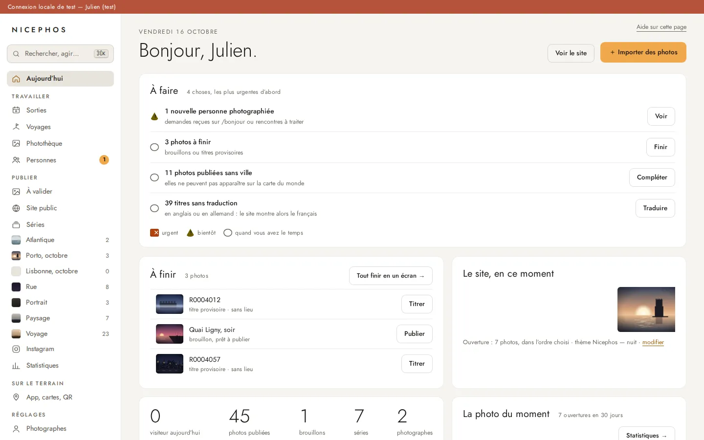

*Démo, menu de l'administration au bureau : 28 entrées, l'Aide est hors de l'écran.*

**Recommandation.** Un premier niveau de 15 entrées au plus, en 5 groupes nommés par tâche : Aujourd'hui · Photos (Photothèque, Sorties, Voyages, Séries) · Personnes (Personnes, App de terrain) · Publier (À valider, Site public, Instagram ; demain Carnets, Galeries privées, Boutique) · Équipe (Comptes et rôles, Circuit, Journal, Statistiques). Un seul lien « Réglages », vers une page à onglets : Identité et apparence, Filigrane & EXIF, Mentions légales & confidentialité, Photographes, Assistants d'analyse. Aide, Nouveautés et Mon compte dans le pied du menu. Les séries repliées (5 visibles, puis « toutes »). Masquer un groupe vide et afficher le rôle réel. Valider ce classement en 30 minutes de tri par cartes avec vous deux.

### UX-A-12 — App de terrain : langue, titres, regroupements et repères

**Gravité :** moyen · **Effort :** S · **Impact :** moyen · **Vague :** 1 (V1-03)  
**Écran :** /admin/rencontre (formulaire tendu à la personne), /admin/rencontre/accueil, /admin/rencontre/qr, planche de cartes ; téléphone  
**Référentiels :** RGAA 8.7 ; RGAA 9.1 ; RGAA 9.2 ; RGAA 11.5 ; RGAA 11.7 ; RGAA 11.13 ; RGAA 12.6 ; RGAA 12.7 ; WCAG 2.2 3.1.2 ; WCAG 1.3.5

**Constat.**

- Langue : quand la personne choisit EN ou DE, 12 libellés visibles (« I agree, for: », « First and last name », « Sign here with your finger »…) restent dans une page lang="fr" ; seul le paragraphe d'accord a son lang. Les légendes « Langue », « Décision », « Âge » restent en français.
- Regroupements : les 4 cases d'usage ne sont pas regroupées sous « J'accepte, pour : » et sont mêlées aux boutons radio de la décision ; le groupe « Âge » contient aussi « Nom du parent ».
- Structure : pas de h1 (titre en &lt;strong>), pas de main, pas de lien d'évitement ; /accueil sans h1, /qr sans aucun titre ; planche de cartes avec h2 avant h1 et cinq h1.
- Saisie : nom et e-mail de la personne en autocomplete="off".

**Preuve.** [captures/A-app-terrain-ecran-en-anglais.webp](captures/A-app-terrain-ecran-en-anglais.webp) (démo, section de la personne en anglais) ; ux-data/rgaa-admin/t8-noms.txt (appEn, appLang) ; t9-bureau-noms.txt ; views/admin/app.eta:23-25 et 53-86 ; axe page-has-heading-one, landmark-one-main.

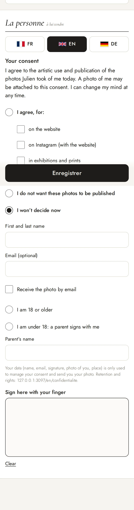

*Démo, app de terrain, section de la personne en anglais : libellés anglais dans une page déclarée en français, cases d'accord mêlées aux choix de décision.*

**Recommandation.** lang="en" ou lang="de" sur chaque &lt;span data-l>, ou la section de la personne rendue dans la seule langue choisie avec son lang ; légendes traduites. Un fieldset « J'accepte, pour : » pour les 4 cases ; « Nom du parent » hors du groupe Âge. Un h1 « Nouvelle rencontre », un &lt;main> autour du formulaire, un lien d'évitement. Pour autocomplete, arbitrer en connaissance de cause : « name » et « email » sont conformes, mais le téléphone du photographe risque de proposer sa propre identité ; à tester avant de trancher.

### UX-A-13 — Cartes d'accord imprimées : textes de 5,3 à 5,6 pt pour un consentement qui doit être éclairé

**Gravité :** moyen · **Effort :** S · **Impact :** moyen · **Vague :** 1 (V1-02)  
**Écran :** /admin/rencontres/cartes/planche (A4, cinq paires 85 × 55 mm, impression à 100 %)  
**Référentiels :** RGPD art. 4, point 11, et art. 7 (consentement éclairé) ; B&S 1.4 Lisibilité ; ISO 9241-112

**Constat.** Sur la carte « pour nous », le passant lit et signe au coin d'une rue. Le texte d'accord fait 7,4 pt, mais les traductions anglaise et allemande font 5,3 pt (#5f5a52), les libellés Nom, Date, Lieu, E-mail et Signature 5,6 pt, et l'invitation de la carte « pour eux » 5,4 pt. Sous 6 pt, la lecture devient difficile pour beaucoup de passants, surtout les plus âgés. La carte dit « Révocable à tout moment » sans dire où ; « site nicephos.art » est écrit en dur. Le QR (21 mm, correction Q) est bien dimensionné.

**Preuve.** [captures/A-cartes-accord-planche-imprimee.webp](captures/A-cartes-accord-planche-imprimee.webp) (démo) ; ux-data/qualite-transverse/mesures/mesures.json (cartes : pt mesurés) ; public/admin/cards.css:20-37 ; server/cards.js:13-21.

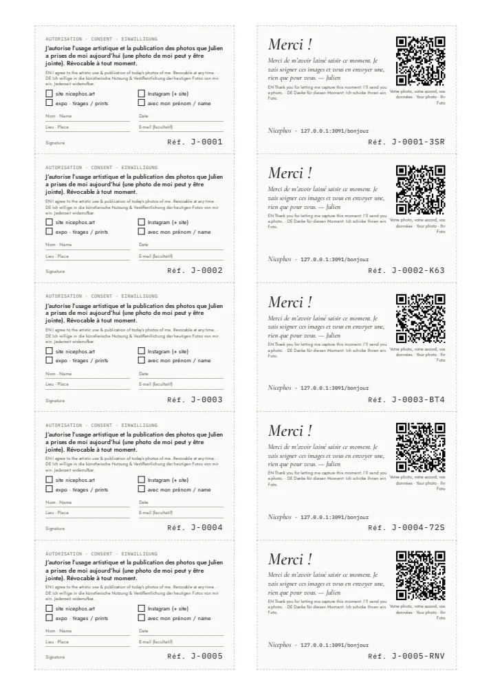

*Démo, planche de cartes d'accord imprimée : traductions en 5,3 pt, aucune ligne pour un parent.*

**Recommandation.** Le passant lit debout, dans la rue : la phrase d'accord en 9 pt au moins, en français et dans sa traduction, en noir ; aucun autre texte sous 8 pt (libellés, invitation, adresse de retrait). Pour que tout tienne sur 85 × 55 mm, passer la carte en recto verso (accord et signature au recto ; nom, date, lieu, e-mail et adresse de retrait au verso) et réduire l'italique décoratif de la carte « Merci » (MQ-10). Sous l'accord : « Pour le retirer : nicephos.art/bonjour + votre référence », et une ligne parent (UX-T-02). L'hôte pris dans la configuration. Imprimer une planche test et la faire lire à trois personnes, à bout de bras.

### UX-A-14 — Inspecteur : une erreur de saisie dite dans un message éphémère, loin du champ

**Gravité :** moyen · **Effort :** S · **Impact :** moyen · **Vague :** 1 (V1-13)  
**Écran :** Photothèque, inspecteur d'une photo (champ Date) ; même mécanisme dans Compléter le lot  
**Référentiels :** RGAA 11.10 (11.10.7) ; RGAA 7.5 (7.5.2) ; WCAG 2.2 3.3.1 ; WCAG 4.1.3 ; B&S 5.2 Qualité des messages d'erreur

**Constat.** Saisie « demain matin » puis Tab : le champ reçoit aria-invalid et une bordure rouge, mais aucun aria-describedby. Le message « Date non comprise : essayez « oct. 2026 »… » n'est que dans le toast, en role="status" (et non alert), à 710 px du champ, effacé après 6 s. Le format attendu n'est que dans le placeholder, invisible dès qu'on tape ; « compris : avr. 2023 » reste affiché au-dessus de la saisie refusée : deux informations contradictoires.

**Preuve.** [captures/A-inspecteur-erreur-date-dans-toast.webp](captures/A-inspecteur-erreur-date-dans-toast.webp) (démo) ; ux-data/rgaa-admin/t2-phototheque.json (inspError : describedby null, toastRole status, distance 710 px) ; public/admin/admin.js:1381-1386 ; views/admin/photos.eta:153.

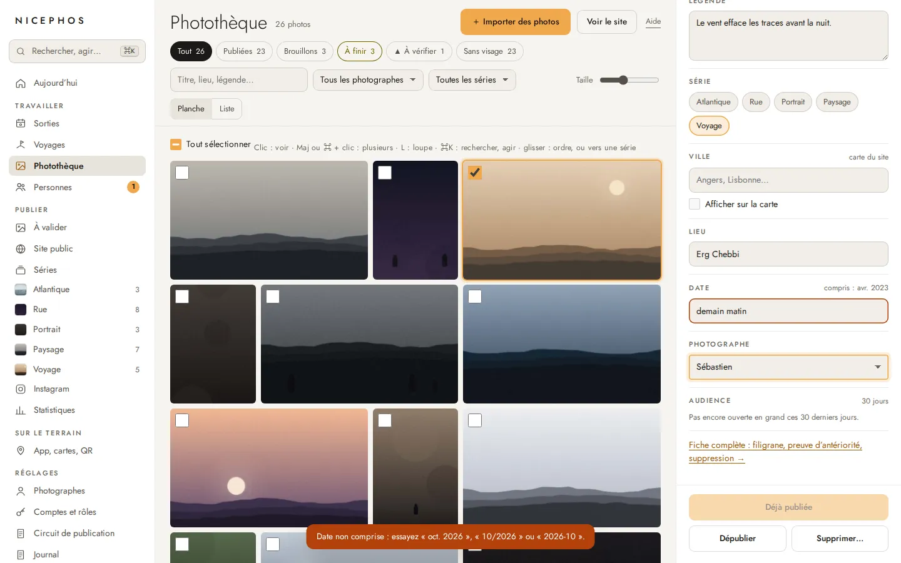

*Démo, inspecteur : la date refusée n'est expliquée que dans un message éphémère, à 710 px du champ.*

**Recommandation.** Le message sous le champ, relié par aria-describedby, à la place de « compris : … », annoncé en role="alert". Le format dans le libellé visible (« Date · ex. oct. 2026 »). Le toast réservé aux confirmations, avec une variante role="alert" pour les erreurs.

### UX-A-15 — Palette ⌘K : 16 requêtes sur 27 sans résultat, et « Aucun résultat » non annoncé

**Gravité :** moyen · **Effort :** S · **Impact :** moyen · **Vague :** 1 (V1-18)  
**Écran :** Palette « Rechercher, agir… » (⌘K / Ctrl+K), toutes les pages  
**Référentiels :** B&S 4.1 Flexibilité ; B&S 8 Compatibilité ; Nielsen #6 et #7 ; ISO 9241-110 Conformité aux attentes ; RGAA 7.1 ; RGAA 7.5 ; WCAG 2.2 4.1.2 ; WCAG 4.1.3

**Constat.** Avec les mots d'un photographe, 16 requêtes sur 27 ne donnent rien : mentions, légales, impressum, thème, couleurs, logo, valider, circuit, signalement, nouveautés, traduction, ville, QR, publier, mots-clés, description. « voyage » renvoie 4 photos de la série Voyage mais pas la page Voyages, absente de la liste interne comme À valider, Circuit, Signalements et Nouveautés. Sans sélection, « publier » ne propose rien et ne dit pas pourquoi. Côté accessibilité, « Aucun résultat » est un &lt;li role="presentation"> dans une listbox vide, hors de toute région live (axe aria-required-children) ; la combobox reste à aria-expanded="true" ; les intitulés de groupe ne sont pas lus. Les touches s'affichent « ⌘K », « ⌘A » sous Windows, Linux et sur téléphone.

**Preuve.** [captures/A-palette-aucun-resultat.webp](captures/A-palette-aucun-resultat.webp) (démo) ; ux-data/ergo-admin/captures/J7.json (16 / 27) ; ux-data/rgaa-admin/t3-dialogues.json (palette.noResult : liveRegionsWithMessage 0) ; public/admin/admin.js:1711 et 1745-1750 ; views/admin/layout.eta:57 et 186-189.

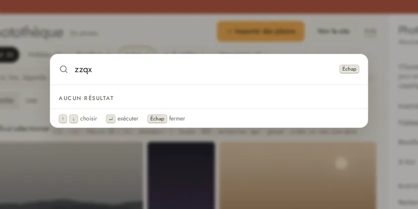

*Démo, palette ⌘K : « Aucun résultat » pour un mot courant, sans annonce aux lecteurs d'écran.*

**Recommandation.** Toutes les entrées du menu et les rubriques profondes dans la palette (Mentions légales vers /admin/droits#mentions, Ouverture, Carte, Cartes d'accord, Mon QR, Assistants), avec des mots-clés (impressum, thème, couleurs, logo, rôle, accord). Un groupe « Aide » qui cherche dans les titres de l'aide. « Publier / Proposer » même sans sélection, avec « Sélectionnez d'abord des photos ». Une région role="status" (« 3 résultats », « Aucun résultat »), aria-expanded à false quand la liste est vide, groupes en role="group" avec aria-label. Ctrl sous Windows et Linux ; touches masquées au toucher.

### UX-A-16 — Vocabulaire et états : un même mot pour des choses différentes, deux pages au même titre

**Gravité :** moyen · **Effort :** S · **Impact :** moyen · **Vague :** 2 (V2-10)  
**Écran :** Import, Aujourd'hui, fiche photo, sortie, voyage, Instagram ; /admin/personnes et /admin/rencontres  
**Référentiels :** B&S 7 Signifiance des codes ; B&S 6 Homogénéité ; B&S 1.3 ; ISO 9241-110 Autodescriptivité ; RGAA 8.6 ; WCAG 2.2 2.4.2 ; Nielsen #2 et #4

**Constat.**

- « Prête » a trois sens : traitée (« 5 photos prêtes sur 5 » à l'import), accords en règle (« Site : prête », « Publier les photos prêtes ») et terminée (« brouillon, prêt à publier »).
- « Ouverture » désigne le diaporama (« Ouverture : 7 photos ») et l'audience (« 7 ouvertures en 30 jours »), dans deux cartes voisines d'Aujourd'hui.
- Un voyage annonce « 2 journées rattachées », puis « 1 journée » dans son en-tête (sorties contre dates).
- Sur une sortie, « Lier à cette personne », « Personne de la sortie n'y figure » et « Rétablir » agissent sur les photos cochées sans le dire ; sur la fiche, « Personne de reconnaissable » est un bouton qui se lit comme un constat.
- Après une proposition Instagram, la rubrique dit toujours « pas encore partagée ».
- Une douzaine de statuts coexistent sans légende commune.
- /admin/personnes et /admin/rencontres ont le même titre et le même H1, « Personnes photographiées » ; le menu mène à l'une, la palette et la tâche « 1 nouvelle personne » à l'autre ; les filtres de /rencontres sont des mots nus, sans état actif visible.

**Preuve.** ux-data/ergo-admin/captures/J1-julien.json, J5.json, J6.json ; ux-data/demo-admin-bureau/admin-personnes.json et admin-rencontres.json (titre et H1 identiques) ; views/admin/outing.eta:62-64 ; views/admin/photo.eta:20 et 248 ; views/admin/home.eta:72 et 90 ; views/admin/encounters.eta:17-20.

**Recommandation.** Un lexique d'une page, dans l'aide, et s'y tenir : « prête » pour le traitement, « accords OK / à vérifier » pour la publication, « vues » pour l'audience ; voyage « 1 jour (2 sorties) » ; sur une sortie, une barre « Pour les 2 photos cochées : [personne] · Lier · Ne la concerne pas · Annuler le lien » ; « Indiquer : personne reconnaissable » ; « proposée, attend le modérateur ». Une seule pastille d'état (symbole et texte) réutilisée partout. Une entrée « Personnes » avec deux onglets aux titres distincts (« Personnes », « Rencontres et demandes ») ; class="chip" sur les filtres.

### UX-A-17 — Assistants d'analyse (IA) : réglages cachés au bas de la page Séries, et dépendants l'un de l'autre

**Gravité :** moyen · **Effort :** M · **Impact :** moyen · **Vague :** 3 (V3-05)  
**Écran :** /admin/series (panneaux « Proposer une série » et « Décrire les photos »), fiche photo, lot, inspecteur  
**Référentiels :** B&S 1.2.1 ; B&S 1.1 ; B&S 8 ; ISO 9241-110 Autodescriptivité ; ISO 9241-110 Engagement de l'utilisateur ; Nielsen #2 et #6

**Constat.** Les trois assistants (série proposée, mots-clés, descriptions) se règlent dans deux panneaux placés après les 7 cartes de séries, à 1 209 et 1 423 px pour une fenêtre de 900. Les descriptions n'ont rien à voir avec les séries ; les mots-clés ne marchent que si les propositions de séries sont allumées, et seule la fiche le dit ; tant que les descriptions sont éteintes, la fiche n'en dit rien. Les panneaux parlent de CLIP, de Florence-2 base ou large, de « ≈ 2 Go de mémoire », de TRANSLATE\_URL ; la plage « la nuit, de 1 h à 6 h » se saisit dans deux champs numériques. Aucune suggestion n'apparaît dans le lot ni dans l'inspecteur, là où l'on titre vraiment.

**Preuve.** outils/ergo-pos.mjs (« Proposer une série » à y = 1209, « Décrire les photos » à y = 1423, page de 1 933 px) ; ux-data/demo-admin-bureau/admin-series.png ; views/admin/series.eta:84-129 ; views/admin/photo.eta:77 ; server/routes/admin.js:834-836.

**Recommandation.** Une page « Réglages › Assistants d'analyse » : un interrupteur par assistant, une phrase qui dit son effet, son état (« prêt, 46 photos analysées »), le détail technique replié (téléchargement, mémoire). Quand un assistant est éteint, une ligne discrète dans la fiche (« Suggérer une description — à activer dans Réglages »). Les suggestions en pastilles « ✦ » à accepter d'un clic dans le lot et l'inspecteur. « La nuit (1 h–6 h) / À tout moment » au lieu des heures numériques.

### UX-A-18 — Jargon d'hébergeur montré aux photographes (TSA\_URL, DATA\_KEY, sub, SMTP\_URL, POST /admin/…)

**Gravité :** moyen · **Effort :** S · **Impact :** moyen · **Vague :** 2 (V2-10)  
**Écran :** Aujourd'hui (preuves d'antériorité), Droits & confidentialité, Comptes et rôles, Instagram, Journal, tâches  
**Référentiels :** B&S 8 Compatibilité ; B&S 7 Signifiance ; Nielsen #2 ; ISO 9241-110 Conformité aux attentes

**Constat.** « Horodatage désactivé sur ce serveur (TSA\_URL=off) » ; « Ajoutez DATA\_KEY au fichier .env du serveur (voir le guide Unraid) » ; « Identifiant (sub) : local:julien » ; « Renseignez SMTP\_URL et MAIL\_FROM » ; INSTAGRAM\_APP\_ID et INSTAGRAM\_APP\_SECRET ; « demandes reçues sur /bonjour » ; « POST /admin/sorties/:author/:day/lieu » au Journal. Ce sont des consignes pour l'hébergeur, montrées à la personne qui publie, et parfois à un Photographe.

**Preuve.** ux-data/demo-admin-bureau/admin-aujourdhui.png, admin-droits.png, admin-comptes.png, ecran/admin-instagram.png ; views/admin/home.eta:116 ; server/todo.js.

**Recommandation.** Une phrase qui dit l'effet pour l'utilisateur (« Les preuves datées ne sont pas activées : seules les empreintes sont gardées »), et le détail technique replié sous « Pour l'administrateur du serveur », visible du seul rôle Administrateur. « la page Bonjour (QR des cartes) » au lieu de « /bonjour ».

### UX-A-19 — Journal peu lisible : 35 % de lignes techniques, 29 % de connexions, heure en UTC, cibles sans lien

**Gravité :** moyen · **Effort :** S · **Impact :** moyen · **Vague :** 2 (V2-10)  
**Écran :** /admin/journal (bureau et téléphone)  
**Référentiels :** B&S 1.4 ; B&S 2.2 ; B&S 7 ; Opquast 4 Dates explicites ; ISO 9241-110 Autodescriptivité ; Nielsen #2

**Constat.** Sur 107 lignes, 37 affichent une adresse technique (« POST /admin/voyages/:id ») et 31 sont des « Connexion (test) ». La cible est un numéro sans lien ; « Action sur plusieurs photos » ne dit ni quoi ni lesquelles. Ni filtre ni pagination : la page fait 6 898 px. Les dates sont en « 16/10/2026 04:35 », sans fuseau : le conteneur tourne en UTC, il était 06 h 35 à Paris, alors que tous les autres écrans fixent Europe/Paris. Sur téléphone, le tableau défile sans être focalisable.

**Preuve.** [captures/A-journal-lignes-techniques.webp](captures/A-journal-lignes-techniques.webp) (démo) ; ux-data/ergo-admin/captures/J8.json (37 sur 107 ; 31 connexions) ; densite.json ; ux-data/qualite-transverse/mesures/mesures.json (journal) ; views/admin/journal.eta:5-12 ; server/routes/admin.js:997 ; Dockerfile:19-24.

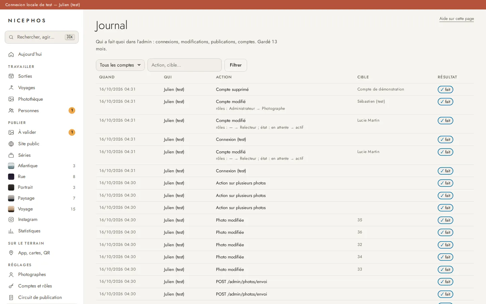

*Démo, Journal : adresses techniques (« POST /admin/… ») et connexions répétées, heure en UTC.*

**Recommandation.** Un libellé lisible pour chaque route d'écriture, avec un test qui échoue s'il en manque un ; la cible nommée et cliquable (« Voyage « Lisbonne, octobre 2026 » ») ; les actions groupées détaillées (« Publiées : 5 photos ») ; les connexions regroupées par jour ; des filtres Type et Période ; une pagination par 50. timeZone: 'Europe/Paris' et mois abrégé (« 16 oct. 2026, 06 h 35 ») ; TZ=Europe/Paris dans l'image.

### UX-A-20 — Import : série par défaut arbitraire, doublons acceptés, lot introuvable ensuite

**Gravité :** moyen · **Effort :** M · **Impact :** moyen · **Vague :** 3 (V3-06)  
**Écran :** Import depuis Aujourd'hui et depuis la Photothèque ; lot « Compléter et publier »  
**Référentiels :** B&S 5.1 ; B&S 4.2 Prise en compte de l'expérience ; B&S 6 ; ISO 9241-110 Adéquation aux tâches ; Nielsen #5

**Constat.** Le lot arrive dans la première série de la liste (« Atlantique »), et non dans la dernière utilisée ou la série proposée : si l'on oublie de la changer, 5 photos de Lisbonne vont dans « Atlantique » (suite partielle de F-m02). Les mêmes 5 fichiers importés quatre fois (même empreinte SHA-256) ont créé 20 photos, sans aucun avertissement ; c'est courant quand on revide une carte mémoire. Rien ne permet ensuite d'afficher « le dernier import ». Le bouton « Importer des photos » ouvre le sélecteur de fichiers dans la Photothèque, mais demande un second clic depuis Aujourd'hui.

**Preuve.** ux-data/ergo-admin/captures/J1-julien.json (« séries par défaut : Atlantique ×5 » ; « pas de sélecteur de fichiers » depuis Aujourd'hui) ; server/routes/admin.js:341 ; server/admin-repo.js:166 (aucun contrôle d'empreinte).

**Recommandation.** Série par défaut : la dernière utilisée par ce photographe, ou la série proposée si l'assistant est allumé, montrée dans le résumé (« dans Voyage — changer »). Doublons repérés par l'empreinte : « 5 photos déjà importées le 16 octobre — Ignorer · Importer quand même ». Un filtre « Importées aujourd'hui / dernier import ». Le même comportement du bouton d'import partout.

### UX-A-21 — Villes et traductions : un travail photo par photo, alors qu'Aujourd'hui en réclame des dizaines

**Gravité :** moyen · **Effort :** M · **Impact :** moyen · **Vague :** 2 (V2-04)  
**Écran :** Tâches d'Aujourd'hui (« photos publiées sans ville », « titres sans traduction »), inspecteur, lot, fiche  
**Référentiels :** B&S 2.1.2 Actions minimales ; ISO 9241-110 Adéquation aux tâches ; Nielsen #7

**Constat.** Aujourd'hui réclame « 12 photos publiées sans ville » et des « titres sans traduction » dont le compteur grimpe à chaque lot (17, puis 27, puis 39). Ni la sélection multiple ni le lot n'ont de champ Ville : 3 actions par photo, soit 36 pour 12 photos. En tapant « Port », les suggestions donnent Port Harcourt, Porto Alegre et Port-au-Prince avant Porto, et mon essai a placé la photo à Port Harcourt. La traduction n'existe ni dans le lot ni dans l'inspecteur : il faut ouvrir la fiche, déplier, saisir, enregistrer et revenir, 6 actions et 2 écrans par photo, soit environ 230 actions pour 39 titres.

**Preuve.** ux-data/ergo-admin/captures/J4.json, J6.json et J8.json ; views/admin/photos.eta (bloc data-insp-many, sans ville) ; views/admin/batch.eta (colonnes Titre, Série, Lieu, Date).

**Recommandation.** La ville dans la barre « pour les cochées » du lot et de l'inspecteur ; suggestions triées par villes déjà utilisées, puis par proximité du GPS de la photo. Un écran « Traduire » en tableau (FR \| EN \| DE par ligne, Tab d'un champ à l'autre), par série entière, avec « Proposer une traduction » si un traducteur est allumé ; la tâche d'Aujourd'hui y mène directement.

### UX-A-22 — Aide : une seule page de 17 600 mots, recherche sans surlignage

**Gravité :** moyen · **Effort :** M · **Impact :** moyen · **Vague :** 3 (V3-07)  
**Écran :** /admin/aide (bureau et téléphone), liens « Aide sur cette page »  
**Référentiels :** Nielsen #10 Aide et documentation ; B&S 2.2 ; B&S 1.1 ; ISO 9241-110 Facilité d'apprentissage

**Constat.** Le lien « Aide sur cette page » est présent sur 26 écrans sur 27, et toutes ses ancres sont valides. Mais l'aide tient en une seule page de 17 600 mots, 41 600 px (environ 46 écrans) et 2 940 nœuds ; sur téléphone, le sommaire occupe à lui seul 2 268 px avant le contenu. La recherche masque les sections qui ne contiennent pas le mot, sans surligner ni sauter à l'occurrence : « couper » laisse deux longues sections à relire, « mot de passe » ne donne rien. Signalements n'a pas de lien d'aide et les Voyages n'ont pas de section à eux.

**Preuve.** ux-data/ergo-admin/captures/J9.json (surlignage des occurrences : 0) ; outils/ergo-pos.mjs (sommaire mobile) ; ux-data/demo-admin-bureau/admin-aide.json ; views/admin/help.eta ; server/help.js.

**Recommandation.** Une page par section (/admin/aide/photos…) ; une recherche qui liste les titres correspondants avec un extrait surligné et un lien direct ; l'aide contextuelle dans un panneau latéral, sans changer de page ; « Questions fréquentes » en tête ; une section Voyages.

### UX-A-23 — Fiche photo : deux commandes de statut (dépublier sans raison possible), champs obligatoires et format de date non annoncés

**Gravité :** moyen · **Effort :** S · **Impact :** moyen · **Vague :** 1 (V1-12)  
**Écran :** /admin/photos/:id (photo publiée, compte Administrateur) ; Photographes  
**Référentiels :** B&S 6 Homogénéité ; B&S 5.1 ; B&S 1.1 Incitation ; Nielsen #4 ; RGAA 11.10 (11.10.2) ; WCAG 2.2 3.3.2

**Constat.** Sur une photo publiée, l'administrateur dispose de deux commandes : à gauche, « Dépublier : pourquoi ? », avec raison obligatoire (« le photographe reçoit la raison ») ; à droite, les boutons radio Statut « Brouillon / Publiée ». Brouillon puis Enregistrer dépublie sans raison : la règle est contournée. La consigne de date dit toujours « AAAA-MM ou AAAA-MM-JJ », alors que « oct. 2026 » est accepté (F-m01 suivi par le serveur, pas par le texte). Le champ « Titre » est obligatoire sans que son libellé le dise, dans un formulaire d'une quinzaine de champs où les facultatifs ne sont pas signalés ; de même « Nom » sur Photographes. L'erreur est bien gérée après l'envoi (aria-describedby), pas annoncée avant.

**Preuve.** ux-data/ergo-admin/captures/F1.json (« rubrique Publication : brouillon » ; « date oct. 2026 … valeur : 2026-10 ») ; ux-data/rgaa-admin/t3-dialogues.json (titleLabel « Titre », required) ; views/admin/photo.eta:46, 66, 100-106 et 165 ; views/admin/authors.eta:6.

**Recommandation.** Retirer les radios de statut pour les comptes qui ont la rubrique Publication : un seul lieu, « Publier » ou « Dépublier » avec raison. Consigne « ex. oct. 2026, 10/2026, 2026-10-16 ». « (obligatoire) » dans le libellé des champs required, ou « facultatif » sur les autres, comme le fait déjà l'app de terrain.

### UX-A-24 — Téléphone : lots 4 à 6 de l'audit iPhone en attente, feuille d'import qui masque la suite, cibles trop petites en vue Liste

**Gravité :** moyen · **Effort :** M · **Impact :** moyen · **Vague :** 1 (V1-14)  
**Écran :** Photothèque, Séries, fiche et lot sur Pixel 7 (412 × 915) ; Droits & confidentialité, Site public, fiche Personne  
**Référentiels :** B&S 2.1.2 ; B&S 4.1 Flexibilité ; B&S 1.1 ; ISO 9241-110 Adéquation aux tâches ; Nielsen #7 ; WCAG 2.2 2.5.8 ; Opquast 112

**Constat.** Les lots 1 à 3 de l'audit iPhone sont faits (lot en cartes, « Ouvrir la fiche », cibles de 44 px). Restent en attente : le mode « Sélectionner » de la photothèque (aucun bouton) ; les Séries (doublon « + Nouvelle série » et carte de création ; poignée masquée au toucher ; ordre changé par le menu ⋯, d'une place par geste) ; la fiche de 3 894 px dont « Enregistrer » est à 2 768 px, sans rester en vue. Nouveau : après l'envoi, la feuille « 5 photos » recouvre le résumé d'import et « Compléter et publier les 5 photos → » est hors de l'écran (y = −1 504 px) ; le lot fait ensuite 2 883 px avec « Publier » tout en haut. En vue Liste, 25 cibles sur 199 sont trop petites et trop proches (cases de 18 × 18 px, titres de 23 px de haut) ; ailleurs, des cases de 18 px dans des libellés de 21 px de haut.

**Preuve.** outils/ergo-mob.mjs (« poignée visible false ; Sélectionner 0 ; Enregistrer y = 2768, position static ») ; ux-data/ergo-admin/captures/J1-julien-mobile.json ; ux-data/rgaa-admin/t5-cibles.json ; demo-admin-bureau/admin-droits.json (axe target-size) ; docs/audit-iphone-2026-10/README.md (« Restent à faire : lots 4, 5, 6 »).

**Recommandation.** Planifier les lots 4 à 6. Dans la feuille d'import, « Compléter les 5 photos » en tête. Dans le lot, une barre basse « Publier les 5 » au-dessus des onglets, avec sa hauteur réservée en bas de page. Étendre les règles du téléphone aux cases de la vue Liste (28 px) et à ses titres (44 px de haut) ; libellés de cases d'au moins 24 px de haut sur bureau.

### UX-A-25 — Pages-formulaires très denses : le bouton plein ne désigne plus l'action principale ; Aujourd'hui répète ses tâches

**Gravité :** moyen · **Effort :** M · **Impact :** moyen · **Vague :** 3 (V3-08)  
**Écran :** /admin/series, /admin/rencontres/:id, /admin/apparence, /admin/auteurs, /admin/comptes, /admin (Aujourd'hui)  
**Référentiels :** B&S 2.2 Densité informationnelle ; B&S 1.2.2 Distinction par le format ; Nielsen #8 ; ISO 9241-110 Autodescriptivité

**Constat.**

- Séries : 29 formulaires, 11 boutons pleins et 7 « Enregistrer » sur une seule page.
- Fiche Rencontre : 3 850 px, 40 champs, 11 formulaires et dix rubriques.
- Apparence : 5 boutons pleins (« Enregistrer l'apparence » et 4 « Envoyer le fichier »).
- Photographes et Comptes gardent les formulaires toujours ouverts que l'audit du 10 octobre avait fait abandonner aux Séries (F-M06), avec l'adresse technique au premier plan.
- Aujourd'hui : « 4 photos à finir » figure deux fois (liste À faire et bloc À finir), la carte des chiffres laisse environ 250 px vides, et « Votre compte » est à 1 667 px ; il n'existe pas de page « Mon compte », et le nom en pied de menu n'est pas un lien.

**Preuve.** ux-data/ergo-admin/captures/densite.json ; ux-data/demo-admin-bureau/admin-rencontre-1-ines.png, admin-apparence.png, admin-auteurs.png, admin-comptes.png, admin-aujourdhui.png ; views/admin/layout.eta:116-119.

**Recommandation.** Un seul bouton plein par écran, pour l'action principale ; les autres en contour. Fiche Rencontre en onglets (Accord · Photos · Données), carte signée et accord en tête. Photographes et Comptes en cartes résumées avec « Modifier ». Logos enregistrés dès le choix du fichier. Aujourd'hui : « À faire » et « À finir » fusionnés (la tâche se déplie en vignettes), chiffres et rythme dans une carte, « Mon compte » ouvert depuis le nom en pied de menu.

### UX-A-26 — Mentions légales introuvables par leur nom dans l'admin ; identité du site répartie sur deux pages

**Gravité :** moyen · **Effort :** S · **Impact :** moyen · **Vague :** 1 (V1-18)  
**Écran :** Menu, palette, /admin/droits#mentions, /admin/site, /admin/apparence  
**Référentiels :** B&S 7 Signifiance ; B&S 1.2.1 ; ISO 9241-110 Autodescriptivité ; Nielsen #6

**Constat.** Aucune entrée de menu ne contient « mentions » ni « légal » (0 sur 21), et la palette ne trouve ni « mentions », ni « légales », ni « impressum ». La rubrique est cachée dans « Droits & confidentialité », sous « Droits d'utilisation », à 1 104 px ; seule la tâche d'Aujourd'hui y mène quand des champs manquent, ce qui explique en partie UX-T-03. Le nom du site se règle dans « Site public », mais le sous-titre et les logos dans « Apparence » : l'identité est coupée en deux.

**Preuve.** ux-data/ergo-admin/captures/J7.json (« libellé contenant mention ou légal : 0 ; rubrique Mentions légales y = 1104 ») ; views/admin/layout.eta:100 ; ux-data/demo-admin-bureau/admin-droits.png.

**Recommandation.** Renommer l'entrée « Mentions légales, droits & confidentialité », ou en faire trois onglets ; rendre l'ancre #mentions accessible par la palette. Regrouper nom, sous-titre, emblème et logos dans « Réglages › Identité ».

### UX-A-27 — Mode clair : anneau de focus des champs à 1,7:1

**Gravité :** moyen · **Effort :** S · **Impact :** moyen · **Vague :** 0 (V0-16)  
**Écran :** Tous les champs, listes et cases de l'admin en thème clair : fiche photo, inspecteur, filtres, Compléter le lot  
**Référentiels :** RGAA 10.7 (10.7.1) ; RGAA 3.3 ; WCAG 2.2 1.4.11 ; WCAG 2.4.7

**Constat.** input:focus, select:focus et textarea:focus suppriment le contour natif et le remplacent par un anneau intérieur #F0A94C de 1,5 px et un halo à 20 %. Sur le rendu, l'anneau ne fait que 1,73:1 avec le fond du champ (#F1EEE8) et 2,0:1 avec le blanc autour. Le mode sombre est conforme (8,85:1). La revue d'octobre avait corrigé les boutons (contour 2 px #9A5B0C), pas les champs.

**Preuve.** [captures/A-focus-champ-mode-clair.webp](captures/A-focus-champ-mode-clair.webp) (démo) ; ux-data/rgaa-admin/t12-focus-contraste.json ; public/admin/admin.css:139.

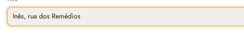

*Démo, mode clair : anneau de focus d'un champ à 1,73:1.*

**Recommandation.** outline: 2px solid var(--accent-ink) avec un décalage de 1 px sur les champs au focus, comme pour les boutons (#9A5B0C ≈ 4,7:1 sur #F1EEE8) ; le halo orange peut rester en complément.

### UX-A-28 — Liens-vignettes sans intitulé sur les fiches Personne et Rencontre

**Gravité :** moyen · **Effort :** S · **Impact :** moyen · **Vague :** 1 (V1-16)  
**Écran :** /admin/personnes/:id (Photos de la personne), /admin/rencontres/:id (Photos de la sortie, Photos liées)  
**Référentiels :** RGAA 6.2 ; RGAA 1.1 ; WCAG 2.2 2.4.4 ; WCAG 1.1.1

**Constat.** Chaque vignette est un lien vers /admin/photos/:id qui ne contient qu'une image alt="" : un lecteur d'écran n'entend que « lien ». Fiche Personne : 1 lien, doublé par le lien du titre juste après. Fiche Rencontre : 3 à 5 liens, et le titre de la photo n'y est pas un lien. axe link-name sur 5 pages. Les boutons répétés « Exclure », « Offrir cette photo », « Retirer » ne nomment pas la photo.

**Preuve.** ux-data/demo-admin-bureau/admin-personne-1.json, admin-rencontre-1-ines.json (axe link-name) ; views/admin/person.eta:64 ; views/admin/encounter.eta:103 et 116.

**Recommandation.** Fiche Personne : masquer le lien-vignette doublon (aria-hidden="true" et tabindex="-1"), comme dans la photothèque. Fiche Rencontre : le titre dans le lien ou alt = titre de la photo ; aria-label « Exclure « Miradouro… » » sur les boutons répétés.

### UX-A-29 — L'administration re-télécharge toutes ses images à chaque page, y compris celles déjà publiques

**Gravité :** moyen · **Effort :** S · **Impact :** moyen · **Vague :** 1 (V1-10)  
**Écran :** /admin, toutes les pages (barre latérale des séries), Photothèque, Aujourd'hui, Séries, Site public  
**Référentiels :** RGESN 6.2 ; RGESN 6.4 ; RGESN 6.1 ; Opquast 119

**Constat.** Les images de l'admin passent par /admin/media/ avec Cache-Control: no-store, choix de la revue d'octobre pour que les brouillons ne restent pas sur un ordinateur partagé. Conséquence : recharger la photothèque refait 31 requêtes d'images (300 ko en démo), même pour les photos publiées, déjà servies publiquement en cache d'un an sous /media/. La barre latérale, présente sur toutes les pages, affiche la vignette de chaque série en 18 × 18 px à partir de la WebP de 640 px : 68 ko par page en démo, où les images de synthèse sont légères ; j'estime ce coût à environ 300 ko par page avec de vraies photos.

**Preuve.** ux-data/demo-admin-bureau/admin-photos.rgesn-reload.json (31 images re-téléchargées, 299 562 o) ; admin-aujourdhui.rgesn-reload.json (5 vignettes de séries, 67 750 o) ; server/routes/media.js:26-32 ; server/routes/admin.js:253 ; views/admin/layout.eta:89 ; docs/revue-2026-10.md:26.

**Recommandation.** Garder no-store pour les brouillons, et servir depuis /media/ les photos publiées affichées dans l'admin (même fichier, déjà public et immuable) ; vignettes de la barre latérale et des listes en 160 px (UX-T-07) ; pour les brouillons, Cache-Control: private, max-age=3600 et un en-tête Clear-Site-Data: "cache" à la déconnexion. La barre latérale pèserait alors environ 95 % de moins.

### UX-A-30 — Petites non-conformités de l'administration à corriger en une passe

**Gravité :** mineur · **Effort :** S · **Impact :** faible · **Vague :** 1 (V1-16)  
**Écran :** Nouveautés, fiche photo, Apparence, Filigrane & EXIF, Aide, import, Compléter le lot et app de terrain à 320 px, 404 de l'admin, tableaux, textes Instagram et e-mails  
**Référentiels :** RGAA 3.2 ; RGAA 10.6 ; RGAA 1.9 ; RGAA 8.9 ; RGAA 10.1 ; RGAA 5.6 ; RGAA 10.11 ; Opquast 82, 225 et 243

**Constat.**

- 3.2 : numéro de version « 1.87.0 » du menu, sur l'entrée active, en 10 px à 4,49:1.
- 10.6 : liens dans le texte de la même couleur que lui et sans soulignement (« voir sur le site », « GeoNames », « réglages », « Site public », « Apparence »).
- 1.9 : figures légendées sans role ni aria-label (aperçus, QR, photo de repère).
- 8.9 et 10.1 : « choisissez des fichiers » en &lt;u>.
- 5.6 : deux en-têtes vides dans un tableau de l'Aide.
- 10.11 : débordement de 7 px à 320 px (bouton du lot au texte coupé, app de terrain).
- Une adresse d'admin inconnue affiche la 404 publique, avec le menu du site : on perd la barre latérale.
- Aucune &lt;caption> dans les tableaux de l'admin (Journal, Instagram, statistiques, lot).
- Motifs et délais Instagram, dates des e-mails de validation figés en français pour un compte réglé en anglais ou en allemand.

**Preuve.** ux-data/demo-admin-bureau/admin-nouveautes.json (axe color-contrast) ; ux-data/rgaa-admin/t13-divers.json et t6-reflow.json ; ux-data/demo-admin-bureau/ecran/admin-erreur-404.png ; public/admin/admin.css:46 et 1135 ; views/admin/\_import.eta:30 ; docs/aide/01-premiers-pas.md:18 ; server/instagram-limits.js:61-72 ; server/review.js:20.

**Recommandation.** .nav-ver en 11 px et --ink2 ; règle « .prose a, p a, figcaption a { text-decoration: underline } » ; role="figure" et aria-label = légende ; un &lt;span> stylé au lieu de &lt;u> ; en-têtes « Entrée » et « Rôle » ; white-space: normal sur le bouton du lot ; une 404 dans le gabarit de l'admin, avec un lien « Photothèque » ; une &lt;caption> (éventuellement masquée) par tableau ; textes d'instagram-limits et de review passés par request.t et la langue du compte.

### UX-A-31 — Annonces de sélection peu parlantes dans l'inspecteur

**Gravité :** suggestion · **Effort :** S · **Impact :** faible · **Vague :** 1 (V1-16)  
**Écran :** Photothèque, inspecteur (une ou plusieurs photos choisies)  
**Référentiels :** WCAG 2.2 4.1.3 ; RGAA 9.1 (9.1.2) ; Nielsen #1

**Constat.** Choisir une photo annonce, par la région role="status", « N°23 · Voyage », et le titre h2 de l'inspecteur devient « Brouillon » ou « Publiée ». Avec deux photos, l'annonce est « 2 publiées ». Le titre de la photo et le mot « sélectionnée » ne sont jamais dits : à l'oreille, on ne sait pas ce qu'on tient.

**Preuve.** ux-data/rgaa-admin/t16-multi.json ; t9-bureau-noms.txt (inspectorOne : heading « Publiée », status « N°04 · Portrait »).

**Recommandation.** h2 = titre de la photo, statut en sous-titre. Annonces : « « Élise, contre-jour » sélectionnée · publiée · Portrait », puis « 2 photos sélectionnées (2 publiées) ».

### UX-A-32 — Préparer le blog, les galeries privées et la boutique sur une administration rangée

**Gravité :** suggestion · **Effort :** L · **Impact :** fort · **Vague :** 2 (V2-11)  
**Écran :** Architecture générale de l'admin (modules à venir)  
**Référentiels :** ISO 9241-210 Conception centrée sur l'opérateur humain ; B&S 6 Homogénéité ; B&S 1.2.1 ; Loi de Hick

**Constat.** Au rythme actuel (87 PR en six jours, menu passé de 12 à 28 entrées), chacun des trois modules annoncés ajoutera 2 à 4 écrans et ses propres états : billet brouillon ou publié ; lien actif, expiré, mot de passe ; commande payée, expédiée, remboursée, facture. Sans cadre commun, on retrouvera les incohérences relevées ici : vocabulaire, façons d'enregistrer, suppressions sans filet, rôles sans issue.

**Preuve.** ux-data/ergo-admin/grille-parcours.json (bloc menu) ; historique git (31 fusions le 15 octobre).

**Recommandation.** Avant de coder ces modules : poser l'architecture cible du menu (UX-A-11), avec un groupe « Publier » prêt à les recevoir ; écrire un système d'états commun (mêmes pastilles, mêmes mots, même place) et une seule façon d'enregistrer ; créer un composant « confirmation et annulation » réutilisé pour toute action irréversible (révoquer un lien privé, rembourser) ; écrire un test e2e par rôle (Administrateur, Photographe, Modérateur, Relecteur) qui rejoue les neuf parcours. Maquettes MQ-18 à MQ-20.

## Constats — transverses : droit, hébergement, gouvernance, projets (UX-T)

### UX-T-01 — Une photo retirée après un refus reste servie par le cache de Cloudflare jusqu'à un an

**Gravité :** critique · **Effort :** M · **Impact :** fort · **Vague :** 0 (V0-01, V1-01)  
**Écran :** Variantes /media/… de toute photo dépubliée après un refus (/bonjour, app de terrain, Personnes) — production  
**Référentiels :** RGPD art. 17 et 21 ; RGPD art. 5.1.f ; engagement de la page Confidentialité (« nous la retirons du site ») ; RGESN 5.8 ; B&S 3 Contrôle explicite

**Constat.** Les variantes sont servies avec « Cache-Control: public, max-age=31536000, immutable ». En production, Cloudflare les garde : cf-cache-status HIT, âge mesuré de 168 322 s (47 h) sur la variante testée. Un refus ne fait que passer la photo en brouillon : l'origine répond alors 404, mais l'adresse de l'image reste servie par le bord de Cloudflare à quiconque la détient (Google Images, épingle Pinterest, aperçu WhatsApp, og:image), jusqu'à éviction ou pendant un an. Le code ne purge rien et ne change pas d'adresse ; la page de la photo répond 404 et non 410. L'étude des galeries privées a prévu ce cas (G43 : nouvelle clé et purge par URL) pour les photos rendues privées, pas pour les refus d'aujourd'hui.

Je classe ce constat critique : c'est la promesse faite à la personne photographiée qui n'est pas tenue.

**Preuve.** Production, une requête HEAD en simple visiteur (décrite, sans image) : ux-data/qualite-transverse/mesures/prod-media-entetes.txt (HIT, age: 168322). Code : server/routes/media.js:21-23 (maxAge 365 j, immutable) ; server/encounters.js:253-255 (applyRefusal : status='draft' seulement) ; aucune purge Cloudflare dans server/.

**Recommandation.** Au passage en brouillon (refus, dépublication, suppression) :

- changer variant\_key, pour que les anciennes adresses ne mènent plus à rien ;
- purger chez Cloudflare, par URL, les anciennes variantes et l'image de partage (API « Purge by URL », ouverte à l'offre gratuite ; jeton limité à Zone.Cache Purge) ;
- en attendant, plafonner le cache du bord : « Cloudflare-CDN-Cache-Control: max-age=86400 » sur /media/\*, en gardant l'immuable côté navigateur ;
- répondre 410 sur la page d'une photo retirée ;
- ajouter dans l'admin une case « retrait demandé à Google Images » (outil de suppression de contenu obsolète) ;
- écrire dans Confidentialité que les aperçus déjà créés par les réseaux échappent à votre contrôle et que vous en demandez le retrait.

### UX-T-02 — Sur /bonjour, l'accord en ligne d'un mineur est enregistré sans parent

**Gravité :** critique · **Effort :** S · **Impact :** fort · **Vague :** 0 (V0-02, V1-02)  
**Écran :** /bonjour (FR, EN, DE) ; planche de cartes d'accord à imprimer  
**Référentiels :** RGPD art. 8 et loi 78-17 art. 45 (15 ans) ; Code civil art. 9 et 371-1 ; loi n° 2024-120 du 19 février 2024 (droit à l'image des enfants) ; B&S 6 Homogénéité/cohérence

**Constat.** L'app de terrain demande « J'ai 18 ans ou plus / J'ai moins de 18 ans : un parent signe avec moi » et le nom du parent. Le formulaire /bonjour, que la personne remplit seule depuis le QR de sa carte, ne pose pas la question : un adolescent peut cocher « J'accepte qu'elle soit publiée : sur Instagram », et l'accord est enregistré tel quel. La carte papier « pour nous » ne prévoit que Nom, Date, Lieu, E-mail et Signature. Le même accord n'a donc pas les mêmes garanties selon le canal.

**Preuve.** views/admin/app.eta:76-79 (adult, guardian) ; views/bonjour.eta (aucun champ d'âge) ; server/cards.js:17 (champs de la carte) ; [captures/A-cartes-accord-planche-imprimee.webp](captures/A-cartes-accord-planche-imprimee.webp) (démo).

**Recommandation.** Reprendre sur /bonjour la question de l'app, avant les usages, avec le nom du parent. Côté serveur, un accord de mineur sans parent passe en « à confirmer » et ne rend jamais la photo publiable. Ajouter sur la carte une ligne « Si mineur·e : nom et signature d'un parent ». À faire valider par votre juriste.

### UX-T-03 — Mentions légales de production incomplètes, et une phrase sur l'hébergement sans objet

**Gravité :** majeur · **Effort :** S · **Impact :** fort · **Vague :** 0 (V0-04)  
**Écran :** Production : /mentions-legales (et /en, /de/impressum) ; Admin › Droits & confidentialité  
**Référentiels :** LCEN art. 1-1 (ex-art. 6-III, loi SREN du 21 mai 2024) ; Opquast 101, 114 et 140 ; Nielsen #2

**Constat.** En production, la page ne montre que « Contact », « Hébergement », « Propriété intellectuelle » et « Données personnelles » : les rubriques « Éditeurs du site » (noms, adresse) et « Responsable de la publication » manquent, car le code les masque quand les réglages sont vides. Le texte fixe dit pourtant « hébergé par ses éditeurs, sur leur propre serveur, en France, à l'adresse ci-dessus », alors qu'aucune adresse n'est affichée. L'adresse électronique et les renvois sont du texte, pas des liens. Le site est hébergé chez vous : l'anonymat permis aux éditeurs non professionnels suppose un hébergeur tiers qui détient leur identité, il ne joue donc pas ici. L'admin sait déjà ce qui manque (legalMissing).

**Preuve.** Production décrite sans image : prod-front-bureau/mentions-legales.json (H2 Contact, Hébergement, Propriété intellectuelle, Données personnelles ; aucun mailto) ; server/legal.js:12-17 et 52-62.

**Recommandation.** Renseigner dans l'admin les noms, l'adresse et le responsable de la publication ; une domiciliation évite de publier votre domicile, et deviendra nécessaire pour la boutique (à faire valider). Rendre la phrase d'hébergement conditionnelle et mettre à jour le commentaire « LCEN art. 6 ». L'e-mail en mailto, les renvois en liens. Faire bloquer la mise en ligne par legalMissing() tant qu'une rubrique obligatoire manque. Avant la boutique : statut, SIREN ou RNE, numéro de TVA (Opquast 106).

### UX-T-04 — Exercer ses droits : le bon formulaire existe mais on ne le trouve pas ; base légale incomplète, aucun accusé de réception

**Gravité :** moyen · **Effort :** S · **Impact :** moyen · **Vague :** 2 (V2-05)  
**Écran :** /confidentialite, /bonjour, /bonjour/merci, /photo/…/signaler?envoye=1, pied de page  
**Référentiels :** RGPD art. 12.2 ; RGPD art. 13.1.c, 14.1.c et 85 ; Opquast 108, 110 et 231 ; B&S 2.1.2 ; B&S 1.3 ; Nielsen #6

**Constat.** Votre page Confidentialité est l'une des plus claires que j'aie lues. Mais « Vos droits » est sa neuvième et dernière section (1 024 mots, sans sommaire ; à 4 363 px sur mobile). Elle renvoie à « la page …/bonjour, rubrique Vos données » et à la CNIL en texte simple, sans lien. Ce formulaire s'intitule « Je vous ai photographié » : un visiteur qui a signalé, aimé ou écrit ne pensera pas à y aller. La base légale des photos publiées sans accord (intérêt légitime, exception artistique) et le droit d'opposition qui s'y attache ne sont pas nommés. Les délais sont « en général sous quelques jours » sur /bonjour, absents sur /signaler. Une personne qui refuse ou demande ses données n'obtient qu'un écran « Merci, c'est noté » : aucun accusé par e-mail, alors qu'elle a laissé une adresse. Le fournisseur de messagerie n'est pas nommé, et la date de mise à jour n'est pas balisée.

**Preuve.** ux-data/ergo-public/desktop/p4-9.json (p7.privacy : bonjour 0, toc 0, words 1024) ; ux-data/ergo-public/mobile/p4-9.json (« Vos droits » à 4 363 px) ; server/privacy.js:19-30 et 61-63 ; server/i18n.js:136.

**Recommandation.** En tête de Confidentialité, un encadré « Vos droits en un clic » (copie, effacement, opposition : liens directs vers /bonjour#vos-donnees) et un sommaire d'ancres ; adresses en liens. Ajouter : « Photos publiées sans accord : intérêt légitime et liberté d'expression artistique (art. 6.1.f et 85) ; vous pouvez vous y opposer à tout moment ». Chiffrer : « sous 7 jours », « un mois au plus pour vos données ». Un accusé de réception automatique (choix enregistré, date, référence, lien pour changer d'avis). À terme, une page /mes-donnees liée depuis le pied de page et depuis Signaler.

### UX-T-05 — Le « N° » change à chaque réordonnancement : il ne peut pas servir de référence

**Gravité :** moyen · **Effort :** M · **Impact :** moyen · **Vague :** 2 (V2-06)  
**Écran :** Cartel de la visionneuse, grille, ouverture (« N°11 · Pas la mer à boire · Julien »)  
**Référentiels :** B&S 7 Signifiance ; Nielsen #4 ; ISO 9241-110 Conformité aux attentes ; Opquast 39 (boutique à venir)

**Constat.** Le N° est le rang de la photo dans l'ordre de la galerie, parmi les photos publiées (n: i + 1). Remonter une photo, en publier ou en dépublier une renumérote tout. Or, dans une galerie, « N° » se lit comme un numéro d'inventaire : on le citera dans des messages, des légendes Instagram, demain sur un certificat ou une facture.

**Preuve.** server/repo.js:7-11 ; views/photo.eta:14 ; views/home.eta:19 et 64.

**Recommandation.** Attribuer à la première publication un numéro d'inventaire stable (par exemple « J-2026-011 », sur le modèle des références de cartes « J-0142 »), l'afficher dans le cartel et le réutiliser pour les éditions et les certificats. Garder la position « 11 / 44 » pour la navigation.

### UX-T-06 — Instagram et le site ne se répondent pas : « lien en bio » vers l'accueil, verticales recadrées par défaut

**Gravité :** moyen · **Effort :** S · **Impact :** moyen · **Vague :** 2 (V2-01)  
**Écran :** Admin › Instagram (cadre, modèle de légende) ; arrivée depuis Instagram ; fenêtre Partager  
**Référentiels :** ISO 9241-110 Conformité aux attentes ; Loi de Jakob ; Nielsen #4 ; B&S 8 Compatibilité

**Constat.** Le modèle de légende renvoie au « Lien en bio · Nicephos », qui mène à l'accueil : il n'existe pas de page d'arrivée qui relie une publication à sa page photo. Le cadre par défaut est « Recadrage » : une photo verticale 2:3 est ramenée à 4:5 et perd 17 % de sa hauteur (recadrage automatique), sans que l'auteur voie le résultat. En sens inverse, le site ne donne jamais votre @compte.

**Preuve.** server/instagram.js:18-30 (FRAMES, DEFAULT\_TEMPLATE, frame: 'crop') et 296-297 ; views/\_share.eta:15.

**Recommandation.** Une page « /instagram » (« Suivre ») : les dernières publications, chacune liée à sa page photo, et un lien vers votre compte ; c'est elle qu'il faut mettre en bio. Cadre par défaut « Passe-partout noir », cohérent avec la marque : il garde la photo entière. « Voir sur Instagram » dans le cartel ou le pied de page, hors de la fenêtre Partager.

### UX-T-07 — Aucune variante sous 640 px : des vignettes de 18 à 220 px servies en 640 px

**Gravité :** moyen · **Effort :** M · **Impact :** moyen · **Vague :** 1 (V1-10)  
**Écran :** Bandeau de l'ouverture, repère de carte, « À proximité », Partager, liste des lieux, listes de l'admin  
**Référentiels :** RGESN 6.4 ; RGESN 5.2 ; Opquast 119

**Constat.** Les variantes produites font 640, 1 280 et 2 000 px (AVIF et WebP). Tout ce qui est plus petit reçoit la 640 : le bandeau de l'ouverture en 64 px (10 fois trop large, 158 ko pour 6 vignettes), la carte de partage en 92 px (35 ko), le repère de la mini-carte, « À proximité » (environ 216 px), la liste des lieux (220 px), les vignettes de l'admin de 18 à 160 px. La sonde ne le voit pas, car srcset ramène la largeur naturelle à la taille affichée ; c'est pourtant l'origine des alertes « 5.2 » de l'accueil (44 à 91 bits par pixel) : le problème n'est pas la compression, c'est la taille.

**Preuve.** server/images.js:9 (WIDTHS = [640, 1280, 2000]) ; views/home.eta:27 ; views/\_share.eta:12 ; views/photo.eta:37 et 55 ; views/carte.eta:51 ; ux-data/rgesn/mesures-camille/serveur.json (160 px : 2,2 ko et 0,19 s ; 320 px : 4,5 ko et 0,42 s ; 640 px : 9,4 ko).

**Recommandation.** Ajouter 160 et 320 px à WIDTHS, en AVIF et WebP : environ +0,7 s de calcul par photo (+4 %) et +10 % de stockage ; les srcset existants les choisiront seuls. Pour les &lt;image> SVG et les &lt;img> sans srcset (épingles, repère, partage, barre latérale), viser la 160 px en WebP. Garder le repli WebP (iPhone restés sous iOS 15). Régénérer le fonds la nuit (UX-T-13). Gains : bandeau 158 → environ 25 ko ; partage 35 → environ 5 ko ; liste de la carte divisée par deux.

### UX-T-08 — Serveur : un contrôle de santé qui consomme plus de processeur que les visiteurs, un traducteur allumé en permanence

**Gravité :** moyen · **Effort :** S · **Impact :** moyen · **Vague :** 0 (V0-17, V3-09)  
**Écran :** Conteneurs Docker (Dockerfile, deploy/unraid/compose.yaml)  
**Référentiels :** RGESN 3.2

**Constat.** Le HEALTHCHECK de l'image lance toutes les 30 s un nouveau processus Node : 0,16 s de processeur et 57 Mo chacun (mesuré), 2 880 fois par jour, soit environ 461 s par jour, autant que 30 000 à 50 000 pages vues (une page coûte 9 à 16 ms au serveur). Sur un an, environ 47 h de processeur : plus de quatre fois la description de 1 000 photos par Florence-2 « Précis » (environ 11 h). Il ne sert qu'à l'ordre de démarrage et à la supervision. Dans la pile Unraid, LibreTranslate tourne en permanence (jusqu'à 2 Go de mémoire) pour des propositions de traduction ponctuelles ; une fois chargée, la session CLIP (environ 170 Mo) reste en mémoire, alors que Florence-2 est déchargé après 2 minutes.

**Preuve.** ux-data/rgesn/mesures-camille/serveur.json ; Dockerfile:47-48 ; deploy/unraid/compose.yaml (libretranslate, mem\_limit 2g) ; server/series-suggest.js:69-73 ; server/describe.js:18 et 52.

**Recommandation.** HEALTHCHECK --interval=5m --start-period=60s --start-interval=5s (Docker 25 ou plus) : le démarrage reste aussi rapide, avec 10 fois moins de lancements ; ou un fichier de battement vérifié par un test shell, sans nouveau processus. LibreTranslate « à la demande » (arrêté après une heure sans requête, « traducteur éteint » dans l'admin). Session CLIP déchargée après inactivité. Gain : environ −410 s de processeur par jour, 1 à 2 Go de mémoire libérés.

### UX-T-09 — Aucun budget de poids ni de requêtes : 8 pages de production au-delà de 1 Mo

**Gravité :** moyen · **Effort :** M · **Impact :** moyen · **Vague :** 2 (V2-09)  
**Écran :** Accueil (fr, en, de), séries, photographes, carte (production) ; photothèque (admin)  
**Référentiels :** RGESN 6.1 ; RGESN 4.3 ; RGESN 1.5

**Constat.** Aucune limite n'est fixée. Mesures à froid en production : accueil 1 953 ko et 44 requêtes (en : 1 901 ko, de : 1 813 ko) ; photographes 1 493 et 1 735 ko ; séries 1 286 et 1 567 ko ; carte 2 522 ko et 67 requêtes ; pages photo 555 à 800 ko ; pages de texte 160 à 204 ko. Dans l'admin (démo), la photothèque fait 41 requêtes. Aucun indicateur ne suit les parcours clés.

**Preuve.** ux-data/rgesn/RESUME.md (tableau « Production ») ; ux-data/rgesn/prod-front-bureau--\*.json ; ux-data/INDEX.md (colonnes « À froid »).

**Recommandation.** Un budget par type d'écran, vérifié à chaque version par un test e2e (performance.getEntriesByType('resource')) : page de texte ≤ 120 ko et 15 requêtes ; page photo ≤ 450 ko et 25 requêtes ; galerie et carte ≤ 500 ko au premier écran et ≤ 1,2 Mo défilées ; admin ≤ 400 ko par page, images publiées en cache. Un indicateur (octets, requêtes, écrans) pour trois parcours : arriver par un lien partagé et voir une photo ; parcourir une série ; importer puis publier. Mes estimations après correction : accueil environ 0,9 Mo, carte 0,8 Mo, page photo 0,45 Mo, À propos 0,1 Mo.

### UX-T-10 — Ni déclaration d'écoconception ni cadre écrit : stratégie, cibles, référent, maintenance, licence

**Gravité :** moyen · **Effort :** M · **Impact :** moyen · **Vague :** 2 (V2-09)  
**Écran :** Site public et dépôt (docs/, wiki, mentions légales)  
**Référentiels :** RGESN 1.1, 1.2, 1.3, 1.4, 1.5 et 1.8 ; RGESN 2.1, 2.6, 2.7, 2.8 et 2.10 ; RGESN 3.4

**Constat.** La sobriété est une exigence écrite (T3) et elle est très présente dans le code, mais rien ne la rend vérifiable : ni déclaration d'écoconception, ni étude d'utilité, ni référent, ni objectif, ni revue datée. Les cibles du site public ne sont pas décrites (l'admin, elle, a ses personas) ; il n'existe ni profil de matériel minimal, ni stratégie de maintenance et de fin de vie (Node 22 sort du support fin avril 2027 ; dépendances figées sans veille). Les fournisseurs et services tiers (Cloudflare, Meta, Zitadel, GitHub, Hugging Face) n'ont pas été examinés sous l'angle environnemental. Le dépôt est public mais sans licence. Plusieurs critères satisfaits dans les faits (1.7, 3.1, 5.2, 7.1, 9.7) attendent eux aussi cette déclaration.

**Preuve.** docs/specs/README.md:106 (exigence T3) ; aucune déclaration dans docs/, le wiki ni le site ; dépôt public sans licence ; .github/ sans Dependabot ; grilles/rgesn-2024.md.

**Recommandation.** Une déclaration d'écoconception courte, publiée (dans À propos ou sur /ecoconception, en trois langues), tirée de la grille : utilité et cibles (futurs acheteurs de tirages compris) ; référent (l'un de vous deux) ; budgets (UX-T-09) ; profil minimal (par exemple « navigateur de 2 ans, iPhone 7 sous iOS 15, 512 kbit/s ») ; coûts mesurés de l'IA ; hébergement (après vos réponses sur le serveur Unraid : est-il allumé en permanence pour d'autres usages, combien consomme-t-il à la prise ?) ; date de cette revue et de la suivante. Dependabot limité aux mises à jour de sécurité ; passage à Node 24 planifié. Une licence, ou une phrase qui dit pourquoi le code reste « tous droits réservés » ; les photos le restent quoi qu'il arrive.

### UX-T-11 — Cloudflare réécrit les pages : script d'obfuscation des e-mails, adresse illisible sans JavaScript

**Gravité :** mineur · **Effort :** S · **Impact :** faible · **Vague :** 0 (V0-17)  
**Écran :** Production : /mentions-legales, /confidentialite, /droits, pages photo et Partager  
**Référentiels :** RGESN 6.5 ; RGESN 2.10

**Constat.** L'option « Email Address Obfuscation » de Cloudflare remplace chaque adresse du HTML par un lien /cdn-cgi/l/email-protection et injecte email-decode.min.js (une requête de plus) sur 9 pages. Sans JavaScript, les Mentions légales affichent « [email protected] » à la place de l'adresse de contact : le site, conçu pour marcher sans script, ne le fait plus à cet endroit, à cause d'un service tiers. L'en-tête NEL fait en outre envoyer les erreurs réseau des visiteurs à a.nel.cloudflare.com.

**Preuve.** Production, une requête le 16 octobre (décrite, sans image) : class="\_\_cf\_email\_\_", script cdn-cgi/…/email-decode.min.js, en-têtes report-to et nel ; prod-front-bureau/\*.json (email-decode.min.js sur 9 pages).

**Recommandation.** Dans Cloudflare, désactiver Scrape Shield → Email Address Obfuscation, et NEL si personne ne lit ces rapports. Aucune ligne de code à changer.

### UX-T-12 — Autocomplétion trop rapide, contrôles uniquement côté serveur, téléchargements sans poids annoncé

**Gravité :** mineur · **Effort :** S · **Impact :** faible · **Vague :** 1 (V1-04)  
**Écran :** Admin : champ Ville (fiche, lot), boutons « Original » et « Fiche de preuve » ; public : /bonjour, /signaler, « Télécharger la photo »  
**Référentiels :** RGESN 4.9 ; RGESN 4.10 ; RGESN 4.11 ; Opquast 147 et 148

**Constat.** Le champ Ville interroge le serveur dès 2 caractères, 150 ms après la dernière frappe ; le RGESN demande au moins 3 caractères et 500 ms (la palette ⌘K, elle, filtre un index chargé une fois : c'est la bonne pratique). Les formulaires publics et la fiche photo sont en novalidate, sans contrôle côté client (voir UX-F-05). « Original » télécharge jusqu'à 90 Mo sans annoncer ni poids ni format ; « Fiche de preuve » et « Télécharger la photo » ne donnent pas le poids.

**Preuve.** public/admin/admin.js:1158-1170 et 1728 ; views/bonjour.eta:24 ; views/report.eta:17 ; views/admin/photo.eta:39 et 349 ; server/media.js:12 (MAX\_FILE\_BYTES = 90 Mo).

**Recommandation.** 3 caractères et 400 à 500 ms. checkValidity() avant l'envoi. « Original (JPEG, 24,3 Mo) », calculé à partir du fichier ; même principe pour les autres téléchargements.

### UX-T-13 — Calculs lourds lancés à toute heure : seule la description des photos attend la nuit

**Gravité :** mineur · **Effort :** S · **Impact :** faible · **Vague :** 3 (V3-09)  
**Écran :** Admin : Séries (propositions CLIP), Images (filigrane, EXIF) ; conteneur de sauvegarde  
**Référentiels :** RGESN 8.10

**Constat.** La file Florence-2 tourne la nuit (1 h–6 h) sur un seul cœur : c'est exactement l'esprit du critère. Les autres calculs partent à l'heure du clic ou du démarrage : l'analyse CLIP de tout le fonds dès l'activation ; le recalcul de toutes les variantes après un changement de filigrane ou d'EXIF (17,7 s de processeur par photo de 24 Mpx, environ 5 h pour 1 000 photos) ; la sauvegarde « toutes les 24 h », comptées à partir du démarrage du conteneur, qui peut donc tomber à 19 h, en plein pic de consommation électrique.

**Preuve.** server/describe.js:9-11 et 78-80 ; server/series-suggest.js:155 ; server/variants.js:178 ; server/db/backup.js:5 et 112-113 ; ux-data/rgesn/mesures-camille/serveur.json (17,74 s par photo).

**Recommandation.** Réutiliser la plage de nuit pour tout ce qui peut attendre (rattrapage CLIP, passage complet des variantes), en gardant le rendu immédiat d'une photo importée et un bouton « Appliquer maintenant » explicite. Fixer l'heure de la sauvegarde (BACKUP\_AT=03:30). Dans l'admin : « Les images seront recalculées cette nuit (≈ N photos) ».

### UX-T-14 — Les originaux (données froides) sont rangés sur le disque rapide avec la base et les variantes

**Gravité :** suggestion · **Effort :** S · **Impact :** faible · **Vague :** 3 (V3-09)  
**Écran :** Déploiement Unraid (DATA\_DIR)  
**Référentiels :** RGESN 8.8

**Constat.** Tout vit dans /data, que l'exemple de déploiement place sur le pool de cache SSD. On y trouve la base et les variantes, lues à chaque visite, mais aussi les originaux (jusqu'à 90 Mo chacun), lus seulement à l'import, aux recalculs et la nuit, qui occupent l'essentiel de la place sur un stockage dont la fabrication pèse bien plus par Go qu'un disque dur.

**Preuve.** deploy/unraid/compose.yaml:11-16 ; server/images.js:104 et 181 ; server/db/backup.js.

**Recommandation.** Monter /data/originals sur un partage du tableau (disques durs qui peuvent se mettre en veille) par un second montage ; la base et les variantes restent sur le SSD. Aucune ligne de code. À n'envisager que si la place vient à manquer : sinon, l'état actuel est acceptable.

### UX-T-15 — Verrouiller les acquis : tests d'accessibilité automatiques et connexion Zitadel

**Gravité :** suggestion · **Effort :** M · **Impact :** moyen · **Vague :** 2 (V2-13)  
**Écran :** Suite e2e ; connexion OIDC (Zitadel)  
**Référentiels :** WCAG 2.2 3.3.8 ; RGESN 2.1 ; ISO 9241-210

**Constat.** La cible d'octobre (« 0 violation axe sur chaque écran revu ») n'est plus tenue sur les écrans ajoutés depuis : 7 règles en échec dans l'admin (link-name, page-has-heading-one, landmark-one-main, aria-required-children, color-contrast, target-size, empty-table-header) et « region » sur le site public. Trois corrections annoncées en octobre ne tiennent pas sur le site public (bordures des champs, focus rendu au lien activé, aria-describedby). La connexion passe par Zitadel, hors du site : je ne l'ai pas auditée (critère 3.3.8 non testé).

**Preuve.** ux-data/INDEX.md (violations axe par règle) ; ux-data/grilles/rgaa-echecs-par-page.md ; server/oidc.js.

**Recommandation.** Un passage axe sur toutes les routes publiques et d'admin (app de terrain, palette et dialogues ouverts compris) dans e2e. Les scénarios clavier de outils/rgaa-front-\*.mjs et outils/rgaa-admin/ (raccourcis, toast, rechargement, focus au téléphone, filtre, langues) en non-régression. Un test par règle Opquast mécanisable (pied de page sur chaque gabarit, &lt;time>, &lt;caption>, menu contextuel non bloqué). Dans Zitadel : clés d'accès (passkeys), collage et gestionnaires de mots de passe permis, aucun CAPTCHA.

### UX-T-16 — Avant le carnet, les galeries privées et la boutique : un menu et une visionneuse prêts à les recevoir

**Gravité :** suggestion · **Effort :** M · **Impact :** fort · **Vague :** 2 (V2-11)  
**Écran :** Menu, visionneuse, pied de page (projets à l'étude)  
**Référentiels :** Loi de Hick ; Loi de Jakob ; B&S 1.2.1 ; ISO 9241-110 Conformité aux attentes ; Opquast 1 et 6 ; RGESN 4.2

**Constat.** Le menu compte déjà six entrées plus la langue. Ajouter Journal, Boutique et Contact le porterait à neuf, sur une ligne qui passe déjà à la ligne sur mobile (UX-F-02), et ferait basculer le site du côté marchand. Les projets réutiliseront la visionneuse : sans contexte dans l'adresse (UX-F-09), une photo de galerie privée ou d'un billet renverrait vers la galerie publique. Les briques existent pourtant : le récit de voyage (base d'un blog), le lien cadeau qui expire (base d'une galerie privée), les preuves horodatées (base d'un certificat).

**Preuve.** views/nav.eta ; views/trip.eta ; views/gift.eta:22 ; ux-data/ergo-public/mesures.json (mobile.header.headerH = 187).

**Recommandation.** Menu cible : Séries · Galerie · Carte · Carnets · À propos \| Tirages (en retrait, après un filet) · recherche · langue ; pas d'icône panier tant qu'il est vide. « Carnets » = voyages et billets, datés et signés, avec flux RSS, liés aux photos dans les deux sens, paginés plutôt qu'en défilement infini. Concevoir une fois pour toutes les contextes de la visionneuse : galerie, série, voyage, recherche, billet, galerie privée, panier. Réserver à côté de Partager l'emplacement « Commander un tirage » ; dans une galerie privée, remplacer Partager par « Télécharger » ou « Choisir pour un tirage », et masquer les liens vers le site public. Maquettes MQ-11 à MQ-17.

### UX-T-17 — Boutique : éditions honnêtes, certificat vérifiable, prix clairs, accessibilité et sobriété comme critères d'acceptation

**Gravité :** suggestion · **Effort :** L · **Impact :** fort · **Vague :** 2 (V2-12)  
**Écran :** Future boutique : fiche d'édition, panier, commande, paiement hébergé, facture  
**Référentiels :** RGESN 4.14 ; RGESN 2.10, 4.4, 4.13 et 5.7 ; Opquast 30 à 68 ; WCAG 2.2 3.3.4, 3.3.7 et 3.2.6 ; RGAA 11.12 ; directive (UE) 2019/882 (EAA) ; CGI ann. III art. 98 A ; Code de la consommation L121-2, L112-1-1 et L221-18

**Constat.** Rien n'existe encore : c'est le bon moment pour fixer les règles. Le marché de la photo d'art joue volontiers sur l'urgence et la rareté (YellowKorner : compte à rebours, « Derniers exemplaires ») ; la vente de tirages de Magnum annonce au contraire d'emblée le format, la signature, un prix unique et une édition connue d'avance. L'acte européen sur l'accessibilité s'applique depuis le 28 juin 2025 au commerce en ligne, mais exempte très probablement une microentreprise (à confirmer selon votre statut) ; l'étude ne le cite pas et classe l'accessibilité du parcours d'achat en « R » (S65). Les défauts relevés aujourd'hui (UX-F-05, UX-F-04, UX-F-27, UX-F-08, UX-F-35) se retrouveraient tels quels dans le tunnel d'achat.

**Preuve.** docs/etudes/blog-galeries-boutique.md (S20 à S27, S48, S63, S65 ; aucune mention de 2019/882) ; https://www.yellowkorner.com/fr/ et https://www.magnumphotos.com/ (consultés le 16/10/2026, aucune capture conservée).

**Recommandation.**

- Éditions : un nombre fixe annoncé, tous formats confondus, 30 au plus (épreuves d'artiste comprises), signées et numérotées ; c'est la condition du statut d'œuvre d'art et de la TVA réduite (à valider avec votre comptable). Afficher « 9 / 15 disponibles », jamais de compte à rebours ni de promotion permanente.
- Certificat : titre, auteur, dates de prise de vue et de tirage, « 3/15 », format, papier, procédé, laboratoire, signature, numéro d'inventaire (UX-T-05), empreinte SHA-256 de l'original et jeton d'horodatage vérifiable.
- Tunnel : prix TTC sur la fiche ; frais et délais avant validation ; achat sans compte ; rien de pré-coché ; adresse reprise par défaut (3.3.7) ; récapitulatif et confirmation avant paiement (3.3.4) ; paiement sur la page hébergée du prestataire, son script chargé sur cette seule page ; factures PDF légères (moins de 100 ko) ; e-mails en texte, sans image distante ; aucune relance marketing par défaut ; CGV, médiateur, rétractation de 14 jours (à faire valider).
- Passer S65 de « R » à « I » (règle du projet), documenter l'exemption EAA sans jamais publier de déclaration non auditée, choisir un prestataire qui publie une déclaration EN 301 549 et tester sa page au zoom 200 % et avec VoiceOver. Choisir aussi l'imprimeur sur des critères environnementaux : papier, encres et transport pèsent plus que le site.

### UX-T-18 — Galeries privées et carnet : les règles d'expérience à écrire dans la spécification

**Gravité :** suggestion · **Effort :** M · **Impact :** moyen · **Vague :** 2 (V2-12)  
**Écran :** Projets carnet (blog) et galeries privées (lien temporaire et mot de passe ; administration via Zitadel)  
**Référentiels :** WCAG 2.2 3.3.8 ; WCAG 2.2.1 ; Opquast 6, 26, 28, 76, 132, 143, 172, 195 et 231 ; RGESN 7.2, 4.1 et 4.4

**Constat.** L'étude couvre déjà le flux Atom, le 410, le no-referrer, la purge Cloudflare et le cache privé. Plusieurs règles d'expérience n'y figurent pas, ou n'y sont qu'implicites ; et les travers relevés aujourd'hui (repli de langue sans lang, Jost 300 sur noir, aucun style d'impression) toucheraient d'abord les billets.

**Preuve.** docs/etudes/blog-galeries-boutique.md (B56, B58, G11, G29, G39 à G43) ; views/gift.eta (modèle « Lien valable jusqu'au… », 410 avec contact).

**Recommandation.**

- Galeries : mot de passe affichable (« Afficher ») ; autocomplete="current-password" et collage permis ; aucun CAPTCHA ni test cognitif ; message unique « Lien ou mot de passe incorrect » ; date d'expiration sur la page d'accès et dans l'invitation ; titre « Galerie de [prénom] », noindex ; favoris pour choisir des tirages ; téléchargement selon les droits accordés ; quota qui ne compte que les vrais échecs, avec un contact ; accès purgés automatiquement, aucune variante supplémentaire.
- Carnet : &lt;time> de publication et de mise à jour ; auteur nommé sous le titre ; styles d'impression ; mode lecture (prose en 400, interlignage 1,7) en thème nuit ; lang sur les citations ; vidéo seulement si elle porte l'information, hébergée sur place, preload="none", jamais en lecture automatique ; pas d'iframe YouTube ni Instagram (une vignette et un lien).

## Regard artistique et marketing

Je parle ici en photographe et en ancienne responsable de la communication d'une galerie, plus qu'en ergonome.

**Ce que je garderais à tout prix.** Le mur noir et neutre, qui ne fausse aucune couleur. Le cartel en Plex Mono, qui donne aux légendes leur ton d'exposition. L'absence de tout tiers : c'est un argument de marque, affichez-le. La relation aux personnes photographiées, rare et juste. Le récit de voyage à deux voix, qui est déjà un livre.

**Ce qui empêche la photo d'être la maîtresse des lieux.** Aujourd'hui, l'œil rencontre d'abord un rhinocéros. En production, le premier écran en montre trois : l'emblème de l'en-tête, le logo publié comme photo N°37 « Bienvenue! Hi ! Hallo! », et le filigrane qui traverse chaque image, vignettes comprises, sur les trois quarts de sa largeur. Puis l'ouverture recadre : un tiers d'un portrait au bureau, un tiers d'un paysage au téléphone, sous un voile qui assombrit le reste. Puis la visionneuse réduit une photo verticale à 16 % de l'écran du bureau, et une horizontale à 27 % de celui du téléphone, où la carte est plus grande qu'elle. Puis la grille mélange votre ordre. Si j'accrochais ces photos dans une galerie, je ne les recadrerais pas au tiers, je ne poserais pas de voile dessus, et je ne signerais pas en travers du ciel. Signez en coin, comme on signe un tirage ; montrez les photos entières sur le noir ; laissez la Sélection se lire comme vous l'avez pensée.

**Ce qui manque au récit.** Personne ne dit, dans le premier écran, que ce site est celui de deux photographes, Sébastien et Julien, ni ce qu'on va y voir. À propos parle de boîtiers ; Julien n'y a pas de biographie ; ni le nom « Nicephos » ni l'animal ne sont expliqués ; la page Voyages, votre meilleur outil de récit, est fermée en production. Les séries n'ont pas de texte d'intention, et fonctionnent comme des genres (fleurs, véhicules, nuit) plutôt que comme des projets. Surtout, le concept le plus fort du site, **deux regards sur un même monde**, n'est mis en scène nulle part : la Sélection enchaîne dix photos de l'un puis seize de l'autre. Des diptyques « même lieu, deux regards » (Saint-Malo, Paris, Lisbonne) en feraient la signature.

**Ce qui manque à la confiance.** Des mentions légales complètes, un contact qu'on peut toucher du doigt, une page photo qui dit chez qui l'on est et où sont les droits. Le ton aussi : « reproduction interdite » sur chaque page et le clic droit bloqué disent la méfiance avant l'invitation. Je commencerais la page Droits par ce qui est possible (partager le lien, demander une licence, acquérir un tirage), puis viendraient les interdictions. Et je relierais enfin Instagram et le site, dans les deux sens.

**La marque.** Un seul rhinocéros, au trait, sans texte, pour 32 à 44 px ; le mot « NICEPHOS » en Jost 300 ; le logo complet réservé à À propos et aux documents (certificats, factures). Un numéro d'inventaire stable pour chaque œuvre, qui servira au certificat. Des titres en casse normale : les capitales espacées vont aux noms courts.

**Parangonnage** (pages consultées le 16 octobre 2026, aucune capture conservée) :

| Site | À emprunter | À éviter |
|---|---|---|
| [Alex Webb & Rebecca Norris Webb](https://www.webbnorriswebb.co/) | Deux noms à égalité, monogrammes A.W. et R.N.W. côte à côte, menu court (Books, News, Workshops, Information, Contact) | — |
| [Magnum Photos](https://www.magnumphotos.com/) | Les récits en tête ; la boutique à part ; une vente de tirages claire (format, signature, prix unique, édition connue d'avance) | — |
| [Polka Galerie](https://www.polkagalerie.com/) | La retenue : pas de boutique dans le menu, la vente passe par la relation | — |
| [Hiroshi Sugimoto](https://www.sugimotohiroshi.com/) | Chaque série ouverte par un texte d'artiste | — |
| [Nick Brandt](https://www.nickbrandt.com/) | Séries ouvertes par un vrai texte ; une page « tirages » sobre qui mène à un contact | — |
| [YellowKorner](https://www.yellowkorner.com/fr/) | Les guides de formats et de finitions | Le compte à rebours, la promotion permanente, « Derniers exemplaires » |

**Pour la suite.** Une rubrique « Carnets » qui réunit les voyages et le blog ; « Tirages » en retrait dans le menu, après un filet, sans icône de panier tant qu'il est vide ; des galeries privées hors de la navigation, avec un titre « Galerie de [prénom] » et une date d'expiration affichée ; des éditions de 30 exemplaires au plus, signées et numérotées, avec un certificat appuyé sur vos preuves d'antériorité horodatées ; et aucune urgence fabriquée. Choisissez aussi l'imprimeur sur des critères environnementaux : le papier, les encres et le transport pèseront plus que le site.

Deux maquettes de direction artistique réalisées pendant l'analyse (visionneuse-cartel et accueil-promesse) sont conservées dans l'espace de travail ; elles sont reprises et précisées par MQ-01 et MQ-04 ci-dessous.

## Plan d'action

Chaque action regroupe des constats, avec un critère de réussite mesurable : on saura qu'elle est faite. L'ordre dans une vague est l'ordre que je recommande.

### Vague 0 — corrections rapides (chacune en moins d'une journée)

Des réglages dans l'admin, du CSS et quelques lignes de gabarit ou de serveur. Les trois premières actions touchent aux droits des personnes photographiées : je les ferais cette semaine. Ensemble, une à deux semaines de travail au rythme actuel du dépôt.

| Id | Action | Constats couverts | Effort | Impact | Critère de réussite mesurable |
|---|---|---|---|---|---|
| V0-01 | Plafonner à 24 h le cache des images chez Cloudflare (en-tête Cloudflare-CDN-Cache-Control sur /media/\*), en attendant la purge (V1-01) | UX-T-01 | S | fort | En-tête présent sur 100 % des variantes ; une variante retirée ne répond plus 200 au bord au-delà de 24 h |
| V0-02 | Poser sur /bonjour la question de l'âge et le nom du parent ; un accord de mineur sans parent passe « à confirmer » | UX-T-02 | S | fort | Aucun accord publiable sans majorité déclarée ou nom de parent (test e2e en FR, EN et DE) |
| V0-03 | App de terrain, premiers filets : signature renvoyée après erreur, âge requis avec un accord, page HTML qui garde la saisie sur 401 et 403 | UX-A-01 | S | fort | Scénario « âge oublié » sans nouvelle signature ; 0 JSON brut ni texte « Jeton CSRF invalide » affiché |
| V0-04 | Compléter les mentions légales dans l'admin ; phrase d'hébergement conditionnelle ; adresses en mailto | UX-T-03 | S | fort | Rubriques « Éditeurs » et « Responsable de la publication » présentes en FR, EN et DE ; legalMissing() vide ; 0 adresse e-mail non cliquable |
| V0-05 | Dépublier le logo de la photothèque ; filigrane en signature d'angle sur les tailles ≥ 1 280 px, dans la même PR que la redirection 301 des anciennes adresses d'images (action 0.10 de l'audit SEO), puisque le changement de filigrane renomme toutes les variantes ; réécrire la section de l'aide | UX-F-16, UX-F-15 | S | fort | Aucun H1 « Bienvenue » ; 44 → 43 photos publiées en production ; une ancienne adresse de variante répond 301 puis 200 ; filigrane ≤ 14 % de la largeur et absent des variantes de 640 px (contrôle sur 3 photos) |
| V0-06 | Formulaires publics en CSS : focus visible, filets à 3:1, couleur d'erreur propre au thème nuit, chevron du résumé | UX-F-03, UX-F-04 | S | fort | Différence de pixels > 0 au focus sur 100 % des contrôles de /bonjour et /signaler ; filets ≥ 3:1 dans les trois thèmes |
| V0-07 | Ancrer la liste des langues au bord visible et ajouter le test e2e | UX-F-02 | S | fort | Bord gauche de la liste ≥ 0 à 320, 360, 375, 390, 412 et 430 px, sur 9 pages, dans les trois langues |
| V0-08 | Contraste de l'ouverture : voile du haut en pixels et menu en --dark-ink (palliatif avant V1-09) | UX-F-01 | S | fort | 0 texte de menu sous 4,5:1 sur les diapositives de production à 320, 412 et 1 440 px (outil de mesure fourni) |
| V0-09 | Lien « Aller au contenu », en-tête exposé comme repère, entrée active du menu soulignée | UX-F-06 | S | moyen | Première tabulation = « Aller au contenu » sur 100 % des gabarits ; ≤ 2 tabulations jusqu'au contenu ; 0 violation axe « region » |
| V0-10 | Rendre le focus au lien réellement activé après un filtre | UX-F-07 | S | moyen | Après Entrée sur une série ou un regard, l'élément focalisé est visible dans la fenêtre (test e2e) |
| V0-11 | Décompter le quota anti-abus après la validation ; message juste, avec heure de reprise et recours par e-mail | UX-F-27 | S | moyen | 10 envois vides consécutifs → 10 listes d'erreurs de saisie, 0 « Trop de messages » |
| V0-12 | Raccourcis d'action sur une vignette seulement (ou avec Maj) ; interrupteur « Raccourcis d'une touche » | UX-A-02 | S | fort | P sur une case à cocher n'envoie aucune requête ; raccourcis désactivables depuis le compte |
| V0-13 | Supprimer les rechargements automatiques (fiche, Séries, Instagram) au profit d'un bandeau d'état | UX-A-05 | S | fort | 0 location.reload() déclenché par minuteur ; la légende en cours est conservée quand la description arrive |
| V0-14 | Rôle Photographe : « Compléter et proposer », bouton « Proposer » dans le lot et dans « À finir », page 403 dans l'admin | UX-A-04 | S | fort | Parcours Photographe de l'import à la proposition en ≤ 12 actions, sans page 403 |
| V0-15 | Confirmation nommée avant la suppression d'un compte ou d'un voyage (dialogue existant de la photothèque) | UX-A-07 | S | moyen | 0 suppression en un clic (test e2e sur photothèque, comptes, voyages) |
| V0-16 | Focus des champs de l'admin en mode clair (contour 2 px) et scroll-padding sous la barre d'onglets | UX-A-27, UX-A-09 | S | moyen | Indicateur de focus ≥ 3:1 dans les deux modes ; 0 arrêt masqué par la barre d'onglets sur 4 pages (Pixel 7) |
| V0-17 | Sobriété immédiate : préchargement des polices décidé par le thème, fond de carte léger (carte-terre.svg, déjà livré) sur la page photo à la place du fond fin, HEALTHCHECK toutes les 5 min, obfuscation des e-mails et NEL coupés chez Cloudflare (= action 0.5 de l'audit SEO pour le fond de carte) | UX-F-37, UX-F-20, UX-T-08, UX-T-11 | S | moyen | 0 police préchargée inutilisée ; plus de carte-terre-fine.svg (230 ko) sur la page photo ; 288 lancements du contrôle de santé par jour au lieu de 2 880 ; Mentions lisibles sans JavaScript |
| V0-18 | Détails du cartel et des réseaux : « J'aime » sans zéro, og:title et og:description avec l'auteur, menu contextuel rendu sur les images | UX-F-39, UX-F-42, UX-F-34 | S | faible | 0 « 0 j'aime » affiché ; og:title contient l'auteur ; contextmenu non annulé |

### Vague 1 — accessibilité et ergonomie majeures

Les chantiers qui changent l'expérience : la visionneuse reliée au site et rendue à la photo, des formulaires qui ne piègent personne, une administration où rien ne se perd. Trois à quatre semaines.

| Id | Action | Constats couverts | Effort | Impact | Critère de réussite mesurable |
|---|---|---|---|---|---|
| V1-01 | Retrait effectif d'une photo refusée : nouvelle clé de variante (après la redirection des anciennes empreintes, SEO 0.10, sauf pour la photo retirée, qui répond 410), purge Cloudflare par URL, réponse 410 | UX-T-01 | M | fort | Après un refus, l'ancienne adresse de variante ne répond plus 200 au bord en moins de 5 min ; la page de la photo répond 410 |
| V1-02 | Cartes d'accord lisibles (phrase d'accord ≥ 9 pt, tout autre texte ≥ 8 pt, recto verso au besoin), ligne parent, adresse de retrait de l'accord | UX-A-13, UX-T-02 | S | moyen | Phrase d'accord ≥ 9 pt et aucun autre texte de carte sous 8 pt ; planche relue sans aide par 3 personnes à bout de bras |
| V1-03 | App de terrain fiable : vérification avant envoi, photo réduite, progression et « Réessayer », brouillon local, structure (h1, main, fieldset, lang) | UX-A-01, UX-A-12 | M | fort | Scénario « âge oublié » en 15 gestes au lieu de 20 ; 0 accord perdu sur coupure réseau simulée ; 0 violation axe sur les 3 écrans de l'app |
| V1-04 | Formulaires publics : obligations annoncées, erreurs reliées et liées depuis le résumé, focus sur le résumé, titre « Erreur », vérification avant envoi | UX-F-05, UX-T-12 | M | fort | 100 % des champs requis annoncés avant l'envoi ; aria-describedby sur 100 % des champs en erreur ; focus sur le résumé après un envoi refusé |
| V1-05 | Recoudre la visionneuse au site : marque, retour nommé, loupe, pied de page compact, « Tirage, licence : nous écrire », contexte dans l'adresse | UX-F-08, UX-F-09, UX-F-11 | M | fort | Liens Droits, Confidentialité, Mentions et Contact sur 100 % des gabarits ; depuis un voyage, compteur « n / 10 » et retour au voyage ; RGAA 12.1 en C |
| V1-06 | La photo d'abord dans la visionneuse : pleine largeur sur téléphone, 64 % de l'écran sur bureau, carte sous la photo, sizes par photo, plein écran | UX-F-14, UX-F-21 | M | fort | Photo 3:2 ≥ 40 % de l'écran sur Pixel 7 et titre ≤ 24 px sous l'image ; portrait servi en ≤ 1 280 px sur 1 440 × 900 |
| V1-07 | De vraies pages Série et Photographe, et un H1 stable à l'accueil | UX-F-10 | M | fort | Première photo de la série à y ≤ 900 px sur bureau ; un seul H1 par page, stable, égal au sujet de la page |
| V1-08 | Grille en rangées justifiées et barre de filtres collante (regards, séries avec couverture) | UX-F-13, UX-F-12, UX-F-30 | M | fort | Première rangée = N°01, 02, 03 ; le focus ne remonte jamais de plus d'une rangée ; l'état du filtre est visible sans défiler |
| V1-09 | Ouverture repensée : texte sorti de l'image, une seule diapositive dans le HTML, point focal, sans zoom ni voile | UX-F-17, UX-F-18, UX-F-01 | M | fort | Accueil ≤ 1 000 ko à froid (production, bureau) ; 0 photo d'ouverture invisible chargée sans JavaScript ; ≥ 80 % de chaque photo visible |
| V1-10 | Images à la bonne taille : variantes 160 et 320 px, épingles et repères légers, tuiles écrites par le serveur, images publiées en cache dans l'admin | UX-T-07, UX-F-19, UX-F-20, UX-A-29 | M | fort | /carte ≤ 800 ko ; page photo ≤ 450 ko ; barre latérale de l'admin ≤ 10 ko ; photothèque rechargée sans re-télécharger les photos publiées |
| V1-11 | Garde-fous de publication : titres provisoires signalés partout et corrigés sur place avant de proposer, valider ou publier | UX-A-03 | S | fort | 0 photo publiée avec un titre égal au nom de fichier sans confirmation explicite (test e2e sur les 4 chemins) |
| V1-12 | Une seule façon d'enregistrer, rien ne se perd en quittant, une seule commande de statut sur la fiche | UX-A-06, UX-A-23 | M | fort | Avertissement sur 100 % des formulaires modifiés ; un seul bouton « Enregistrer » par formulaire ; dépublier exige toujours une raison |
| V1-13 | Focus et annulation dans l'admin : focus rendu après une action, message « Annuler » suspendu au focus, région live permanente, listes qui n'agissent qu'à la validation, erreurs près des champs | UX-A-08, UX-A-10, UX-A-14 | M | fort | « Annuler » atteignable en ≤ 3 tabulations ; 0 requête à la flèche dans une liste ; erreur de date reliée au champ et annoncée |
| V1-14 | Admin au téléphone : focus jamais masqué, menu en inert, lots 4 à 6 de l'audit iPhone, cibles de la vue Liste | UX-A-09, UX-A-24 | M | moyen | 0 arrêt masqué sur 5 pages (Pixel 7) ; bouton « Sélectionner » présent ; « Enregistrer » toujours visible ; 0 cible sous 24 px en conflit |
| V1-15 | Langues : lang sur les textes de repli, langue du navigateur d'abord, sélecteur en texte | UX-F-22, UX-F-32 | M | moyen | 0 texte de repli sans lang sur /en/ et /de/ ; 7 combinaisons sur 7 respectent la langue du navigateur |
| V1-16 | Passe RGAA de finition, site public et admin | UX-F-23, UX-F-24, UX-F-41, UX-A-28, UX-A-30, UX-A-31 | S | moyen | 0 violation axe sur l'échantillon des deux grilles ; critères 1.1, 1.9, 6.1, 6.2, 7.1, 7.5, 8.2, 9.3 et 10.6 en C |
| V1-17 | Téléphone, site public : cibles de 44 px, en-tête compact sur une ligne, bords sûrs | UX-F-36 | S | moyen | 0 action isolée sous 44 px sur l'accueil, la page photo et /bonjour ; en-tête ≤ 80 px |
| V1-18 | Menu de l'admin rangé en 5 groupes, Réglages à onglets, palette complète avec synonymes | UX-A-11, UX-A-15, UX-A-26 | M | fort | ≤ 15 entrées au premier niveau (celles de MQ-07) ; menu ≤ 900 px de haut ; 27 requêtes sur 27 aboutissent dans la palette |

### Vague 2 — contenus, marketing, préparation du carnet, des galeries privées et de la boutique

Le récit, la voix, la marque, la confiance juridique, et le cadre commun sur lequel poser les trois projets. Une grande partie est de l'écriture et des réglages, que vous seuls pouvez faire.

| Id | Action | Constats couverts | Effort | Impact | Critère de réussite mesurable |
|---|---|---|---|---|---|
| V2-01 | Contact, tirages et licences : formulaire prérempli depuis la photo, page Contact, Instagram et RSS au pied de page, page « Suivre » pour la bio Instagram | UX-F-11, UX-F-34, UX-T-06 | S | fort | Depuis une photo, demande envoyée en ≤ 3 actions avec sa référence ; @compte et flux RSS liés depuis chaque page |
| V2-02 | Raconter : À propos en trois temps, Voyages ouvert, nom et animal expliqués, page « Droits, tirages et licences » tournée vers le possible | UX-F-33, UX-F-34 | S | fort | Deux biographies de longueur comparable et deux portraits ; /voyages en 200 ; mesure d'audience déplacée dans Confidentialité |
| V2-03 | Typographie et thème « auto » pour les pages de texte | UX-F-29 | S | moyen | 0 texte de contenu sous 12 px ; 0 faux gras ni faux italique ; titres de photos en casse normale |
| V2-04 | Traduire par séries : écran « Traduire », villes en lot, relecture des noms de séries, correction typographique à la saisie | UX-F-31, UX-A-21 | M | moyen | 39 titres traduits en ≤ 80 actions ; 12 villes en ≤ 6 actions ; 0 nom de série traduit mot à mot |
| V2-05 | Confidentialité : « Vos droits en un clic », base légale, délais chiffrés, accusé de réception | UX-T-04 | S | moyen | Formulaire de droits atteint en 1 clic depuis Confidentialité et le pied de page ; accusé envoyé à chaque demande avec e-mail |
| V2-06 | Numéro d'inventaire stable et dénominations claires (« photos », « ← Galerie », nom complet de l'auteur, adresses régénérées) | UX-T-05, UX-F-28 | M | moyen | Numéro inchangé après réordonnancement ; « 43 photos sur 43 » en production ; 0 adresse publiée tirée d'un nom de fichier |
| V2-07 | Charte de marque : un seul rhinocéros au trait, en SVG, sous-titre revu | UX-F-38 | S | moyen | Emblème ≤ 5 ko ; un seul dessin sur le site, l'admin et le filigrane |
| V2-08 | Feuille d'impression (photo avec cartel, pages de texte, voyages) | UX-F-35 | S | moyen | Une page photo tient sur une A4 avec son cartel et son adresse ; texte imprimé ≥ 4,5:1 dans les trois thèmes |
| V2-09 | Écoconception : déclaration publiée, budgets vérifiés en e2e, référent, Dependabot, licence, mode sobre | UX-T-10, UX-T-09, UX-F-43 | M | moyen | Déclaration en ligne en trois langues ; budgets tenus à chaque version (test e2e) ; Save-Data pris en compte |
| V2-10 | Admin : lexique, pastille d'état unique, titres de pages distincts, jargon replié, Journal lisible | UX-A-16, UX-A-18, UX-A-19 | M | moyen | Un sens par mot (lexique publié dans l'aide) ; 0 variable d'environnement visible d'un Photographe ; 0 ligne « POST /admin » au Journal |
| V2-11 | Architecture commune avant les modules : menu public cible, contextes de la visionneuse, états, composant confirmation et annulation, tests par rôle | UX-T-16, UX-A-32 | M | fort | Maquettes MQ-11 à MQ-20 validées par vous deux ; un test e2e par rôle (4 rôles × 9 parcours) |
| V2-12 | Spécifier le carnet, les galeries privées et la boutique avec leurs critères d'acceptation (WCAG 2.2, Opquast, RGESN, éditions honnêtes, EAA) | UX-T-17, UX-T-18 | M | fort | Chaque règle listée devient un critère d'acceptation testable dans l'étude ; S65 passé en « I » |
| V2-13 | Verrouiller les acquis : axe et scénarios clavier en e2e sur toutes les routes, Zitadel vérifié | UX-T-15 | M | moyen | axe à 0 violation sur toutes les routes ; scénarios clavier des deux grilles rejoués à chaque PR ; passkeys actives |

### Vague 3 — évolutions

À planifier au fil de l'eau, une fois les vagues 0 à 2 en place.

| Id | Action | Constats couverts | Effort | Impact | Critère de réussite mesurable |
|---|---|---|---|---|---|
| V3-01 | Descriptions des photos pour les personnes aveugles (suggestion relue, trois langues) | UX-F-44 | M | moyen | 100 % des photos publiées ont une alternative distincte du titre |
| V3-02 | Diptyques « deux regards », Sélection alternée, monogrammes S et J | UX-F-45 | M | fort | Au moins 3 diptyques publiés ; aucune suite de plus de 3 photos d'un même auteur dans la Sélection |
| V3-03 | Recherche tolérante (pluriels, fautes, OU) et pages vides utiles, 404 comprise | UX-F-26 | M | moyen | « brumes », « lisbone » et « lisbonne porto » donnent des résultats ; 0 page de zéro résultat sans proposition |
| V3-04 | Carte : vue cadrée sur les lieux, noms des villes, panneau du lieu, déplacement au clavier | UX-F-25 | M | moyen | Toutes les épingles visibles à l'ouverture ; 0 saut de page au clic ; RGAA 7.3 et WCAG 2.5.7 en C |
| V3-05 | Assistants d'analyse : page de réglages et suggestions dans le lot et l'inspecteur | UX-A-17 | M | moyen | Réglages atteints en 1 clic depuis Réglages ; suggestions acceptées en 1 clic là où l'on titre |
| V3-06 | Import : série par défaut, doublons repérés, filtre « dernier import » | UX-A-20 | M | moyen | 0 doublon créé sans avertissement ; série par défaut = dernière utilisée |
| V3-07 | Aide en pages, recherche surlignée, panneau contextuel | UX-A-22 | M | moyen | Toute question type trouvée en ≤ 2 actions depuis la recherche de l'aide |
| V3-08 | Pages denses : un bouton plein par écran, Rencontre en onglets, Aujourd'hui fusionné, page « Mon compte » | UX-A-25 | M | moyen | 1 bouton plein par écran ; fiche Rencontre ≤ 1 500 px par onglet |
| V3-09 | Serveur sobre : traducteur à la demande, CLIP déchargé, calculs et sauvegarde la nuit, originaux sur disques durs si besoin | UX-T-08, UX-T-13, UX-T-14 | S | faible | 0 recalcul de masse en journée ; 1 à 2 Go de mémoire libérés hors usage |
| V3-10 | Finitions : couleur dominante en réserve d'image, police de repli ajustée, « Votre photo » en deux colonnes | UX-F-40, UX-F-46 | S | faible | 0 aplat vide de plus de 1 s en réseau lent ; téléchargement visible sans défiler sur 1 440 × 900 |

### Matrice impact / effort

Chaque case liste les actions du plan. En haut à gauche, ce qui rapporte le plus pour le moins d'effort.

| Impact \ Effort | S (≤ 1 jour) | M (2 à 5 jours) | L (plus d'une semaine) |
|---|---|---|---|
| **fort** | V0-01, V0-02, V0-03, V0-04, V0-05, V0-06, V0-07, V0-08, V0-12, V0-13, V0-14, V1-11, V2-01, V2-02 | V1-01, V1-03, V1-04, V1-05, V1-06, V1-07, V1-08, V1-09, V1-10, V1-12, V1-13, V1-18, V2-11, V2-12, V3-02 | — |
| **moyen** | V0-09, V0-10, V0-11, V0-15, V0-16, V0-17, V1-02, V1-16, V1-17, V2-03, V2-05, V2-07, V2-08 | V1-14, V1-15, V2-04, V2-06, V2-09, V2-10, V2-13, V3-01, V3-03, V3-04, V3-05, V3-06, V3-07, V3-08 | — |
| **faible** | V0-18, V3-09, V3-10 | — | — |

Répartition : vague 0 : 18 actions ; vague 1 : 18 actions ; vague 2 : 13 actions ; vague 3 : 10 actions.

## Maquettes

Vingt maquettes d'écran en HTML et CSS, sans dépendance, utilisables sans script côté site public, et une planche de direction artistique, MQ-00, qu'elles assemblent sans la redessiner. MQ-01 à MQ-10 corrigent l'existant et illustrent les recommandations les plus fortes du plan ; MQ-11 à MQ-20 préparent les projets : les Carnets, les galeries privées et la boutique (« Tirages » sur le site public, « Boutique » dans l'administration). Trois documents les accompagnent :

- [GRILLE.md](maquettes/GRILLE.md), la grille de quatorze critères qui sert à les noter : la note d'une maquette est la plus basse de ses notes ; cible 10/10, seuil 8/10.
- [LEXIQUE-ET-DONNEES.md](maquettes/LEXIQUE-ET-DONNEES.md), les mots et les données fictives qu'elles partagent (titres et inventaire des 26 photos, comptes, séries, carnets, stocks des tirages, commandes, galeries privées, personnes). Une maquette n'invente ni un mot ni une donnée : elle les prend là.
- [maquettes/README.md](maquettes/README.md), pour les ouvrir et lire leurs rendus.

Elles reposent sur `maquettes/_commun/` : les jetons (`tokens.css`), les composants du site public (`public.css`) et de l'administration (`admin-plus.css`, à côté des copies de `admin.css` et `app.css`), le gabarit des annotations, les polices et 26 photos de synthèse ; jamais le logo ni vos photos personnelles, et rien n'est chargé depuis un autre site. Les rendus WebP sont en page entière : bureau 1 440 × 900, densité 1 ; téléphone Pixel 7 (412 × 839), densité 2. Une capture plus haute que la limite du WebP (16 383 px) est coupée en bandes posées côte à côte, à lire de gauche à droite, coupées entre deux blocs. Tout ce qui est magenta appartient à la maquette, pas à l'interface : pastilles numérotées hors du flux, étiquettes « État · … », traits du bas du premier écran, et l'encart « Ce qui change » en fin de page (repères numérotés avec leurs références, composants utilisés, écarts, bloc « Mesures »). Ajouter `#sans-annotations` à l'adresse montre l'interface seule, qui ne bouge pas d'un pixel.

| Id | Maquette | Périmètre | Constats illustrés | Images |
|---|---|---|---|---|
| MQ-00 | Planche de direction artistique — jetons, typographie, en-têtes, cartel, boutons, formulaires, prix, composants des pages, administration, annotations, lexique | commune | toutes (référence des vingt écrans) | [HTML](maquettes/MQ-00-direction-artistique.html) · [bureau](maquettes/MQ-00-direction-artistique-bureau.webp) · [téléphone](maquettes/MQ-00-direction-artistique-mobile.webp) (en bandes) |
| MQ-01 | Accueil — la photo d'abord, la promesse, les deux regards | site public | UX-F-36, UX-F-02, UX-F-17, UX-F-01, UX-F-44, UX-F-16, UX-F-10, UX-F-29, UX-F-23, UX-F-18, UX-F-45, UX-F-12, UX-F-30, UX-F-28, UX-T-16, UX-F-34, UX-F-06 | 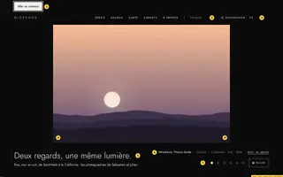 [HTML](maquettes/MQ-01-accueil-promesse.html) · [bureau](maquettes/MQ-01-accueil-promesse-bureau.webp) · [téléphone](maquettes/MQ-01-accueil-promesse-mobile.webp) |
| MQ-02 | Galerie — rangées justifiées, filtres par adresse | site public | UX-F-28, UX-F-10, UX-F-12, UX-F-07, UX-F-30, UX-F-13, UX-F-17, UX-F-29, UX-F-44, UX-F-45, UX-F-26 | 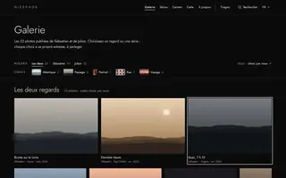 [HTML](maquettes/MQ-02-galerie-rangees-filtres.html) · [bureau](maquettes/MQ-02-galerie-rangees-filtres-bureau.webp) · [téléphone](maquettes/MQ-02-galerie-rangees-filtres-mobile.webp) |
| MQ-03 | Page d'une série — « Rue » | site public | UX-F-06, UX-F-10, UX-F-28, UX-F-17, UX-F-18, UX-F-13, UX-F-45, UX-F-30, UX-F-34, UX-F-40 | 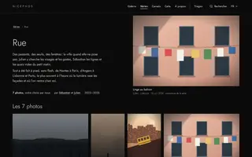 [HTML](maquettes/MQ-03-page-serie.html) · [bureau](maquettes/MQ-03-page-serie-bureau.webp) · [téléphone](maquettes/MQ-03-page-serie-mobile.webp) |
| MQ-04 | Visionneuse et cartel — la photo d'abord, reliée au site et au carnet | site public | UX-F-08, UX-F-09, UX-F-28, UX-F-14, UX-F-21, UX-F-44, UX-F-29, UX-F-11, UX-F-39, UX-F-24, UX-T-05, UX-T-17, UX-F-23, UX-F-46, UX-F-45, UX-F-20, UX-F-34 | 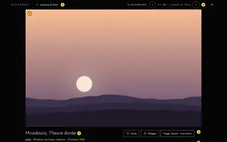 [HTML](maquettes/MQ-04-visionneuse-cartel.html) · [bureau](maquettes/MQ-04-visionneuse-cartel-bureau.webp) · [téléphone](maquettes/MQ-04-visionneuse-cartel-mobile.webp) |
| MQ-05 | « Je vous ai photographié » (/bonjour) — un consentement lisible, des erreurs à leur place | site public | UX-F-05, UX-F-04, UX-F-03, UX-T-02, UX-T-04, UX-F-23, UX-F-27 | 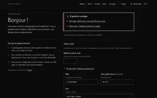 [HTML](maquettes/MQ-05-bonjour-formulaire.html) · [bureau](maquettes/MQ-05-bonjour-formulaire-bureau.webp) · [téléphone](maquettes/MQ-05-bonjour-formulaire-mobile.webp) |
| MQ-06 | Demander une licence depuis une photo, contact, Instagram | site public | UX-F-11, UX-F-05, UX-T-04, UX-F-34, UX-F-23, UX-T-03, UX-T-06 | 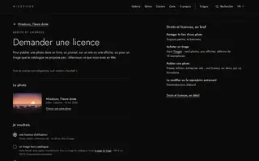 [HTML](maquettes/MQ-06-contact-tirage.html) · [bureau](maquettes/MQ-06-contact-tirage-bureau.webp) · [téléphone](maquettes/MQ-06-contact-tirage-mobile.webp) |
| MQ-07 | Admin — menu rangé, Réglages à onglets, Assistants d'analyse | administration | UX-A-11, UX-A-26, UX-T-03, UX-A-17, UX-A-18, UX-T-13, UX-A-15, UX-A-25, UX-A-06, UX-A-16, UX-A-22, UX-A-02, UX-A-04, UX-A-09, UX-A-29, UX-A-30, UX-A-32 | 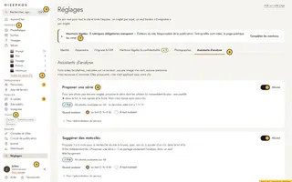 [HTML](maquettes/MQ-07-admin-menu-reglages.html) · [bureau](maquettes/MQ-07-admin-menu-reglages-bureau.webp) · [téléphone](maquettes/MQ-07-admin-menu-reglages-mobile.webp) |
| MQ-08 | Admin — compléter et proposer (ou publier) un lot | administration | UX-A-04, UX-A-03, UX-A-02, UX-A-10, UX-A-20, UX-A-21, UX-A-06, UX-A-14, UX-A-16, UX-A-17, UX-A-24, UX-A-08, UX-A-11, UX-A-30, UX-T-01 | 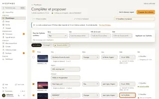 [HTML](maquettes/MQ-08-admin-lot-proposer.html) · [bureau](maquettes/MQ-08-admin-lot-proposer-bureau.webp) · [téléphone](maquettes/MQ-08-admin-lot-proposer-mobile.webp) |
| MQ-09 | Admin — enregistrer, confirmer, défaire (composants communs) | administration | UX-A-06, UX-A-07, UX-A-08, UX-A-05, UX-A-23, UX-A-14, UX-A-16, UX-A-27 | 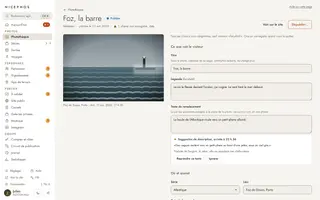 [HTML](maquettes/MQ-09-admin-enregistrer-confirmer.html) · [bureau](maquettes/MQ-09-admin-enregistrer-confirmer-bureau.webp) · [téléphone](maquettes/MQ-09-admin-enregistrer-confirmer-mobile.webp) |
| MQ-10 | App de terrain — un accord qui ne se perd jamais | administration | UX-A-01, UX-A-12, UX-A-13, UX-A-09, UX-T-02, UX-A-18, UX-F-32 | 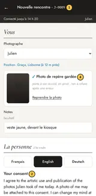 [HTML](maquettes/MQ-10-app-terrain-accord.html) · [téléphone](maquettes/MQ-10-app-terrain-accord-mobile.webp) (téléphone seulement) |
| MQ-11 | Carnets — la liste des billets | site public | UX-T-16, UX-F-33, UX-F-45, UX-T-18, UX-F-34, UX-T-03 | 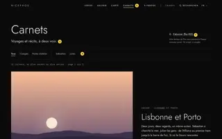 [HTML](maquettes/MQ-11-carnets-liste.html) · [bureau](maquettes/MQ-11-carnets-liste-bureau.webp) · [téléphone](maquettes/MQ-11-carnets-liste-mobile.webp) |
| MQ-12 | Carnets — un billet, « Lisbonne et Porto » | site public | UX-T-16, UX-T-18, UX-F-20, UX-F-01, UX-F-17, UX-F-29, UX-F-09, UX-F-45, UX-F-22, UX-F-23, UX-F-34, UX-F-11, UX-T-17, UX-F-35 | 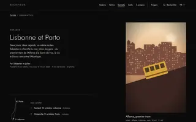 [HTML](maquettes/MQ-12-carnet-billet.html) · [bureau](maquettes/MQ-12-carnet-billet-bureau.webp) · [téléphone](maquettes/MQ-12-carnet-billet-mobile.webp) |
| MQ-13 | Tirages — la page d'un tirage | site public | UX-T-16, UX-F-15, UX-T-17, UX-F-11, UX-T-05 | 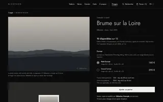 [HTML](maquettes/MQ-13-boutique-tirage.html) · [bureau](maquettes/MQ-13-boutique-tirage-bureau.webp) · [téléphone](maquettes/MQ-13-boutique-tirage-mobile.webp) |
| MQ-14 | Tirages — le panier, une commande par photographe | site public | UX-T-17, UX-F-05 | 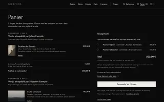 [HTML](maquettes/MQ-14-boutique-panier.html) · [bureau](maquettes/MQ-14-boutique-panier-bureau.webp) · [téléphone](maquettes/MQ-14-boutique-panier-mobile.webp) |
| MQ-15 | Tirages — coordonnées, deux paiements, confirmation | site public | UX-F-04, UX-T-17, UX-F-05, UX-F-35 | 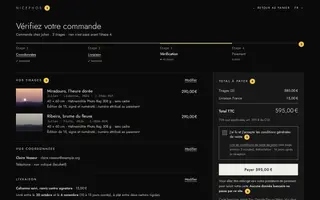 [HTML](maquettes/MQ-15-boutique-commande-paiement.html) · [bureau](maquettes/MQ-15-boutique-commande-paiement-bureau.webp) · [téléphone](maquettes/MQ-15-boutique-commande-paiement-mobile.webp) |
| MQ-16 | Galerie privée — la page du lien et du mot de passe | site public | UX-T-16, UX-T-18, UX-F-05, UX-F-27 | 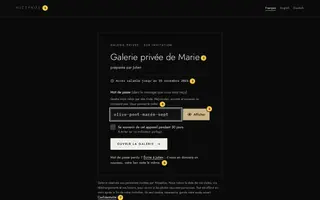 [HTML](maquettes/MQ-16-galerie-privee-acces.html) · [bureau](maquettes/MQ-16-galerie-privee-acces-bureau.webp) · [téléphone](maquettes/MQ-16-galerie-privee-acces-mobile.webp) |
| MQ-17 | Galerie privée — la galerie ouverte, les favoris, le téléchargement selon les droits | site public | UX-T-16, UX-T-18, UX-F-13, UX-F-09, UX-T-12 | 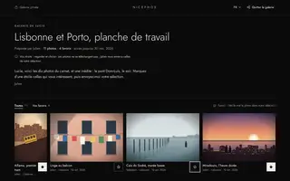 [HTML](maquettes/MQ-17-galerie-privee.html) · [bureau](maquettes/MQ-17-galerie-privee-bureau.webp) · [téléphone](maquettes/MQ-17-galerie-privee-mobile.webp) |
| MQ-18 | Admin — créer un accès à une galerie privée (lien, mot de passe, suivi, révocation) | administration | UX-T-18, UX-A-32, UX-A-07, UX-A-16, UX-A-06, UX-A-08, UX-A-11 | 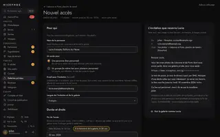 [HTML](maquettes/MQ-18-admin-acces-prive.html) · [bureau](maquettes/MQ-18-admin-acces-prive-bureau.webp) · [téléphone](maquettes/MQ-18-admin-acces-prive-mobile.webp) |
| MQ-19 | Admin — les commandes de la boutique | administration | UX-T-17, UX-A-16, UX-A-32, UX-A-07, UX-A-06, UX-A-08, UX-A-11 | 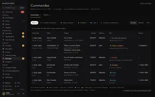 [HTML](maquettes/MQ-19-admin-commandes.html) · [bureau](maquettes/MQ-19-admin-commandes-bureau.webp) · [téléphone](maquettes/MQ-19-admin-commandes-mobile.webp) |
| MQ-20 | Admin — l'éditeur d'un billet | administration | UX-T-16, UX-T-18, UX-A-06, UX-A-21, UX-A-10, UX-A-16, UX-A-08, UX-F-44 | 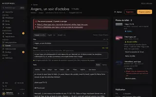 [HTML](maquettes/MQ-20-admin-editeur-billet.html) · [bureau](maquettes/MQ-20-admin-editeur-billet-bureau.webp) · [téléphone](maquettes/MQ-20-admin-editeur-billet-mobile.webp) |

### Version 2 des maquettes (16 octobre 2026)

**Pourquoi une deuxième version.** Un jury indépendant (ergonome, auditeur RGAA, directeur artistique de galerie photo) a noté la première série (v0) avec la grille. Toutes les notes étaient entre 5 et 7/10, donc sous le seuil de 8 : les vingt maquettes ont été refaites. Les causes étaient surtout communes à la série :

- **Trois défauts transverses du site public**, comptés dans chaque maquette : l'en-tête débordait entre 761 et environ 1 100 px de large, et en allemand (WCAG 1.4.4 et 1.4.10) ; le bouton « Menu » du téléphone exigeait JavaScript ; les pastilles d'annotation, posées dans le flux, décalaient ou recouvraient l'interface, et deux maquettes les faisaient lire aux lecteurs d'écran.
- **Des maquettes qui ne se ressemblaient pas** : cinq en-têtes, trois pieds de page, cinq formes de cartel, trois façons d'annoncer un champ obligatoire ; côté administration, deux jeux de composants (MQ-07 à MQ-09 contre MQ-18 à MQ-20), deux règles d'enregistrement, deux ordres de boutons dans les dialogues, deux codes de pastilles.
- **Des mots et des données qui se contredisaient** : « Tous » ici, « Les deux » là ; « Prix TTC » à côté de la franchise de TVA ; « Tirage, licence : nous écrire » à côté de la boutique ; une même image sous plusieurs titres ; des stocks et un ordre du carnet qui changeaient d'une maquette à l'autre.
- **Des défauts de direction artistique récurrents** : passe-partout gris autour des vignettes, capitales espacées, trop de Plex Mono, trop de boîtes, une photo d'ouverture timide.

| Maquette | Note v0 | Note v1 |
|---|---|---|
| MQ-01 à MQ-06, MQ-11 à MQ-13, MQ-15 (site public) | 6/10 | à venir |
| MQ-14 (panier) | 5/10 | à venir |
| MQ-16 et MQ-17 (galerie privée) | 7/10 | à venir |
| MQ-07 à MQ-09 (administration) | 7/10 | à venir |
| MQ-10 (app de terrain), MQ-18 à MQ-20 (administration) | 6/10 | à venir |

**Ce qui a changé.**

- **Une direction artistique commune**, la planche [MQ-00](maquettes/MQ-00-direction-artistique.html) : jetons uniques pour cinq thèmes ; trois en-têtes nommés (Site, Contexte, Tunnel), calés sur l'allemand et vérifiés de 320 à 1 440 px ; menu du téléphone sans script ; deux pieds de page ; un seul cartel ; des rangées justifiées partout, sans fond gris ; trois niveaux de boutons ; un gabarit de formulaire ; une règle des prix et de la TVA ; les mêmes pastilles d'état ○ ◐ ● ▲ ✕ pour les photos, les billets, les accès et les commandes. Les composants sont dans `_commun/public.css` et `_commun/admin-plus.css` ; une maquette ne garde dans son style que sa mise en page.
- **Un référentiel commun**, [LEXIQUE-ET-DONNEES.md](maquettes/LEXIQUE-ET-DONNEES.md) : une image = une photo, à jamais (26 photos, dont 22 publiées) ; un numéro d'inventaire stable (`J26-003`) ; les stocks et numéros des tirages ; les commandes (`C-2026-0001` à `C-2026-0008`) ; les galeries privées et les personnes ; l'ordre « choisi par nous » de la Galerie.
- **Une grille écrite avant de redessiner**, [GRILLE.md](maquettes/GRILLE.md) : quatorze critères (les huit de Bastien et Scapin, accessibilité, sobriété, direction artistique, fidélité au site, couverture des constats, lisibilité de la maquette). Chaque maquette a été refaite entièrement et chaque remarque du jury v0 traitée.
- **Des annotations qui ne touchent plus l'interface** : pastilles carrées hors du flux, `aria-hidden`, interrupteur `#sans-annotations` contrôlé pixel à pixel ; axe-core à 0 violation au bureau et au téléphone ; états d'erreur, de chargement et en allemand montrés.

**Évaluation v1 : à venir.**

### Les maquettes une à une

#### MQ-00 — Planche de direction artistique — jetons, typographie, en-têtes, cartel, boutons, formulaires, prix, composants des pages, administration, annotations, lexique

**Rôle :** la référence commune des vingt maquettes (site public et administration). **Fichier :** [MQ-00-direction-artistique.html](maquettes/MQ-00-direction-artistique.html). Rendue en trois bandes au bureau et en six au téléphone (densité 1,5).

#### MQ-01 — Accueil — la photo d'abord, la promesse, les deux regards

**Constats illustrés :** UX-F-36, UX-F-02, UX-F-17, UX-F-01, UX-F-44, UX-F-16, UX-F-10, UX-F-29, UX-F-23, UX-F-18, UX-F-45, UX-F-12, UX-F-30, UX-F-28, UX-T-16, UX-F-34, UX-F-06. **Fichier :** [MQ-01-accueil-promesse.html](maquettes/MQ-01-accueil-promesse.html).

#### MQ-02 — Galerie — rangées justifiées, filtres par adresse

**Constats illustrés :** UX-F-28, UX-F-10, UX-F-12, UX-F-07, UX-F-30, UX-F-13, UX-F-17, UX-F-29, UX-F-44, UX-F-45, UX-F-26. **Fichier :** [MQ-02-galerie-rangees-filtres.html](maquettes/MQ-02-galerie-rangees-filtres.html).

#### MQ-03 — Page d'une série — « Rue »

**Constats illustrés :** UX-F-06, UX-F-10, UX-F-28, UX-F-17, UX-F-18, UX-F-13, UX-F-45, UX-F-30, UX-F-34, UX-F-40. **Fichier :** [MQ-03-page-serie.html](maquettes/MQ-03-page-serie.html).

#### MQ-04 — Visionneuse et cartel — la photo d'abord, reliée au site et au carnet

**Constats illustrés :** UX-F-08, UX-F-09, UX-F-28, UX-F-14, UX-F-21, UX-F-44, UX-F-29, UX-F-11, UX-F-39, UX-F-24, UX-T-05, UX-T-17, UX-F-23, UX-F-46, UX-F-45, UX-F-20, UX-F-34. **Fichier :** [MQ-04-visionneuse-cartel.html](maquettes/MQ-04-visionneuse-cartel.html).

#### MQ-05 — « Je vous ai photographié » (/bonjour) — un consentement lisible, des erreurs à leur place

**Constats illustrés :** UX-F-05, UX-F-04, UX-F-03, UX-T-02, UX-T-04, UX-F-23, UX-F-27. **Fichier :** [MQ-05-bonjour-formulaire.html](maquettes/MQ-05-bonjour-formulaire.html).

#### MQ-06 — Demander une licence depuis une photo, contact, Instagram

**Constats illustrés :** UX-F-11, UX-F-05, UX-T-04, UX-F-34, UX-F-23, UX-T-03, UX-T-06. **Fichier :** [MQ-06-contact-tirage.html](maquettes/MQ-06-contact-tirage.html).

#### MQ-07 — Admin — menu rangé, Réglages à onglets, Assistants d'analyse

**Constats illustrés :** UX-A-11, UX-A-26, UX-A-17, UX-A-15, UX-A-25, UX-A-18. **Fichier :** [MQ-07-admin-menu-reglages.html](maquettes/MQ-07-admin-menu-reglages.html).

#### MQ-08 — Admin — compléter et proposer (ou publier) un lot

**Constats illustrés :** UX-A-04, UX-A-03, UX-A-02, UX-A-10, UX-A-20, UX-A-21. **Fichier :** [MQ-08-admin-lot-proposer.html](maquettes/MQ-08-admin-lot-proposer.html).

#### MQ-09 — Admin — enregistrer, confirmer, défaire (composants communs)

**Constats illustrés :** UX-A-06, UX-A-07, UX-A-08, UX-A-05, UX-A-23, UX-A-14, UX-A-16, UX-A-27. **Fichier :** [MQ-09-admin-enregistrer-confirmer.html](maquettes/MQ-09-admin-enregistrer-confirmer.html).

#### MQ-10 — App de terrain — un accord qui ne se perd jamais

**Constats illustrés :** UX-A-01, UX-A-12, UX-A-13, UX-A-09, UX-T-02. **Fichier :** [MQ-10-app-terrain-accord.html](maquettes/MQ-10-app-terrain-accord.html). Téléphone seulement : l’app de terrain ne s’utilise que sur téléphone.

#### MQ-11 — Carnets — la liste des billets

**Constats illustrés :** UX-T-16, UX-F-33, UX-F-45, UX-T-18, UX-F-34, UX-T-03. **Fichier :** [MQ-11-carnets-liste.html](maquettes/MQ-11-carnets-liste.html).

#### MQ-12 — Carnets — un billet, « Lisbonne et Porto »

**Constats illustrés :** UX-T-16, UX-T-18, UX-F-20, UX-F-01, UX-F-17, UX-F-29, UX-F-09, UX-F-45, UX-F-22, UX-F-23, UX-F-34, UX-F-11, UX-T-17, UX-F-35. **Fichier :** [MQ-12-carnet-billet.html](maquettes/MQ-12-carnet-billet.html).

#### MQ-13 — Tirages — la page d'un tirage

**Constats illustrés :** UX-T-16, UX-F-15, UX-T-17, UX-F-11, UX-T-05. **Fichier :** [MQ-13-boutique-tirage.html](maquettes/MQ-13-boutique-tirage.html).

#### MQ-14 — Tirages — le panier, une commande par photographe

**Constats illustrés :** UX-T-17, UX-F-05. **Fichier :** [MQ-14-boutique-panier.html](maquettes/MQ-14-boutique-panier.html).

#### MQ-15 — Tirages — coordonnées, deux paiements, confirmation

**Constats illustrés :** UX-F-04, UX-T-17, UX-F-05, UX-F-35. **Fichier :** [MQ-15-boutique-commande-paiement.html](maquettes/MQ-15-boutique-commande-paiement.html).

#### MQ-16 — Galerie privée — la page du lien et du mot de passe

**Constats illustrés :** UX-T-16, UX-T-18, UX-F-05, UX-F-27. **Fichier :** [MQ-16-galerie-privee-acces.html](maquettes/MQ-16-galerie-privee-acces.html).

#### MQ-17 — Galerie privée — la galerie ouverte, les favoris, le téléchargement selon les droits

**Constats illustrés :** UX-T-16, UX-T-18, UX-F-13, UX-F-09, UX-T-12. **Fichier :** [MQ-17-galerie-privee.html](maquettes/MQ-17-galerie-privee.html).

#### MQ-18 — Admin — créer un accès à une galerie privée (lien, mot de passe, suivi, révocation)

**Constats illustrés :** UX-T-18, UX-A-32, UX-A-07, UX-A-16. **Fichier :** [MQ-18-admin-acces-prive.html](maquettes/MQ-18-admin-acces-prive.html).

#### MQ-19 — Admin — les commandes de la boutique

**Constats illustrés :** UX-T-17, UX-A-16, UX-A-32, UX-A-19, UX-A-07. **Fichier :** [MQ-19-admin-commandes.html](maquettes/MQ-19-admin-commandes.html).

#### MQ-20 — Admin — l'éditeur d'un billet

**Constats illustrés :** UX-T-16, UX-T-18, UX-A-06, UX-A-21, UX-A-32. **Fichier :** [MQ-20-admin-editeur-billet.html](maquettes/MQ-20-admin-editeur-billet.html).

### Ce que chaque maquette doit montrer

Ce que montrent les maquettes v2, écran par écran. Mots, dates, prix, numéros et personnes viennent de [LEXIQUE-ET-DONNEES.md](maquettes/LEXIQUE-ET-DONNEES.md) ; les composants, de la planche MQ-00.

- **MQ-00 — Planche de direction artistique.** Ce n'est pas un écran du site : c'est la référence que les vingt maquettes assemblent sans la redessiner, chaque règle écrite à côté de son exemple. Jetons des cinq thèmes (nuit, jour, Atelier, admin clair, « Chambre noire ») et leurs contrastes ; échelle typographique (Jost ; IBM Plex Mono réservée aux données) ; espaces sur une grille de 8 px. Trois en-têtes nommés, Site, Contexte et Tunnel, montrés à plusieurs largeurs en français et en allemand, menu du téléphone en `
`, sans script ; deux pieds de page (complet, réduit). Le cartel unique (titre, puis « Auteur · Lieu · date »), les rangées justifiées et le diptyque. Boutons à trois niveaux (plein, filet, lien) ; bascules J'aime (cœur, site public) et Favori (étoile, galerie privée). Le gabarit de formulaire : une seule phrase d'obligation, « ⚠ Erreur : » sous le champ ou sous la légende du groupe, résumé focalisé, cases et radios dessinées, pas de phrase d'obligation pour un formulaire à un seul champ. Prix (« 180 € » en vitrine, « 290,00 € » au panier), une seule mention de TVA, étapes du tunnel. Les composants des pages (section 10), l'administration (barre latérale, en-tête de page, pastilles ○ ◐ ● ▲ ✕, message d'action avec « Défaire », dialogue), le gabarit des annotations et le lexique.
- **MQ-01 — Accueil — la photo d'abord, la promesse, les deux regards.** Thème Nicephos nuit. « Aller au contenu » est le premier arrêt du clavier (état montré). En-tête Site : « NICEPHOS », Galerie · Séries · Carnets · Carte · À propos, puis, après un filet et de même graisse, Tirages ; recherche ; langue « FR » ; pas de panier tant qu'il est vide ; au téléphone, « Menu » en `
`. Photo d'ouverture entière, à la hauteur de l'écran, ni voile, ni zoom, ni texte posé dessus : Belém, contre-jour au bureau (1 008 × 672 px), une verticale au téléphone (Escaliers des Guindais) ; une seule `<picture>`, une seule image chargée. Le diaporama est à l'arrêt par défaut : rien ne bouge sans geste ; points nommés (« Photo 1 sur 6 : Belém, contre-jour ») et « Lire », cachés sans script. Dessous, un bandeau : H1 « Deux regards, une même lumière. », sous-ligne « Les photographies de Sébastien et Julien, d'Angers à Lisbonne et Porto. », cartel à droite (« Belém, contre-jour », « Sébastien · Lisbonne · 10 oct. 2026 », « Voir la photo »). Puis « Les deux · Sébastien · Julien » avec le compte de chacun (22, 10 et 12 photos), à côté du diptyque « Même fleuve » (le Douro à Porto le 11 oct. 2026, « deux regards, à 9 h 10 puis à 17 h 20 » : Ribeira, brume du fleuve, puis Foz, la barre) ; les cinq séries au format de leur couverture, avec leur compte, et « Toute la galerie : 22 photos » ; les deux derniers billets des Carnets (15 et 14 oct. 2026), en cartes à couverture verticale à côté du texte ; pied de page complet (Le site, Tirages). États : le diaporama lancé (après « Lire », la photo 2, Brume sur la Loire, et « Pause ») ; sans JavaScript (ni points ni « Lire ») ; allemand avec le panier plein (« Reisetagebücher », « Kunstdrucke », « Warenkorb (2) », « Abspielen », « Beide · 22 Fotos, von uns gewählt ») ; première tabulation. Titre de page : « Nicephos — photographies de Sébastien et Julien ».
- **MQ-02 — Galerie — rangées justifiées, filtres par adresse.** Une page `/galerie` (à créer ; `/?regard=julien` y redirigera), H1 « Galerie », titre de page « Galerie · Nicephos ». Barre collante : « Les deux · Sébastien · Julien » avec le compte de chacun (actif en 500, souligné de sable, `aria-current`) ; « Ordre : choisi par nous » en `
` à droite (« Plus récentes d'abord ») ; les séries en couvertures de 32 px au format de la photo, avec leur compte (Atlantique 3, Paysage 5, Portrait 3, Rue 7, Voyage 4). Chaque filtre est un lien dont l'adresse se partage (`/galerie?regard=julien`). Titre de la grille : « Les deux regards · 22 photos ». Rangées justifiées dans l'ordre « choisi par nous » du lexique, chaque photo à son format, sans fond gris, deux photos au plus par rangée au téléphone ; cartel « Titre » puis « Auteur · Lieu · date », jamais coupé ; « Quai, 7 h 12 » au focus. Le diptyque « Même soir » (Miradouro, l'heure dorée, Julien, 18 h 52, puis Belém, contre-jour, Sébastien, 19 h 05 ; « deux regards, à 18 h 52 puis à 19 h 05 ») prend la place de Belém, et Miradouro quitte la sienne. Les trois scènes de nuit et de contre-jour (Deux ombres, Élise, Deux, minuit), redessinées lisibles, ne sont dans la première rangée d'aucune vue filtrée ; « Deux ombres » est au rang 18. Fin de liste sans défilement infini ni « Charger plus » : « Les 22 photos sont affichées. », puis les séries et la carte. États : regard « Julien » (« Les photos de Julien · 12 sur 22 », Atlantique à 0 et non lié, Rue 6, la vue ouverte par Ligne d'eau, Passage et Sous-bois, titre de page « Galerie, par Julien (12 photos) · Nicephos ») ; deux filtres sans photo commune (« Atlantique, par Julien », 0 photo, étiquettes ✕, deux pistes) ; ordre ouvert ; allemand (« Beide », « Reihenfolge: von uns gewählt », les séries traduites).
- **MQ-03 — Page d'une série — « Rue ».** `/serie/rue` (l'adresse du code), sans diaporama. Fil d'Ariane « Séries / Rue » (page en `aria-current`, « Séries » vers `/series`, à créer). H1 « Rue », stable ; texte d'intention : « Des passants, des seuils, des fenêtres : la ville quand elle ne pose pas. Julien y cherche les visages et les gestes, Sébastien les lignes et les quais vides du petit matin. » (au téléphone, deux phrases, puis « Lire la suite » en `
`). Fiche : « 7 photos, ordre choisi par nous · par Sébastien et Julien · 2023–2026 », les noms vers la galerie de chacun. Couverture du référentiel (Linge au balcon), entière, 45 % de la hauteur de l'écran au plus, avec son cartel ; au téléphone, une petite version à côté du fil d'Ariane (une seule image chargée). « Les 7 photos » dès le premier écran, en rangées, dans l'ordre de la galerie filtrée : Quai, 7 h 12 · Passage · Alfama · Linge, puis Deux ombres · Escaliers · Deux, minuit, les deux scènes de nuit après la première rangée ; deux photos au plus par rangée au téléphone. Puis « La même série, un seul regard » (« Rue, par Sébastien », 1 photo ; « Rue, par Julien », 6 photos), « Autres séries » (quatre couvertures à hauteur commune, vers `/serie/<slug>`) et le pied de page complet. États : réseau lent (la première rangée du bureau, place réservée au format de chaque photo), allemand (« Serien / Straße », « 7 Fotos, von uns gewählt »). Titre de page : « Rue — série de Sébastien et Julien · Nicephos ».
- **MQ-04 — Visionneuse et cartel — la photo d'abord, reliée au site et au carnet.** « Miradouro, l'heure dorée », ouverte depuis le billet « Lisbonne et Porto » (`/photo/miradouro-l-heure-doree?carnet=lisbonne-et-porto`). En-tête Contexte : « ← Lisbonne et Porto » (retour à la photo 4 du billet), « NICEPHOS » au centre, « Menu » en `
`. Photo à la hauteur de l'écran (1 064 × 709 px au bureau), bord à bord au téléphone ; précédente (Cais do Sodré, marée basse) et suivante (Belém, contre-jour) dans l'ordre du billet. Cartel sous l'horizontale : « 4 / 10 · Lisbonne et Porto », H1 « Miradouro, l'heure dorée » en casse normale, « Julien · Lisbonne · 10 oct. 2026 ». Gestes : un seul bouton plein, « Tirage : à partir de 180 € » ; « J'aime 12 » en bascule à filet ; « Partager » en lien. La légende, puis les données : Miradouro da Graça, Lisbonne · 10 oct. 2026, 18 h 52 ; Lisbonne et Porto, photo 4 sur 10 ; série Voyage ; « Julien · 12 photos » ; Fujifilm X-T5 · 23 mm · 1/1000 s · f/11 · ISO 160 ; inventaire « J26-003 » en Plex Mono. L'offre en clair : 180 € en petit format, 290 € en grand, édition de 15 exemplaires, 8 disponibles, une mention de TVA. « Demander une licence », un lien souligné vers `/droits/demande?photo=miradouro-l-heure-doree` (le formulaire prérempli de MQ-06) ; « Vous êtes sur cette photo ? » (« Recevez-la, ou donnez ou refusez votre accord »). Raccourcis dits en une ligne au bureau (← →, Échap, F) et « Plein écran ». « À proximité », trié par distance, la distance en tête de la méta : Alfama, premier tram (« 600 m · Alfama · Julien »), Linge au balcon (700 m), Cais do Sodré, marée basse (2,4 km), Belém, contre-jour (« 6 km · Belém · Sébastien · même soir »), à hauteur commune ; mini-carte en SVG avec une échelle de 1 km (« 4 photos à moins de 7 km ») ; pied de page complet. États : plein écran (« Quitter », Échap), menu ouvert, allemand (« Lissabon und Porto », « Kunstdruck: ab 180 € », « Gefällt mir », « Lizenz anfragen »). Titre de page : « Miradouro, l'heure dorée — Julien · Lisbonne et Porto (4 / 10) · Nicephos ».
- **MQ-05 — « Je vous ai photographié » (/bonjour) — un consentement lisible, des erreurs à leur place.** Thème Nicephos nuit, celui de la production (et non plus Atelier), une colonne, tous les champs de `views/bonjour.eta`. Étiquette « Votre photo », H1 « Bonjour ! ». État principal : le 15 oct. 2026, le retour du serveur après l'envoi incomplet de Claire Exemple, photographiée la veille quai Ligny ; titre de page « Erreur : 2 points à corriger · Je vous ai photographié · Nicephos » ; résumé focalisé en `<section>` titrée (« 2 points à corriger »), chaque point lien vers son champ (Votre âge, Votre e-mail) ; « ⚠ Erreur : » sous le champ, ou sous la légende d'un groupe ; saisie gardée. Une seule phrase : « Tous les champs sont obligatoires, sauf mention « facultatif ». ». Groupes : Votre carte (« Pas de carte ? Dites-nous quand et où », date en champ libre, « 14/10/2026 », jamais `type=date`) ; Votre âge, avant les usages (le nom du parent n'apparaît que si « moins de 18 ans » est coché, sans script) ; Ce que vous souhaitez ; Publication de la photo (« Je ne sais pas encore » présélectionné, usages rattachés à « J'accepte ») ; Vos données (copie, effacement, « Vos droits sur vos données ») ; Vous joindre. Cases et radios dessinées, focus de 2 px ; « Envoyer », et « Nous répondons sous 7 jours. » ; puis « Ce qui se passe ensuite », en trois points. États : allemand vide, focus sur une case (« Das Foto per E-Mail erhalten ») ; le champ e-mail atteint depuis le résumé (focus et erreur ensemble) ; moins de 18 ans ; limite anti-abus (« Envoi suspendu un moment », reprise à 15 h 40, recours par e-mail, saisie gardée) ; après l'envoi (« Merci, c'est noté. » et le récapitulatif, la date relue « mercredi 14 octobre 2026 »).
- **MQ-06 — Demander une licence depuis une photo, contact, Instagram.** `/droits/demande?photo=miradouro-l-heure-doree` (à créer), ouverte par « Demander une licence » dans la visionneuse ; titre de page « Demander une licence · Miradouro, l'heure dorée · Nicephos ». Le vendredi 16 oct. 2026 à 15 h 34, Lucie Exemple (Éditions du Fleuve) remplit sa demande. « ← Miradouro, l'heure dorée » ; étiquette « Droits et licences », H1 « Demander une licence » ; la phrase d'obligation de la planche. Groupes : La photo (vignette de 160 px et cartel, une fois, « Choisir une autre photo ») ; Je voudrais (une licence d'utilisation, un tirage hors catalogue, autre chose ; « tirage hors catalogue » renvoie à la page du tirage, « 180 € ou 290 €, 8 exemplaires disponibles », description hors du label) ; Usage prévu (le support en quatre radios, puis la diffusion et la durée, facultatives, avec un exemple) ; Votre message ; Vous joindre. Un seul bouton plein, « Envoyer la demande », et « Julien vous répond sous 7 jours, avec un prix. ». « Droits et licences, en bref » à droite au bureau, après le formulaire au téléphone. États : deux points à corriger (résumé en `<section>` titrée, la photo restée en tête) ; un seul point (pas de résumé, titre « Erreur : votre e-mail · Demander une licence · Nicephos », focus sur le champ) ; après l'envoi (« Merci, c'est envoyé. » et le récapitulatif) ; le contact `/a-propos#contact` (« Écrire à Sébastien, à Julien, ou aux deux » : trois adresses en `mailto`, une photo de chacun, sans cadre, à hauteur commune, le diptyque « Même soir » pour les deux ; puis Instagram, le flux RSS des carnets, les éditeurs et le directeur de la publication) ; `/instagram` (à créer), la page du lien en bio, où chaque publication renvoie à sa page photo (seules les photos dont les personnes ont accepté Instagram : Inês oui, Tiago non) ; `/mentions-legales` complètes (éditeurs, directeur de la publication, contact, hébergement, vente des tirages, photos, données).
- **MQ-07 — Admin — menu rangé, Réglages à onglets, Assistants d'analyse.** Le mode suit le système (« Chambre noire » au bureau, clair au téléphone) ; Julien, administrateur, le vendredi 16 oct. 2026 à 22 h 40. Barre latérale (la même dans les sept maquettes de l'administration) : Aujourd'hui, puis quatre groupes nommés par tâche, Photos · Personnes · Publier · Équipe (18 entrées et 5 au pied, au lieu de 28), qui tiennent dans 900 px ; séries repliées sous « Séries », comptées comme le code (3 · 6 · 3 · 8 · 5, tous statuts) ; « Publier » prêt à recevoir Carnets, Galeries privées et Boutique ; Signalements dans Personnes ; au pied, Réglages et Aide, Voir le site et la langue, Nouveautés et la version 1.90.0, le compte, le thème et la déconnexion (langue et thème en formulaires POST, comme main). Une seule page « Réglages », cinq onglets en liens (Identité et apparence, Filigrane et EXIF, Mentions et confidentialité, Photographes, Assistants d'analyse), qui passent à la ligne au téléphone. Assistants : un interrupteur par assistant, avec sa phrase d'effet et « Analyse faite : 26 photos sur 26 » ; « Quand calculer » dit une fois, titré dans son panneau (« La nuit, de 1 h à 6 h » ou « Dès l'import ») ; le jargon replié sous « Pour l'administrateur du serveur ». Ce qui se défait s'enregistre au geste, avec « Défaire » pendant 10 s ; les mentions légales gardent un bouton, « Mettre en ligne les mentions », refusé tant que deux rubriques obligatoires sont vides (résumé titré, erreur sous chaque champ, focus visible sur le champ en erreur) ; l'e-mail de contact et le téléphone y sont obligatoires, et un choix « Hébergement » (par les éditeurs ou chez un hébergeur) règle la phrase de la page ; « Revenir à la version enregistrée ». États : mentions refusées, allemand (le menu et l'Impressum), sans JavaScript (« Enregistrer les assistants »), logo refusé puis remplacé, assistant allumé (téléchargement, « Défaire »), palette (« impressum » et ses synonymes, « 3 résultats » annoncé ; « Aucun résultat » annoncé, avec une issue), Mon compte ouvert depuis le nom (raccourcis d'une touche), rôle Photographe (Sébastien : « Séries » n'est pas un lien, ses séries 3 · 4 · 1 · 2 · 2, « Mes propositions », Boutique 2, ni Signalements ni Réglages), Aujourd'hui (« Bonsoir, Julien. », une seule liste À faire), Photographes en cartes, menu du téléphone avec « Fermer ».
- **MQ-08 — Admin — compléter et proposer (ou publier) un lot.** Mode clair ; Sébastien, photographe, le 16 oct. 2026 à 21 h 34, complète les trois brouillons importés le 14 oct. à Angers (`R0004012.JPG` Minoterie, brume du matin ; `R0004046.JPG` Quai Ligny, soir ; `R0004057.JPG` Réverbères, quai Ligny). Son menu, la variante Photographe de la planche (« Séries » sans lien, ses séries 3 · 4 · 1 · 2 · 2, Boutique 2). « Compléter et proposer », un seul bouton plein, « Proposer les 3 photos » (« Compléter et publier » pour Julien) ; étapes visibles au téléphone (« Étape 3 sur 3 »). Chaque champ s'enregistre en le quittant (« Enregistré à 21 h 34 », « 1 champ non enregistré : date de R0004057 », avec un lien vers le champ, dont le focus reste visible malgré son filet rouge). Doublons écartés et signalés. Barre « pour les cochées » : rien ne change avant « Appliquer », « Celle de chaque photo » par défaut, repliée au téléphone. Filtres « Les 3 photos · À corriger 1 · Accord à vérifier 1 ». Chaque ligne a pour en-tête sa vignette et son nom de fichier ; « ✦ Suggestion : Rue » (jamais « Proposée ») ; la date refusée est dite sous la ligne, sur toute sa largeur ; accord à vérifier visible (Quai Ligny) ; ville d'après le GPS, titres anglais et allemands repliés ; titre provisoire signalé. Dialogue avant de proposer : [Annuler] [Proposer sans corriger] [Proposer les 3 photos] ; côté administrateur, 2 photos sur 3 partent. États : sans JavaScript (« Enregistrer le lot »), proposer avec deux points à corriger, publier côté administrateur, touche P avec confirmation, « Défaire » après « Appliquer », la ville la plus probable d'abord, le filtre « À corriger », page refusée qui reste dans l'admin, allemand.
- **MQ-09 — Admin — enregistrer, confirmer, défaire (composants communs).** Mode clair ; Julien, le 16 oct. 2026 à 22 h 58, revoit la fiche de « Foz, la barre » (● Publiée, Sébastien). Un témoin et une règle : chaque champ s'enregistre quand on le quitte (« 1 champ non enregistré : date »), plus de « • Modifié » ni de bouton « Enregistrer » ; une seule commande de statut, « Dépublier… », avec une raison. Obligations dites en tête ; focus visible, sur le champ en erreur compris (le filet rouge reste, l'anneau du focus s'ajoute) ; la ✦ Suggestion de description arrive sans recharger la page ; date refusée sous le champ, avec « Corriger en 11 oct. 2026 ». États : sans JavaScript (« Enregistrer la fiche ») ; dialogue de départ seulement si un champ est refusé, [Annuler] d'abord ; message d'action en trois états (« Défaire », en pause au focus ; rétabli ; erreur avec « Réessayer ») ; dialogue « Dépublier » qui nomme la photo, raison obligatoire, focus visible sur le bouton radio en erreur ; un compte se désactive avant de se supprimer (Camille) ; Séries et Instagram sans rechargement ; les mots de l'administration (Annuler, Défaire, Revenir à la version enregistrée, ✦ Suggestion, Proposée, prête) ; la Photothèque filtrée « Brouillons 3 », avec la pastille ○ ◐ ● ▲ ✕ et sa légende ; allemand.
- **MQ-10 — App de terrain — un accord qui ne se perd jamais.** Téléphone seulement. Julien et Inês Exemplo, rua dos Remédios, Lisbonne, le samedi 10 oct. 2026 à 19 h 24, carte `J-0001`. H1 « Nouvelle rencontre », « connecté jusqu'à 3 h 24 » ; « Tendre le téléphone à la personne » replie la partie du photographe (photo de repère gardée). La section de la personne passe en anglais (« Français · English · Deutsch », sans drapeau, attribut `lang`) ; résumé focalisé en tête ; « I agree to them being used: » regroupe les quatre usages sous la décision ; erreur sous la légende du groupe, « Error: tell us whether you are 18 or older. », boutons radio marqués en erreur, dont le focus reste visible ; nom du parent hors du groupe Âge ; signature gardée (« Signature saved », « Clear » de 44 px) ; barre « Save » qui ne cache pas le champ focalisé. États : sans JavaScript (la carte papier à la place de la signature), « Vous » avant de tendre le téléphone, accueil Terrain à 19 h 26, envoi en cours (bouton « Sending… » inactif, en contour), réseau coupé (« Try again »), session expirée (l'accord est gardé sur le téléphone), signature effacée puis « Undo », allemand pour une mineure (le nom du parent manque), « Thank you! » avec le QR d'Inês, Mon QR, carte imprimée recto verso (plus rien sous 8 pt).
- **MQ-11 — Carnets — la liste des billets.** `/carnet` (à créer), en-tête Site avec « Carnets » actif, pas de panier tant qu'il est vide. H1 « Carnets », « Nos voyages et nos notes d'atelier, à deux voix : Sébastien cherche la mer, Julien les gens. », et « Qui sommes-nous ? ». Filtres en liens, chacun avec son nombre de billets : « Rubrique : Toutes 4 · Voyages 1 · Notes d'atelier 3 », « Regard : Les deux 4 · Sébastien 3 · Julien 2 ». « 4 billets, du plus récent au plus ancien » : « Inês, ou comment demander une photo » (Julien, 15 oct. 2026, 1 photo, 3 min de lecture), « Lisbonne et Porto » (Sébastien et Julien, 14 oct. 2026, 10 photos, 4 min), « Pourquoi nous ne recadrons pas » (Sébastien, 2 oct. 2026, 2 photos, 4 min), « Tirer sur Photo Rag » (Sébastien, 25 sept. 2026, 1 photo, 4 min) : rubrique, titre, chapô, « Auteur · date · photos · lecture » en `<time>`. Une couverture verticale (Inês, Lisbonne et Porto) se pose à côté du texte ; une horizontale prend la colonne, à hauteur commune ; ni passe-partout gris ni recadrage. Le titre est le seul lien, étendu à la carte. Page 1 sur 1 : pas de pagination à vide. « S'abonner au flux RSS des carnets » (`/carnet/flux.xml`, un flux Atom par langue), sans compte ni adresse e-mail, repris au pied de page. États : filtre « Julien » (`/carnet?par=julien` : 2 billets, « dont un à deux voix », comptes des rubriques recalculés, focus au clavier sur le premier billet) ; allemand (`/de/carnet`, « Reisetagebücher », le billet non traduit marqué « Nur auf Französisch ») ; au-delà de 12 billets, « Page 1 sur 2 · billets 1 à 12 sur 15 » et « Billets plus anciens » (`?page=2`).
- **MQ-12 — Carnets — un billet, « Lisbonne et Porto ».** `/carnet/lisbonne-et-porto` (à créer). Fil d'Ariane « Carnets / Lisbonne et Porto ». Ouverture en double page : étiquette « Voyages », H1, chapô « Deux jours, deux regards, un même océan. Sébastien a cherché la mer, Julien les gens : du premier tram de l'Alfama à la barre de Foz, là où le Douro rencontre l'Atlantique. », « Par Sébastien et Julien », « Publié le 14 oct. 2026 · mis à jour le 15 oct. 2026 · 4 min de lecture · 10 photos » (`<time>`, JSON-LD) ; la couverture est la photo 1 (Alfama, premier tram), seule image prioritaire. Sommaire des deux journées (samedi 10 octobre à Lisbonne, 6 photos ; dimanche 11 à Porto, 4 photos) et carte au trait en SVG. Prose en mode lecture (Jost 400, 18 px, interlignage 1,7, environ 65 signes). Les dix photos dans l'ordre du lexique, chacune à l'une des trois tailles de l'éditeur (normale, large, écran), les verticales avec leur cartel à côté ; dans le texte, le cartel du récit, l'auteur en tête, avec le lieu précis et l'heure (« Julien · Alfama, Lisbonne · sam. 10 oct., 7 h 42 ») ; diptyque « Même soir » (photos 4 et 5 : Miradouro, puis Belém ; « deux regards, à 18 h 52 puis à 19 h 05 ») ; paire sans titre commun (Tiago et Ribeira) ; citation en portugais (`lang="pt-PT"`) et sa traduction ; la mise à jour du 15 oct. renvoie au billet d'Inês. Chaque photo ouvre la visionneuse dans le contexte du billet (`?carnet=lisbonne-et-porto`). Fin : « Écrire à Sébastien et Julien », « Partager ce billet », « Les 10 photos de ce billet » en rangées (cartel standard), « Cinq de ces photos existent en tirage » (une ligne chacune, « à partir de 180 € », une mention de TVA), « Autres billets » (« ← Billet précédent » et « Billet suivant → », datés), le flux RSS et « Tous les billets ». États : la visionneuse ouverte depuis le billet (« ← Lisbonne et Porto », « 4 / 10 », « J'aime 12 », « Tirage : à partir de 180 € ») ; le mode automatique, nouveauté à créer (Nicephos jour sur un système réglé en clair) ; l'aperçu d'impression (noir sur blanc, à l'échelle 1, chaque cartel suivi de son adresse en 10 pt, 4 pages A4) ; allemand (titres des photos gardés en français, « 8:15 Uhr »).
- **MQ-13 — Tirages — la page d'un tirage.** `/tirages/brume-sur-la-loire` (à créer), titre de page « Brume sur la Loire, tirage d'art · Nicephos » ; le vendredi 16 oct. 2026, un peu avant 10 h, Claire Exemple a déjà « Escaliers des Guindais » dans son panier (« Panier (1) »). Fil d'Ariane « Tirages / Brume sur la Loire ». Photo entière, « © Sébastien » discret en coin ; une phrase dit que le tirage, lui, est signé au crayon. Étiquette « Tirage d'art », H1 « Brume sur la Loire », « Sébastien · Anjou · mars 2024 ». Édition honnête : « 10 disponibles sur 15 », et d'où viennent les 5 vendus (4 à l'exposition d'Angers, en juin 2026, et 1 ici). Formats en radios dessinées : petit format, image 24 × 36 cm · feuille 30 × 40, 180 € ; grand format, image 40 × 60 cm · feuille 50 × 70, 290 € ; le papier (Hahnemühle Photo Rag 308 g) dit une fois. Livraison : 15 € en France métropolitaine (reçu du 30 oct. au 6 nov.), 25 € dans l'Union européenne (du 3 au 10 nov.) ; « TVA non applicable, art. 293 B du CGI. » une seule fois, sous le premier prix. Un seul bouton plein, « Ajouter au panier » (formulaire POST), juste sous les formats, sans barre collante ; « Vendu, signé et expédié par Sébastien Exemple, en son nom », 14 jours pour changer d'avis. Le tirage au mur, à l'échelle, au-dessus d'une console de 120 cm, qui suit le format coché (CSS `:has`) : sans aplat gris, posé sur un trait de sol, réduit au petit format. « Ce que vous recevez » (le tirage, la signature, le certificat avec l'inventaire `S25-001`, la fabrication, l'entretien, le fabricant), « Livraison et retours », deux billets des Carnets ; « Les autres tirages de Sébastien » (« Épuisé : 15 sur 15 vendus » pour Le ciel s'est ouvert) et « Voir les 9 tirages ». Aucun compte à rebours. États : juste après l'ajout (« Ajouté au panier », focus, « Panier (2) ») ; l'édition s'épuise entre-temps (Le ciel s'est ouvert : rien n'est ajouté, « Voir les 8 tirages disponibles ») ; grand format coché (la feuille de 50 × 70 cm au mur) ; allemand (« Warenkorb (1) », « Nebel über der Loire », « In den Warenkorb »).
- **MQ-14 — Tirages — le panier, une commande par photographe.** `/panier`, titre de page « Panier (2) · Nicephos » ; le panier de Claire Exemple, le vendredi 16 oct. 2026 vers 10 h. H1 « Panier » ; dans l'en-tête, « Panier (2) » en mots au bureau, l'icône et le nombre au téléphone (nom lu « Panier, 2 tirages »). La règle dite une fois, dans le chapô : chacun signe ses tirages, les expédie depuis Angers et encaisse son propre paiement. Au téléphone et sur tablette, le total et le bouton aussi en tête du panier (« Total 500,00 € · 2 commandes, livraison comprise », « Commander les 2 tirages »). Un bloc par vendeur, dans l'ordre des ajouts : « Vendu et expédié par Julien Exemple » (Escaliers des Guindais, grand format, 290,00 € + livraison 15,00 € = 305,00 €, « Commande 1 sur 2 »), puis Sébastien Exemple (Brume sur la Loire, petit format, 180,00 € + 15,00 € = 195,00 €, « Commande 2 sur 2 »). Un exemplaire par ligne, son numéro donné après le paiement, « Retirer « … » » ; vignettes au format de la photo (verticale 120 × 180, horizontale 180 × 120 au bureau). Récapitulatif, collant au bureau : les deux paiements, « Total 500,00 € », livraison comprise, la seule mention de TVA ; l'enchaînement annoncé (coordonnées une fois, puis 305,00 € à Julien, puis 195,00 € à Sébastien, deux lignes sur le relevé, exemplaires réservés 35 minutes dès le premier « Payer »). Pays : France par défaut, « Livrer dans un autre pays » en repli, « Recalculer la livraison ». Un seul bouton plein, « Commander les 2 tirages » ; ni compte, ni produit suggéré, ni case cochée d'avance ; le cookie du panier dit en une phrase (30 jours). États : après « Retirer » (« Panier (1) », « Le remettre dans le panier », une commande à 305,00 €) ; l'édition s'épuise entre-temps (Le ciel s'est ouvert, barré et hors du total) ; panier vide (« Voir les tirages · 9 photos, de 180 € à 290 € », plus de panier dans l'en-tête).
- **MQ-15 — Tirages — coordonnées, deux paiements, confirmation.** Claire Exemple commande à 10 h 12 (`/commande`, titre de page « Vos coordonnées · Nicephos »). En-tête Tunnel : la marque, « ← Retour au panier », la langue ; pied de page réduit. Étapes « 1. Panier · 2. Coordonnées · 3. Paiement · 4. Confirmation » (« Étape 2 sur 4 » au téléphone). H1 « Vos coordonnées », « Une seule fois pour vos deux commandes. » : neuf champs avec `autocomplete`, la phrase d'obligation, « Adresse de facturation différente » en repli ; « Vos deux commandes » relues (lignes et vignettes, livraisons, total 500,00 €, une mention de TVA, deux colis reçus du 30 oct. au 6 nov.) ; une case des conditions de vente, non cochée, qui nomme les deux vendeurs et le droit de rétractation (14 jours). « Paiement 1 sur 2 » : bouton « Payer 305,00 € à Julien » ; dessous, la redirection vers le prestataire, le second paiement (195,00 € à Sébastien) et la réservation de 35 minutes. États : conditions non cochées (« Erreur : 1 point à corriger · Vos coordonnées · Nicephos », erreur sous la légende, focus sur la case) ; deux points à corriger (résumé, puis le code postal atteint depuis lui) ; la page du prestataire, en dessin neutre, hors du site (10 h 13, « Retour à Nicephos sans payer ») ; le second paiement à 10 h 15 (C-2026-0007 confirmée, exemplaire 6/15 ; « Étape 3 sur 4 · Paiement · 2 sur 2 » ; Brume sur la Loire réservé jusqu'à 10 h 47 ; « Payer 195,00 € à Sébastien » ou « Ne pas commander « Brume sur la Loire » ») ; la confirmation à 10 h 17 (« Merci, Claire : vos deux commandes sont payées. », C-2026-0007 et C-2026-0008, exemplaires 6/15, deux lignes de relevé « NICEPHOS JULIEN EXEMPLE » et « NICEPHOS SEBASTIEN EXEMPLE », « Suivre la commande » par `/commande/suivi/<jeton>`, livraison du 30 oct. au 6 nov., une facture par photographe envoyée à l'expédition, droit de changer d'avis) et son impression (« Confirmation de vos commandes », la date sur sa ligne : « Vendredi 16 octobre 2026, 10 h 17 ») ; l'édition s'épuise entre-temps (il ne reste qu'un paiement, 305,00 € à Julien) ; retour sans payer (« Reprendre le paiement de 305,00 € à Julien » ou « Annuler les deux commandes ») ; allemand (« Zurück zum Warenkorb », « Zahlungspflichtig bestellen · 305,00 € an Julien »).
- **MQ-16 — Galerie privée — la page du lien et du mot de passe.** `/g/6Me5pScUZIQhW-wezlKchJ9h3k7EDpzm` (`/g/:jeton`, à créer) ; le vendredi 16 oct. 2026 à 13 h 49, Lucie Exemple ouvre le lien reçu de Julien pour « Lisbonne et Porto, planche de travail ». En-tête Tunnel réduit à la marque, en texte, et à « Galerie privée » : ni menu, ni recherche, ni sélecteur de langue ; `noindex`, `no-referrer`, `no-store`. Titre d'onglet « Galerie privée · Nicephos » ; étiquette « Sur invitation », H1 « Galerie privée », « Julien a préparé ces photos pour vous. », « Accès valable jusqu'au 30 nov. 2026 » (`<time>`) ; ni titre de galerie, ni nom de l'invitée, ni photo, ni Open Graph. Mot de passe : aide « Julien vous l'a donné à part, dans un autre message : 12 lettres et chiffres, en trois groupes », majuscules, espaces et tirets ignorés, collage permis, `autocomplete="current-password"`, bascule « Afficher » (`aria-pressed`), avec script seulement ; pas de phrase d'obligation pour ce seul champ ; « Se souvenir de cet appareil pendant 30 jours » décoché par défaut (sinon, la galerie se referme après 12 h sans visite) ; « Ouvrir la galerie » ; « Mot de passe perdu ? Écrivez à Julien », et le lien reste le même ; ce qui est noté, en trois phrases. Aucun CAPTCHA. États, dans l'ordre de la journée de Lucie : 13 h 49, premier refus (« Erreur : mot de passe refusé · Galerie privée · Nicephos », encore 4 essais, champ vidé et focalisé) ; 13 h 57, pause d'une minute après 5 refus (« réessayez à 13 h 58 ») ; 14 h 05, mot de passe collé depuis le SMS puis affiché, accepté ; sans JavaScript (pas de bouton « Afficher ») ; invitation en allemand (« Private Galerie », « Galerie öffnen ») ; serveur occupé (503, « Un instant ») ; accès suspendu après 30 refus ; accès terminé (410, « Cet accès a pris fin le 30 sept. 2026. », galerie « Angers, juin 2026 » de Marc Exemple, « Écrire à Sébastien »).
- **MQ-17 — Galerie privée — la galerie ouverte, les favoris, le téléchargement selon les droits.** `/prive/7Hk2Qp9xLm4R`, titre de page « Lisbonne et Porto, planche de travail · Galerie privée · Nicephos » ; le vendredi 16 oct. 2026 à 14 h 46, juste après le 4e favori de Lucie Exemple (Pont Dom-Luís, le soir), focus sur l'étoile de « Cais do Sodré, marée basse ». En-tête Contexte privé : « Galerie privée », la marque en texte, la langue en boutons d'un formulaire POST, « Quitter la galerie » (POST). « Galerie de Lucie », H1 « Lisbonne et Porto, planche de travail », « Préparée par Julien · 11 photos · 4 favoris · accès jusqu'au 30 nov. 2026 » ; les droits dits une fois (« regarder et choisir », pas de téléchargement) ; le mot de Julien. Vues « Toutes 11 · Vos favoris 4 » (`?vue=favoris`). « Les 11 photos » en rangées justifiées, deux au plus par rangée au téléphone, dans l'ordre du carnet puis l'inédite (Pont Dom-Luís, le soir), servies par la route privée à la taille d'affichage (480, 900 et 1 600 px) ; sous le cartel de chaque vignette, toujours à la même place, l'étoile « Favori : titre » (44 × 44 px, `aria-pressed`, formulaire POST), jamais le cœur de J'aime. Barre de la sélection : « 4 favoris dans votre sélection » et « Envoyer ma sélection à Julien » ; ce qui est noté, effacé le 30 mai 2027. États, dans l'ordre de la journée : 14 h 05, vue des favoris vide ; 14 h 20, visionneuse dans la galerie (« ← Lisbonne et Porto, planche de travail », « 4 / 11 », Favori enfoncé sur Miradouro, ni Partager, ni J'aime, ni lien vers le site public) ; 15 h 20, sélection envoyée, encore modifiable (« Reprendre ma sélection ») ; allemand (« Private Galerie », « Lissabon und Porto, Arbeitsauswahl », « Verlassen », « Auswahl an Julien senden ») ; autres droits (« Quai Ligny, 14 octobre » de Claire : « Tout télécharger », une archive ZIP de 2,6 Mo, ou une photo à la fois, JPEG de 2 048 px, 1,3 Mo) ; après « Quitter la galerie » (favoris gardés jusqu'au 30 nov. 2026) ; retour après 12 h sans visite (404).
- **MQ-18 — Admin — créer un accès à une galerie privée (lien, mot de passe, suivi, révocation).** Le mode suit le système (« Chambre noire » en sombre, clair sinon). Julien, le 16 oct. 2026 de 11 h 20 à 17 h 32, ouvre un accès à Lucie Exemple (Éditions du Fleuve) depuis la galerie « Lisbonne et Porto, planche de travail » (Publier › Galeries privées). Un accès, une personne (le lien de groupe est un choix explicite) ; e-mail facultatif, et ce qu'il devient ; échéance saisie en mots et relue en toutes lettres, avec deux choix rapides qui sont des boutons d'envoi (sans script), jamais au-delà de la fermeture de la galerie (30 nov. 2026) ; droits en cases qui disent leur effet (favoris, téléchargement en 2 048 px ; filigrane, ni original ni GPS) ; les 11 photos et leurs accords (Tiago : site seulement, signalé ▲ sans bloquer, « Ouvrir l'accord de Tiago », `/admin/rencontres/30`, « Retirer de la galerie ») ; mot de passe généré (12 caractères), jamais dans l'e-mail ; [Annuler], puis « Créer l'accès et envoyer l'invitation » ; aperçu de l'invitation en texte seul. États : 11 h 22, deux erreurs (résumé titré, saisie gardée, focus visible sur le champ en erreur) ; 11 h 24, lien et mot de passe montrés une seule fois (« Copier » avec le script) ; 13 h 57, Lucie en pause après 5 refus, « Débloquer » ou un nouveau mot de passe ; 17 h 30, la liste des galeries (« ▲ Sélection envoyée par Lucie ») ; 17 h 31, la fiche de la galerie et ses onglets (Photos, Accès, Sélections, Activité, Réglages) ; 17 h 32, le suivi de l'accès (ouverture, dernière visite, appareils, favoris ; la journée de Lucie, sa sélection et sa demande de licence ; « Rouvrir ») ; révoquer (le dialogue nomme Lucie, Annuler a le focus, le message final n'offre pas de « Défaire ») ; effacer (ce qui part, ce qui reste) ; allemand.
- **MQ-19 — Admin — les commandes de la boutique.** Le mode suit le système. Julien, le vendredi 16 oct. 2026 à 9 h 40 : Publier › Boutique, avec son compteur (1 à préparer), deux onglets, Commandes 6 et Éditions 9. Les six commandes du lexique (C-2026-0001 à C-2026-0006) ; filtres aux noms des états et par vendeur (Les deux · Sébastien · Julien) ; une ligne par commande : référence, date, client et sa langue, tirages et leur exemplaire, montant à deux décimales, état ; légende des cinq états ; la franchise de TVA dite une fois. Fiche de C-2026-0005, ouverte à 9 h 41 (Anna Beispiel, Fribourg-en-Brisgau ; Ribeira ex. 4/15 et Miradouro ex. 7/15 ; 605,00 € ; ◐ Payée, à préparer) : où en est la commande, en une colonne (✓ Payée, « Maintenant · lancer les 2 tirages au laboratoire », puis la suite) ; l'action pleine est l'étape suivante, « Marquer « Tirage lancé » », un formulaire qui marche sans script et se défait ; « Rembourser… » à part ; registre des 15 exemplaires ; certificat en attente de signature ; facture émise à l'expédition (J-2026-0002), au SIREN du vendeur (fictif : 000 000 000). États : 16 h 10, après « Tirage lancé », « Défaire » pendant 10 s ; plus tard, l'expédition (un numéro de suivi Colissimo de 13 signes, refusé s'il est incomplet, focus visible sur le champ en erreur) ; un remboursement en exemple (montant proposé, motif obligatoire, sort de l'exemplaire, avoir ; Annuler a le focus) ; la commande de Sébastien en lecture seule (C-2026-0006, exemplaire réservé jusqu'à 9 h 47) ; e-mail et facture en allemand.
- **MQ-20 — Admin — l'éditeur d'un billet.** Le mode suit le système. Sébastien, photographe, le vendredi 16 oct. 2026 à 22 h 42, reprend son brouillon « Angers, un soir d'octobre » (Voyages ; Quai, 7 h 12 · Quai Ligny, soir · Réverbères, quai Ligny) et le propose à Julien ; son menu est la variante Photographe de la planche. « ← Carnets », le titre, ○ Brouillon, « ✓ Enregistré à 22 h 42 » : le brouillon s'enregistre seul, sans bouton « Enregistrer ». Une seule commande, « Proposer à Julien » (« Publier » ou « Programmer pour… » pour un administrateur), qui marche sans script. Après « Proposer », le résumé en tête : la photo sans accord (Quai Ligny, soir ; « Ouvrir la rencontre du 14 oct. », `/admin/rencontres/31`), le texte de remplacement manquant. Onglets Français · English · Deutsch avec leur état, sur deux lignes sous 420 px ; compteurs (titre 25 / 70 ; chapô 182 / 160, signalé ▲ sans erreur) ; Markdown restreint, barre de vrais boutons (avec script), Écrire ou Aperçu ; une photo est une ligne seule, son adresse (`photo:quai-ligny-soir`), son texte de remplacement et sa légende se réglant dans « Photos du billet » (écart avec l'étude § 1.4, lexique § 4.10) ; photos du billet avec leur pastille et leurs issues ; adresse, poids (380 ko sur un budget de 1 Mo), versions ; réglages repliés. États : « Décrire la photo… » (titre donné à 22 h 41, texte de remplacement avec ✦ Suggestion), version allemande proposée à 22 h 44 et à relire, le libellé qui suit le choix (« Programmer pour le sam. 17 oct., 8 h », date passée refusée), sans JavaScript, aperçu comme sur le site (nuit, à « Puis le soir » ; jour, le haut du billet), une photo ouverte dans la visionneuse du billet, « Retirer du billet » avec « Défaire ».

## Annexes

### Grilles

- [Grille RGAA 4.1.2 du site public](grilles/rgaa-site-public.md) et [version Excel](grilles/rgaa-site-public.xlsx) : 106 critères, justification et page pour chacun, critères WCAG 2.2 AA nouveaux, suivi des audits précédents.
- [Grille RGAA 4.1.2 de l'administration](grilles/rgaa-administration.md) et [version Excel](grilles/rgaa-administration.xlsx) : 106 critères, échantillon de 14 groupes d'écrans, critères WCAG 2.2 AA nouveaux.
- [Grille RGESN 2024](grilles/rgesn-2024.md) : 78 critères, statut, preuve et constat pour chacun, règles de statut.
- [Données structurées](donnees-audit.json) : constats, plan d'action, maquettes et notes, au format JSON.

### Captures

Toutes les captures viennent de l'instance de démonstration (données et photos fictives) ou de ses copies privées. Aucune ne vient de la production ni du serveur de test.

| Capture | Ce qu'elle montre | Constat |
|---|---|---|
| [A-a-valider-titres-provisoires.webp](captures/A-a-valider-titres-provisoires.webp) | Démo, À valider : R0004012 et R0004057 apparaissent « Site : prête », sans mention du titre provisoire. | UX-A-03 |
| [A-app-terrain-ecran-en-anglais.webp](captures/A-app-terrain-ecran-en-anglais.webp) | Démo, app de terrain, section de la personne en anglais : libellés anglais dans une page déclarée en français, cases d'accord mêlées aux choix de décision. | UX-A-12 |
| [A-app-terrain-erreur-apres-signature.webp](captures/A-app-terrain-erreur-apres-signature.webp) | Démo, app de terrain sur téléphone, après l'envoi : un message en tête, en français ; la signature et la photo de repère sont à refaire. | UX-A-01 |
| [A-cartes-accord-planche-imprimee.webp](captures/A-cartes-accord-planche-imprimee.webp) | Démo, planche de cartes d'accord imprimée : traductions en 5,3 pt, aucune ligne pour un parent. | UX-A-13, UX-T-02 |
| [A-focus-champ-mode-clair.webp](captures/A-focus-champ-mode-clair.webp) | Démo, mode clair : anneau de focus d'un champ à 1,73:1. | UX-A-27 |
| [A-inspecteur-erreur-date-dans-toast.webp](captures/A-inspecteur-erreur-date-dans-toast.webp) | Démo, inspecteur : la date refusée n'est expliquée que dans un message éphémère, à 710 px du champ. | UX-A-14 |
| [A-journal-lignes-techniques.webp](captures/A-journal-lignes-techniques.webp) | Démo, Journal : adresses techniques (« POST /admin/… ») et connexions répétées, heure en UTC. | UX-A-19 |
| [A-menu-28-entrees.webp](captures/A-menu-28-entrees.webp) | Démo, menu de l'administration au bureau : 28 entrées, l'Aide est hors de l'écran. | UX-A-11 |
| [A-mobile-focus-sous-la-feuille.webp](captures/A-mobile-focus-sous-la-feuille.webp) | Démo, Pixel 7 : une photo choisie, le focus parcourt les vignettes cachées sous la feuille de l'inspecteur. | UX-A-09 |
| [A-mobile-menu-tabulation-dessous.webp](captures/A-mobile-menu-tabulation-dessous.webp) | Démo, Pixel 7 : menu ouvert, la tabulation est sortie du panneau et circule dans le contenu caché dessous. | UX-A-09 |
| [A-palette-aucun-resultat.webp](captures/A-palette-aucun-resultat.webp) | Démo, palette ⌘K : « Aucun résultat » pour un mot courant, sans annonce aux lecteurs d'écran. | UX-A-15 |
| [A-photographe-acces-refuse-403.webp](captures/A-photographe-acces-refuse-403.webp) | Démo, compte Photographe : le bouton « Publier » d'Aujourd'hui mène à une page 403 au thème du site public. | UX-A-04 |
| [A-photographe-lot-sans-issue.webp](captures/A-photographe-lot-sans-issue.webp) | Démo, compte Photographe : le lot « Compléter et publier » est complet, mais n'offre ni Publier ni Proposer. | UX-A-04 |
| [A-touche-p-photo-publiee.webp](captures/A-touche-p-photo-publiee.webp) | Démo (copie privée) : la photo en attente de validation a été publiée par la seule touche P ; il reste 10 s pour « Annuler ». | UX-A-02 |
| [F-bonjour-erreur-trait-colore-mobile.webp](captures/F-bonjour-erreur-trait-colore-mobile.webp) | Démo, /bonjour sur téléphone après un envoi incomplet : seul le trait sous le champ change de couleur. | UX-F-04 |
| [F-bonjour-liens-et-filets-pales.webp](captures/F-bonjour-liens-et-filets-pales.webp) | Démo, /bonjour : filets des champs à 1,30:1 et lien « Confidentialité » impossible à distinguer du texte. | UX-F-04, UX-F-23 |
| [F-carte-zoom-focus-hors-cadre.webp](captures/F-carte-zoom-focus-hors-cadre.webp) | Démo, /carte après trois zooms au clavier : le focus est sur une vignette sortie du cadre visible. | UX-F-25 |
| [F-filtre-serie-focus-hors-ecran.webp](captures/F-filtre-serie-focus-hors-ecran.webp) | Démo : après Entrée sur « Atlantique », la page défile mais le focus est parti 814 px plus haut ; rien n'est visible. | UX-F-07 |
| [F-focus-formulaire-sans-avec.webp](captures/F-focus-formulaire-sans-avec.webp) | Démo, /bonjour : à gauche sans focus, à droite avec focus — champ, case et bouton radio sont identiques. | UX-F-03 |
| [F-grille-ordre-en-colonnes.webp](captures/F-grille-ordre-en-colonnes.webp) | Démo : numéro d'ordre de la Sélection posé sur chaque vignette — la première rangée montre 1, 8 et 16. | UX-F-13 |
| [F-impression-sans-feuille-print.webp](captures/F-impression-sans-feuille-print.webp) | Démo, aperçu d'impression (A4, fonds non imprimés) : voyage avec et sans fonds, puis Confidentialité et page photo en thème nuit — texte presque blanc sur blanc. | UX-F-35 |
| [F-langues-hors-ecran-mobile.webp](captures/F-langues-hors-ecran-mobile.webp) | Démo, Pixel 7 : la liste des langues ouverte commence à x = −105 px ; aucun nom de langue n'est lisible. | UX-F-02 |
| [F-ouverture-contraste-menu-sur-photo.webp](captures/F-ouverture-contraste-menu-sur-photo.webp) | Démo : menu de l'ouverture sur la photo à 320 px (deux diapositives) et au bureau — « À propos », la loupe et « FR » se perdent dans le ciel clair. | UX-F-01 |
| [F-ouverture-recadrage-38pc-mobile.webp](captures/F-ouverture-recadrage-38pc-mobile.webp) | Démo : l'ouverture sur Pixel 7 (à gauche) ne garde que 38 % de la largeur de la photo (cadre, à droite). | UX-F-17 |
| [F-page-serie-rue-premier-ecran.webp](captures/F-page-serie-rue-premier-ecran.webp) | Démo, /serie/rue au bureau : le premier écran est l'ouverture de l'accueil, avec une photo d'une autre série. | UX-F-10 |
| [F-photo-depuis-voyage-compteur-galerie-mobile.webp](captures/F-photo-depuis-voyage-compteur-galerie-mobile.webp) | Démo, photo ouverte depuis le voyage « Lisbonne et Porto » : le compteur dit « 13 / 22 », sa position dans toute la galerie, et non parmi les 10 photos du voyage. | UX-F-09 |
| [F-recherche-faute-sans-suggestion.webp](captures/F-recherche-faute-sans-suggestion.webp) | Démo, /recherche?q=lisbone : aucun résultat, aucune suggestion, aucun lien. | UX-F-26 |
| [F-regard-julien-apres-clic.webp](captures/F-regard-julien-apres-clic.webp) | Démo : écran juste après le clic sur « Julien » — la page n'a pas bougé, seul un point de 6 px a changé. | UX-F-12 |
| [F-signaler-erreurs-focus-en-haut.webp](captures/F-signaler-erreurs-focus-en-haut.webp) | Démo, /signaler après un envoi vide : le message est en tête, le focus reste sur la page, rien ne mène au champ. | UX-F-05 |
| [F-visionneuse-mobile-photo-27pc.webp](captures/F-visionneuse-mobile-photo-27pc.webp) | Démo, Pixel 7 : une photo 3:2 occupe 27 % de l'écran, entre deux bandes noires ; « 0 j'aime » au premier plan du cartel. | UX-F-14, UX-F-39 |

### Outils et données de mesure

Les scripts (Playwright, sondes, calculs de contraste sur photo) et les mesures brutes sont dans l'espace de travail de l'audit, hors du dépôt : `outils/rgaa-front-*.mjs`, `outils/rgaa-admin/`, `outils/camille-*.mjs`, `outils/ergo-*.mjs`, `outils/qt-*.mjs`, `outils/mesure-da*.mjs`, et `ux-data/` (dont `ux-data/prod/`, qui contient des captures de production et ne doit jamais être copié dans le dépôt). Les scénarios clavier et de mesure peuvent devenir des tests e2e de non-régression (UX-T-15).

### Questions qui restent ouvertes pour vous

1. **Serveur Unraid** : est-il allumé en permanence pour d'autres usages ? Combien consomme-t-il à la prise ? (critères RGESN « non évalués », déclaration d'écoconception)
2. **Statut et adresse** : sous quel statut vendrez-vous des tirages, et quelle adresse publierez-vous dans les mentions légales (domicile ou domiciliation) ? (mentions légales, boutique, TVA, acte européen sur l'accessibilité)
3. **Arbitrages d'auteurs** : le filigrane (signature d'angle ou plein cadre), les noms de séries en anglais et en allemand (adapter ou garder l'original), l'ouverture (photo entière ou recadrée avec point focal), la Sélection (alternée ou par auteur). Je vous donne mon avis ; la décision vous appartient.
4. **Test réel** : accepteriez-vous deux séances courtes, l'une avec une personne qui utilise un lecteur d'écran, l'autre avec un passant à qui l'on tend l'app de terrain ? Ce sont les deux lacunes les plus importantes de cet audit.
