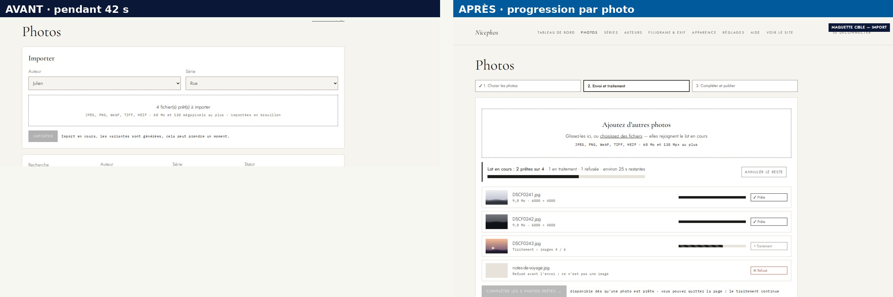
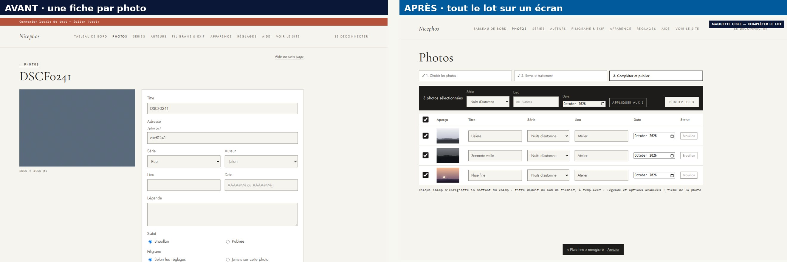
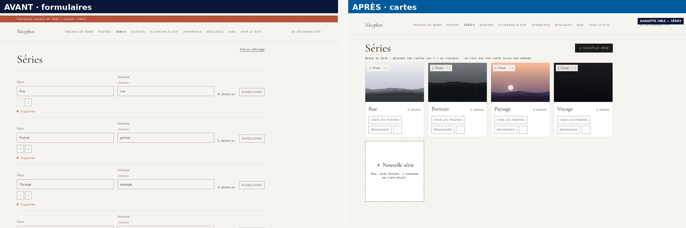
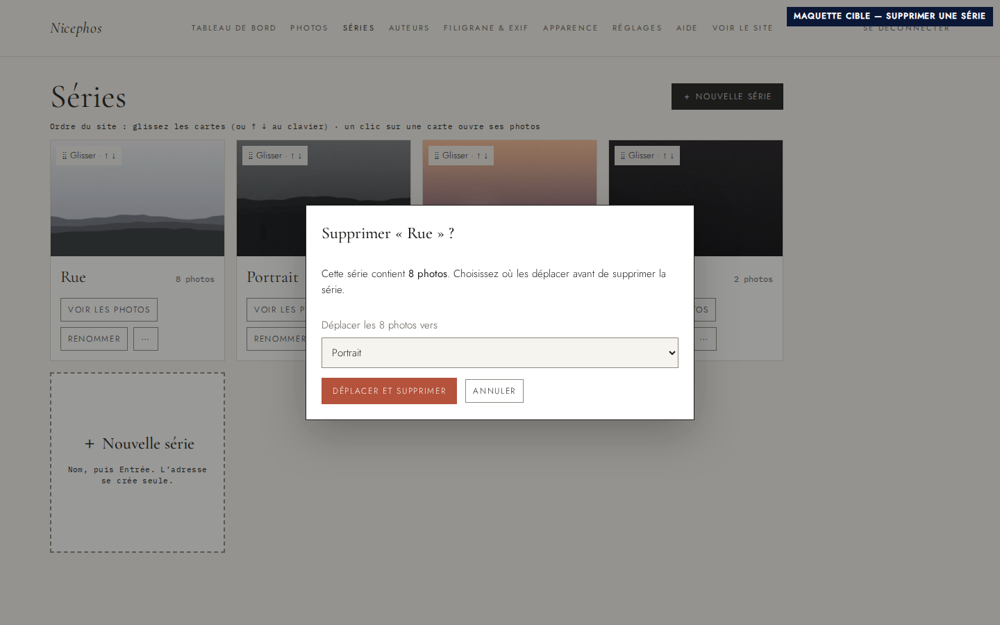
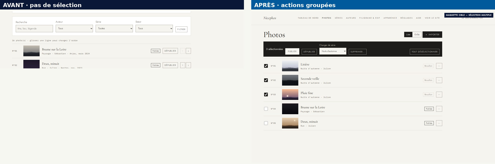

# Audit d’ergonomie et d’accessibilité — administration de Nicephos

> **Livrables :** ce rapport ; [présentation de direction](audit-ergonomie-admin-direction.pdf) (12 diapositives, [PPTX](audit-ergonomie-admin-direction.pptx)) ; [présentation détaillée](audit-ergonomie-admin-detaille.pdf) (25 diapositives, [PPTX](audit-ergonomie-admin-detaille.pptx)) ; maquettes HTML autonomes dans [`images/`](images/) ; données structurées [`donnees-audit.json`](donnees-audit.json) ; **[écrans cibles et grille de notes actuel → cible](cible/README.md)** (14 écrans, 8/10 minimum à chaque critère).
>
> Parcours rejouables : `E2E_AUDIT=1 BASE_URL=… E2E_LOCAL_AUTH=… e2e/run.sh --project=audit` (`e2e/tests/audit.spec.js`, serveur de test uniquement : le parcours importe puis supprime des photos). Depuis la refonte (PR #13), ce fichier rejoue les mêmes tâches sur les nouveaux écrans et vérifie les seuils de [`cible/`](cible/README.md) ; la version qui a mesuré l'état « avant » est celle du commit `3f40f30`.

**Date :** 2026-10-10  
**Périmètre :** Admin du site (serveur de test http://10.21.30.23:3080/admin, thème Atelier de l’admin, connexion locale de test). Parcours d’import, de complétion, de classement en séries, de gestion des séries et de choix de l’ouverture ; navigation clavier et mobile (412 px). Code : views/admin, public/admin, server/routes/admin.js.  

## Méthode et limites

- Parcours réels rejoués dans Chromium (Playwright, 1440×900 et 412×915), avec des photos d’essai réalistes (3 JPEG de 24 Mpx, 9,8 Mo, et un faux fichier)
- Mesures instrumentées : actions, écrans, durées, positions à l’écran, tailles de cibles, tabulations
- Revue du code des gabarits, du JavaScript et des routes (références fichier:ligne)
- Grille Bastien & Scapin, ISO 9241-110, WCAG 2.2 AA (contrastes calculés)
- Maquettes cibles réalisées avec les styles réels de l’admin

### Limites

- Lecteur d’écran non testé (NVDA, VoiceOver) : annonces vocales non vérifiées
- Zoom 200 %, espacement du texte et mode contrastes élevés non testés
- Durées mesurées sur un serveur partagé chargé : elles varient selon la machine (l’encodage AVIF domine)
- Un seul utilisateur d’essai : pas de test avec les auteurs eux-mêmes
- Maquettes statiques : comportements (glisser, enregistrement automatique) à valider sur prototype

## Synthèse globale

L’admin est sûre et correcte, mais pensée « une photo à la fois ». Importer 3 photos de 24 Mpx fige l’écran 42 s sans progression ; compléter et publier ces 3 photos demande 20 actions sur 9 écrans, et les classer dans une série 12 actions de plus. La page Séries présente des formulaires plutôt que des séries. Les fondations (brouillons, messages, clavier, contrastes) sont saines : il faut passer à un travail par lot.

**Décision proposée :** Lancer la vague 1 (import avec progression par photo) puis la vague 2 (compléter le lot et sélection multiple) avant toute refonte visuelle des séries.

## Points forts

- **Brouillon par défaut** — Rien n’est publié par accident : l’import crée des brouillons, la publication est un geste explicite.
- **Refus précis et non bloquants** — Un fichier refusé est nommé avec sa raison et n’empêche pas le reste du lot.
- **Erreurs de formulaire bien gérées** — Saisie conservée, champ signalé (aria-invalid) et message relié (aria-describedby).
- **Équivalents clavier** — Le glisser-déposer de la liste a ses boutons ↑ ↓ ; focus visible de 2 px ; contrastes AA.
- **Suppressions en deux gestes** — Aucune suppression d’un seul clic ; conséquences annoncées.
- **Aide contextuelle** — Chaque écran mène à sa section d’aide.

## Audit par parcours

### J1 — Importer un lot de photos (4/10)

**Persona :** Auteur, après une séance (lot de 10 à 50 photos)  
**Objectif :** Voir ses photos dans l’admin, prêtes à compléter

**Parcours observé**

1. Ouvrir Photos
2. Choisir auteur et série du lot (avant les photos)
3. Glisser ou choisir les fichiers (seul le nombre s’affiche)
4. Cliquer Importer
5. Attendre 42 s devant un message fixe, bouton grisé
6. Arriver sur la liste des brouillons ; le fichier invalide n’est signalé qu’à la fin

**Frictions**

- Aucune progression ni état par photo pendant 42 s
- Fichier invalide découvert après tout l’envoi
- Un second glisser remplace le lot au lieu de l’ajouter
- Quitter la page interrompt l’import, sans annulation possible

**Points forts**

- Bouton désactivé pendant l’envoi (pas de double import)
- Compte rendu final précis

**Parcours cible**

1. Déposer les photos (n’importe quand, en plusieurs fois)
2. Voir chaque photo : vignette, envoi en %, traitement, prête
3. Fichiers invalides refusés immédiatement
4. Continuer pendant le traitement, ou annuler
5. Passer à « Compléter » dès la première photo prête

**Gains potentiels**

- Premier retour en < 1 s au lieu de 42 s
- Refus immédiat des fichiers invalides
- Zéro perte de lot en cas de navigation
### J2 — Compléter et publier les photos importées (3/10)

**Persona :** Auteur  
**Objectif :** Titre, lieu, date, série, puis publication du lot

**Parcours observé**

1. Filtrer les brouillons
2. Ouvrir la fiche d’une photo
3. Saisir titre, lieu, date ; cocher Publiée ; Enregistrer
4. Revenir à la liste
5. Recommencer pour chaque photo

**Frictions**

- Aucune action groupée : effort proportionnel au nombre de photos
- Date au format imposé : « 10/2026 » refusé
- Titre par défaut « DSCF0241 » publiable tel quel

**Points forts**

- Erreur de date expliquée, saisie conservée

**Parcours cible**

1. Voir tout le lot sur un écran (tableau éditable)
2. Sélectionner tout, appliquer série, lieu et date en une fois
3. Corriger les titres en place
4. Publier la sélection

**Gains potentiels**

- ≈ 67 actions → ≈ 15 pour un lot de 10 photos
- 9 écrans → 1
### J3 — Gérer les séries (4/10)

**Persona :** Auteur  
**Objectif :** Créer, renommer, ordonner, supprimer une série

**Parcours observé**

1. Ouvrir Séries : une pile de formulaires (nom, adresse, Enregistrer, ↑ ↓, Supprimer)
2. Faire défiler jusqu’à « Nouvelle série » (sous la ligne de flottaison)
3. Créer : la série arrive en dernier
4. Monter en tête : 1 clic par place (4 clics)
5. Supprimer une série non vide : le refus n’apparaît qu’après ouverture

**Frictions**

- Formulaires toujours ouverts : risque de modification involontaire
- Adresse technique (slug) au premier plan
- Pas de couverture ni d’accès aux photos de la série
- Suppression bloquée sans chemin de résolution

**Points forts**

- Suppression d’une série non vide impossible : aucune perte

**Parcours cible**

1. Voir les séries en cartes (couverture, nombre de photos)
2. « Nouvelle série » en tête, nom puis Entrée
3. Glisser une carte (↑ ↓ au clavier)
4. Supprimer : déplacer les photos vers une autre série dans le même geste

**Gains potentiels**

- Création visible sans défilement
- Réordonnancement : 4 clics → 1 geste
- Suppression d’une série non vide : de « impossible » à 2 actions
### J4 — Classer des photos dans une série (2/10)

**Persona :** Auteur  
**Objectif :** Mettre 3 photos existantes dans une nouvelle série

**Parcours observé**

1. Ouvrir la fiche de la photo
2. Changer la série
3. Enregistrer
4. Revenir à la liste
5. Recommencer pour chaque photo

**Frictions**

- Aucune sélection multiple dans la liste
- Effort linéaire : 40 actions pour 10 photos

**Points forts**

**Parcours cible**

1. Cocher les photos dans la liste
2. « Changer de série » dans la barre d’actions
3. Confirmer

**Gains potentiels**

- 4 actions par photo → 3 actions au total
### J5 — Choisir les photos de l’ouverture (6/10)

**Persona :** Auteur  
**Objectif :** Composer le diaporama de l’accueil

**Parcours observé**

1. Ouvrir Réglages
2. Faire défiler jusqu’à l’ouverture
3. Cocher jusqu’à 8 photos parmi toutes les publiées
4. Enregistrer

**Frictions**

- Ordre imposé (celui de la galerie)
- Au-delà de 8, les photos en trop sont ignorées sans avertissement

**Points forts**

- Vignettes cliquables en entier (cible large)

**Parcours cible**

1. Choisir les photos
2. Les ordonner par glisser
3. Voir le compteur « 5 / 8 »

**Gains potentiels**

- Ordre choisi par l’auteur
- Limite visible avant l’envoi

## Parcours cibles et intention des maquettes

### J1 — Importer un lot de photos

**Transformation recherchée :** Déposer les photos (n’importe quand, en plusieurs fois) → Voir chaque photo : vignette, envoi en %, traitement, prête → Fichiers invalides refusés immédiatement → Continuer pendant le traitement, ou annuler → Passer à « Compléter » dès la première photo prête
**Message visuel avant/après :** Premier retour en < 1 s au lieu de 42 s ; Refus immédiat des fichiers invalides ; Zéro perte de lot en cas de navigation

### J2 — Compléter et publier les photos importées

**Transformation recherchée :** Voir tout le lot sur un écran (tableau éditable) → Sélectionner tout, appliquer série, lieu et date en une fois → Corriger les titres en place → Publier la sélection
**Message visuel avant/après :** ≈ 67 actions → ≈ 15 pour un lot de 10 photos ; 9 écrans → 1

### J3 — Gérer les séries

**Transformation recherchée :** Voir les séries en cartes (couverture, nombre de photos) → « Nouvelle série » en tête, nom puis Entrée → Glisser une carte (↑ ↓ au clavier) → Supprimer : déplacer les photos vers une autre série dans le même geste
**Message visuel avant/après :** Création visible sans défilement ; Réordonnancement : 4 clics → 1 geste ; Suppression d’une série non vide : de « impossible » à 2 actions

### J4 — Classer des photos dans une série

**Transformation recherchée :** Cocher les photos dans la liste → « Changer de série » dans la barre d’actions → Confirmer
**Message visuel avant/après :** 4 actions par photo → 3 actions au total

### J5 — Choisir les photos de l’ouverture

**Transformation recherchée :** Choisir les photos → Les ordonner par glisser → Voir le compteur « 5 / 8 »
**Message visuel avant/après :** Ordre choisi par l’auteur ; Limite visible avant l’envoi

## Mesures relevées

Parcours rejoués le 10/10/2026 dans Chromium (1440 × 900), compte de test, photos d’essai de 24 Mpx (9,8 Mo).

| Mesure | Valeur |
|---|---|
| Import de 3 photos de 24 Mpx + 1 faux fichier | 42.2 s d’attente ; seul un message fixe s’affiche : « Import en cours… les variantes sont générées, cela peut prendre un moment. » |
| Compléter et publier 3 photos | 20 actions (8 + 6 + 6), 9 écrans |
| Créer une série et la monter en tête | 6 actions, dont 4 clics pour 4 places |
| Classer 3 photos dans une série | 12 actions, 9 écrans |
| Tabulations jusqu’au champ d’import | 15 (lien d’évitement : aucun) |
| Position de la première photo (page Photos) | y = 754 px, fenêtre de 900 px |
| Position du formulaire « Nouvelle série » | y = 1033 px |
| En-tête de l’admin sur mobile (412 px) | 412×256 px |
| Boutons ↑ ↓ ; Publier | 30×34 px ; 90×34 px |

Les durées dépendent de la machine : serveur de test partagé, chargé pendant la mesure ; l’encodage AVIF des variantes domine.

## Maquettes avant / après

Les maquettes reprennent les styles réels de l’admin. Les fichiers HTML autonomes (`images/M*.html`) s’ouvrent dans n’importe quel navigateur.

### Import avec progression par photo (F-M01, F-M02, F-M03)

- Les photos apparaissent dès le dépôt (nom, poids, vignette locale) ; un fichier invalide est refusé avant tout envoi ; les dépôts successifs s’ajoutent au lot.
- Chaque ligne montre l’envoi (%), puis le traitement (« images 4 / 6 »), puis « Prête » ; le total du lot et le temps restant sont en tête, avec « Annuler le reste ».
- « Compléter les photos prêtes » est disponible dès la première photo prête ; quitter la page n’interrompt pas le traitement.

### Compléter le lot sur un écran (F-M04, F-m01, F-m06)

- Tableau éditable (titre, série, lieu, date au sélecteur de mois), enregistré au fil de la saisie, avec « Annuler ».
- Barre d’actions : « Appliquer aux 3 » (série, lieu, date) et « Publier les 3 ».

### Séries en cartes (F-M06, F-M07)

- Couverture, nombre de photos, « Voir les photos », « Renommer » en place ; adresse et suppression dans le menu « ⋯ ».
- « Nouvelle série » en tête et en carte « + » ; glisser les cartes, ↑ ↓ au clavier.
- Supprimer une série non vide : choisir où déplacer ses photos, dans le même dialogue.

### Sélection multiple dans la liste des photos (F-M05, F-m05)

- Cases à cocher et barre d’actions collante : Publier, Dépublier, Changer de série, Supprimer… ; bascule Liste / Grille ; « + Importer » en bouton.

## Audit des non-conformités

### Critique

### Majeur

#### F-M01 — Import : 42 s d’attente sans progression ni état par photo

- **Parcours :** J1
- **Critères :** Bastien & Scapin — Guidage (feedback immédiat) ; ISO 9241-110 — Autodescription, contrôlabilité
- **Niveau de preuve :** `cross-confirmed`
- **Preuves :** J1-S04 : message fixe pendant 42,2 s pour 3 × 24 Mpx (mesure Playwright) ; public/admin/admin.js:25-26 ; server/routes/admin.js:111-170 : une seule requête, réponse à la fin du traitement
- **Impact :** L’auteur ne sait pas si l’import avance ni combien de temps attendre ; risque de rechargement, d’abandon ou de double import, et lassitude sur des lots de 30 photos (≈ 7 min).
- **Recommandation :** Envoyer les photos une par une (fetch avec progression d’envoi) ; côté serveur, accepter le fichier puis le traiter en arrière-plan en exposant son état (reçue, traitement n/6, prête, refusée) ; afficher une ligne par photo avec vignette locale, barre d’envoi puis de traitement, et un total du lot avec temps restant estimé ; région aria-live annonçant seulement les changements d’état.
- **Vérification :** Lot de 10 × 24 Mpx : premier retour visible < 1 s, état mis à jour au moins toutes les 2 s, lecteur d’écran : une annonce par photo terminée.
- **Effort :** Medium

#### F-M02 — Import tout-ou-rien : pas d’annulation, navigation qui interrompt le lot

- **Parcours :** J1
- **Critères :** Bastien & Scapin — Contrôle explicite ; ISO 9241-110 — Contrôlabilité, tolérance aux erreurs
- **Niveau de preuve :** `code-confirmed`
- **Preuves :** views/admin/photos.eta:3-22 : formulaire classique, un seul envoi ; server/routes/admin.js:111 : jusqu’à 50 fichiers × 60 Mo dans une seule requête
- **Impact :** Une coupure réseau ou un clic ailleurs pendant l’envoi interrompt le lot sans indiquer quelles photos sont arrivées ; l’auteur doit vérifier et recommencer.
- **Recommandation :** File d’envoi côté navigateur (une requête par photo, 2 en parallèle), bouton « Annuler le reste », reprise des seuls fichiers échoués (« Réessayer »), traitement serveur qui continue si l’onglet est fermé.
- **Vérification :** Couper le réseau à mi-lot : les photos reçues restent, les autres sont proposées en « Réessayer ».
- **Effort :** Medium

#### F-M03 — Fichiers invalides découverts après l’envoi ; second glisser qui remplace le lot

- **Parcours :** J1
- **Critères :** Bastien & Scapin — Gestion des erreurs (prévention) ; Bastien & Scapin — Charge de travail
- **Niveau de preuve :** `cross-confirmed`
- **Preuves :** J1-S03 : seul « 4 fichier(s) prêt(s) » s’affiche, sans noms ; J1-S05 : le faux fichier n’est signalé qu’après 42 s ; public/admin/admin.js:20 : input.files = e.dataTransfer.files (remplacement)
- **Impact :** L’auteur attend la fin pour apprendre qu’un fichier n’est pas pris en charge ; ajouter des photos en deux fois fait perdre la première sélection sans le dire.
- **Recommandation :** Lister les fichiers dès leur dépôt (nom, poids, vignette locale), refuser immédiatement ce qui n’est pas une image acceptée ou dépasse 60 Mo, et ajouter les dépôts successifs au lot (retrait possible par photo).
- **Vérification :** Déposer 3 photos puis 2 autres : 5 lignes ; un .txt renommé en .jpg est refusé avant tout envoi.
- **Effort :** Small

#### F-M04 — Compléter un lot photo par photo : 20 actions et 9 écrans pour 3 photos

- **Parcours :** J2
- **Critères :** Bastien & Scapin — Charge de travail (actions minimales) ; ISO 9241-110 — Adéquation à la tâche
- **Niveau de preuve :** `runtime-confirmed`
- **Preuves :** Mesure J2 : 8, 6 et 6 actions par photo ; 3 écrans par photo ; J2-S01 : fiche individuelle seule voie d’édition
- **Impact :** Le coût croît avec le lot (≈ 67 actions pour 10 photos) ; c’est l’étape la plus longue après une séance, et la plus propice aux oublis (titres « DSCF… » publiés).
- **Recommandation :** Après l’import, écran « Compléter le lot » : tableau éditable (vignette, titre, série, lieu, date) enregistré au fil de la saisie, sélection multiple, barre « Appliquer aux n » (série, lieu, date) et « Publier les n » ; la fiche individuelle reste pour la légende et les options.
- **Vérification :** Lot de 10 : série + lieu + date + publication en ≤ 6 actions hors saisie des titres.
- **Effort :** Medium

#### F-M05 — Pas de sélection multiple dans la liste des photos

- **Parcours :** J4
- **Critères :** Bastien & Scapin — Charge de travail ; ISO 9241-110 — Adéquation à la tâche
- **Niveau de preuve :** `cross-confirmed`
- **Preuves :** Mesure J4 : 12 actions et 9 écrans pour classer 3 photos ; views/admin/photos.eta : aucune case de sélection
- **Impact :** Reclasser, publier ou dépublier plusieurs photos impose un aller-retour par photo ; les réorganisations de séries sont dissuasives.
- **Recommandation :** Cases à cocher sur chaque ligne (et « tout sélectionner »), barre d’actions collante : Publier, Dépublier, Changer de série, Supprimer… (avec confirmation), compteur « n sélectionnées » annoncé (aria-live).
- **Vérification :** Classer 10 photos dans une série en ≤ 4 actions ; parcours entièrement au clavier.
- **Effort :** Small

#### F-M06 — Page Séries : des formulaires plutôt que des séries

- **Parcours :** J3
- **Critères :** Bastien & Scapin — Guidage (groupement, distinction) ; Bastien & Scapin — Signifiance des codes ; ISO 9241-110 — Conformité aux attentes
- **Niveau de preuve :** `cross-confirmed`
- **Preuves :** J3-S01 : chaque série = 2 champs toujours éditables + Enregistrer + ↑ ↓ + Supprimer ; views/admin/series.eta:6-20 ; J3-S05 : page de 2000 px sur mobile pour 5 séries
- **Impact :** Lecture difficile (aucun visuel), modification involontaire possible, adresse technique au premier plan, aucun accès aux photos d’une série : la page est perçue comme austère et « technique ».
- **Recommandation :** Cartes : couverture (première photo), nom, nombre de photos ; actions « Voir les photos » (liste filtrée), « Renommer » (édition en place, Entrée pour valider, Échap pour annuler), menu « ⋯ » (adresse, supprimer) ; adresse déplacée dans le mode Renommer.
- **Vérification :** Test 5 secondes : identifier la série la plus fournie ; aucun champ éditable hors du mode Renommer.
- **Effort :** Medium

#### F-M07 — Séries : création sous la ligne de flottaison, ordre au clic par clic, suppression sans issue

- **Parcours :** J3
- **Critères :** Bastien & Scapin — Gestion des erreurs (correction) ; Bastien & Scapin — Charge de travail
- **Niveau de preuve :** `runtime-confirmed`
- **Preuves :** Mesure : formulaire de création à y = 1033 px (fenêtre de 900 px) ; Mesure J3 : 4 clics pour monter une série en tête ; J3-S04 : refus affiché seulement après ouverture de « Supprimer »
- **Impact :** On cherche où créer ; réordonner est fastidieux ; une série à fusionner impose de rouvrir chaque photo.
- **Recommandation :** Bouton « Nouvelle série » en tête et carte « + » ; glisser-déposer des cartes avec ↑ ↓ au clavier ; dialogue de suppression : « Déplacer les n photos vers [série] puis supprimer ».
- **Vérification :** Créer une série visible sans défilement ; fusionner une série de 8 photos en 3 actions.
- **Effort :** Small

#### F-M08 — Pas de lien d’évitement : 15 tabulations avant l’import

- **Parcours :** J1
- **Critères :** WCAG 2.4.1 Contourner des blocs (A) ; Bastien & Scapin — Charge de travail
- **Niveau de preuve :** `cross-confirmed`
- **Preuves :** Mesure clavier : 15 tabulations jusqu’au champ fichier ; views/admin/layout.eta:16-33 : aucun lien « Aller au contenu »
- **Impact :** Au clavier, chaque page impose de traverser les 12 entrées du menu ; non-conformité WCAG de niveau A.
- **Recommandation :** Lien « Aller au contenu » en premier élément focusable (visible au focus) vers main#contenu ; sur Photos, lien « Aller à l’import ».
- **Vérification :** Tab depuis le haut : 1re tabulation = « Aller au contenu », Entrée place le focus dans le contenu.
- **Effort :** Small

### Mineur

#### F-m01 — Date au format imposé (AAAA-MM) ; « 10/2026 » refusé

- **Parcours :** J2
- **Critères :** Bastien & Scapin — Gestion des erreurs (prévention) ; ISO 9241-110 — Tolérance aux erreurs
- **Niveau de preuve :** `cross-confirmed`
- **Preuves :** J2-S02 ; server/admin-repo.js:5 ; views/admin/photo.eta:22
- **Impact :** Erreur évitable à chaque saisie « naturelle » ; un aller-retour par photo.
- **Recommandation :** Champ type=month (jour facultatif à part) et tolérance côté serveur : 10/2026, 10.2026, oct. 2026 → 2026-10.
- **Vérification :** Les quatre formats sont acceptés et normalisés.
- **Effort :** Small

#### F-m02 — Import : auteur et série demandés avant les photos, pour tout le lot

- **Parcours :** J1
- **Critères :** ISO 9241-110 — Conformité aux attentes ; Bastien & Scapin — Compatibilité
- **Niveau de preuve :** `runtime-confirmed`
- **Preuves :** J1-S02 : listes Auteur et Série au-dessus de la zone de dépôt ; views/admin/photos.eta:10-13
- **Impact :** L’ordre inverse du geste naturel (on part des photos) et un lot mixte impose plusieurs imports.
- **Recommandation :** Déposer d’abord ; auteur et série proposés par défaut (compte lié, dernière série) et modifiables dans « Compléter le lot ».
- **Vérification :** Import possible sans toucher aux listes ; série modifiable par photo après coup.
- **Effort :** Small

#### F-m03 — Mobile : en-tête de 256 px ; cibles ↑ ↓ de 30 × 34 px

- **Parcours :** J3
- **Critères :** WCAG 2.5.8 Taille de la cible (AA) — respecté (≥ 24 px) ; Objectif de conception 44 × 44 px (WCAG 2.5.5 AAA)
- **Niveau de preuve :** `runtime-confirmed`
- **Preuves :** J3-S05 ; Mesure : en-tête 412 × 256 px ; boutons ↑ ↓ 30 × 34 px
- **Impact :** Sur téléphone, le contenu commence bas ; petites cibles plus difficiles au doigt (sans non-conformité AA).
- **Recommandation :** Menu replié derrière un bouton « Menu » sous 720 px ; cibles tactiles de 44 px sur mobile.
- **Vérification :** Contenu visible dès 120 px ; cibles ≥ 44 px sous 720 px.
- **Effort :** Small

#### F-m04 — Ouverture : ordre imposé ; photos au-delà de 8 ignorées sans avertissement

- **Parcours :** J5
- **Critères :** Bastien & Scapin — Contrôle explicite ; Bastien & Scapin — Gestion des erreurs
- **Niveau de preuve :** `code-confirmed`
- **Preuves :** server/admin-repo.js:199 : slice(0, 8) silencieux ; views/admin/settings.eta:22 : cases dans l’ordre de la galerie
- **Impact :** L’auteur ne compose pas son diaporama ; une 9e photo cochée disparaît sans explication.
- **Recommandation :** Sélection ordonnée (glisser les vignettes choisies) avec compteur « 5 / 8 » et cases désactivées à 8.
- **Vérification :** Ordre enregistré tel que composé ; impossible de cocher une 9e photo.
- **Effort :** Small

#### F-m05 — Liste des photos repoussée à 754 px par l’import et les filtres

- **Parcours :** J4
- **Critères :** Bastien & Scapin — Densité informationnelle
- **Niveau de preuve :** `runtime-confirmed`
- **Preuves :** Mesure : première photo à y = 754 px (fenêtre de 900 px) ; J1-S02
- **Impact :** La page Photos montre une seule ligne sans défilement : l’état du site n’est pas lisible d’un coup d’œil.
- **Recommandation :** Import en bouton « + Importer » ouvrant le panneau (ou dépôt sur toute la page), filtres en une ligne compacte, option d’affichage en grille.
- **Vérification :** Au moins 6 photos visibles sans défilement en 1440 × 900.
- **Effort :** Small

#### F-m06 — Titre par défaut issu du nom de fichier, publiable tel quel

- **Parcours :** J2
- **Critères :** Bastien & Scapin — Gestion des erreurs (prévention)
- **Niveau de preuve :** `risk`
- **Preuves :** Titre « DSCF0241 » observé après import (J1-S05) ; Aucun contrôle à la publication
- **Impact :** Risque de publier « DSCF0241 » sur le site.
- **Recommandation :** Signaler les titres non modifiés (« titre provisoire ») et demander confirmation avant de publier une photo qui en a un.
- **Vérification :** Publier une photo au titre d’origine demande une confirmation.
- **Effort :** Small

## Synthèse accessibilité

- **Tailles de cibles :** Boutons ↑ ↓ 30 × 34 px et Publier 90 × 34 px : conformes à 2.5.8 AA (≥ 24 px), sous l’objectif de 44 px sur mobile. Cases de l’ouverture 18 px mais libellé (vignette) cliquable.
- **Clavier et focus :** Focus visible (2 px) et équivalents clavier au glisser-déposer ; pas de lien d’évitement (2.4.1) : 15 tabulations jusqu’à l’import.
- **Indépendance à la couleur :** Statuts en texte (Publiée / Brouillon) avec bordure ; erreurs avec texte et position, pas seulement la couleur.
- **Sémantique :** Libellés reliés, erreurs reliées par aria-describedby, région aria-live pour l’import ; lecteur d’écran non testé.

### Contrastes mesurés

| Usage | Premier plan | Arrière-plan | Ratio | Seuil |
|---|---:|---:|---:|---:|
| Texte secondaire | `#6B665D` | `#F6F4EF` | 5.19:1 | 4.5:1 |
| Bouton principal | `#F6F4EF` | `#1D1C1A` | 15.49:1 | 4.5:1 |
| Bordure des champs | `#8F897F` | `#F6F4EF` | 3.16:1 | 3.0:1 |
| Lien Supprimer (limite) | `#B5523B` | `#F6F4EF` | 4.51:1 | 4.5:1 |
| Bandeau de test | `#FFFFFF` | `#B5523B` | 4.96:1 | 4.5:1 |

## Feuille de route priorisée

### Vague 1 — Import fluide et rassurant (1–2 semaines)

- Liste des fichiers dès le dépôt, refus immédiats, dépôts cumulés (F-M03)
- Envoi photo par photo avec progression, traitement en arrière-plan avec état (F-M01)
- Annuler, réessayer, quitter sans perdre (F-M02)
- Lien « Aller au contenu » (F-M08)
### Vague 2 — Travailler par lot (1–2 semaines)

- Écran « Compléter le lot » : tableau éditable, appliquer aux n, publier les n (F-M04)
- Sélection multiple et barre d’actions dans la liste (F-M05)
- Date tolérante (F-m01), titres provisoires signalés (F-m06)
### Vague 3 — Séries visuelles (1 semaine)

- Cartes avec couverture, voir les photos, renommer en place (F-M06)
- Création en tête, glisser les cartes, suppression avec déplacement (F-M07)
### Vague 4 — Finitions (quelques jours)

- Page Photos compacte, vue grille (F-m05)
- Ouverture ordonnable avec compteur (F-m04)
- Menu mobile replié, cibles 44 px (F-m03)
- Import sans choix préalable (F-m02)

## Mesure et non-régression

- Délai avant le premier retour après dépôt (cible < 1 s)
- Actions pour importer, compléter et publier 10 photos (≈ 70 aujourd’hui ; cible ≤ 20)
- Actions pour classer 10 photos dans une série (40 → ≤ 4)
- Tabulations jusqu’à l’import (15 → 2)
- Lots interrompus récupérés sans réimport (cible 100 %)
- Audit axe sans violation sérieuse ; parcours complets au clavier

## Sources

- Serveur de test http://10.21.30.23:3080 (10/10/2026)
- Dépôt Volfieldd/deux-regards (main, commit 90d117d)
- e2e/tests/audit.spec.js (parcours instrumentés)
- views/admin/*.eta, public/admin/admin.js, server/routes/admin.js, server/admin-repo.js

## Conclusion

L’admin est sûre et correcte, mais pensée « une photo à la fois ». Importer 3 photos de 24 Mpx fige l’écran 42 s sans progression ; compléter et publier ces 3 photos demande 20 actions sur 9 écrans, et les classer dans une série 12 actions de plus. La page Séries présente des formulaires plutôt que des séries. Les fondations (brouillons, messages, clavier, contrastes) sont saines : il faut passer à un travail par lot.
