# Écrans cibles — à valider avant tout développement

Ces 14 écrans montrent l’administration de Nicephos **après** les corrections proposées par l’[audit](../README.md). Ce sont des maquettes, rien n’est encore codé. Elles reprennent les styles réels de l’admin (polices, couleurs, boutons), sur ordinateur (1440 px) et sur mobile (412 px). Les pastilles bleues numérotées et les bandeaux « Cible » servent seulement à commenter les écrans : ils ne feront pas partie de l’interface.

## Grille de notes : actuel → cible (sur 10)

Grille Bastien & Scapin (8 critères) et WCAG 2.2 AA. Objectif : **8 au minimum partout**. Les notes « actuel » viennent de l’audit (parcours rejoués et mesurés). Les notes « cible » sont un jugement d’expert sur ces maquettes : chaque note s’appuie sur un élément visible, détaillé plus bas. Elles seront vérifiées après le développement (voir « Comment les notes seront vérifiées »).

| Critère | J1 | J2 | J3 | J4 | J5 |
|---|---|---|---|---|---|
| Guidage | 3 → **9** | 3 → **8** | 4 → **9** | 2 → **8** | 6 → **8** |
| Charge de travail | 4 → **8** | 2 → **9** | 3 → **8** | 1 → **9** | 6 → **8** |
| Contrôle explicite | 3 → **9** | 4 → **8** | 4 → **9** | 3 → **9** | 4 → **9** |
| Adaptabilité | 5 → **8** | 3 → **8** | 4 → **8** | 2 → **8** | 6 → **8** |
| Gestion des erreurs | 2 → **9** | 3 → **9** | 3 → **9** | 3 → **8** | 4 → **9** |
| Homogénéité | 6 → **8** | 4 → **8** | 5 → **8** | 3 → **8** | 7 → **8** |
| Signifiance des codes | 4 → **9** | 4 → **8** | 3 → **9** | 2 → **8** | 6 → **8** |
| Compatibilité | 5 → **8** | 3 → **8** | 4 → **8** | 2 → **9** | 6 → **8** |
| Accessibilité (WCAG 2.2 AA) | 4 → **8** | 5 → **8** | 5 → **8** | 4 → **8** | 6 → **8** |
| **Note du parcours** | 4 → **8,4** | 3 → **8,2** | 4 → **8,4** | 2 → **8,3** | 6 → **8,2** |

J1 Importer un lot · J2 Compléter et publier · J3 Gérer les séries · J4 Classer dans une série · J5 Choisir l’ouverture.

## Les écrans

### 1. Import : vérifier avant d’envoyer (F-M03, F-m02)
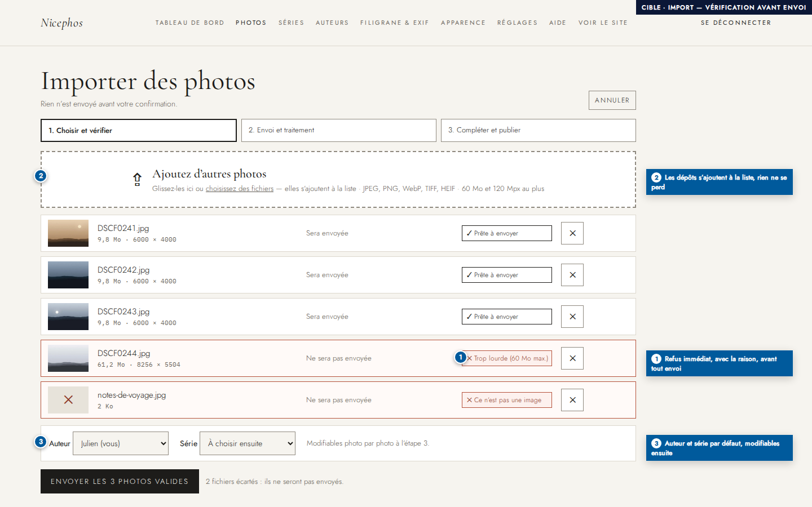
- Les fichiers refusés le sont **tout de suite**, avec la raison (« Trop lourde (60 Mo max.) », « Ce n’est pas une image »), avant tout envoi. On peut les retirer d’un clic.
- Un second glisser-déposer **ajoute** des photos à la liste au lieu de remplacer la première sélection.
- L’auteur et la série ont une valeur par défaut, modifiable photo par photo à l’étape 3 : plus rien à choisir avant d’avoir vu les photos.
- Des étapes 1-2-3 indiquent où l’on en est. Le bouton annonce exactement ce qui va se passer : « Envoyer les 3 photos valides ».

### 2. Import : progression photo par photo (F-M01, F-M02)
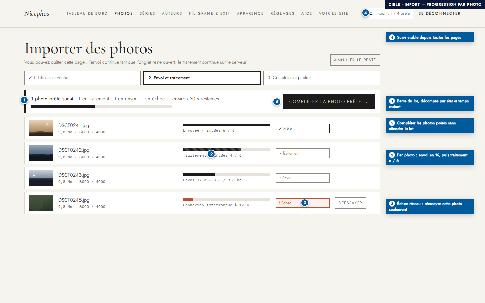
- **Barre du lot** : nombre de photos prêtes sur le total, décompte par état et temps restant estimé.
- **Barre par photo** : pourcentage d’envoi, puis traitement « images n / 6 » (variantes AVIF/WebP), puis « Prête ». L’état s’affiche en texte, avec un symbole : la couleur ne porte jamais seule l’information.
- **Échec réseau** : seule la photo concernée échoue, et un bouton « Réessayer » la relance sans renvoyer le reste du lot. « Annuler le reste » arrête ce qui n’est pas encore parti.
- « Compléter la photo prête → » permet de passer à l’étape 3 sans attendre la fin du lot.
- Un indicateur « Import : 1 / 4 prête » reste visible dans l’en-tête, sur toutes les pages : on peut naviguer pendant le traitement.

### 3. Compléter et publier le lot sur une seule page (F-M04, F-m01, F-m06)
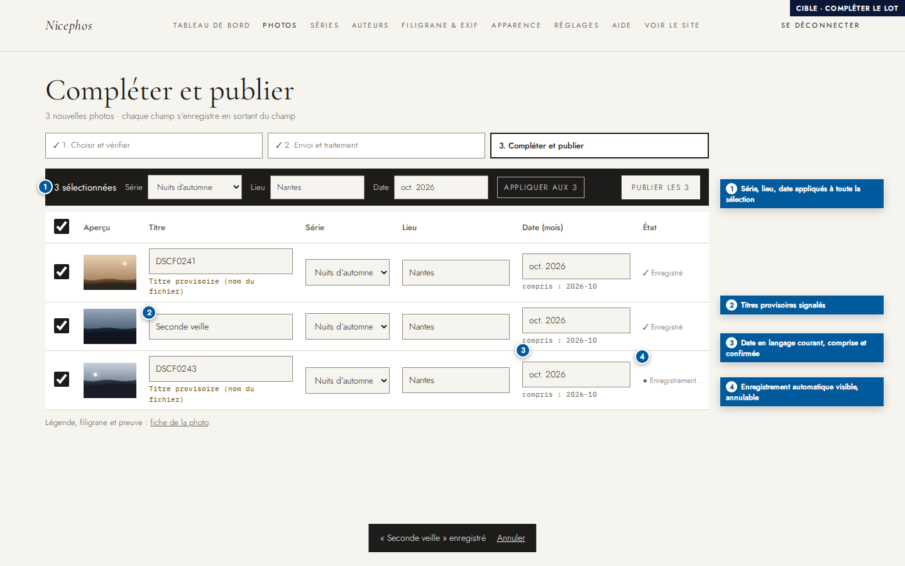
- Un tableau unique pour tout le lot : titre, série, lieu et date de chaque photo, modifiables sur place. Chaque champ s’enregistre quand on le quitte, avec un état visible (« Enregistrement… », « ✓ Enregistré ») et une annulation possible.
- La barre de sélection applique la même série, le même lieu ou la même date à toutes les photos cochées, puis publie (« Publier les 3 »).
- La date accepte le langage courant (« oct. 2026 », « 10/2026 », « 2026-10 ») et affiche ce qu’elle a compris (« compris : 2026-10 »).
- Les titres provisoires, tirés du nom de fichier, sont signalés. **Publier les 3 = 4 actions au lieu de 20, sur 1 écran au lieu de 9.**

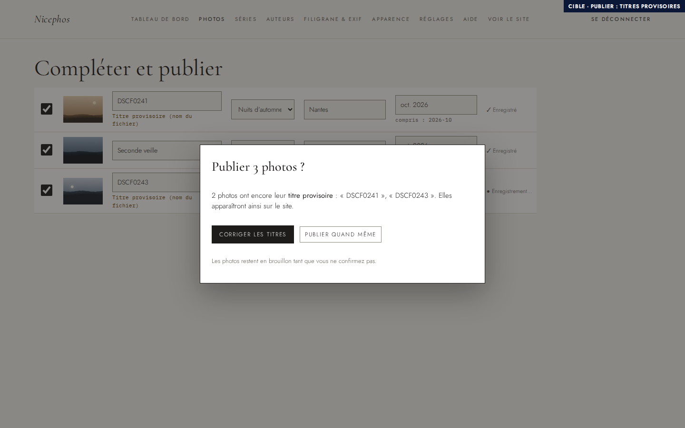
- Avant de publier une photo qui porte encore son titre provisoire, une confirmation propose d’abord de corriger les titres. Le choix par défaut est « Corriger les titres ».

### 4. Photos : liste compacte et sélection multiple (F-M05, F-m05)
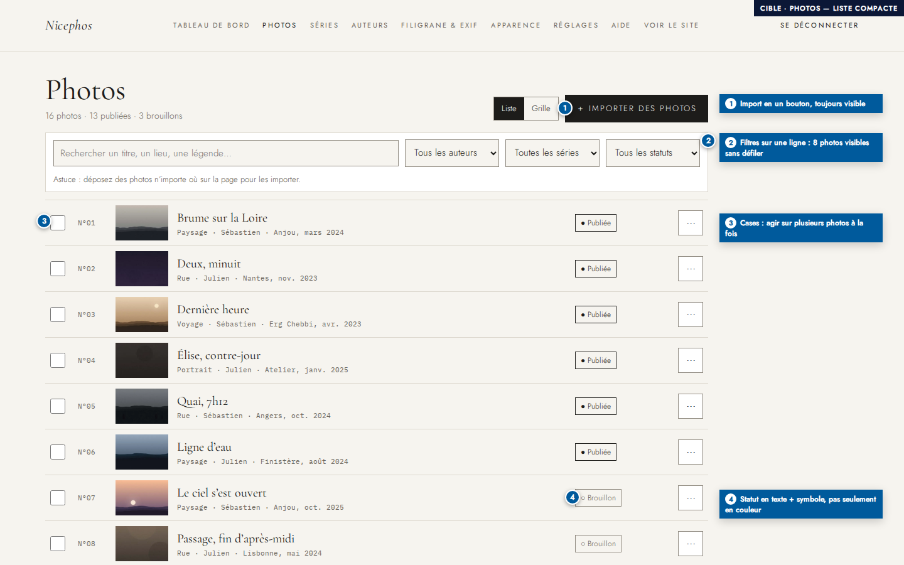
- Le bouton « + Importer des photos » est toujours visible, et l’on peut déposer des photos n’importe où sur la page. Les filtres tiennent sur une seule ligne : **8 photos visibles sans défiler** (la première photo est aujourd’hui à 754 px).
- Les statuts s’affichent en texte avec un symbole (● Publiée, ○ Brouillon). Le menu « ⋯ » regroupe les actions de chaque photo.

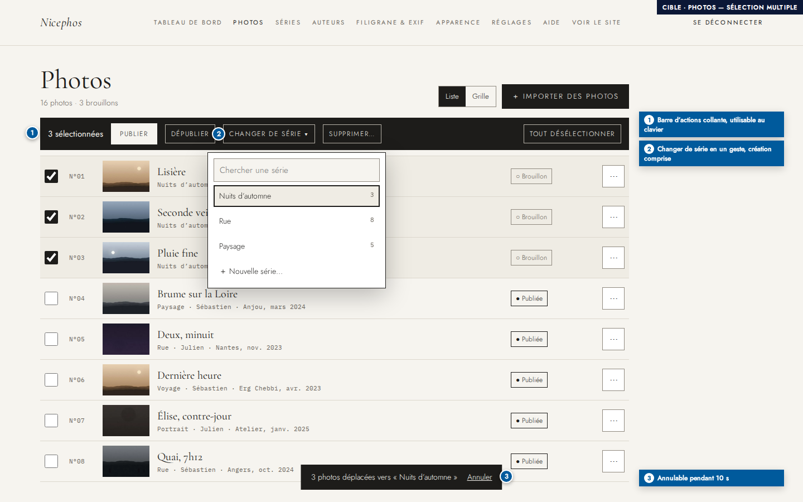
- Cocher des photos fait apparaître une barre d’actions collante : Publier, Dépublier, **Changer de série** (avec recherche et « + Nouvelle série… »), Supprimer.
- Un message de confirmation propose « Annuler » pendant 10 s. **Classer 3 photos = 4 actions au lieu de 12.**

### 5. Séries : des cartes plutôt que des formulaires (F-M06, F-M07)
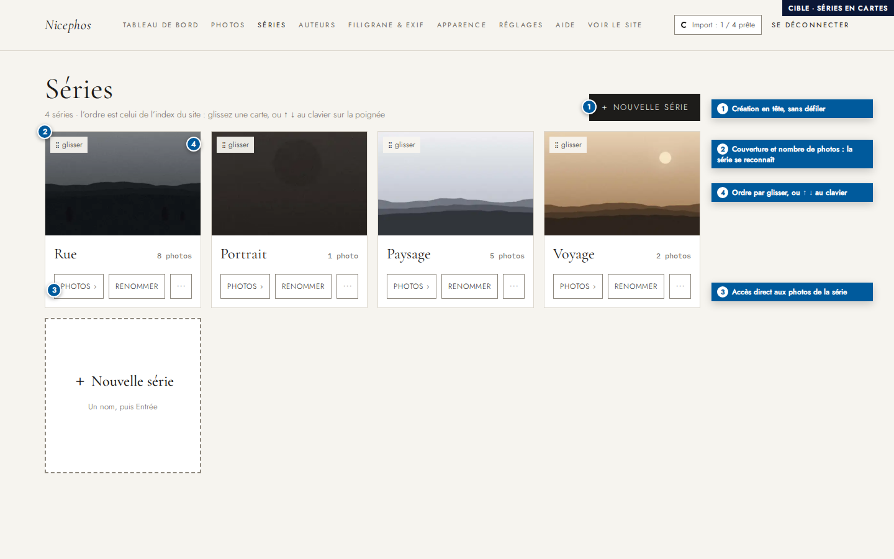
- Chaque série est une carte avec sa couverture, son nombre de photos et un accès direct à ses photos (« Photos › »).
- « + Nouvelle série » se trouve en haut, sans défiler (aujourd’hui le formulaire est à y = 1033 px).
- Pour changer l’ordre, on **glisse la carte en un seul geste** au lieu de 4 clics. Une alternative au clavier existe : ↑ ↓ sur la poignée (WCAG 2.5.7).

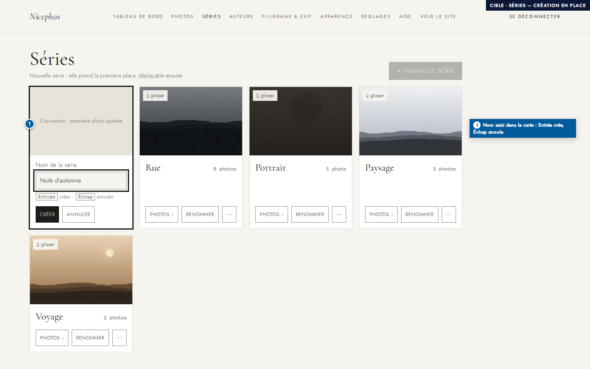
- La série se crée directement dans une carte : le nom, puis Entrée pour créer, Échap pour annuler.

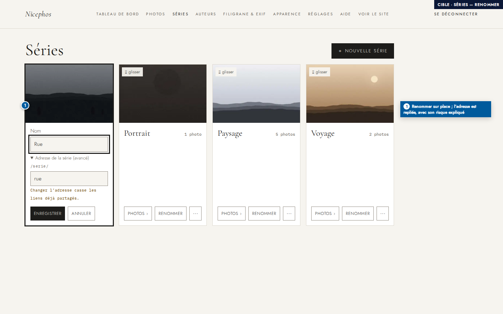
- Le renommage se fait aussi dans la carte. L’adresse de la série est repliée sous « avancé », avec un avertissement : la changer casse les liens déjà partagés.

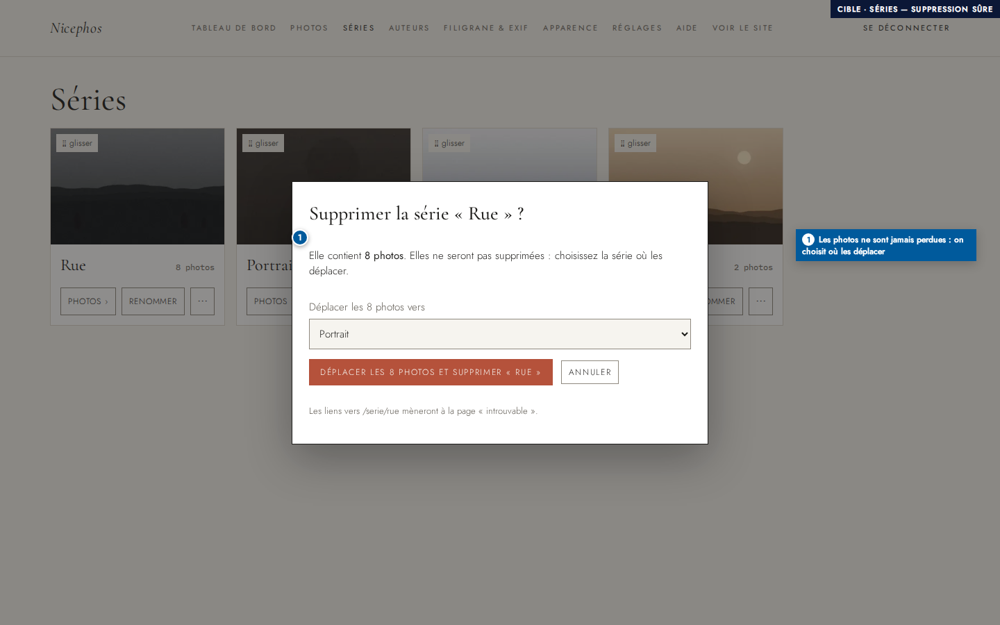
- Supprimer une série non vide propose de **déplacer ses photos** vers une autre série : on n’est plus bloqué, et aucune photo n’est perdue. Le bouton dit exactement ce qui va se passer.

### 6. Ouverture : composer l’ordre du diaporama (F-m04)
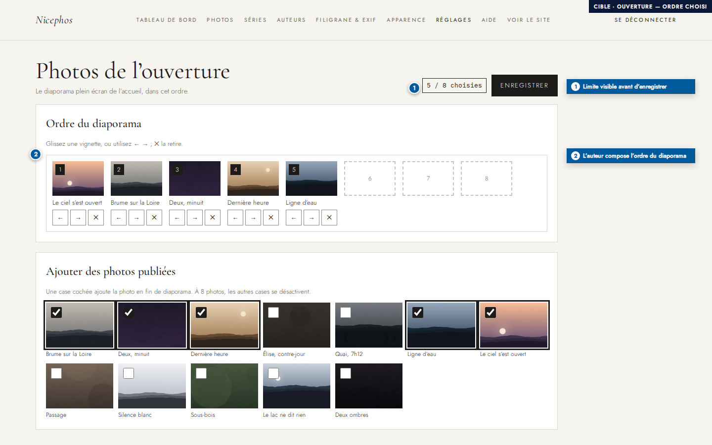
- Les photos choisies forment une bande ordonnée de 8 emplacements. On les réordonne en les glissant ou avec ← →, et ✕ en retire une.
- Le compteur « 5 / 8 choisies » montre la limite. À 8 photos, les autres cases se désactivent, avec un message : plus aucune photo n’est ignorée en silence.

### 7. Mobile (F-m03)
| Séries | Photos |
|---|---|
| 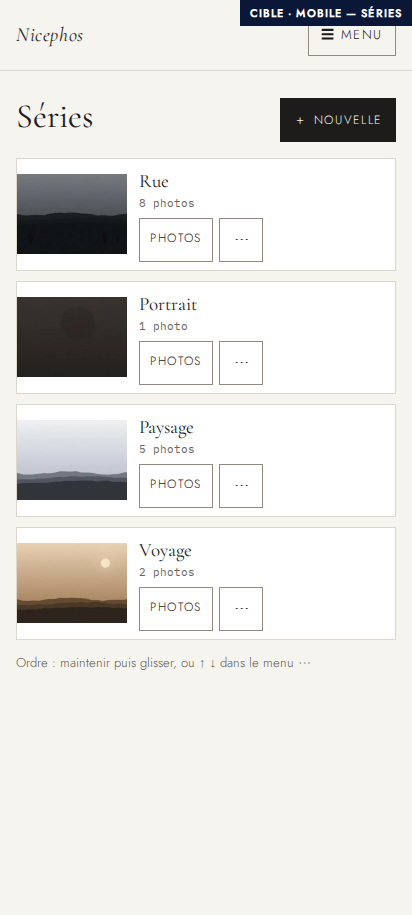 | 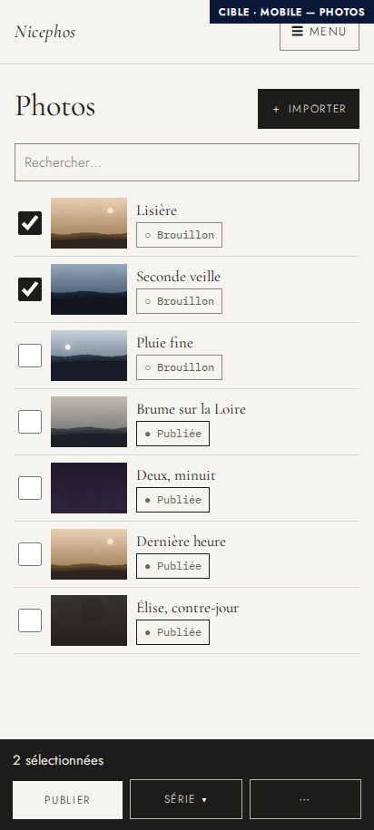 |

- L’en-tête mobile est replié derrière un bouton « Menu » : 70 px au lieu de 256 px. Toutes les cibles tactiles font au moins 44 × 44 px (aujourd’hui ↑↓ font 30 × 34 px).
- Sur mobile, la barre d’actions de la sélection se place en bas de l’écran, à portée du pouce. Le changement d’ordre des séries passe par un appui long ou par le menu ⋯.
- Les écrans d’import (étapes 1 à 3) sont des listes d’une colonne qui s’empilent de la même façon sur mobile.

### 8. Clavier (F-M08)
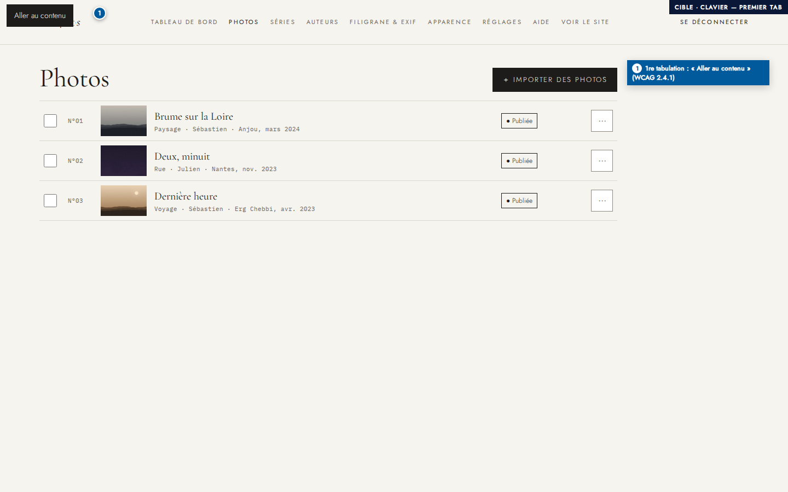
- Dès la première tabulation, un lien « Aller au contenu » permet d’atteindre l’import en 2 tabulations au lieu de 15.

## Ce qui fonde chaque note cible ≥ 8

| Critère | Éléments des maquettes qui le justifient |
|---|---|
| Guidage | Étapes 1-2-3 de l’import ; décompte du lot ; « Nouvelle série » et « Importer » en haut ; bandeau de sélection qui dit « 3 sélectionnées » |
| Charge de travail | Lot complété sur 1 écran (20 → 4 actions) ; classement multiple (12 → 4) ; ordre en 1 geste (4 → 1) ; 8 photos visibles sans défiler |
| Contrôle explicite | Rien n’est envoyé sans confirmation ; « Annuler le reste » ; « Réessayer » par photo ; « Annuler » après déplacement ou enregistrement ; ordre de l’ouverture choisi |
| Adaptabilité | Glisser-déposer **et** boutons ou clavier ; liste ou grille ; navigation libre pendant l’import ; mobile avec barre d’actions en bas |
| Gestion des erreurs | Refus avant envoi, avec la raison ; échec isolé et relançable ; date tolérante et confirmée ; suppression qui déplace les photos ; limite de 8 annoncée ; titres provisoires signalés |
| Homogénéité | Un seul motif de sélection (cases + barre noire) pour les photos, le lot et le mobile ; une seule forme de statut (symbole + texte) ; même menu « ⋯ » partout |
| Signifiance des codes | Libellés qui disent l’effet (« Envoyer les 3 photos valides », « Déplacer les 8 photos et supprimer « Rue » ») ; couvertures des séries ; « images 4 / 6 » |
| Compatibilité | Glisser-déposer cumulatif comme dans un gestionnaire de fichiers ; saisie « oct. 2026 » ; cartes de séries qui ressemblent à l’index public |
| Accessibilité | Lien d’évitement ; progression et confirmations annoncées (`role="status"`) ; alternative clavier à chaque glisser (2.5.7) ; cibles ≥ 44 px sur mobile, ≥ 24 px partout (2.5.8) ; états jamais portés par la couleur seule (1.4.1) ; contrastes ≥ 4,5:1 (calculés : brouillon #5f5a52 sur blanc 6,8:1 ; erreur #8e3a27 sur #fdf1ee 6,8:1 ; barre de sélection 15,5:1) |

## Comment les notes seront vérifiées

Les notes cibles sont des engagements, pas des résultats. Une fois les écrans codés, le parcours d’audit (`e2e/tests/audit.spec.js`) sera rejoué sur le serveur de test et devra montrer :

| Mesure | Aujourd’hui | Seuil cible |
|---|---|---|
| Fichier invalide signalé | après l’envoi (42 s) | avant l’envoi |
| Progression pendant l’import | un message fixe | % par photo et décompte du lot, annoncés |
| Compléter et publier 3 photos | 20 actions, 9 écrans | ≤ 6 actions, 1 écran |
| Classer 3 photos dans une série | 12 actions, 9 écrans | ≤ 4 actions, 1 écran |
| Mettre une série en tête | 4 clics | 1 geste (ou 1 touche répétée) |
| Tabulations jusqu’à l’import | 15 | ≤ 3 |
| Première photo de la liste | y = 754 px | y ≤ 360 px |
| Hauteur de l’en-tête mobile | 256 px | ≤ 80 px |
| Analyse axe-core (WCAG 2.2 AA) | — | 0 violation sur chaque écran |

Une note qui retomberait sous 8 à cette vérification serait corrigée avant la livraison.

Captures réalisées dans le conteneur Playwright à partir de maquettes HTML autonomes (styles et polices réels de l’admin, photos d’essai du dépôt).

## Résultats après développement (PR #13, puis simplification)

Mesures du parcours d'audit rejoué sur le serveur de test (`E2E_AUDIT=1 … --project=audit`) :

| Mesure | Avant | Seuil | Après |
|---|---|---|---|
| Fichier invalide signalé | après l'envoi (42 s) | avant l'envoi | avant l'envoi ✓ |
| Progression pendant l'import | un message fixe | % par photo et décompte du lot, annoncés | % d'envoi, « images n / 6 », décompte, temps restant ✓ |
| Importer un lot | 4 actions | — | **2** (Importer, choisir les fichiers : l'envoi part seul) |
| Compléter et publier 3 photos | 20 actions, 9 écrans | ≤ 6 actions, 1 écran | **5 actions**, 1 écran ✓ (3 titres, le lieu une fois, Publier ; la date vient de l'appareil) |
| Classer 3 photos dans une série | 12 actions, 9 écrans | ≤ 4 actions, 1 écran | 4, 1 écran ✓ |
| Mettre une série en tête | 4 clics | 1 geste | une nouvelle série arrive en tête ; 1 touche par place ✓ |
| Tabulations jusqu'à l'import | 15 | ≤ 3 | 3 ✓ |
| Première photo de la liste | y = 754 px | ≤ 360 px | 357 px (bandeau de test compris) ✓ |
| Hauteur de l'en-tête mobile | 256 px | ≤ 80 px | 60 px ✓ |
| axe-core (WCAG 2.2 AA), toutes violations | — | 0 | 0 sur chaque écran revu et ses états ✓ |

Écarts assumés par rapport aux maquettes, pour réduire les actions : l'envoi part dès le choix des fichiers (plus de bouton « Envoyer ») ; série, lieu et date de la barre s'appliquent dès qu'on les change (plus de bouton « Appliquer ») ; une série est toujours proposée par défaut (une photo en a toujours une).
