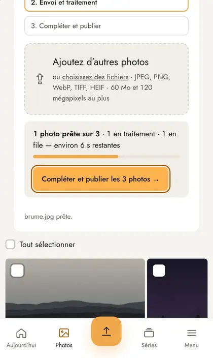
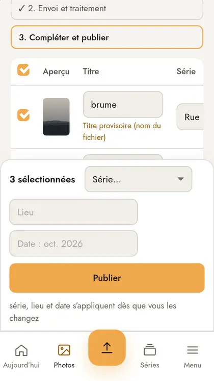
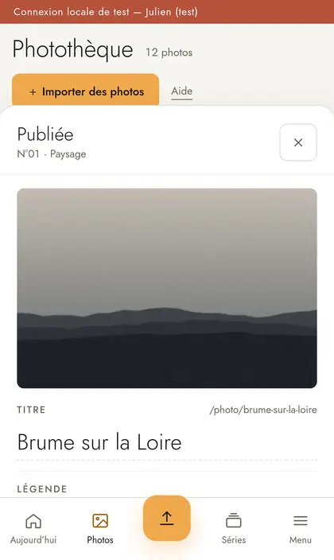
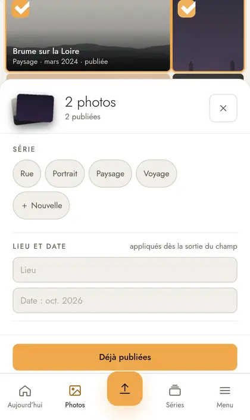
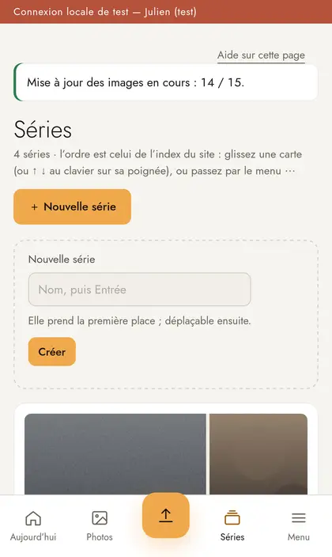

# Audit d'ergonomie de l'admin sur iPhone

**Date :** 2026-10-12
**Demande :** sur iPhone, ajouter et modifier des photos et des séries n'est pas facile ; la correction de série après un import ne fonctionne pas ; on ne voit pas comment ouvrir le détail d'une photo.
**Périmètre :** admin (`/admin`) au toucher : photothèque, panneau d'une ou plusieurs photos, import, page « Compléter et publier », fiche photo, séries.

## Méthode et limites

- Parcours rejoués dans **WebKit** (le moteur de Safari) en émulation **iPhone 15**, **iPhone SE** et **iPhone 15 Pro Max** (Playwright 1.64, conteneur officiel), sur un serveur jetable avec le jeu de démonstration et 3 photos importées.
- Mesures : recouvrements (élément réellement touché à l'endroit d'un champ), tailles des cibles, débordements, positions à l'écran. Revue du code : `views/admin/batch.eta`, `views/admin/photos.eta`, `public/admin/admin.js`, `public/admin/admin.css`.
- Scripts pour rejouer : [`parcours/`](parcours/) (`BASE=http://… TOKEN=<LOCAL_AUTH_TOKEN> node parcours-iphone.mjs`, dans le conteneur Playwright).

**Limites.** Ce n'est pas un vrai iPhone : le clavier virtuel, le sélecteur natif d'iOS et les barres de Safari ne sont pas simulés. Dans Safari, la hauteur réellement visible est plus petite qu'en émulation (barre d'adresse, clavier) : les problèmes de recouvrement décrits ici y sont **pires**, pas meilleurs. Pas de test avec Sébastien et Julien eux-mêmes.

## Synthèse

L'admin a été pensée pour l'ordinateur, puis adaptée au téléphone par empilement : panneaux qui deviennent des feuilles en bas d'écran, barres fixes, tableau qui défile de côté. Sur iPhone, ces barres fixes **mangent l'écran** :

1. **Bloquant.** Sur « Compléter et publier », la barre d'actions fixe et la barre d'onglets recouvrent le tableau des photos. Les dernières lignes **ne peuvent pas être touchées**, même tout en bas de la page, et la colonne Série est hors de l'écran à droite. C'est la cause de « la correction de série après import ne fonctionne pas ».
2. **Majeur.** Le détail d'une photo est caché : toucher une vignette ouvre un panneau, et le lien vers la fiche complète est au fond de ce panneau ; le titre de la vignette n'est pas touchable.
3. **Majeur.** Beaucoup de cibles font moins de 44 px (repère Apple), surtout sur Séries, la fiche et les filtres.

Ce qui marche bien et doit rester : la feuille du bas pour une ou plusieurs photos (pastilles de série en un toucher, enregistrement immédiat, annulation), l'import avec progression et le bouton « Compléter et publier les N photos », la barre d'onglets avec le bouton d'import central.

## Constats

### B1 — « Compléter et publier » : le tableau est recouvert (bloquant)

 

Mesures, page défilée tout en bas, lot de 3 photos :

| Appareil | Barre d'actions fixe | Lignes touchables |
|---|---|---|
| iPhone SE (320 × 568) | 257 px | **1 sur 3** |
| iPhone 15 (393 × 659) | 238 px | **2 sur 3** |
| iPhone 15 Pro Max (430 × 739) | 191 px | **2 sur 3** |

- La barre (`.main:not(.wide) .bulk`, fixée à 74 px du bas) et la barre d'onglets occupent **312 px**, mais la page ne réserve que 120 px en bas (`.main { padding-bottom: 120px }`). Les dernières lignes restent dessous, quel que soit le nombre de photos.
- Le tableau fait **778 px de large** dans 361 px : la colonne **Série** commence à 308 px, en partie hors de l'écran, et rien n'indique qu'il faut faire défiler le tableau de côté.
- La liste « Série… » de la barre s'applique **à toutes les photos cochées** (toutes par défaut), sans qu'on voie lesquelles : on corrige le lot entier en croyant corriger une photo.
- Fonctionnellement, l'enregistrement marche (série de la barre et série d'une ligne vérifiées en base) : le problème est **d'accès**, pas de calcul.

**Correction proposée.** Sous 720 px, afficher le lot en **cartes** (une par photo : vignette, titre, pastilles de série, lieu, date, état) au lieu du tableau ; mettre la barre « pour les photos cochées » **en haut, non fixe**, repliée par défaut (« Appliquer à toutes… ») ; garder seul le bouton **Publier** en bas, au-dessus des onglets, et réserver sa hauteur en bas de page.

### M1 — Ouvrir le détail d'une photo n'est pas évident (majeur)

- Toucher une vignette **sélectionne** la photo et ouvre une feuille qui couvre ~70 % de l'écran. Rien n'annonce qu'il existe une fiche plus complète.
- Le lien « **Fiche complète : filigrane, preuve d'antériorité, suppression →** » est à **≈ 1 130 px** dans la feuille : il faut faire défiler la feuille pour le trouver.
- Le **titre** de la vignette n'est pas touchable sur iPhone : il n'est cliquable qu'avec une souris (`pointer-events` activé seulement si `hover: hover`).
- Le double-toucher ouvre la loupe : invisible, et sans équivalent annoncé.

**Correction proposée.** En tête de la feuille, à côté de ✕, un bouton **« Ouvrir la fiche »** ; rendre le titre de la vignette touchable (vers la fiche) ; dans la feuille, mettre la série et le titre avant la grande image, pour que l'essentiel tienne dans le premier écran.

### M2 — Sélection multiple : correcte, mais à découvrir (majeur)

- Une fois deux photos cochées, la feuille est **bonne** : pastilles de série en un toucher (vérifié : la série change en base), lieu et date, Publier.
- Mais pour cocher, il faut viser la case de 28 px dans le coin de la vignette : toucher l'image sélectionne **une seule** photo (et décoche les autres). Les raccourcis du bureau (Maj, ⌘, glisser) n'ont pas d'équivalent tactile.
- « Tout sélectionner » est une case de **18 × 18 px**.

**Correction proposée.** Un bouton **« Sélectionner »** dans l'en-tête de la photothèque (mode où chaque toucher coche ou décoche, comme dans Photos d'iOS) ; agrandir la zone de « Tout sélectionner ».

### M3 — Cibles trop petites (majeur)

Relevé des cibles de moins de 44 px de haut (repère Apple : 44 × 44 pt) :

| Écran | Cibles concernées |
|---|---|
| Photothèque | filtres Auteur et Série (34 px), lien « Aide » (25 × 20), « Tout sélectionner » (18 × 18) |
| Compléter et publier | cases à cocher des lignes (18 × 18) |
| Fiche photo | « ← Photos » (51 × 18), « voir sur le site » (78 × 18), boutons radio Brouillon / Publiée (18 × 18) |
| Séries | « Créer », « Renommer », « Enregistrer », « Photos › » (34 px) ; champs Nom et Adresse du renommage (87 px de large) |
| Accueil | liens « modifier », « 4 séries », « 2 auteurs », titres des photos récentes (≈ 20 px de haut) |

La règle `min-height: 44px` du téléphone ne couvre que certains boutons : elle est contournée par des styles plus précis (`.scard .btn`, filtres, liens texte).

### M4 — Séries : créer et renommer sont à l'étroit (majeur)

- Le bouton « ＋ Nouvelle série » **et** le formulaire de création sont affichés en même temps : doublon.
- Renommer ouvre, dans la carte, deux champs de 87 px de large (Nom, Adresse) et un bouton de 34 px.
- Changer l'ordre : le glisser est désactivé au toucher ; il reste « Descendre d'une place » dans le menu ⋯, une place à la fois.

**Correction proposée.** Un seul point d'entrée « ＋ Nouvelle série » qui ouvre le formulaire ; renommer dans une feuille pleine largeur ; boutons ↑ ↓ visibles sur chaque carte au toucher.

### m1 — Fiche photo longue (mineur)

La fiche fait ≈ 4,5 écrans ; la photo occupe tout le premier, et le bouton « Enregistrer » arrive après le titre, l'adresse, la série, l'auteur, le lieu, la date, la légende, le statut et le filigrane. Proposé : réduire l'image en tête sur téléphone et rendre « Enregistrer » collant en bas tant que le formulaire a des modifications.

## Plan de correction proposé

| Ordre | Lot | Règle | Effort |
|---|---|---|---|
| 1 | « Compléter et publier » en cartes sur téléphone, barre d'actions en haut et non fixe | B1 | moyen |
| 2 | « Ouvrir la fiche » en tête de la feuille, titre des vignettes touchable | M1 | petit |
| 3 | Cibles de 44 px partout (filtres, Séries, fiche, cases) | M3 | petit |
| 4 | Mode « Sélectionner » dans la photothèque | M2 | moyen |
| 5 | Séries : entrée unique, renommage en feuille, ↑ ↓ au toucher | M4 | petit |
| 6 | Fiche : image réduite, « Enregistrer » collant | m1 | petit |

Les lots 1 à 3 règlent les trois plaintes remontées ; à vérifier ensuite sur un vrai iPhone (Safari), clavier ouvert.

## Suite donnée (lots 1 à 3)

Branche `fix/admin-iphone`, vérifiée dans WebKit sur iPhone SE et iPhone 15 :

| Mesure | Avant | Après |
|---|---|---|
| Champs du lot touchables (3 photos × 4 champs) | 6 à 8 sur 12 | **12 sur 12** |
| Série d'une photo changée depuis le lot | impossible pour les dernières photos | depuis sa carte |
| Accès à la fiche depuis la photothèque | lien à ≈ 1 130 px dans le panneau | **« Ouvrir la fiche »** en tête du panneau, titre de la vignette touchable une fois choisie |
| Cibles < 44 px (Photothèque, Séries, fiche) | 20 et plus | **0** |

- « Compléter et publier » : une carte par photo sous 720 px ; la barre d'actions n'est plus fixée en bas ; série, lieu et date pour toutes les cochées sont repliés derrière un bouton (on ne change plus tout le lot par mégarde).
- Le grand écran ne change pas, sauf le bouton « Ouvrir la fiche », présent aussi dans le panneau du bureau.
- Test permanent : projet e2e `iphone` (`e2e/tests/iphone.spec.js`).

Restent à faire : lots 4 (mode « Sélectionner »), 5 (Séries) et 6 (fiche), puis un essai sur un vrai iPhone.
