# Refonte de l’admin : trois directions de design

L’admin fonctionne. Après l’audit, elle est simple : 2 actions pour importer, 5 pour publier un lot. Mais elle a encore l’allure d’un formulaire. Ce dossier propose de la transformer en **outil de photographe** : la photo d’abord, les réglages autour, et aucune page qui recharge pour une petite modification.

Trois directions, de la plus ambitieuse à la plus sage. Toutes reprennent les fonctions existantes : import suivi, lot, séries, ouverture, filigrane, preuves. Ce sont des maquettes : rien n’est codé.

> Maquettes réalisées avec les polices du site (Cormorant Garamond, Jost, IBM Plex Mono) et les **photos de démonstration** uniquement : ni le logo, ni des photos personnelles.

---

## Ce qui change vraiment, au-delà des couleurs

| Idée | Aujourd’hui | Proposé | Pourquoi |
|---|---|---|---|
| **La photothèque est une planche contact** | liste de lignes, vignettes de 84 px | grille justifiée qui respecte le format de chaque photo, taille réglable par curseur | on choisit des photos en les **voyant**, pas en lisant des titres |
| **Inspecteur contextuel** | une page « fiche » par photo, une page « lot » | panneau à droite : 1 photo → sa fiche ; plusieurs → édition groupée ; rien → statistiques | **zéro changement de page** : sélectionner, modifier, publier, au même endroit |
| **L’import se fait dans la photothèque** | panneau d’import puis page « Compléter » | on dépose les photos n’importe où ; elles apparaissent dans la grille et se « développent » (du flou au net) pendant le traitement ; l’inspecteur ouvre le lot | on complète pendant que ça calcule, sans quitter la planche |
| **Palette de commandes ⌘K** | menus et boutons | une barre de recherche universelle : actions, photos, séries, aide | les habitués font tout au clavier (« pub ↵ » publie la sélection) |
| **Raccourcis** | — | **P** publier · **←/→** photo suivante · **Espace** plein écran · **⌘Z** annuler · **Échap** fermer | rapidité, et chaque raccourci a son bouton visible |
| **Classer en glissant** | menu « Changer de série » | glisser des photos sur une série de la barre latérale (le menu reste) | geste naturel, une seule action |
| **Mode loupe** | — | la photo en grand, pellicule en bas, fiche à droite | on juge une photo **en grand** avant de la publier |
| **« Aujourd’hui »** | tableau de bord de chiffres | ce qui reste à faire (3 gestes), le site tel qu’il est, l’activité des deux auteurs | on ouvre l’admin et on sait quoi faire |
| **Mobile** | pages empilées | barre d’onglets en bas, bouton Importer central, inspecteur en feuille glissante | utilisable d’une main, depuis le téléphone qui a pris la photo |

---

## Direction A — « Chambre noire » *(recommandée)*

Interface sombre, comme Lightroom ou un labo photo : le noir neutre fait ressortir les photos et ne fausse pas leurs couleurs. Une seule couleur d’accent, **l’ambre de la lampe inactinique**, réservée à ce qui est sélectionné ou actif. Les titres sont en Cormorant italique, l’interface en Jost, les données techniques en Plex Mono.

### Photothèque : sélection et édition groupée
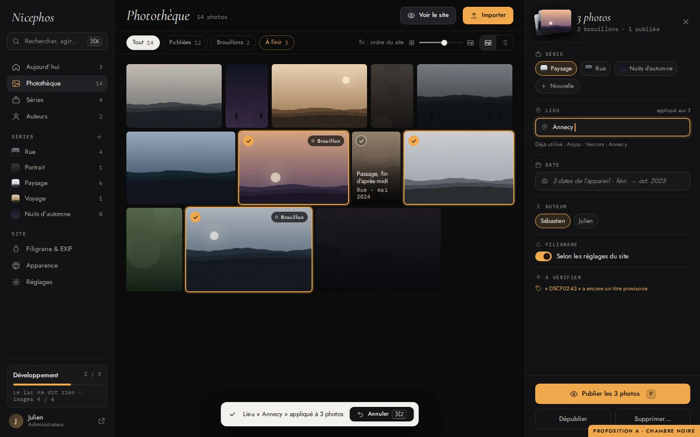
- **Barre latérale :** les sections, puis les séries, chacune avec sa vignette et son nombre de photos (on y dépose des photos pour les classer), puis le suivi du développement en bas.
- **Filtres en pastilles :** « À finir » regroupe les brouillons, les titres provisoires et les photos sans lieu.
- **Grille justifiée :** au survol, titre et série apparaissent ; les photos sélectionnées ont un liseré ambre.
- **Inspecteur, 3 photos sélectionnées :** série en pastilles, lieu appliqué aux 3 avec suggestions, dates venues de l’appareil, et ce qui reste « À vérifier ». Le bouton principal est **Publier les 3 (P)**. Le message propose **Annuler (⌘Z)**.

### Mode loupe : une photo
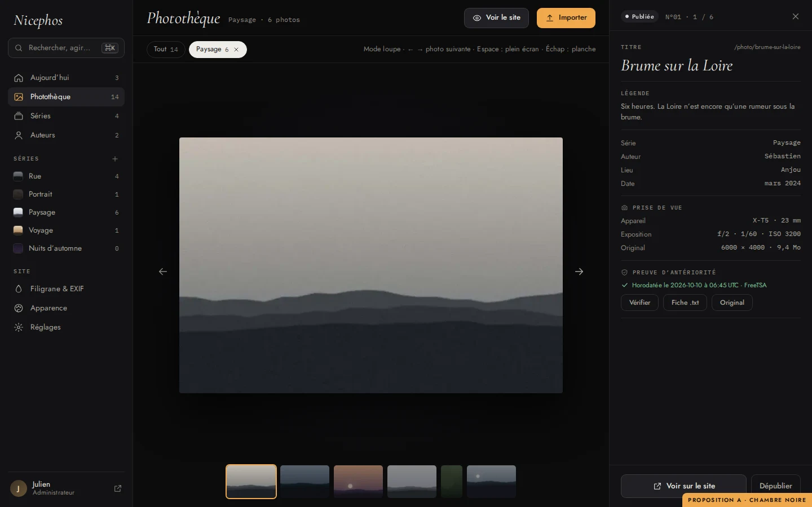
- **La photo en grand :** flèches et pellicule pour passer d’une photo à l’autre.
- **La fiche à droite :** titre, légende, métadonnées, prise de vue lue dans les EXIF de l’original, preuve d’antériorité avec ses trois actions.

### Import : les photos se développent dans la grille
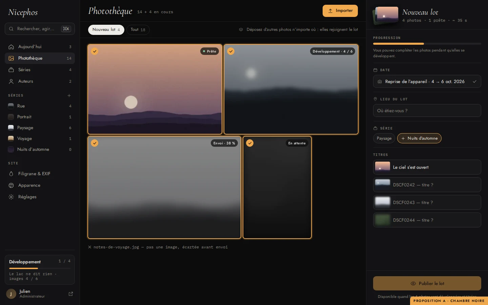
- **Chaque vignette passe du flou au net** au fil des étapes : envoi, puis développement « images 4 / 6 », puis « Prête ».
- **L’inspecteur ouvre le lot :** la date de l’appareil est déjà là, puis le lieu du lot, la série (y compris une nouvelle) et les titres à saisir **pendant** le traitement.
- **Publication :** « Publier le lot » s’active quand tout est prêt et titré.
- **Fichiers refusés :** ils sont signalés sous la grille, comme aujourd’hui.

### Palette de commandes ⌘K
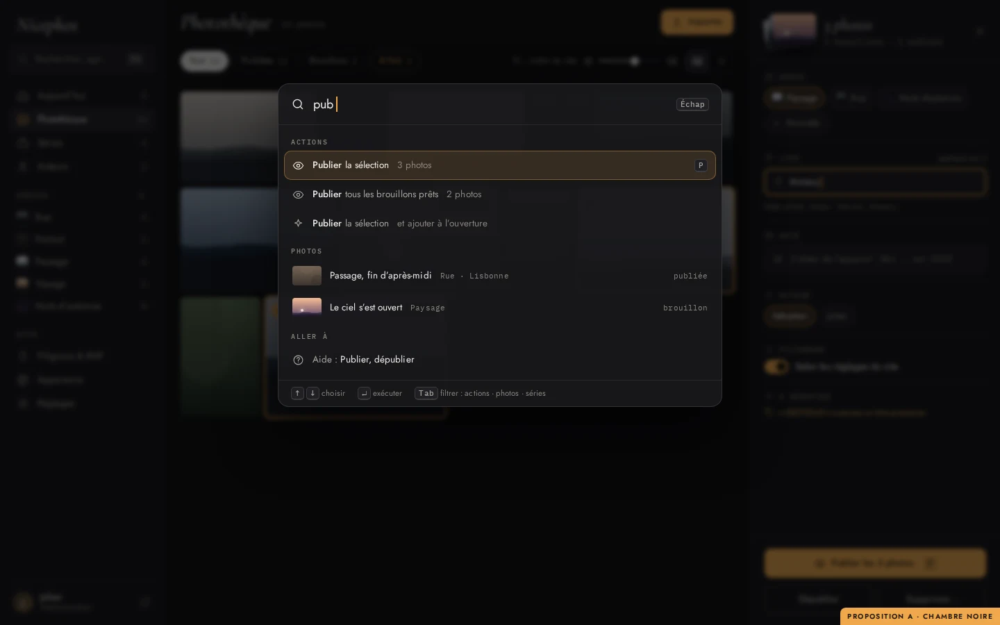
- **Une seule barre pour tout :** taper « pub » propose de publier la sélection, de publier tous les brouillons prêts, des photos qui correspondent, et la page d’aide.
- **Clavier :** ↑ ↓ pour choisir, ↵ pour exécuter, Tab pour filtrer par type.

### Aujourd’hui
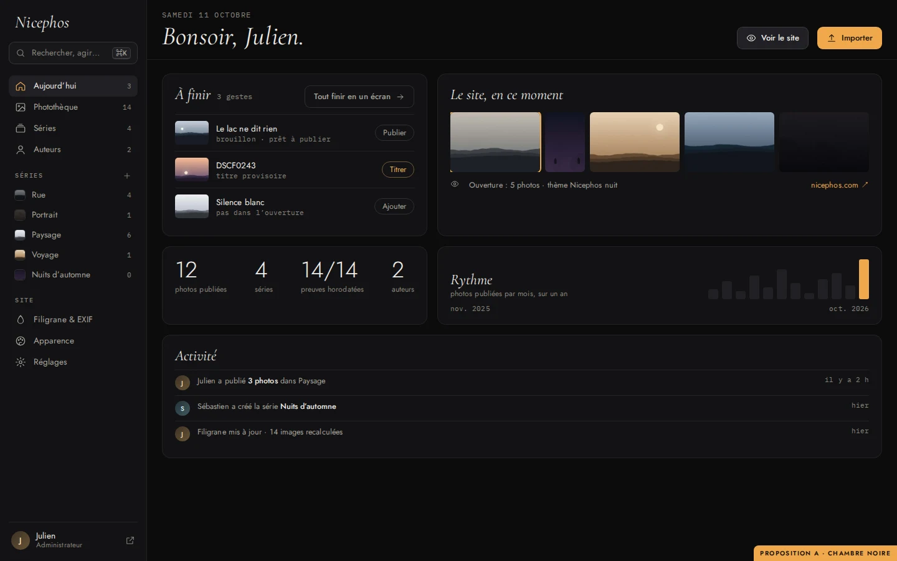
- **« À finir » :** chaque ligne a son action directe (Publier, Titrer, Ajouter à l’ouverture), et « Tout finir en un écran ».
- **Le reste :** le site en ce moment (l’ouverture dans l’ordre), les chiffres clés, le rythme de publication et l’activité des deux auteurs.

### Séries en planches
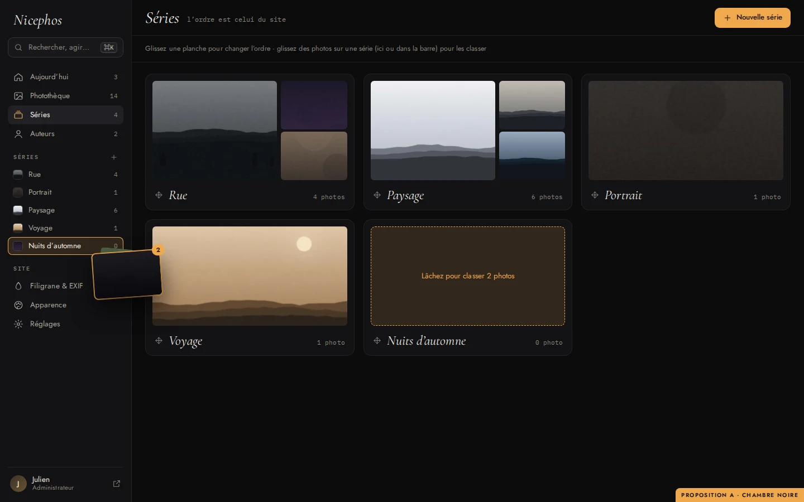
- **Chaque série est une planche** de 3 photos. On glisse une planche pour changer l’ordre du site.
- **On classe des photos en les déposant** sur une série, dans la page ou dans la barre latérale (ici, 2 photos vers « Nuits d’automne »).

### Mobile
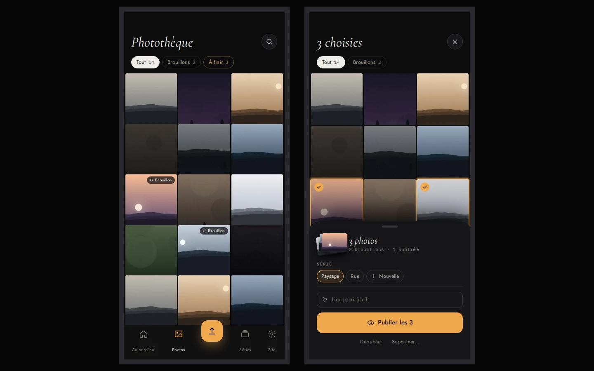
- **Grille carrée et barre d’onglets :** le bouton **Importer** est au centre.
- **Inspecteur en feuille :** une sélection l’ouvre depuis le bas, et **Publier** reste à portée du pouce.

---

## Direction B — « Cimaise »

L’admin comme un **mur de galerie** : fond papier, tirages accrochés avec passe-partout et ombre, cartels en dessous comme au musée. Le vocabulaire suit : « accrocher » pour publier, « réserve » pour les brouillons. Les titres sont en grand Cormorant, l’accent est le rouge brique du thème « Atelier ».

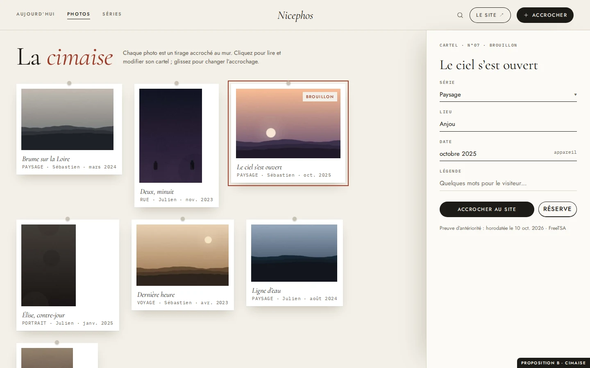
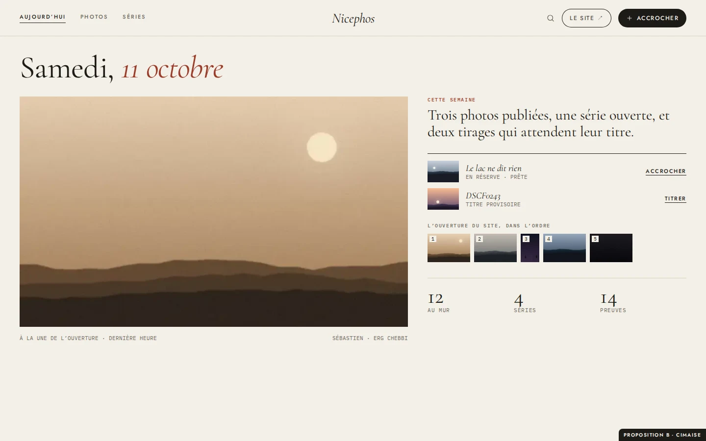

- **Points forts :** très élégante, et cohérente avec le site public en thème clair. Elle se comprend sans explication.
- **Limites :**
  - le mur montre moins de photos à l’écran : le tri d’un gros import est plus lent ;
  - le fond clair juge mal les photos sombres (« Deux, minuit ») ;
  - le vocabulaire imagé (« accrocher ») demande un temps d’adaptation.

---

## Direction C — « Studio »

**Tableau de bord en tuiles** (« bento ») sur fond dégradé, panneaux en verre dépoli, coins très arrondis, chiffres en grand. Un violet électrique sert d’accent. C’est l’esthétique des applications grand public récentes.

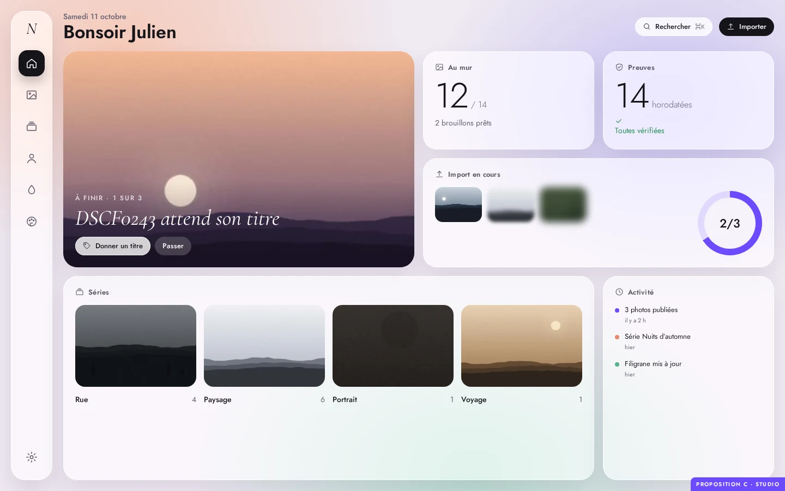
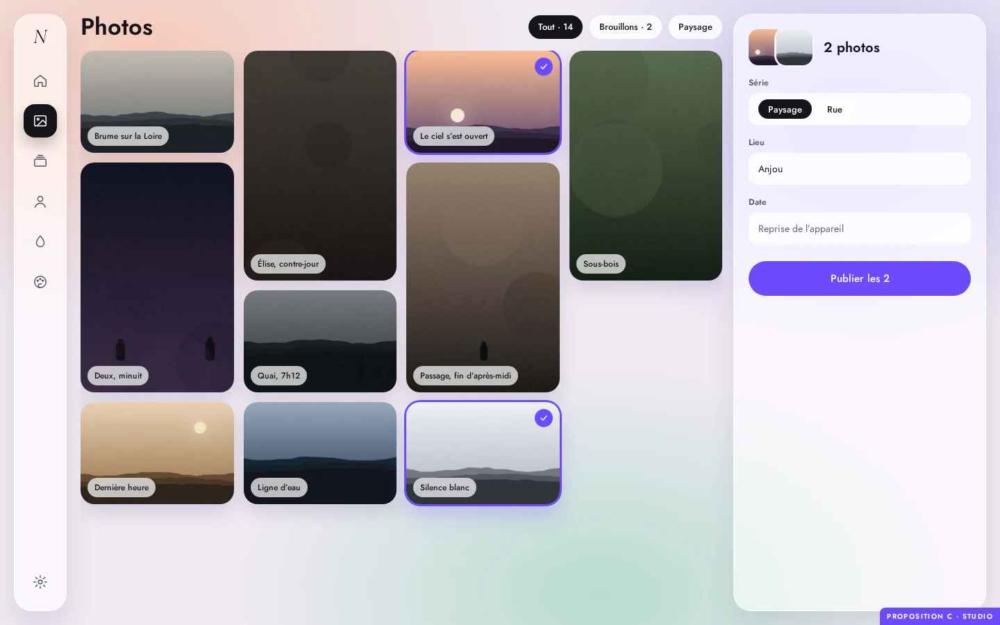

- **Points forts :** spectaculaire, très « produit 2026 », et la tuile « À finir » en photo pleine page est très engageante.
- **Limites :**
  - le décor (dégradés, verre) concurrence les photos ;
  - le violet n’a rien à voir avec l’identité Nicephos ;
  - les effets de flou coûtent cher sur les petites machines ;
  - le texte sur verre est plus difficile à rendre lisible.

---

## Comparaison

| | A · Chambre noire | B · Cimaise | C · Studio |
|---|---|---|---|
| Mise en valeur des photos | ★★★ | ★★☆ | ★☆☆ |
| Vitesse sur un gros lot | ★★★ (grille dense, clavier) | ★☆☆ | ★★☆ |
| Effet « waouh » | ★★★ | ★★☆ | ★★★ |
| Cohérence avec Nicephos (noir, sable, trait fin) | ★★★ | ★★☆ (thème Atelier) | ★☆☆ |
| Lisibilité, accessibilité | ★★★ | ★★★ | ★★☆ |
| Effort de réalisation | important | moyen | important |

**Recommandation : A, « Chambre noire ».** C’est la seule direction qui met les photos au centre *et* accélère le travail : planche contact, inspecteur, clavier. Elle reprend aussi naturellement le noir et le sable du thème Nicephos nuit.

On peut prendre à B son **mode clair**, en option : même structure, fond papier, pour qui préfère travailler en clair. Et à C sa **tuile « À finir » illustrée** pour « Aujourd’hui ».

---

## Accessibilité (vérifiée sur les maquettes)

- **Contrastes calculés :**
  - texte principal 16,7:1, texte secondaire 7,6:1, texte tertiaire 5,1:1 ;
  - ambre sur noir 9,8:1, texte sombre sur bouton ambre 9,2:1 (B et C ajustés au même seuil de 4,5:1).
- **État jamais porté par la couleur seule :** coche et liseré pour la sélection, libellé « Brouillon » ou « Prête » pour le statut.
- **Clavier :** chaque geste de glisser garde son équivalent (menu, raccourci, palette), et la palette elle-même se pilote entièrement au clavier.
- **Animations :** le « développement » des vignettes et les transitions respectent `prefers-reduced-motion` (état final directement).
- **Cibles tactiles :** 44 px au moins sur mobile.

## Mise en œuvre (si A est retenue)

L’admin reste rendue côté serveur. Elle continue de fonctionner sans JavaScript, et les points d’accès JSON existent déjà : envoi, traitement, actions groupées, champs. Les étapes, dans l’ordre de valeur :

1. **Nouveau système visuel :** jetons de couleur, typographie, barre latérale, pastilles, sur toutes les pages existantes. C’est un gain immédiat, sans changer les parcours.
2. **Photothèque :** planche contact justifiée et inspecteur, qui remplace la fiche et la page « Compléter le lot ».
3. **Import dans la grille,** avec le « développement » des vignettes.
4. **Palette ⌘K et raccourcis.**
5. **Aujourd’hui, séries en planches, glisser vers une série.**
6. **Mobile :** onglets et feuille.

Chaque étape est livrable seule, avec les mêmes garanties qu’aujourd’hui : tests, parcours mesurés, audit d’accessibilité à zéro violation.
