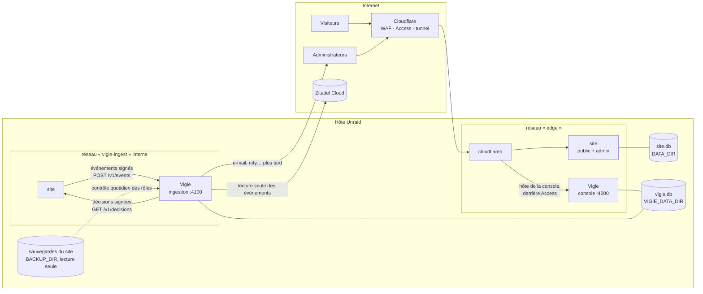

# Annexe : architecture de la Vigie (composant de sécurité isolé)

| | |
|---|---|
| Statut | Étude, rien n'est développé. Complète [`journalisation-securite.md`](journalisation-securite.md) et la remplace là où elles diffèrent : stockage des événements, écran, notifications. |
| Date | 17 octobre 2026. Sources consultées ce jour-là. |
| Demande | « Je veux une instance de base séparée dans un conteneur séparé pour stocker les alertes, et un front séparé qui sera caché derrière le menu. Tout le composant sécu doit être isolé de l'admin. Et audite sécu. On peut même réfléchir à l'intégrer dans Zitadel si ça permet d'améliorer la sécurité. Pour les remontées on privilégie la notification dans la page d'admin mais je veux pouvoir plus tard envoyer un message par un autre canal tant que ça reste gratuit. Je veux une façon simple d'activer et désactiver les détections, alertes et blocages, et un moyen simple de forcer le blocage. […] SQLite sera peut-être en panne de performances […] Propose-moi la meilleure architecture. » |
| Décisions D1 à D7 | **Validées** le 17 octobre 2026 (« je suis tes suggestions ») : 6 mois, en-têtes de position de Cloudflare, un mois d'observation sauf DS1 et DS8, e-mails aux administrateurs, canal de secours plus tard, `LOG_KEY` à part, double authentification obligatoire chez Zitadel. |
| Annexe liée | [Cloudflare : configuration gratuite recommandée](annexe-vigie-cloudflare.md) |

Le composant s'appelle ici **la Vigie** (nom de travail : conteneur `vigie`, image `deux-regards-vigie`).

---

## En bref

- **Architecture retenue** : un service à part (conteneur `vigie`, même dépôt, image à part), **sa propre base SQLite** dans son propre dossier de l'hôte, **sa propre console web** sur une autre origine (`<sous-domaine>.nicephos.art`), protégée par **trois verrous** : Cloudflare Access (gratuit jusqu'à 50 utilisateurs), une connexion Zitadel propre à la console avec un rôle `securite` tenu **chez Zitadel** (et non dans la base du site), et la double authentification exigée. L'admin du site n'affiche qu'un lien « Sécurité » et un compteur d'alertes.
- **Le site ne peut qu'écrire et lire ses consignes.** Il envoie ses événements à la Vigie (écriture seule, signée) et lit les décisions qui le concernent (adresses bloquées, sessions révoquées, comptes gelés), signées par la Vigie. Il ne peut ni lire, ni modifier, ni effacer une alerte. La Vigie, elle, n'appelle jamais le site : un site compromis ne peut pas effacer ses traces, et une Vigie compromise ne peut pas modifier le site.
- **SQLite suffit, à condition d'être à part.** Le volume prévu (quelques milliers d'événements par jour, quelques dizaines de milliers un jour de scan) est cent à mille fois sous ce que SQLite écrit sans peine en lots. Le vrai risque n'était pas la vitesse mais **la concurrence avec la base du site** (un seul écrivain à la fois) et **l'isolement** : une base à part dans un conteneur à part règle les deux. PostgreSQL n'apporterait ici qu'un serveur de plus à tenir (section 2).
- **Zitadel** : la console s'y authentifie, le rôle `securite` y vit, la double authentification y est imposée, et la Vigie lit ses événements d'identité (échecs de mot de passe, facteur retiré, rôle donné, politique affaiblie) avec un compte de service **en lecture seule**. Les alertes ne vont pas dans Zitadel (ce n'est pas un stockage de journaux ; l'offre gratuite garde son journal un jour).
- **Interrupteurs** : trois interrupteurs généraux (détection, alertes, blocages automatiques), un mode par règle (arrêt, observer, alerter, bloquer), et des **actions forcées** à un clic : révoquer une session, toutes les sessions d'un compte, geler un compte, bloquer une adresse ou un réseau, verrouiller l'admin. Appliquées par le site en moins de 5 secondes.
- **Notifications** : dans l'admin d'abord (badge, bandeau, « Aujourd'hui ») ; plus tard, un canal gratuit au choix (e-mail par la boîte existante, ntfy, Telegram, Matrix, Discord), sans aucune donnée personnelle dans le message.
- **Audit de sécurité** (section 9) : 26 menaces examinées, la conception répond à chacune ; 6 risques résiduels dits.

---

## 1. Exigences

| Id | Exigence | D'où |
|---|---|---|
| V1 | Base des événements et alertes **séparée** de celle du site, dans un **conteneur séparé** | demande |
| V2 | Console **séparée** de l'admin, atteinte depuis un lien du menu, invisible autrement | demande |
| V3 | Composant **isolé** : une faille de l'admin ne donne ni la console, ni la lecture, ni l'effacement des alertes | demande |
| V4 | Notification dans l'admin d'abord ; autre canal **gratuit** plus tard | demande |
| V5 | Activer et désactiver simplement détections, alertes et blocages | demande |
| V6 | Forcer simplement un blocage : session, compte, adresse, réseau | demande |
| V7 | Rester dans l'existant : Node 22, Fastify, SQLite, gabarits Eta, pas de framework front, pas de build, aucune ressource tierce dans les pages | `docs/wiki/Développer.md` |
| V8 | Coût nul ; tout ce qui est payant est signalé | demande |
| V9 | La Vigie en panne ne fait jamais tomber le site, et ne bloque jamais tout le monde | sûreté |

---

## 2. SQLite tiendra-t-il ?

### 2.1 Volume attendu

| Source | Volume normal | Pire cas réaliste |
|---|---|---|
| Admin (deux photographes, quelques comptes) | 200 à 1 000 événements par jour | 5 000 (journée d'import et de tri) |
| Site public, événements suspects seulement (`J2` : seuils, pièges, saisies) | 100 à 2 000 par jour | 50 000 un jour de scan (borné à 60 lignes par adresse et par heure, puis une synthèse) |
| Zitadel (lecture de ses événements) | quelques dizaines par jour | quelques centaines |
| **Sur 6 mois** | **≈ 0,5 million de lignes** | **≈ 5 à 9 millions** |

À environ 400 octets par ligne avec ses index, le pire cas fait 2 à 4 Go sur 6 mois, le cas normal 200 Mo.

### 2.2 Ce que SQLite sait faire

- En mode WAL, avec des insertions groupées en transaction (un lot par seconde), SQLite écrit des **dizaines de milliers de lignes par seconde** sur un disque SSD ordinaire. Le besoin de pointe (50 000 par jour) représente moins d'une ligne par seconde en moyenne.
- Les règles en temps réel tournent **en mémoire** (fenêtres glissantes) ; la base ne sert qu'à garder et à interroger. Les requêtes des règles périodiques portent sur des fenêtres courtes (5 min à 24 h) indexées par date : quelques millisecondes.
- Les tableaux de la console sur plusieurs mois lisent des **agrégats par jour** tenus à jour à l'écriture (`vigie_daily`), jamais la table brute.
- La purge à 6 mois se fait par paquets de 5 000 lignes, avec `auto_vacuum = INCREMENTAL` : pas de verrou long.

### 2.3 Où SQLite aurait vraiment posé problème

- **Dans la base du site** : un seul écrivain à la fois. Un scan qui produit des milliers d'événements aurait mis en attente les écritures de l'admin (import, enregistrement d'une fiche), et la purge ou une requête lourde de la console aurait gêné le site. **Base à part = problème réglé.**
- **Lecture par plusieurs conteneurs** d'un même fichier SQLite : à éviter (verrous et mémoire partagée du mode WAL). Ici, un seul processus ouvre la base de la Vigie.

### 2.4 Options comparées

| Option | Pour | Contre | Verdict |
|---|---|---|---|
| **A. Module dans le site, même base** (étude principale, première version) | simple | contraire à V1 et V3 ; contention d'écriture | écartée |
| **B. Service Vigie + SQLite à part** | même pile que le site (aucune compétence nouvelle) ; une seule dépendance déjà connue (`better-sqlite3`) ; sauvegarde par `VACUUM INTO` déjà maîtrisée ; ~60 Mo de mémoire | une seule instance (pas de haute disponibilité, inutile ici) | **retenue** |
| C. Service Vigie + PostgreSQL | rôles SQL (le service d'ingestion n'aurait que `INSERT`) ; montée en charge | un serveur de base de plus à tenir, mettre à jour, sauvegarder (~150 à 300 Mo de mémoire) ; le gain des rôles SQL est déjà obtenu par l'isolement des conteneurs (le site n'a aucun accès à la base) | à reconsidérer au-delà de 50 millions de lignes ou si un outil d'analyse externe (Grafana) est voulu |
| D. Outil du marché (Wazuh, pile Grafana Loki, OpenSearch) | tableaux de bord riches | plusieurs Go de mémoire, ne connaît ni les sessions, ni les rôles, ni les rencontres du site ; c'est le « vrai SIEM » que la demande exclut | écartée |
| E. CrowdSec (libre, gratuit) en complément | réputation d'adresses partagée par la communauté ; « bouncer » qui pousse des blocages vers Cloudflare | lit des journaux, pas la logique de l'application ; un composant de plus | **option de la phase D**, pour la seule réputation des adresses ; la Vigie reste la source des décisions |

---

## 3. Architecture cible



`S`/`S2` et `VC`/`VI` sont le même conteneur, montré sur ses deux réseaux.

### 3.1 Conteneurs et réseaux

| Conteneur | Réseaux | Ports | Données | Secrets |
|---|---|---|---|---|
| `site` (existant) | `edge`, `vigie-ingest` | 3000 (tunnel) | `DATA_DIR` | ceux d'aujourd'hui + `VIGIE_INGEST_KEY` (signer ses envois) + clé publique de la Vigie (vérifier les décisions) |
| `vigie` (nouveau) | `edge` (console), `vigie-ingest` (ingestion), `egress` (sorties : SMTP, Zitadel, Cloudflare, ntfy) | 4200 console, adresse fixe sur `edge` ; 4100 ingestion, adresse fixe sur `vigie-ingest` (chaque écoute liée à son adresse) | `VIGIE_DATA_DIR` ; `BACKUP_DIR` du site en **lecture seule** | `VIGIE_INGEST_KEY`, clé privée de signature des décisions, `LOG_KEY`, client OIDC de la console, compte de service Zitadel (lecture), jeton Cloudflare (phase D), SMTP |
| `vigie-backup` | aucun | — | `VIGIE_DATA_DIR` (lecture), `VIGIE_BACKUP_DIR` | aucun |
| `cloudflared` (existant) | `edge` | — | — | jeton du tunnel |

- `vigie-ingest` est un réseau Docker `internal: true` : aucune sortie vers Internet, seuls `site` et `vigie` y sont.
- `cloudflared` n'est pas sur `vigie-ingest` : le tunnel ne peut pas joindre l'ingestion. Le site est sur `edge` et pourrait joindre l'adresse de la console : elle ne lui répond rien sans le jeton de Cloudflare Access **et** une session de la console (section 5).
- Le site ne monte rien de la Vigie, la Vigie ne monte pas `DATA_DIR`. Elle lit les **sauvegardes** du site (instantanés `VACUUM INTO`, fichiers fermés et cohérents) en lecture seule, pour le contrôle quotidien des rôles (`DS8`, section 4.4).
- Durcissement identique au site : `read_only`, `cap_drop: [ALL]`, `no-new-privileges`, utilisateur non root, `mem_limit: 256m`, `pids_limit: 128`, journaux Docker bornés.

### 3.2 Dans le dépôt

```
vigie/
  index.js            démarrage, deux écoutes (ingestion, console)
  ingest.js           POST /v1/events, GET /v1/decisions, GET /v1/summary
  engine/             règles DS1 à DS28 (une par fichier), fenêtres en mémoire, tâches périodiques
  store.js            base, migrations, chaîne HMAC, agrégats, purge
  decisions.js        blocages, révocations, gels, verrouillage ; signature Ed25519
  notify/             canaux : admin (résumé), email, ntfy, telegram, matrix, discord
  zitadel.js          lecture des événements d'identité
  console/            routes, gabarits Eta, CSS (aucun script tiers)
  cli.js              secours en ligne de commande (section 6.4)
server/securite/      côté site : client d'envoi, file et reprise, application des décisions, vocabulaire partagé
Dockerfile.vigie      image à part (sans sharp, onnxruntime ni modèles : surface réduite)
```

Le vocabulaire des événements (`E1` à `E24`, étude principale) est un module partagé ; le site et la Vigie refusent de démarrer sur un type inconnu.

---

## 4. Flux

### 4.1 Événements : site → Vigie

1. Le site produit un événement (étude principale, section 2) et le met dans une file en mémoire (10 000 au plus).
2. Chaque seconde, ou dès 200 événements, il envoie un lot : `POST /v1/events`, corps JSON, en-têtes `x-vigie-ts` (horodatage), `x-vigie-nonce` (aléatoire), `x-vigie-sig` = HMAC-SHA-256(`VIGIE_INGEST_KEY`, ts ‖ nonce ‖ corps).
3. La Vigie refuse un lot dont l'horodatage s'écarte de plus de 60 s, un nonce déjà vu (gardé 5 min), une signature fausse (comparée en temps constant), un corps de plus de 1 Mo, un type inconnu ; elle borne chaque champ. Elle **réécrit** elle-même `at_received`, la chaîne HMAC et l'identifiant : le site ne choisit pas la place d'un événement dans le journal.
4. Vigie injoignable : le site écrit les lots dans un fichier tampon (`DATA_DIR/securite-attente/`, 50 Mo au plus, les plus anciens abandonnés en dernier recours avec un événement `sys_events_dropped`) et les renvoie au retour. Un lot renvoyé garde son horodatage d'origine.
5. **Battement** : le site envoie un événement `sys_heartbeat` par minute. Plus de 3 minutes sans battement ni lot : alerte `DS24` (le site est arrêté, ou on l'a fait taire).

### 4.2 Décisions : Vigie → site (lecture par le site)

1. Le site interroge `GET /v1/decisions?depuis=<version>` en attente longue (25 s) : dès qu'une décision change, il la reçoit ; sinon il repose la question.
2. Réponse : liste versionnée et **signée par la Vigie** (Ed25519 ; le site n'a que la clé publique). Contenu :
   - adresses et réseaux bloqués, avec portée (`tout`, `admin`, `auth`) et fin ;
   - sessions révoquées (empreinte tronquée à 16 caractères), comptes dont toutes les sessions sont révoquées avant une date ;
   - comptes gelés (`sub`) : le site les traite comme désactivés tant que dure le gel ;
   - verrouillage de l'admin : seules les adresses et comptes listés entrent ;
   - interrupteurs (section 6) : le site sait s'il doit appliquer les blocages.
3. Le site applique dans un crochet `onRequest`, avant toute route : adresse bloquée → 403 sobre ; session révoquée → session détruite, retour à la connexion ; compte gelé → comme désactivé.
4. Le site garde la dernière liste valide sur disque (signée : un fichier modifié est rejeté). Au redémarrage, il l'applique en attendant la Vigie.
5. **Vigie injoignable** (V9) : le site garde les décisions connues jusqu'à leur fin, n'en invente aucune, et toute décision expire d'elle-même (blocage : 30 jours au plus ; verrouillage de l'admin : 24 h au plus). Le site ne se bloque jamais entièrement : une liste qui bloquerait `0.0.0.0/0` ou `::/0`, ou plus de 10 000 entrées, est refusée.

Pourquoi le site tire au lieu que la Vigie pousse : le site n'ouvre **aucune route interne** nouvelle. Une Vigie compromise ne peut que publier des décisions (bloquer, révoquer, geler), jamais lire ou modifier une donnée du site.

### 4.3 Notification dans l'admin

Avec les décisions, le site lit `GET /v1/summary` : nombre d'alertes ouvertes par gravité, le titre générique de la plus grave (« Session reprise depuis un autre navigateur »), sa date, le lien de la console. **Ni adresse, ni compte, ni détail.** L'admin l'affiche aux seuls comptes qui ont la permission `securite.voir` :

- badge sur l'entrée « Sécurité » du menu ;
- ligne dans « Aujourd'hui » (`server/todo.js`) : `urgent` pour haut et critique, `bientot` pour moyen ;
- bandeau rouge en haut de toutes les pages pour une alerte critique, jusqu'à son acquittement dans la console.

Un site compromis pourrait masquer ce bandeau : c'est pourquoi la Vigie a ses propres canaux (e-mail tout de suite pour haut et critique, autres canaux plus tard), qui ne passent pas par le site.

### 4.4 Rôles : contrôle indépendant du site

`DS8` (rôle changé hors de l'application) repose, dans l'étude principale, sur des déclencheurs SQLite du site. Un attaquant maître du conteneur du site peut les supprimer puis falsifier les événements qu'il envoie. La Vigie ajoute deux contrôles qu'il ne maîtrise pas :

- **Mémoire des rôles** : la Vigie tient sa propre liste des comptes et rôles, construite à partir des événements `privilege_permissions_changed` reçus. Elle est hors d'atteinte du site.
- **Contrôle quotidien** : après chaque sauvegarde du site, la Vigie ouvre l'instantané en lecture seule (`BACKUP_DIR`), lit `accounts` et la présence des déclencheurs, et compare à sa mémoire. Un administrateur apparu sans événement, ou un déclencheur absent : **critique**.

### 4.5 Zitadel → Vigie

Voir section 7.

---

## 5. Console

### 5.1 Où et comment on y arrive

- Adresse : un sous-domaine dédié, non devinable (par exemple `veille-7k2.nicephos.art`, `D8`), publié par le **même tunnel** vers `vigie:4200`. Le certificat universel de Cloudflare couvre `*.nicephos.art` : le nom n'apparaît pas dans les journaux publics de certificats.
- **Autre origine que l'admin** : une faille XSS dans l'admin ne peut ni lire la console, ni agir en son nom (politique de même origine) ; les cookies ne sont pas partagés.
- Lien « Sécurité » dans le menu de l'admin, montré aux seuls comptes `securite.voir` : il ouvre la console dans un nouvel onglet. Aucun lien ailleurs ; `robots.txt` et `X-Robots-Tag: noindex` de toute façon.

### 5.2 Trois verrous

| Verrou | Ce qu'il fait | Coût |
|---|---|---|
| **Cloudflare Access** | Application Access sur le sous-domaine ; politique : les adresses e-mail des administrateurs ; fournisseur d'identité : Zitadel (OIDC générique), code à usage unique par e-mail en secours ; session Access 8 h. Rien n'atteint la Vigie sans être passé par là | gratuit jusqu'à 50 utilisateurs |
| **Jeton Access vérifié par la Vigie** | Chaque requête porte `Cf-Access-Jwt-Assertion` ; la Vigie vérifie signature (clés publiques de l'équipe Access), audience (étiquette de l'application) et expiration. Sans lui : 403. Ferme le passage direct par le réseau `edge` | gratuit |
| **Connexion Zitadel propre à la console** | Application OIDC « Vigie » distincte de celle du site ; accès seulement avec le rôle de projet `securite` **donné dans Zitadel** ; double authentification exigée (contrôle de la revendication `amr` du jeton, `D9`) ; session 1 h, 15 min sans activité ; ré-authentification (`max_age=300`) avant toute action forcée et tout changement d'interrupteur | gratuit (offre gratuite de Zitadel : 100 utilisateurs actifs par jour) |

Pourquoi le rôle `securite` vit chez Zitadel et pas dans la base du site : quelqu'un qui obtient le rôle Administrateur du site (faille, injection, `ADMIN_SUBS`) **n'obtient pas la console**. Il faut en plus un compte Zitadel avec ce rôle et son second facteur. C'est la séparation demandée en V3.

### 5.3 Écrans

Les écrans `EC1` à `EC5` de l'étude principale, dans la console, avec en plus :

- **Interrupteurs** (section 6) en tête de la vue d'ensemble ;
- **Actions forcées** (section 6.3) depuis la vue d'ensemble, la fiche d'une alerte, la fiche d'un compte ou d'une adresse ;
- **Décisions en cours** : tout ce que le site applique, avec qui l'a décidé, pourquoi, jusqu'à quand, « Lever » ;
- **Santé** : dernier battement du site, file d'attente du site, dernière lecture de Zitadel, dernier contrôle des rôles, état de la chaîne, place sur le disque.

Gabarits Eta rendus côté serveur, CSS propre à la console (jetons de couleur repris de l'admin pour la cohérence), un script local minimal (rafraîchissement de la vue d'ensemble), CSP stricte sans `unsafe-inline`, `frame-ancestors 'none'`. Utilisable sur iPhone. Maquettes et jury avant le code, comme pour l'admin.

---

## 6. Interrupteurs et actions forcées

### 6.1 Trois interrupteurs généraux

| Interrupteur | Arrêté | Marche |
|---|---|---|
| **Détection** | les événements sont gardés, aucune règle ne tourne | les règles tournent selon leur mode |
| **Alertes** | les alertes s'ouvrent dans la console, aucune notification ne part (ni admin, ni e-mail) | notifications selon la gravité |
| **Blocages automatiques** | aucune règle ne bloque, ne révoque ni ne gèle d'elle-même ; les actions **forcées** restent possibles | les règles en mode « bloquer » agissent |

Chacun se change d'un clic (avec ré-authentification), est journalisé, et peut être arrêté **pour une durée** (« 1 h », « jusqu'à demain ») : il se rallume seul, pour ne jamais rester éteint par oubli. Un interrupteur arrêté depuis plus de 24 h ouvre une alerte « surveillance réduite ».

### 6.2 Mode par règle

Chaque règle `DS` a un mode : **Arrêt**, **Observer** (alerte ouverte, aucune notification, aucune réponse), **Alerter**, **Bloquer** (alerte et réponse automatique). Seuils réglables à côté. Au départ (D3) : toutes en **Observer** pendant un mois, sauf `DS1` et `DS8` en **Bloquer**.

### 6.3 Actions forcées

| Action | Effet sur le site | Portée et durée |
|---|---|---|
| Révoquer une session | session détruite à la requête suivante | immédiat |
| Révoquer toutes les sessions d'un compte | idem pour toutes ; le titulaire se reconnecte par Zitadel | immédiat |
| Geler un compte | traité comme désactivé (aucune session, connexion refusée) ; ses rôles ne sont pas touchés | 1 h, 24 h, 7 jours, jusqu'à levée |
| Bloquer une adresse ou un réseau | 403 sur tout le site, sur l'admin seulement, ou sur `/auth` seulement ; en option, recopié dans la liste de Cloudflare (phase D) | 1 h à 30 jours |
| Verrouiller l'admin (« mode urgence ») | seuls les comptes et adresses choisis entrent dans l'admin et `/auth` ; le site public reste ouvert ; toutes les autres sessions sont révoquées | 24 h au plus, renouvelable |
| Lever | annule une décision | immédiat |

Délai d'application : la durée d'une attente longue, moins de 5 secondes en pratique. Une action qui viserait **son propre compte ou sa propre adresse** demande une confirmation explicite ; « verrouiller l'admin » ajoute d'office le compte et l'adresse de qui le décide.

### 6.4 Secours en ligne de commande

Sur l'hôte, si la console est inaccessible (Access en panne, erreur de réglage) :

```
docker exec nicephos-vigie node vigie/cli.js etat
docker exec nicephos-vigie node vigie/cli.js lever --tout          # lève toutes les décisions
docker exec nicephos-vigie node vigie/cli.js blocages --arret 2h
docker exec nicephos-vigie node vigie/cli.js bloquer 203.0.113.0/24 --duree 24h --motif "…"
```

Et côté site, en dernier recours : `VIGIE_APPLIQUER=0` dans le `.env` du site puis redémarrage : le site ignore toute décision (un bandeau le dit dans l'admin, la Vigie ouvre une alerte « décisions ignorées »).

---

## 7. Zitadel : ce qu'il apporte

| Apport | Comment | Gain |
|---|---|---|
| Authentification de la console | application OIDC à part, rôle de projet `securite` | séparation des droits du site et de la console (V3) |
| Double authentification | politique de connexion de l'organisation : facteur obligatoire (y compris après Google, `D9`) ; la Vigie vérifie `amr` | un vol de mot de passe ne suffit plus |
| Événements d'identité | compte de service Zitadel **en lecture seule**, lecture des événements par l'API toutes les minutes (l'offre gratuite ne garde son journal qu'**un jour** : la Vigie en fait la copie durable) | voit enfin ce que le site ne voit pas : mots de passe faux, facteurs retirés, rôles donnés |
| Nouvelles détections | **DS25** rafale d'échecs de mot de passe ou de second facteur sur un compte de l'admin ; **DS26** second facteur retiré ou remplacé ; **DS27** rôle `admin` ou `securite` donné dans Zitadel ; **DS28** politique affaiblie (facteur non obligatoire, inscription libre, nouveau fournisseur d'identité) | haut, critique pour DS27 et DS28 |

Ce qu'on ne fait **pas** avec Zitadel :

- y stocker les alertes : ce n'est pas un stockage de journaux, rétention d'un jour dans l'offre gratuite, et ce serait confier au fournisseur d'identité des adresses de visiteurs ;
- donner à la Vigie un compte de service capable de **modifier** les utilisateurs Zitadel (gérant des utilisateurs) : une Vigie compromise deviendrait une porte de prise de compte. Le gel d'un compte se fait côté site (suffisant : c'est le site qu'on protège) ; la console offre un lien direct vers l'utilisateur dans la console Zitadel pour le bloquer à la main. À reconsidérer seulement si Zitadel propose un droit limité au blocage ;
- recevoir les **Actions v2** de Zitadel (webhooks signés par HMAC sur ses événements) : ce serait plus rapide que la lecture par minute, mais il faudrait exposer une route d'entrée de la Vigie sur Internet. Option de la phase D, sur une route à part, sans Access, vérifiée par la signature de Zitadel.

À vérifier sur l'instance (`D9`) : noms exacts des événements et du rôle de lecture du compte de service, contenu de `amr` après une connexion par Google, réglage « facteur obligatoire aussi après un fournisseur externe ».

---

## 8. Autres canaux de notification (plus tard)

Une interface commune `notify/` : chaque canal reçoit le même message court, **sans adresse, sans compte, sans donnée personnelle** : « Vigie : 1 alerte critique, Rôle donné hors de l'application, 14 h 02 » et le lien de la console (qui exige toujours Access et Zitadel).

| Canal | Coût | Sur le téléphone | Remarque |
|---|---|---|---|
| E-mail (boîte existante, `SMTP_URL`) | gratuit | oui | dès la phase C pour haut et critique ; déjà en place pour les relances RGPD |
| **ntfy** (serveur public ntfy.sh, ou auto-hébergé sur Unraid) | gratuit | oui, application iOS et Android | **recommandé** : un simple POST HTTP ; sujet au nom long et aléatoire ou jeton d'accès ; sur iOS, la notification passe par le serveur public de ntfy pour atteindre Apple |
| Telegram (robot) | gratuit | oui | messages chez Telegram (pas chiffrés de bout en bout pour un robot) |
| Matrix (Element) | gratuit | oui | chiffrement possible, réglage plus long |
| Discord (webhook) | gratuit | oui | le plus simple à brancher, chez un tiers |
| Signal (`signal-cli`) | gratuit | oui | numéro de téléphone dédié nécessaire, conteneur de plus |
| Pushover | **payant** (licence unique par plateforme) | oui | signalé, non retenu |
| SMS | **payant** | oui | signalé, non retenu |

Garde-fous communs : 20 messages par heure au plus et par canal, puis un message de synthèse ; un canal en échec ouvre une alerte dans la console ; secrets des canaux dans le `.env` de la Vigie seulement.

---

## 9. Audit de sécurité de l'architecture

Modèle STRIDE, menaces numérotées `MV`. Gravité de la menace avant mesures ; « Résiduel » après.

### 9.1 Attaquant venu d'Internet

| Id | Menace | Mesures | Résiduel |
|---|---|---|---|
| MV1 | Trouver et attaquer la console | sous-domaine non devinable, absent des journaux de certificats ; Cloudflare Access devant ; jeton Access vérifié par la Vigie ; connexion Zitadel, rôle `securite`, second facteur | faible |
| MV2 | Contourner Access en joignant directement l'origine | aucun port de la Vigie publié sur l'hôte ; seul `cloudflared` y mène ; jeton Access exigé à chaque requête | faible |
| MV3 | XSS stockée : une saisie publique malveillante s'exécute dans la console quand l'administrateur la lit | tout est échappé (Eta `<%=`), saisies suspectes neutralisées et tronquées à l'écriture, affichées en texte ; CSP stricte sans `unsafe-inline` ; aucun `innerHTML` dans le script de la console ; test dédié avec les charges du `DS11` | faible |
| MV4 | CSRF sur la console (lever un blocage, éteindre les blocages) | cookie `__Host-`, `SameSite=Strict`, jeton CSRF, vérification de `Origin`, ré-authentification avant les actions sensibles | faible |
| MV5 | Clickjacking de la console | `frame-ancestors 'none'`, `X-Frame-Options: DENY` | faible |
| MV6 | Noyer la Vigie (millions d'événements provoqués par un scan) pour masquer une vraie attaque ou remplir le disque | synthèse au-delà de 60 lignes par adresse et par heure (`J2`) ; regroupement des alertes ; quota disque de la base (alerte à 80 %, purge anticipée des événements `bas` au-delà) ; les événements `haut` et `critique` ne sont jamais résumés | moyen : un scan massif réduit le détail gardé sur les petits événements |
| MV7 | Provoquer le blocage d'un administrateur (usurper son adresse, ou se placer derrière la même adresse, réseau d'hôtel) | adresse crue seulement derrière `TRUST_PROXY` (prérequis) ; adresses des sessions de l'admin jamais bloquées automatiquement ; blocage automatique jamais à plus large qu'un /24 ou /48 ; secours en ligne de commande | faible |
| MV8 | Épuiser les notifications pour cacher la vraie | plafond par canal, synthèse, les critiques passent toujours en tête et en objet | faible |

### 9.2 Attaquant maître du conteneur du site (faille dans l'admin, dans le traitement d'image…)

| Id | Menace | Mesures | Résiduel |
|---|---|---|---|
| MV9 | Effacer ou modifier les traces | impossible : le site n'a ni accès au fichier de la Vigie, ni route de lecture ou de suppression ; la chaîne est calculée par la Vigie | nul |
| MV10 | Faire taire le site (ne plus rien envoyer) | battement par minute, alerte `DS24` après 3 min | faible |
| MV11 | Envoyer de faux événements rassurants ou du bruit (il a `VIGIE_INGEST_KEY`) | il ne peut qu'**ajouter** ; les contrôles indépendants (sauvegardes, Zitadel, Cloudflare) ne passent pas par lui ; le bruit massif est borné (MV6) | moyen : pendant la compromission, les événements venant du site ne sont plus fiables ; d'où les contrôles indépendants |
| MV12 | Ignorer les décisions (ne plus bloquer) | les blocages recopiés chez Cloudflare (phase D) s'appliquent en amont ; la Vigie voit que les requêtes d'une adresse bloquée continuent d'arriver (événements) | moyen sans Cloudflare, faible avec |
| MV13 | Se donner le rôle Administrateur du site puis la console | la console exige le rôle `securite` chez Zitadel et le second facteur : le rôle du site ne donne rien | nul |
| MV14 | Supprimer les déclencheurs et changer un rôle | contrôle quotidien sur la sauvegarde (section 4.4) et mémoire des rôles de la Vigie | faible (délai d'un jour au plus ; l'événement du site, s'il arrive, alerte tout de suite) |
| MV15 | Lire la clé publique des décisions et forger des décisions | une clé publique ne permet pas de signer | nul |
| MV16 | Atteindre la console par le réseau `edge` | jeton Access exigé et vérifié | faible |
| MV17 | Trafiquer le fichier tampon pour rejouer de vieux événements | la Vigie refuse les nonces déjà vus ; les lots renvoyés sont marqués « en retard » | faible |

### 9.3 Attaquant maître de la Vigie

| Id | Menace | Mesures | Résiduel |
|---|---|---|---|
| MV18 | Lire les adresses complètes et l'historique de connexion | conteneur minimal (sans traitement d'image ni modèles), aucune route publique hors Access ; durées courtes (6 mois) ; base non chiffrée (comme celle du site, protégée par les droits) | moyen : c'est la contrepartie d'avoir des adresses complètes |
| MV19 | Bloquer tout le monde, révoquer toutes les sessions (déni de service) | le site refuse les décisions qui bloquent tout ou plus de 10 000 entrées, et toute décision expire ; `VIGIE_APPLIQUER=0` côté site | faible |
| MV20 | Modifier des données du site | impossible : le site tire, il n'expose aucune route à la Vigie ; la Vigie ne lit que des sauvegardes, en lecture seule | nul |
| MV21 | Prendre des comptes Zitadel | compte de service en **lecture seule** | faible |
| MV22 | Abuser du jeton Cloudflare (phase D) | jeton limité à l'édition des listes de règles de l'**unique** zone, sans DNS, sans tunnel, sans réglages ; filtré par adresse source si possible | faible |
| MV23 | Lire la base du site depuis les sauvegardes montées | les données personnelles y sont chiffrées par `DATA_KEY`, que la Vigie n'a pas ; elle ne lit que `accounts` et `sqlite_master` | faible |

### 9.4 Exploitation et chaîne d'approvisionnement

| Id | Menace | Mesures | Résiduel |
|---|---|---|---|
| MV24 | Dépendance compromise dans l'image de la Vigie | image séparée aux dépendances minimales (`fastify`, `@fastify/cookie`, `better-sqlite3`, `eta`, `nodemailer`, `jose` pour les jetons), versions épinglées, actions GitHub épinglées comme pour le site | faible |
| MV25 | Perte de la base de la Vigie | sauvegarde quotidienne à part (`VIGIE_BACKUP_DIR`), 14 instantanés, contrôle d'intégrité ; la chaîne est vérifiée après restauration | faible |
| MV26 | Horloges décalées (fenêtres, voyage impossible, signatures refusées) | même horloge d'hôte pour les deux conteneurs ; la Vigie compare l'horodatage des lots à la sienne et alerte au-delà de 30 s d'écart | faible |

### 9.5 Risques résiduels à accepter

1. **MV6** : un scan massif ne garde qu'un résumé des petits événements.
2. **MV11** : pendant une compromission du site, ce qu'il envoie n'est plus digne de foi ; seuls les contrôles indépendants restent sûrs.
3. **MV12** : sans la recopie des blocages chez Cloudflare (phase D), un site compromis peut ignorer les blocages.
4. **MV18** : la Vigie concentre des adresses complètes ; sa compromission les expose (6 mois au plus).
5. **MV14** : le contrôle indépendant des rôles a jusqu'à 24 h de retard.
6. **Zitadel Cloud et Cloudflare** restent des tiers de confiance : une compromission de l'un d'eux est hors de portée de la Vigie (elle en verrait seulement les effets).

---

## 10. Plan révisé

Une branche et une PR par phase, revue et audit avant la suivante.

| Phase | Contenu |
|---|---|
| **0. Hors code** | Zitadel : second facteur obligatoire (D7), projet ou application « Vigie », rôle `securite`, compte de service en lecture seule ; Cloudflare : réglages gratuits de l'annexe Cloudflare (sections 1 à 4), en-têtes de position, application Access sur le sous-domaine ; `TRUST_PROXY` fixé |
| **A. Site : émission** | `server/securite/` : vocabulaire, événements E1 à E24, contexte des sessions, déclencheurs, file et tampon, battement, signature ; sans Vigie, le site garde ses événements en tampon (aucun changement visible). Confidentialité et registre RGPD mis à jour |
| **B. Vigie : socle** | conteneur, réseaux, ingestion, base, chaîne, agrégats, purge, sauvegarde ; décisions signées et leur application par le site ; interrupteurs ; secours en ligne de commande |
| **C. Vigie : règles** | moteur, DS1 à DS24 puis DS25 à DS28 (Zitadel), contrôle des rôles sur les sauvegardes ; un test par règle (attaque détectée, parcours normal non alerté) |
| **D. Console et notifications** | maquettes et jury, console (EC1 à EC5, interrupteurs, actions forcées, décisions, santé), résumé dans l'admin, e-mail |
| **E. Compléments** | recopie des blocages chez Cloudflare par l'API ; canal ntfy (ou autre) ; Actions v2 de Zitadel ; CrowdSec en option ; jeu d'attaques rejouable contre l'instance de démonstration |

---

## 11. Décisions nouvelles

| Id | Question | Proposition |
|---|---|---|
| D8 | Sous-domaine de la console | un nom non devinable, choisi par vous, jamais écrit dans le dépôt public (variable `VIGIE_PUBLIC_URL`) |
| D9 | Second facteur exigé après une connexion Google | oui, réglé dans Zitadel ; à défaut, la console refuse une connexion sans `amr` de second facteur |
| D10 | Canal hors admin à brancher en premier (phase E) | ntfy (gratuit, simple, application téléphone) |
| D11 | Recopie des blocages chez Cloudflare | oui en phase E, pour les blocages de 24 h et plus (la liste gratuite est limitée à 10 000 entrées) |
| D12 | Qui a le rôle `securite` | les deux administrateurs ; aucun autre compte |

---

## Sources

1. Cloudflare, *Cloudflare Access* et offre Zero Trust gratuite jusqu'à 50 utilisateurs ; fournisseurs OIDC génériques. https://www.cloudflare.com/products/zero-trust/access/ · https://blog.cloudflare.com/teams-plans/
2. Cloudflare, *Validate the Access token* (`Cf-Access-Jwt-Assertion`, clés de l'équipe, audience). https://developers.cloudflare.com/cloudflare-one/identity/authorization-cookie/validating-json/
3. Zitadel, *Actions V2* (cibles webhook, appel, asynchrone ; conditions sur requêtes, réponses, fonctions et événements ; signature des requêtes). https://zitadel.com/docs/concepts/features/actions_v2 · https://zitadel.com/docs/guides/integrate/actions/testing-request-signature
4. Zitadel, tarifs : offre gratuite à 100 utilisateurs actifs par jour, historique d'audit d'un jour (deux semaines en Pro). https://zitadel.com/pricing/detail
5. SQLite, *Write-Ahead Logging* (un écrivain, lecteurs concurrents) et *Appropriate Uses For SQLite*. https://www.sqlite.org/wal.html · https://www.sqlite.org/whentouse.html
6. CrowdSec, *Cloudflare Bouncer*. https://docs.crowdsec.net/u/bouncers/cloudflare
7. ntfy, documentation (publication par HTTP, applications iOS et Android, contrôle d'accès). https://docs.ntfy.sh/
8. OWASP, *Threat Modeling Cheat Sheet* (STRIDE). https://cheatsheetseries.owasp.org/cheatsheets/Threat_Modeling_Cheat_Sheet.html
