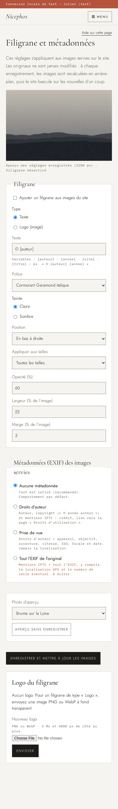

# Visite de l'admin

Captures du serveur de test (jeu de démonstration), faites le 10/10/2026. Elles se régénèrent avec `E2E_CAPTURES=1 npm run e2e -- --project=captures-bureau --project=captures-mobile`. Pour l'usage pas à pas, voir le [Mode opératoire de l'admin](Mode-opératoire-admin).

En haut de chaque page : **Tableau de bord · Photos · Séries · Auteurs · Filigrane & EXIF · Réglages · Voir le site**, et **Se déconnecter**. Le bandeau rouge « Connexion locale de test » n'apparaît qu'avec la connexion de test.

## Connexion

En ligne, la connexion passe par Zitadel. Sur un serveur de test, ce formulaire la remplace : on choisit l'auteur à incarner et on saisit le jeton de test.

## Tableau de bord

Il montre le nombre de photos publiées et de brouillons, de séries et d'auteurs, l'état des preuves d'antériorité, et le compte connecté avec l'auteur auquel il est lié.

## Photos

La page réunit :

- **l'import** : glisser-déposer, auteur et série du lot ;
- **la recherche et les filtres** ;
- **la liste dans l'ordre du site** : glisser une ligne pour la déplacer, ou utiliser ↑ ↓ ; publier ou dépublier en un clic.

## Fiche d'une photo

On y trouve :

- **l'édition** : titre, adresse, série, auteur, lieu, date, légende, statut, filigrane ;
- **la preuve d'antériorité** : empreinte, date certifiée, téléchargements, vérification ;
- **la suppression**, confirmée dans la page.

## Séries

Renommer, changer l'adresse, ordonner. La suppression n'est possible que si la série est vide.

## Auteurs

Nom, adresse, biographie et lien avec le compte de connexion.

## Filigrane et EXIF

Le filigrane (texte ou logo, position, opacité, taille), le niveau de métadonnées des images servies, et un aperçu, avec ou sans enregistrement.

## Réglages

Nom du site, accroche, textes, page « Droits d'utilisation », photos de l'ouverture.

## Sur mobile

Toutes les pages s'adaptent au téléphone.

| Photos | Fiche | Filigrane |
|---|---|---|
|  |  |  |
